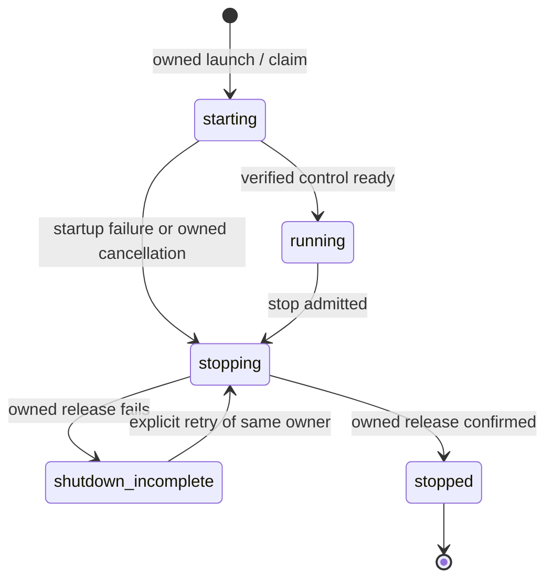

# Can dev server for AI coding agents

The native development server owns state and lifecycle under `dev-server/`; Ratatui renders its facts and submits events. This document defines the interface/behavior contract. [REMAINING-WORK.md](../implementation/REMAINING-WORK.md) alone owns current acceptance, extensions and the held benchmark. Earlier illustrative agent APIs below are design vocabulary, not additional tasks.

## Purpose

Can is authored by AI coding agents, including agents that have never seen this language. An agent should need only a tiny Given/When/Then orientation, be free to write a plausible first guess, and learn the closest supported Can construct from the error response. `can dev` should give it a short, reliable loop from a `.can` edit to an observed application result:

```text
guess .can → check the exact source revision → receive likely Can keyword + help
           → revise and check again → inspect the resolved app
           → run an isolated example or local request → explain a failure
           → make a change → compare and verify the new revision
```

The server is one long-lived local project session. It joins the compiler, test artifact, local workerd runtime and source-derived app interfaces. `.can` remains the source of app identity, composition, permissions, operations, pages and examples. The compiler and runtime retain ownership of their semantics; the server presents their evidence to an agent. A browser preview is useful to people too, but the agent must be able to inspect and drive the loop through structured tools without scraping terminal output or generated JavaScript.

## An unfamiliar agent's first loop

A discoverable bootstrap card should be about this small: **Given** declares data and rules; **When** declares permitted operations and their behavior; **Then** declares pages. Write the best `.can` draft for the requested app, run the check, use the suggested Can keyword and its signature to revise, and repeat. The agent can ask for the current app's available declarations and one relevant valid snippet at the error location. It should not have to ingest the full grammar or design book before its first edit.

The development error response should point to a **real language construct**, with enough local help to use it. For example, with an existing `Todo` model and member role, an agent might guess:

```can
When
 manage Todo by=members fields=title,done
```

An illustrative response could say:

```text
Unknown When construct: manage
Closest supported construct: crud
Signature: crud path by=expr fields=selectors
Meaning: generate create, update and delete operations for a model. Reference: docs/specification/DESIGN.md#5-canonical-operations
Alternative: scenario (a custom operation with an authored body)
```

The `crud` signature and [canonical-operations reference](../specification/DESIGN.md#5-canonical-operations) come from Can's versioned language help, not from Jev-generated prose. Jev selects or ranks the closest supported construct ID using the guessed words and surrounding context. The response identifies the invalid span and source revision, exposes uncertainty and alternatives, and gives the agent enough information to write valid source. An exact edit can be included when the mapping is mechanical, but a full patch is not the primary requirement.

### Keyword and construct guidance in the error response

1. The compiler reports a useful primary error and its section, syntactic position, surrounding source, resolved names/types and owning declarations. Group downstream errors only when their causal relationship is proven; the current compiler does not supply that relationship.
2. Use grammar-position facts and the versioned help index to build a bounded list of supported keyword/construct IDs, with completion as supporting evidence. Include nearby constructs when an invented word suggests the agent chose the wrong section or abstraction; do not offer unavailable language features as working alternatives.
3. Jev ranks that **supplied** list only for reliable residual ambiguity after deterministic help, with “none/unclear” available. The response retains probabilities and uncertainty. A single unambiguous grammar match is reported without a Jev call.
4. Resolve each ranked ID through one version-pinned Can help index: canonical signature, one-sentence meaning, section, minimal valid example, implementation availability and stable documentation link. Jev returns an ID and probabilities; Can supplies all syntax and reference text. Keep the leading card inline in the error and expose alternatives by ID so normal output stays small.
5. The agent revises `.can` and checks again. A hash-guarded exact edit is optional for a genuinely mechanical substitution; any proposed patch must be checked against the pinned source before offering it. If intent is unresolved, show the nearest supported forms and what choice the agent must make. No suggestion may silently grant permission, invent a business effect, change evaluation order or alter an example expectation.

Jev cannot generate replacement `.can` text: its [documented interface](https://typesafe.ai/blog/introducing-system-one-models-and-jev) returns typed decisions over supplied options. The keyword list and help index therefore come from Can, and the compiler remains the validator of any revised source. Full-patch generation is an optional later extension if task evidence shows keyword guidance is insufficient.

The provider must keep three facts distinct: **the source is invalid** (compiler fact), **this is a supported construct at this position** (grammar/help fact), and **this construct is probably what the author meant** (Jev advice). A suggested keyword does not prove that an entire replacement declaration compiles or matches business intent. Existing [diagnostic design](../implementation/DIAGNOSTICS.md) supplies the machine format and guarded code-action boundary; the dev session joins the error to the keyword help card.

## What the session contains

### Project, revision and build state

- Discover the selected app and its owning package/import closure from `.can` declarations. Report the compiler, language, catalog, runtime and generated-asset versions used for a build. Do not require an authored duplicate source manifest.
- Watch the actual input closure: `.can` files, the producer catalog, required package outputs and browser assets. File additions, removals and changed dependencies cause a new analysis/build epoch. Superseded work cannot publish current diagnostics or replace the preview.
- Identify every answer by session, complete source set and revision. Distinguish current source, build in progress, failed build, ready preview, and a preview still serving an older successful revision. An incomplete or truncated check is never reported as clean.
- Let the agent ask for changes since a revision: new/resolved diagnostics, changed declarations, example outcomes and preview readiness. Keep full details addressable by stable IDs.

### Compiler feedback and app inspection

- Return existing stable diagnostic codes, primary and related spans, source hashes, completeness and omitted counts. Include an agent-friendly path/line/column view derived from the canonical byte spans. For an unknown construct, inline the top keyword help card and make alternatives addressable; optional exact edits use separate hash-guarded code actions.
- Inspect the checked declaration graph: models and fields, canonical operations and inputs, effective permissions and defaults, pages, generated business MCP tools, dependencies and required resource bindings. Each answer identifies the owning declaration and distinguishes source policy from language defaults.
- Show unsupported or unqualified capabilities as such. Inspection never infers an interface by reading generated JavaScript or treats a desired draft contract as an implemented API.

### Real local app preview

- Serve the compiled app, its released browser resources and app `/mcp` interface over loopback HTTP through the actual local workerd path. Local D1 and other declared resources must match the capabilities the selected app uses; missing bindings produce explicit startup failures.
- Exercise normal identity, authorization, validation, operation, state and interface paths. A development invocation may choose a fixture actor only inside an isolated test scope; it does not gain a bypass around business admission.
- Keep local state and provider behavior visible: which bindings are real local implementations, which external providers are simulated, and which requested capability is unavailable. A failed rebuild may leave an older preview available only with its old revision clearly displayed.

### Examples, controlled exercise and replay

- Run one inline example, one operation's examples or the app's selected suite. Compile examples into the separate test artifact and execute their independently authored expectations through the normal operation and permission path.
- Provision each fixture scope deterministically, including distinct actors and teams, files and required parent records. Report setup failure, business rejection, assertion failure and runtime failure separately. Repeated runs cannot inherit earlier test mutations.
- A qualified example runner may return a revision-pinned **rerun** reference for a new isolated execution. Exact replay is unavailable in the first profile. Claim execution replay only after source/artifact, realized fixtures, actor, clock, state and provider responses can be restored; a business receipt's saved outcome is not execution replay. The [replay boundary](can-dev-session-control.md#rerun-is-not-replay) keeps missing inputs explicit.
- Provide browser automation with a stable preview URL and revision; inspect rendered and accessible behavior through the served app. Browser observations remain distinct from unit/example execution.

### Deterministic failure explanation

`can explain CODE` currently describes a diagnostic code in general. `can dev` needs an explanation of **this occurrence**. A failure record should contain, when observed:

- its session and source/artifact revision, phase and stable failure ID;
- the first known failing boundary, code/status, exact `.can` location and related declarations;
- the actor, operation or example step, safe input path, expected outcome and observed result where applicable;
- a source-mapped runtime frame, relevant state/receipt effects and trace references where the runtime actually supplies them;
- whether analysis, mapping and trace collection were complete, with missing evidence named explicitly.

The first response is a compact summary. The agent can request the trace, source excerpt, related declarations or static code explanation separately. Link derivative diagnostics to their known root when the compiler proves that relationship. Do not turn a probable cause into an observed cause. Public HTTP/MCP business errors keep their safe disclosure contract; richer local debugging detail stays behind the development control boundary and is redacted according to the actor's access.

### Jev decision support

- The proposed [construct-ranking contract](can-dev-jev-ranking.md) specifies the automatic trigger, revision-pinned evidence packet, `none`/`unclear` outcomes, display gate and provider-failure fallback. Its thresholds are trial values awaiting the same-task comparison below.
- Use Jev within eligible syntax errors to rank finite, context-eligible Can construct IDs by likely author intent. Preserve “none/intent unclear” and alternative probabilities. The help index supplies the winning construct's signature, meaning, example and link. Also expose Jev as an explicit development tool over a bounded failure or design evidence packet from the current revision. Other suitable questions rank plausible causes, choose the next discriminating check, or assess narrow alternatives against declared criteria.
- Use the typed System One question that fits the task: Noul for a defined yes/no property, Choice for finite alternatives, Score for an ordered rubric. Batch independent questions that share one state. Return the model identity, complete probabilities, confidence where defined, usage, exact question/evidence IDs and source revision.
- Keep Jev's judgment visibly separate from compiler errors, runtime observations, test results and human approval. The agent runs the chosen check and verifies any fix. Jev does not edit `.can`, authorize an operation, decide that company intent is approved, or turn an incomplete build green.
- Keep credentials server-side. Bound and redact source/trace material sent to the remote provider; make provider unavailability explicit without blocking deterministic checking or local preview.

This development use is separate from a Can application's source-declared `judgment` capability and its authenticated business `/mcp` tools. The recorded consultations cover contextual failure explanation and an earlier patch-first repair comparison. The latter does not evaluate this clarified keyword-first requirement; neither establishes agent speed or correctness gains.

### Change impact and verification

- Compare two checked revisions for changed models/schema, effective permissions, operations and their schemas, page/routes, business MCP exposure, resource bindings, migration requirements and affected examples. Link each change to its owner declaration and indicate what remains unverified.
- Return compact verification evidence: which exact revision ran, which examples or browser journeys executed, their outcomes, any simulated dependencies, and gaps. A successful compile is not a successful whole app workflow.
- Measure unfamiliar agents given only the bootstrap card on real app tasks, including invented constructs: completion, total input/output tokens, edit/check turns, keyword coverage, top-choice accuracy, wrong-intent selections, isolated-rerun usefulness and behavior-example coverage. Measure exact replay fidelity separately if a qualified replay profile is later added. Compare the same tasks with deterministic grammar-position help alone and with Jev ranking; shorter output alone is not proof of a better workflow.
- Repeatedly guessed forms are evidence about the language itself. Prefer simplifying or adding a canonical Can construct when that improves the same real tasks while preserving complete semantics, rather than compensating indefinitely with larger repair prompts.

## Agent control surface

An agent needs discoverable, versioned operations over the **same session state**. The [selected first control contract](can-dev-session-control.md) uses a JSON CLI attached to an owner-only local session service; a later development MCP adapter can expose the same facts and IDs. The first command families cover session status, check/diagnostics/help, preview, selected examples and failure detail. Eligible automatic Jev ranking stays in check; an explicit `ask_jev` action follows the bounded packet and disclosure policy. Richer `inspect`, `exercise`, `trace`, `diff` and `reset` operations follow their owning evidence and selected-profile support. Exact command spellings remain implementation work. The development control is separate from the generated app's business `/mcp` endpoint.

Every response should identify the exact source/session revision and its evidence completeness; preview or runtime responses also identify their serving build revision. Use stable codes and bounded output, with revision-bound references for deeper detail. Pagination, filters and change cursors prevent a large project or log from consuming the agent's context. Tool failure, compiler diagnostic, example failure and app business error are distinct result classes. Calls that affect local state are explicit and scoped; the agent writes source through its file tools and checks the next revision. Any optional edit action uses an expected source hash.

## Isolation and operational boundaries

Bind listeners to loopback and scope control access to the owning local session. Isolate data, ports, processes and evidence by checkout or worktree so parallel agents cannot mistake each other's revisions or mutate each other's fixture state. Validate paths against the selected workspace. Treat `.can` descriptions, runtime values, logs and provider text as data when they appear in an agent tool result.

Keep secrets and inaccessible business values out of control responses and Jev requests. Provider simulations must be explicit; live external effects need explicit configuration and remain subject to ordinary app authority. Bound request bodies, trace retention, memory, time and output size, and clean up listeners and local runtime instances when the session closes. Preserve the order of validation, authorization, business effects and receipts; tracing does not change evaluation.


### Supported Miniflare boundary and lifecycle limitation — T14/T16

[Miniflare's documented API](https://developers.cloudflare.com/workers/testing/miniflare/)
is the local-development integration. Source inspection used the repository's
`miniflare@4.20260730.0` / `workerd@1.20260730.1` lock and installed definitions:
the `Miniflare` class exposes construction, `ready`, `dispatchFetch`, `setOptions`,
binding access and asynchronous `dispose()`. Keep those objects inside JS. Rust
does not consume private fields, generated Workerd configuration, or the lower-level
exported `Runtime` as an alternative supported control API. `handleRuntimeStdio`
exposes streams, not a Workerd process handle.

Two inspected implementation facts constrain the design:

- In this pin, Miniflare spawns Workerd as a non-detached child and its own disposal
  awaits that child's exit. Rust can wait/reap its **own host child**, not promise
  arbitrary grandchild reaping through the Miniflare API. A dedicated POSIX process
  group is the implemented `setsid` scope for the qualified macOS/Linux profile;
  retained host-loss/termination checks require direct-child reap and observed
  group absence. Launch strips inherited debugger injection variables because
  this pin can otherwise create detached VS Code watchdogs. No PID-by-name killing, private Miniflare handle access or unqualified Linux-only
  subreaper assumption is part of this plan.
- `Miniflare.#handleWorkerdCrash` internally recreates Workerd. The exposed
  `unsafeHandleRuntimeRestart` callback runs **after** successful restart; it is
  not a veto, and the inspected public options provide no restart-disable switch. No immediate stable exit notification is promised. Supported readiness/dispatch
  probes and owner timeouts remain required evidence; optional unsafe callbacks
  cannot be the sole correctness mechanism.

**Precise supported-API limitation:** Miniflare may perform internal Workerd
recovery without a pre-spawn veto or immediate stable exit notification. Rust
retains session admission, generation selection, publication and owned-host
recovery authority. Prior approval of every internal Workerd spawn is a stronger
contract requiring an explicit architecture decision; it is not an additional
prerequisite for the recorded native manual acceptance. Current native health
checks observe host transport; preparation performs real runtime probes. Immediate
inner-restart observation and continuous post-restart readiness invalidation are
not implemented or claimed. Preserve this limitation without reopening accepted
host-loss and owned-scope release checks. Do not patch Miniflare internals or remove
Miniflare to conceal it. A future stronger restart contract remains proposed.

### Bounded subordinate host protocol — T14/T16

Rust controls local preparation through a private, versioned, bounded control
channel with command/result correlation and separate bounded logs. The implemented
format is bounded versioned NDJSON over owned stdio (the earlier framed-JSON
wording was a proposal), with bulk artifacts carried as admitted
job-local file references plus digests. The existing private IPC conventions
supply size/error rules; this is neither a new public service nor a generic RPC
framework. Exact encoding details cannot transfer orchestration back into JS.

- Bridge launch/handshake identifies the owned process, protocol version, session and
  supported profile. Pin source/input/artifact/producer identities and the selected
  persistence scope. An incompatible or unverified host never becomes ready.
- Rust issues ordered bounded target operations: bundle/configure, provision local
  services, start an instance, probe, execute an admitted example/qualification
  assertion, cancel and release/retry. Concrete `prepare` retains the existing
  target builder without a second session controller or publication authority;
  further splitting of its internal target phases remains proposed. Requests carry session,
  operation/generation and Rust-assigned resource identities before allocation. Results carry the corresponding identity,
  actual readiness/failure and outstanding resource-release state. Rust verifies
  authority and correlation and alone promotes a current ready candidate. Late
  or superseded results cannot publish, but any reported allocations or retained
  release outcomes still require ownership reconciliation; never drop a resource
  handle merely because its check operation is obsolete. A ready process is not a ready app; a ready app is not a browser-applied update.
- Graceful shutdown first closes Rust's work/access admission, then cancels or
  joins owned jobs and releases runtimes. Retain ownership handles through failed
  cleanup: JS retains actual Miniflare instances/retry closures, Rust their opaque
  IDs and verified host/supervision-scope identity. Request supported `dispose()`
  cooperatively before bounded escalation against only that owned OS scope; Rust
  waits for its direct child. Qualify descendant containment/termination separately. A host exit, reported PID or endpoint disappearance alone is not release proof. Scope granularity must allow cancelling a candidate/job without silently killing
  a serving generation; no general worker pool is implied.
- Release results distinguish runtime/listener release, host termination and
  owned scratch removal. In this pin Miniflare's temporary removal is asynchronous;
  `dispose()` is not proof every file has disappeared. Preserve persistent state,
  and release only known scratch after its consumers terminate. On host loss an
  opaque ID cannot recreate a JS handle: retain release-uncertain, reconcile the
  owned OS scope and block applicable new allocation until its gate clears.
- An observed runtime failure/restart or failed owner probe invalidates that
  backend's readiness while Rust remains able to report state and accept recovery
  commands. Preserve the primary error, last verified
  facts and retained data. Uncertain prepare/release results require ownership
  reconciliation before retry/new allocation; never replay application mutations. Automatic session recovery, when selected in T19, is bounded and obeys no-growth
  gates; it does not describe or disable Miniflare's internal restart behavior.
- Logs/events identify their session/generation, operation and source; drain them
  with bounded retention and explicit dropped/unavailable counts so they cannot
  block stop. Redact secrets and sanitize terminal controls. Only typed owner facts
  drive state; neither log prose nor UI animation is a readiness signal.
- Preserve the existing command families beyond preview preparation. Rust owns
  revision/reference admission, bounded history, queues and cancellation for
  examples/reruns, failures and construct help/ranking. T16 exposes admitted
  exact-artifact execution, installed Testkit and concrete trusted qualification
  assertions as bounded subordinate operations, plus typed business-refusal events from the
  serving generation. The adapter does not own command policy or a second session;
  runtime values and authority stay with their semantic owners. Qualification is
  not caller-supplied; Rust schedules any qualification capture/compile/preparation
  through its same owners. External ranking remains separately policy-gated, with
  no retained JS pending-job/cache/retry controller.
- Persistence retains its existing compatibility and isolation rules. Rust owns
  scope/lifetime admission; the adapter reports actual Workerd/schema/readiness facts. Do not activate conflicting writable owners during replacement or erase data on
  source/schema failure. Recovery/reset choices remain explicit, with uncertain
  in-flight effects preserved rather than retried blindly.

**Terminal behavior:** implement the existing 24-state terminal research with
Ratatui's [inline viewport](https://ratatui.rs/examples/apps/inline/): a prominent
current-status area, durable history/diagnostics, normal/error/narrow layouts and
commands submitted with Enter. Consume Rust's T14 snapshots and ordered updates;
reconnect by resnapshotting. Show actual phases, elapsed time, captured-revision
errors, serving freshness and cleanup/recovery actions. Source errors can coexist
with an older serving preview; missing evidence stays waiting/unknown. Ratatui's
renderer is selected, while actual scrollback, resize and input behavior still
requires T15/T17 verification. The UI requests admitted actions from the one owner.

T15 carries that research into one presentation contract:

- Identify the app/source, manual or automatic mode, and owned or attached view. Keep the active phase and elapsed time, latest check with its captured revision,
  serving preview with its freshness, and any blocking recovery action visible
  together. “Control connected” never substitutes for “Preview ready.”
- Append completed outcomes and bounded diagnostic excerpts to history once;
  redraw phase/timer changes in the live area. Keep older-revision errors labeled
  and retain the latest failure until a later owner result supersedes it. Details
  expose retained diagnostics/logs and any truncation or unavailable content.
- Enter submits a known command or alias; unknown input explains available
  commands and never executes shell text. Show the owner's available actions and
  reasons for blocked actions, then recheck admission at dispatch. Redraws, resize
  and incoming logs preserve the command being typed. Pasted text is input, not
  an implicit sequence of commands. Build/log work cannot starve input or stop.
- At 80 and 44 columns, prioritize current phase, preview/freshness, failure and
  next action. Wrap or move secondary detail into history/details without hiding
  the active blocker. Text labels carry meaning without color; no simulated
  percentage or ETA fills gaps in owner evidence.

Plain mode and redirected/noninteractive runs append meaningful transitions and
diagnostics without cursor rewriting, raw input or an interactive prompt.
`NO_COLOR` retains meaning; human progress stays on stderr and JSON stdout stays
machine-only. Ctrl+C stops an owned session or detaches an attached presenter;
restore terminal state on supported exit/error/interrupt paths. The Rust owner can
outlive an attached UI, so losing the presenter never implies runtime shutdown.

### Explicit server state machine — T14 defining contract

This contract becomes the **Rust development server's state machine**. The current
`DevSessionCore`, service, daemon and socket are behavioral references for the port:
preserve input epochs, capture/check ordering, cancellation, retained checks,
serving identity, admission and root/process ownership. Rust owns those mechanisms
after cutover; one controller accepts compiler/adapter facts and applies transitions. Ratatui only renders that state and converts input into events. Do not retain a
competing TypeScript controller or reconstruct state from terminal logs.

The retained lifecycle handoff owner is **Prevent Miniflare instance accumulation**;
that work remains stopped. Its preserved work supplies E1 and the lifecycle portion
of T14 when released. This document dispatches no implementation owner. The handoff
is the state/transition contract below plus the existing T14–T30 task boundaries.

#### Related state dimensions and authoritative facts

| Dimension | Proposed states / retained facts | Defining owner and meaning |
| --- | --- | --- |
| Server lifecycle | `starting → running → stopping → stopped`; failed release yields `shutdown_incomplete`, retry returns to `stopping` | Rust supervisor, preserving E1 cleanup semantics. `running` means the control owner is usable, not that source or preview is ready. Startup failure is a retained launch outcome; if owned resources remain it must follow the same cleanup path. |
| Check operation | No active operation, or an operation ID with `queued`, `capturing`, `checking_source`, `preparing_preview` with actual subphase, or `publishing`; retain one bounded latest terminal outcome separately | Core serializes work. Existing source result (`valid`, `errors`, `limited`, `incomplete`, `unsupported`, `tool_failure`, `superseded`) stays distinct from preview preparation/promotion outcome and cancellation reason. Source-valid does not imply preview-ready. |
| Preview availability | `unavailable`, or `serving` with exact revision/build, safe origin and last verified readiness | Rust selects the Workerd generation using actual adapter readiness/release facts. A failed candidate leaves a usable previous serving handle intact. An observed failure/restart or failed supported probe invalidates readiness. T16 qualifies bounded observation and timeouts; do not promise an immediate Miniflare exit callback or infer availability from logs. |
| Preview freshness | `not_applicable` when absent; otherwise `current`, `older`, or `unconfirmed` | Derived from the serving identity and a coherent current input generation. Watcher dirtiness, incomplete capture or unresolved newer hints mean `unconfirmed`, not proven old bytes. A confirmed different current generation means `older`; verified identical inputs can restore `current`. Never infer freshness solely from the latest check outcome. |
| Work admission / cleanup | Bounded owner-supplied blocking reasons such as restart required or retained failed cleanup; Rust retains process/resource handles and outcomes using E1 semantics | A preview may be serving and current while retired cleanup has failed. No new preparation or ordinary work is admitted while the applicable cleanup/restart gate forbids it. This is a guard on transitions, not a second runtime controller. |
| Presenter connection | `connecting`, `connected`, `lost`, `detached` with last verified snapshot | Client-only observation, not another server lifecycle. A lost connection makes server state unknown to that client; it cannot assert stopped or unavailable. Preview access expiry is likewise distinct from backend availability and application Identity. |

During early launch, before a verifiable owner exists, the launcher can report its
own observed `starting/waiting for owner` action and elapsed time. It cannot label
compiler/runtime phases from daemon log text. Once connected, the server supplies
one coherent snapshot with session identity, operation ID, monotonically ordered
update sequence, revision identities, phase timestamps, latest outcome, serving
facts and admission reasons. An additive/versioned human observation route can
carry it without reinterpreting existing JSON envelopes. Consumers reconnect with
a snapshot, discard events from another session or an already applied sequence,
and resnapshot after a gap. Operation identity scopes check/phase updates; it does
not discard a newer owner update about an older retained cleanup handle. That
update must still change cleanup/admission without overwriting the active check. No unbounded event log or durable workflow engine is needed.

For example, this is a valid simultaneous state, **not a single `error` state that
turns off the preview**:

```text
server: running
check: idle; last source result = errors for r15
preview: serving r14; freshness = older
admission: check/open allowed; current application authorization still applies
terminal: “Check r15 failed. Preview r14 is still serving. Fix and check again.”
```

A source-valid r16 with failed preview preparation likewise leaves r14 serving. A check failure against identical inputs does not by itself prove the preview is
older. The current check response's `preview: unavailable` describes the requested
candidate; it must not overwrite actual serving availability from owner status.



Rejected duplicate starts and unattached clients do not enter this owner's
lifecycle. A failed launch with no acquired resources can finish immediately with
its startup error; `stopped` is not a claim that startup succeeded. After terminal
release the final owner-confirmed outcome remains in the client transcript; if it
was not observed, endpoint disappearance alone is insufficient evidence of full
resource release. Do not add a persistent status file solely for that display.

#### Triggers, guards, transitions and recovery

| Trigger / authoritative observation | Allowed transition and action | Failure, preservation and next action |
| --- | --- | --- |
| Explicit start | Reuse private canonical-root claim and verified app/profile/session handshake; only the winning owner enters `starting`, then `running` when control is ready. Manual mode remains unchecked; automatic mode requests its explicitly declared initial check. | Existing live owner produces `SESSION_EXISTS`; offer explicit discover/attach, never silently start a second owner or change its seed/profile. Failed launch preserves its primary error and reports any pending owned-child cleanup. |
| Explicit attach / reconnect | Verify private descriptor, root, app/profile/session, process identity and nonce handshake; fetch authoritative snapshot. | Unknown/unresponsive identity stays unverified. Do not reclaim merely because a socket times out; do not acquire stop ownership, switch mode or launch a substitute. |
| Watch hint or explicit refresh | Increment existing change serial, mark freshness unconfirmed, reconcile captured membership/bytes through the existing queue. Source membership/bytes determine `sourceRevision`; changed full input identity (including tools/options) advances the core input epoch/revision even when source is unchanged. A coherent identical capture advances neither. | Capture failure records incomplete/unknown freshness and preserves last-good serving. Manual mode waits for check; automatic mode keeps only the newest pending demand. |
| Explicit check or automatic demand while `running` and admitted | Existing check queue enters `capturing → checking_source → preparing_preview → publishing` only for phases actually performed. Each operation pins coherent inputs and retains source result separately. | Duplicate human request reports already checking; T19 coalesces automatic demand. Preserve existing expected-revision refusal and JSON behavior. Active preparation is never bypassed by another check or cache hit. |
| Source invalid, limited, unsupported, capture/tool failure | End that attempt with its exact typed result; return operation to idle, retain bounded details and any last-good preview. | Show the failing generation and meaningful next step. Corrected input/manual check or automatic next save may retry; producer restart-required is an admission reason, not an endless retry loop. |
| Source valid; candidate preparation/readiness fails | Record source success plus preview failure; dispose every partially allocated candidate through its existing owner. | Last-good preview is preserved. Failed disposal becomes retained cleanup/admission blocked; source success must not display a new Ready. Schema mismatch retains data and requires the existing explicit recovery choice. |
| Rust observes host exit, a supported runtime failure/restart fact or a failed owner probe | Invalidate readiness/availability only for affected serving generations; fail an affected candidate without replacing a healthy serving generation. Miniflare's internal restart does not itself restore Rust readiness or publish anything. Keep Rust control running and retain the typed failure plus all resource handles. A lost host makes its unverified runtime scope unavailable pending reconciliation, not released; opaque handles do not survive as callable JS objects. | Reconcile and release affected resources through the same owner; uncertain or failed cleanup blocks new preparation. For a still-owned internally restarted instance, Rust may re-probe under the resolved restart contract before restoring readiness. Otherwise confirmed release and cleared gates allow an explicit manual check to prepare a replacement from current inputs. Cleanup retry targets the retained handle; restart-required stays explicit. Preserve data/login and never replay mutations. Automatic retry belongs to T19. |
| New inputs or cancellation during check/preparation | Keep currentness checks before and after preparation. Mark obsolete operation superseded/cancelled, reject publication, and release candidate resources. | One latest pending automatic demand may run only after safe release/admission; manual mode does not invent another check. Preserve captured diagnostic provenance and do not replay uncertain effects. |
| Ready current candidate reaches publication | Recheck input generation, lifecycle/admission and cancellation at the owner selection point; atomically choose the candidate and its matching resources, then notify. T18 pins existing in-flight requests. | Stop/source-change winning that ordering prevents publication. Retire the previous generation through E1; a failure leaves the new serving preview plus cleanup warning, not fictitious rollback or permission-result reuse. |
| Retired/cancelled/failed candidate cleanup fails | Retain the same failed resource ID/JS handle while its host is live, or the owned OS scope if it is lost; report cleanup-required and refuse resource growth. An explicit supported retry targets that handle/owner. | Do not allocate another candidate, forget the handle, or turn repeated stop into false success. A successful retry clears only its own blocker; other restart/stop reasons remain. |
| Explicit open while running with a serving preview | Use the existing explicit protected-access action; label older/unconfirmed source and keep application Identity/CSRF/current authorization unchanged. Status reads use only safe origin. | Missing serving backend or closing admission refuses. Access renewal is explicit; it does not recheck source, clear errors, refresh a tab or prove page load. |
| First owned stop / signal | Synchronously close work/access admission **before acknowledgement**, cancel pending automatic demand, stop watchers, abort cancellable work and await owned operations/cleanup. Enter `stopping`; duplicate stop joins the same attempt. | Late check/build completions cannot publish or create another runtime. Keep necessary status/details and the same owner's retry route available while release remains incomplete. |
| Stop cleanup fails / succeeds | Failure enters `shutdown_incomplete`, preserving handles/control ownership needed for retry. Explicit retry enters `stopping` without reopening normal work. Success reaches `stopped` only at the lifecycle owner's confirmed release boundary. | `stopping:true` is intent only. Client timeout/disconnect is unknown completion, not stopped. Endpoint disappearance cannot hide release failure. Retry failure stays incomplete; primary failure is not replaced by incidental cleanup noise. |
| Ctrl+C in attached view; second Ctrl+C in stopping owned view | Detach that presenter and abort its own in-flight request where present, using the existing request-cancellation contract; print last verified session/recovery action. Observation detach alone is not session stop. | Cancelled request work releases its owned resources without late publication; another client's work and the owner/queue remain usable. Never kill an unrelated owner or claim shutdown completion. New start remains subject to the existing root claim while the old owner is retained. |

Read-only status/help and retained diagnostics are available whenever the verified
owner can serve them, including cleanup failure, with retention limits stated. Check/example/rank work and access issuance remain subject to their existing
revision/authority predicates plus lifecycle admission; the service must enforce
these guards even if a client sends a command absent from its displayed menu. No terminal-derived guard substitutes for owner enforcement. This adds lifecycle
gating to existing commands, not new example/ranking work or wider feature scope.

#### Lifecycle ownership and terminal observation

The Rust owner is the only transition and action-admission authority. Exclusive
session claims bind publication and cleanup to the acquired ownership; a stale
starter cannot release a successor's resources. Failed cleanup retains enough
ownership for retry, and endpoint disappearance alone does not prove child release. The subordinate host reports readiness, cancellation and release facts. It cannot
publish a serving generation or declare the owner stopped.

Ratatui, plain and JSON controls consume the same typed snapshot/events. They
distinguish source validity, candidate availability, last-good serving state,
freshness and cleanup health without inferring transitions from logs. The terminal
remains responsive during compilation/building and shows failure and recovery
actions consistent with current admission.

Accepted native T14–T17 lifecycle and terminal qualification is retained at its
recorded scope. Automatic-demand/no-growth and later browser updates belong to
the [remaining extension outcomes](../implementation/REMAINING-WORK.md#development-extension-contracts).
