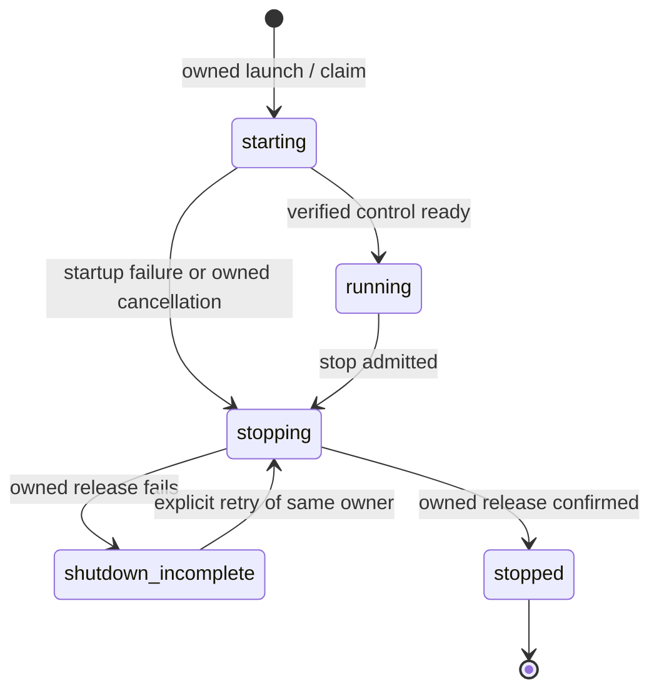

# `can dev` implementation plan

**Current ownership-completion execution, 2026-10-18:** after the accepted
native main/manual release checkpoint, the user explicitly requests deletion of
redundant TypeScript dev-server code and implementation of remaining development
logic in Rust. This strengthens the former coarse target adapter boundary; prior
manual/profile results remain accepted at their recorded inputs, not proof of the
new ownership scope.

Continue canonical T14/T16/T17 in dependency order: (1) migrate maintained callers
to native control and disconnect legacy controller types; (2) port help/rank,
native inventory/config/persistence/preparation and example/qualification sequencing;
(3) reduce the JS host to fixed Miniflare/SDK/defining shared semantic API calls,
with no dev capture/compiler/queues/cache/publication workflow; (4) delete obsolete
controller/helper sources and their exclusive tests, retaining semantic-owner
regressions and migrating still-used public CLI consumers; (5) qualify changed
native/bridge/installed manual behavior, then integrate under a new safe main
window and remeasure. No old session-controller fallback or renamed coarse builder
counts as completion. Compiled application/runtime and Testkit semantics retain
their defining owners; direct JS APIs are an execution boundary, not a second dev
controller.

Required output is an actually used native pipeline, no maintained caller/import
of retired TS orchestration, exact explicit allocation/late-result retention and
confirmed release, unchanged permissions/evaluation/atomicity, and the same real
installed manual/terminal outcomes. Native child IDs are allocated before SDK
calls; absent/failed replies retain the parent generation/owned process scope.
JavaScript keeps only live SDK objects and retryable disposal handles. Existing
source/epoch/currentness and private file contracts remain. Old stopped U and
foreign unfinished main inputs stay preserved, excluded from implementation.

**Integrated release acceptance and final measurement, 2026-10-18:** native
manual development is integrated in local main at `cdf26e070`. The accepted
compiler-context batch9e9b1c7c4 is included, all24 foreign tracked source/test/AGENTS
files remained byte-identical across integration, and untracked foreign work stayed
in place. Both original dev planning notes are retained/reconciled. Stopped old
TS/cache/UI inputs are preserved in named stash
`c587f365e0333ea185a6be58545a3f9f1d270f4d`, excluding artifacts and foreign work.

The actual integrated release compiler rebuilt on both hosts using the existing
compatible caches. Canonical checksum installation and the affected installed
manual workflow pass again on each platform: login/grants/D1, isolated failed
examples and exact rerun, JSON compatibility, invalid edit/last good, repair,
safe HTTP refusal and stop/restart preserving login/data. Reuse native94 release
and installed23 qualification per host above for unchanged server/package/installer
criteria; no repeated whole suite or broader compiler claim follows.

| Integrated installed observation | macOS arm64 | Linux x86_64 |
| --- | ---: | ---: |
| PreviewPersistence start → serving |9.901s|14.797s|
| Owner/control |161ms|41ms|
| Invalid check |1.204s|1.289s|
| Repaired generation |8.331s|11.795s|
| Confirmed stop |173ms|160ms|
| Restart check |8.586s|12.729s|

The final ModelFreePreview macOS phase run is **9.270s** start → serving,
**82ms** owner/control, **37ms** authenticated HTTP and **182ms** confirmed stop.
Sampled check phases: capture about1.47s, compiler/currentness .36s, runtime
preparation7.24s and final currency .11s. Sampling is80ms; runtime preparation
remains dominant. These are single warm-dependency/fresh-app observations, not
statistical latency claims or a causal percentage against older source/profile
samples. ModelFreePreview bytes retain SHA
`f54fd4c9ed820a59d3fd3f19d24b222ab37adefe2aec8fa763836748ed5fbf98`.

Integrated compiler SHA is
`d448d36d440d7e9bedf1f7428921de29dcae9acc24d3faa0ab912b44b6232f20` on macOS,
`b7a768109e5ff11cf234ffd91fd541833ce7e1669cd6457472295af0ad4b3bce` on Linux.
Native server SHA remains
`71e2736f06224becf437c9fc9a01364a807c8b9e7bcee96ab2f8d6d23275143f` / Linux
`973be1ffd0d1ce9309173083c4fc244d23904624e5d2ffa88e1e85070697ccb9`.
Linux records glibc2.39 as the actual native minimum. Artifacts and concise reports
are retained in the owned local output/private qualification directories and Linux
packet. Rebuildable owned caches are released after inactive-consumer checks;
shared primary caches are untouched. No public publishing or GitHub workflow run
was performed. Later automatic features and the documented Miniflare internal
restart notification limitation retain their separate scope.

**Release-profile platform qualification, 2026-10-18:** the locked Rust1.99
release compiler and native server build on macOS arm64 and Linux x86_64. Native94
release checks pass on both; macOS reuses64 sandbox-valid checks and retries only
13 socket/watch-blocked checks with the required environment, then passes gateway4
and state13. Actual archive qualification passes23 criteria per platform, including
clean toolchain-free PATH, bundled runtime/dependency identity, real installed
manual login/grants/D1, isolated examples/rerun, invalid edit/last good, repair,
safe HTTP refusal and stop/restart preserving data. The earlier development-profile
results remain evidence at their recorded scope.

The first release manual attempts exposed a verifier race at replacement: new
Ready does not imply the old generation has finished retiring. Preserve owner
CLEANUP_REQUIRED and observe normal retirement via status, bounded to10s, before
requesting access. No cleanup retry or relaxed assertion is used. Linux's affected
retry observed107ms retirement and passes all manual groups; macOS's affected
manual retry passes, reusing19 unchanged archive checks and the remaining3. The
first macOS repair assertion did not retain its check result; the verifier now
records it, and the successful retry confirms valid/ready r3. No production change
was inferred from that missing historical outcome.

The release tuples use committed source e45f9655b and its frozen producer outputs.
macOS manual ready9.181s/control.085s/stop.120s; Linux ready14.507s/control.041s/
stop.170s. These are separate host observations, not a cross-platform comparison.
Linux qualification is Rocky10.2/glibc2.39; its actual ELF closure requires glibc2.39.
The existing configured GitHub release workflow was not dispatched or published;
actual equivalent locked release builds and installed checks close this platform
qualification scope. Main integration and its final measurement follow the safe
foreign-writer release. T18–T30 and public publication remain separate.

## Current execution view — development experience, 2026-10-18

**Implementation resumed by the user, 2026-10-18.** This is the single current
execution view for the terminal-first development experience and its later
save-to-presentable-preview work. The earlier implementation authorization for
**Prevent Miniflare instance accumulation** was followed by the user's stop;
its work remains preserved. The current instruction selects a Rust development
server with Ratatui and managed Workerd. The user now authorizes implementation,
prioritizing the authoritative state machine and Ratatui terminal in dependency order.
Pause wording retained below records the prior planning handoff, not the current
execution authorization. T14–T30 retain their IDs and acceptance scopes.
First priority is T14's authoritative state contract
and T15's Ratatui experience, with T16 supplying the runtime boundary needed to
qualify that manual workflow. Later automation and performance work stay separate.

**Native command parity and installed manual checkpoint, 2026-10-18:** T14/T15's
remaining manual command policy is implemented: compatible status/check fields,
bounded captured diagnostics and safe compiler/example/HTTP failure references,
serialized isolated examples and retained exact-row reruns, captured construct
help and trusted four-job qualification, stale-proof downgrade and default-disabled
external ranking. All public command families are advertised; missing pending
ranks produce the existing typed refusal. Rust alone admits work, assigns refs,
retains inputs and selects generations. Caller detach cancels and joins only its
own work; uncertain resource release retains payloads/recipes and blocks growth.
The subordinate host acknowledges consumption of verified private spool outputs.
Existing example/qualification cleanup now retains failed disposal handles and
joins pending allocations, preserving the primary failure.

Native94 checks pass at their scopes (whole93 plus the affected final owner check).
Bridge protocol/target6, new cleanup/recipe4 and spool1 pass. Existing example13
pass with the failed-only canonical fixture-key correction; no request/wire or
business assertions were removed. Source AST comparison covers445 changed native/
bridge functions with zero complexity violations. The installed native manual
journey passes real login/team selection and D1 mutation, isolated failed examples
and exact rerun, safe failure/diagnostic commands and historical refs, invalid edit
with last-good serving, repair/replacement, real HTTP refusal, and stop/restart
retaining the same login, MCP grant and data. The existing TS JSON consumer also
controls that installed native owner. External ranking/account gates stay held.

T17 now assembles the native `libexec/can-dev` with the existing installer,
explicit component input, native host/release identity, component bytes and
separate locked dependency notices. The release jobs build both native targets
serially in a compatible target; installed defaults use bundled Node/bridge and
the existing compiler override. Preflight runs nonstarting dev help before the
atomic switch. Conflicting TS bin/installed controller routes are retired; stopped
TS sources remain preserved. The existing Linux tools archive also takes the
native component instead of losing its former bin mapping. Local macOS archive
verification passes23 checks, reusing19 unchanged passes after correcting the
verifier's help invocation and retrying only its manual scope and remaining3.
Producer emission temporarily isolated the stopped dirty TS/UI inputs, restored
all original source bytes, and froze the coherent outputs through qualification.
No private dependency install or foreign compiler output was replaced.

**Integrated local build measurement:** the packaged development-profile compiler
is SHA `fcb86188b219f156915b5379cf6dc41e4cadf56e91d8db74083ecfacafe46746`;
native SHA is `5b609df5fead8eddb0ced75bec86cc081f642cba188f502eb16b8e650846aa8f`.
The external PreviewPersistence workflow reaches ready in10.110s, control in.115s,
invalid check in3.613s, repair in9.399s, restart check in11.328s and confirmed stop
in.197s. This is a different packaged producer/app tuple from the earlier matched
checkout comparison below; do not derive a new percentage from those old samples.
These are local observations, not a statistical or two-second latency claim.
The final installed ModelFreePreview phase run is10.360s to serving (control.101s,
HTTP.020s, confirmed stop.163s): capture about2.18s, compiler/currency about1.68s,
runtime preparation about5.81s and final currency about.60s. Runtime preparation
still dominates. This uses the same source bytes and compiler as the earlier
checkout sample, but the packaged producer closure differs.

Actual installed generic-command PTY also passes: diagnostics and same-session
failure lookup render real captured results, typed input survives, Ctrl+C detaches
with exact terminal restoration, the same owner remains live, and explicit stop
retires it. Reuse unchanged earlier80/44 resize/history/plain checks. The one-off
helper expected an invented SESSION_NOT_FOUND code after teardown; actual missing
endpoint reports CONTROL_IO, consistent with its existing native boundary. No
extra owner/terminal retry was needed.

**Historical local T17 checkpoint:** Linux/release-profile qualification was
unrun at this checkpoint and is now closed at the recorded host scope above. No public publication, T18–T30 extension or external gate release
is inferred. The native manual and terminal outcomes above are closed at their
local scope; these external platform gates do not reopen their accepted checks.

**Earlier native core checkpoint, 2026-10-18:** `dev-server/` now supplies the
typed authoritative state, one owner event loop, immutable capture/compiler
adapter, private root claim/control, managed runtime bridge and process groups,
protected gateway, watcher and Ratatui/plain foreground. The subordinate bridge
is committed as `078366c48`; its minimal tracked changes exclude preserved U
cache, stable-gateway, update-client producer and controller work. Real Workerd
readiness and release pass. The Rust manual journey passes initial ready,
authorized HTTP, invalid edit with retained r1 preview and r2 diagnostics,
repair/replacement to r3, and confirmed endpoint/process retirement. A delayed
watch hint exposed by that journey now triggers a bounded full byte/currentness
confirmation rather than rejecting already-current bytes. The current compiler's
valid capability minimum version zero is admitted.

Native checks cover 80 source/state/transport/input/rendering/process/HTTP cases
at their recorded scopes, plus actual 80/44-column PTY input/paste/resize/history,
owned stop, attached detach and terminal restoration. Redirected stdout selects
plain stderr before Crossterm can emit its stdout cursor query. Horizontal
shrink preserves the visible screen in physical scrollback with an explicit
historical-view marker before Ratatui redraws. No source or lifecycle authority
is added to the renderer. Actual cross-controller checks pass: native UI attaches
to a TS owner and detaches without stopping it; TS status/discover/stop control a
native owner. The latter exposed idle-only maintenance starvation. Maintenance
now follows an independent deadline, so status polling cannot defer retirement,
watch reconciliation or runtime health checks; final-response draining remains.

**Current local measurement:** one matched process-cold manual run uses the same
ModelFreePreview source path/bytes, current compiler SHA
`fcb86188b219f156915b5379cf6dc41e4cadf56e91d8db74083ecfacafe46746`
and frozen emitted producer closure. Preserved TypeScript reaches serving in
19.410s (owner/control 6.181s). The native full journey reaches serving in12.972s
(control .080s); the final binary's startup-only measurement is16.857s (control
.077s), about13% less than TS. Record both observations: runtime preparation
varies from7.35s to10.77s and accounts for most of the difference. Final native
capture completes around3.1s, compiler plus currency around1.7s and final currency
around1.1s. Authorized HTTP is .023s final native/.019s TS; stop including actual
endpoint/process retirement is .144s final native/1.854s TS. Final native binary
SHA is `e20455897a8573d8307aa7c48c2f954ec6919f2414f9cb7eedbc4fca3ae90a31`.
Control readiness is an earlier boundary
than app readiness; capture was moved into an owned operation and also sped up.
The original38.476s/17.503s was a different older tuple, not this matched baseline.
ARM software hashing had dominated a failed native diagnostic run; maintained
runtime-detected ARM SHA acceleration and eight bounded readers retain all byte,
canonical-path, permission, membership and publication checks. Raw inventory
enumeration is about.86s per request and was retained, including all three browser
driver pins. Runtime preparation is now the largest remaining phase. These are
single local observations, not a two-second or statistical latency claim.

**Historical gaps at the core checkpoint `5d8113012`:** T14's complete JSON/result policy,
retained failure/reference, example/rerun, explicit local-actor and construct
help/ranking coordination; full T15 compatible-command qualification; T17 native
installation/default resolution, complete retained-login/data journey and
cutover. Native help lists unavailable command families. The installed TS entry
remains in place; no public release, whole-plan completion, T18–T30 resumption or
external gate release is inferred from this checkpoint.

**Historical stopped TypeScript work, 2026-10-18:** these are U/source results,
not implemented Rust T14/T15 acceptance or authorization to resume. E1/startup capture reduction is committed
as `da726fc78`; T16's owned asynchronous bundle adapter is committed as
`4b6ab6ae2`. T14/T15 and explicit T19 automatic admission are implemented locally:
the owner snapshot separates operation/source outcome from actual serving state,
stop confirms runtime release before endpoint/process retirement, and one latest
automatic demand reuses the existing check queue. Focused terminal9, observation4,
publication-failure1, socket6 and automatic service1 controls pass; affected service/
daemon integration and package emission pass at their recorded scopes. T17's real
terminal/current-build phase run remains pending. T18/T20/T22 have their focused
owner checks; the genuine resource/routing/browser join is still pending. T23–T30
remain open at their defined scopes; no complete integration or two-second result
is claimed. The compiler chat's current uncommitted work must reach its requested
commit handoff before final synchronization and current-build measurement.

The original **T00–T13 and G1/G2 remain accepted at their recorded frozen scopes**;
consume their outputs without repeating their qualification. G3/A7 remains the
external account/executor/protocol gate recorded below. The stopped platform
handoffs remain stopped and outside this extension. T14–T30 add outcomes to the
accepted session, protected preview and JSON controls; they do not replace those
IDs or turn historical open counts into new assignments.

### Accepted Rust development server and managed Workerd — 2026-10-18

**[Accepted direction](../../specification/DECISIONS.md#2026-10-18--choose-a-rust-development-server-with-ratatui-and-managed-workerd):**
the Can development server is implemented in Rust under the root
`dev-server/` directory, with [Ratatui](https://ratatui.rs/) front
and center. Rust owns the development application's authoritative state machine,
watching/invalidation, scheduling/checks, build coordination and managed lifecycle:
start, readiness acceptance, publication, replacement, stop, failure and recovery.
This supersedes the earlier UI-only choice and the assumption that the general
server remains TypeScript or Cloudflare-owned. The existing Rust compiler remains
the sole Can compiler and produces the JavaScript executed by **Workerd**.
**Miniflare is retained for local development:** a bounded subordinate JS host
calls its supported API to configure services and launch Workerd. Miniflare is
neither the production runtime nor embedded inside Workerd. The host has no
independent session controller, rebuild scheduler, publication authority or
session-restart policy. Miniflare's own internal runtime restart behavior is a
separate, explicitly unresolved API limitation below. Ratatui renders Rust facts
and submits user events; it does not supply the application state machine.
Can application/business semantics remain with the compiler and runtime owners.
This is an accepted architecture, not a resumed rewrite or a claim of superiority.
The earlier `dev server/` name is historical: the directory has already been
renamed to `dev-server/`. No relocation remains in this plan.

**Proposed public entry:** `can dev ui --source App.can` is the prominent human
workflow, with explicit attachment to a verified existing owner. The native `can`
entry continues to forward to a separate native `can-dev` executable owned by
`dev-server/`, shipped in the same Can installation as the compiler. The selected
packaging and cutover are specified below; there is no separate user installation.
Explicit JSON commands, no-argument help, envelopes and exit semantics remain
compatible; their control handling reaches the same Rust owner after cutover.
TTY detection never turns an explicit machine command into a UI. No entry or
source relocation is implemented by this planning change.

```text
can dev → native can-dev → Rust development server in dev-server/
            ├─ Ratatui primary interface / plain output / JSON control
            ├─ authoritative session, watcher, scheduler and process supervisor
            ├─ compiler adapter → existing Rust Can compiler → JavaScript
            └─ private versioned process/control boundary
                 → retained subordinate JS host → supported Miniflare API
                    → local services and Workerd launch
                       → Workerd executes compiled Can JavaScript
```

| Responsibility | Defining owner and boundary |
| --- | --- |
| Session/control | Rust owns the canonical-root claim, verified discovery/attachment, input generations, capture/check queues, cancellation, diagnostics/history, work admission and recovery. Port the existing behavior and retained evidence; do not retain an independent TypeScript session controller after cutover. |
| Runtime lifecycle | Rust owns session start/recovery policy, admitted preparation, readiness acceptance, replacement/publication and retirement/stop, supervising the JS host and its owned OS scope. The host performs ordered concrete API operations and reports results. It cannot publish, rebuild or restart a session. Miniflare's internal Workerd restart is not a Rust veto hook; see the precise limitation below. |
| Target integration | Retain Cloudflare bundle algorithms, Miniflare configuration/service primitives and actual Workerd probes. The JS host owns concrete Miniflare objects and local retry handles; Rust owns their admitted lifetime, ordering and opaque resource registry. No Cloudflare SDK objects or Miniflare internals cross into Rust core, and no target module imports the general session controller. |
| Preview/access/data | Rust owns development access admission, preview gateway/routing and generation selection. Runtime Identity/CSRF/host checks and application grants still run at their defining owners. Preserve retained data/login and schema-compatibility refusal; replacement is never an implicit reset or permission bypass. |
| Shared semantics | Compiler, State, Identity, Values, UI, Work and Testkit retain their language/runtime/business semantics. Their supported code runs in Workerd or the appropriate existing adapter/tooling context. A Rust development server does not require porting these packages or physically copying them into its directory. |

#### Source ownership and imports after cutover

These source-location and further decomposition notes were proposed during the
paused planning stage. The accepted implementation uses the bounded Cloudflare
host at `@canlang/cloudflare/dist/dev/runtime-host.js`, with bundled Node. These
proposals do not reopen closed native manual criteria or require relocation.
The proposed locations/interfaces below are retained as alternatives:
`dev-server/src/` owns the Rust controller, capture/compiler adapter, queues,
resource/supervision registry, protected gateway and control/presentation code.
`dev-server/host/entry.mjs` is the private JS protocol shim, packaged with this
component; it imports a narrow target adapter factored from the existing
Cloudflare tooling. The adapter performs supported Miniflare API calls and target
computations. It does not import the former TS session/core/service/daemon,
general preview gateway or controller-owned caches.

| Existing mixed owner | Proposed further decomposition; retained semantics |
| --- | --- |
| `createLocalPreviewBuilder` / `createInstalledLocalPreviewBuilder` | Port build sequencing, capture/currency checks, allocation registry, origin selection and promotion policy to Rust. Keep concrete bundle/configuration, provisioning and probe operations in the target adapter. Its current reverse `SessionServicePreview` import from `session-service.ts` becomes explicit result data/opaque handles; do not retain the whole builder as a hidden controller. |
| `startProtectedPreview` | Rust owns the baseline gateway and allocates its protected origin before target configuration; the host consumes that origin and returns backend/probe facts. No JS target helper creates the general gateway. T18 later changes the same owner's origin lifetime; it does not introduce another gateway. |
| `ExampleRerunCoordinator` / `ConstructRanker` | Rust owns queues, pending refs, retention/TTL/eviction, currentness, deadlines and disclosure policy. Retain only admitted semantic runner/Testkit work or one provider transport request in JS, with bounded outcomes and cleanup facts. No retained JS ranking/rerun scheduler or independent cache lifetime. |
| `first-profile-qualification.ts` | Rust captures and invokes the sole compiler, schedules fixture preparation, owns qualification cache/cancellation and releases resources. Retain concrete existing runtime/browser assertions against supplied artifact/resource handles. The existing helper's capture/compiler/builder imports cannot remain an independent qualification workflow inside the host. |
| Producer bundling/classification | Cloudflare computes target bundle output and checked compatibility facts; Rust coordinates jobs, owns cache admission/lifetime and selects publication/update actions. This applies to T22/T24/T27 as well as the initial adapter. |

The accepted minimal adapter retains concrete `createInstalledLocalPreviewBuilder`
and `createInstalledFirstProfileQualification` operations; Rust retains the
command/capture/currentness/resource policy recorded above. Deeper helper splitting
is proposed, not an additional release prerequisite.

The public compiler and package APIs keep their semantic owners. Necessary target
adapter exports are private development integration surfaces, not new Can language
APIs. Audit the changed import closure at T17: retirement removes replaced TS
orchestration and its command routes, while retaining this JS host, Miniflare,
Workerd and unrelated runtime/business packages.

### Selected entry packaging and cutover — T17

**Planning choice:** build `can-dev` from an independent Rust crate at
`dev-server/Cargo.toml`, with its lockfile and dependency notices owned there.
Keep the compiler's `can` binary as the thin dispatcher; do not link the server
or Ratatui into `canlang-compiler`. The server invokes the existing compiler
through its compiler adapter and owns its session process entry. T14 supplies an
additive non-starting `can-dev --version` identity probe for packaging; existing
JSON command envelopes remain unchanged. This keeps
compiler/library ownership intact and replaces the existing executable boundary
without creating another install/update channel.

This choice follows the current sources: [compiler dispatch](../../../compiler/src/cli.rs)
already forwards arguments and exit status through `CAN_DEV_BIN` or `can-dev` on
PATH, with a typed missing-tool failure. The [install packer](../../../scripts/pack-install.mjs)
already sets that override to the release's `libexec/can-dev`, but currently emits
a shell launcher to the TypeScript control client there. Linking could remove
that child launch, but would add server/UI dependencies to the compiler while
the owned session and Workerd bridge still need process supervision. It supplies
no required outcome missing from the existing forwarding boundary.

T17's distribution writer performs the following bounded cutover after consuming
T14's native command/session entry, T15's controls and T16's installed bridge:

- Extend `scripts/build-install.mjs` and the existing native artifact job in
  `.github/workflows/release.yml` to build the locked `can-dev` crate for the
  existing macOS arm64 and Linux x64 targets. Carry its actual dependency notices
  separately from the compiler notices, whose current checker pins only compiler
  inputs. Reuse compatible build caches under the existing resource rules.
- Add a `--dev-server FILE` input to `scripts/pack-install.mjs` alongside
  `--compiler`. Local release assembly and CI both supply the matching built
  output and verify its version against the release being assembled and its native
  host target. Copy the executable to `libexec/can-dev` through the existing
  inventory helper instead of generating the TypeScript launcher. Record its
  release identity and component bytes in the existing manifest and include its
  notices/checksums in the existing archive flow. Missing or mismatched host/release
  output fails assembly; do not fall back to a stale checkout binary.
- Preserve the public `bin/can` launcher, explicit `CAN_DEV_BIN` overrides and
  current `CAN_INSTALL_ROOT`, `CAN_DEV_COMPILER`/`CAN_COMPILER_BIN` defaults. The
  implemented installed server resolves the release's
  `@canlang/cloudflare/dist/dev/runtime-host.js` and bundled Node; it requires no checkout, npm/Bun install, host Node or Rust toolchain.
  The existing package inventory carries that host and target-adapter closure.
  A future proposed `dev-server/host/` / `libexec/dev-server-host/entry.mjs`
  relocation would require explicit inventory support because the packer scans
  `packages/`. Either location resolves target imports through that release's `node_modules`;
  Miniflare remains a pinned target dependency. No separate JS host installer.
  `scripts/distribution/package.json` remains the JS tools owner, not a Rust package.
- Remove the conflicting TypeScript `can-dev` bin mapping and obsolete control
  launch route from `packages/cloudflare/package.json` at cutover; retain target
  tooling and shared runtime exports. Update contributor instructions to point
  `CAN_DEV_BIN` to the built Rust executable and explicitly select the prepared
  host/target closure for a source checkout; do not silently fall back to stale
  installed tooling or the removed TS session client. Source development still
  uses its existing Node/Bun build prerequisites. Compiler-owned forwarding/help and
  existing JSON/no-argument behavior stay compatible; no second controller remains.
- Extend the existing install preflight with a non-starting `can dev --help`
  smoke check before switching `current`, so a broken server cannot replace a
  working install. Keep the existing atomic whole-version switch and public
  `can` symlink. T17 verifies native identity, forwarding/override/exit behavior,
  symlink and space-containing paths, clean-PATH help/JSON, and its one installed
  Workerd journey on the existing release targets. Reuse unchanged installer
  security/inventory evidence; no new platform matrix or public release is implied.

Packaging is resolved for this execution plan. No further user packaging decision
is required. Implementation is underway; cutover remains gated by T17. The E1
source contract in the parity mapping is an input to Rust lifecycle acceptance;
its former owner remains stopped.

### Supported Miniflare boundary and lifecycle limitation — T14/T16

[Miniflare's documented API](https://developers.cloudflare.com/workers/testing/miniflare/)
is the local-development integration. Source inspection used the repository's
`miniflare@4.20260730.0` / `workerd@1.20260730.1` lock and installed definitions:
the `Miniflare` class exposes construction, `ready`, `dispatchFetch`, `setOptions`,
binding access and asynchronous `dispose()`. Keep those objects inside JS. Rust
does not consume private fields, generated Workerd configuration, or the lower-level
exported `Runtime` as an alternative supported control API. `handleRuntimeStdio`
exposes streams, not a Workerd process handle.

Two inspected implementation facts constrain the design:

- In this pin, Miniflare spawns Workerd as a non-detached child and its own disposal
  awaits that child's exit. Rust can wait/reap its **own host child**, not promise
  arbitrary grandchild reaping through the Miniflare API. A dedicated POSIX process
  group is the implemented `setsid` scope for the qualified macOS/Linux profile;
  retained host-loss/termination checks require direct-child reap and observed
  group absence. Launch strips inherited debugger injection variables because
  this pin can otherwise create detached VS Code watchdogs.
  No PID-by-name killing, private Miniflare handle access or unqualified Linux-only
  subreaper assumption is part of this plan.
- `Miniflare.#handleWorkerdCrash` internally recreates Workerd. The exposed
  `unsafeHandleRuntimeRestart` callback runs **after** successful restart; it is
  not a veto, and the inspected public options provide no restart-disable switch.
  No immediate stable exit notification is promised. Supported readiness/dispatch
  probes and owner timeouts remain required evidence; optional unsafe callbacks
  cannot be the sole correctness mechanism.

**Precise supported-API limitation:** Miniflare may perform internal Workerd
recovery without a pre-spawn veto or immediate stable exit notification. Rust
retains session admission, generation selection, publication and owned-host
recovery authority. Prior approval of every internal Workerd spawn is a stronger
contract requiring an explicit architecture decision; it is not an additional
prerequisite for the recorded native manual acceptance. Current native health
checks observe host transport; preparation performs real runtime probes. Immediate
inner-restart observation and continuous post-restart readiness invalidation are
not implemented or claimed. Preserve this limitation without reopening accepted
host-loss and owned-scope release checks. Do not patch Miniflare internals or remove
Miniflare to conceal it. A future stronger restart contract remains proposed.

### Bounded subordinate host protocol — T14/T16

Rust controls local preparation through a private, versioned, bounded control
channel with command/result correlation and separate bounded logs. The implemented
format is bounded versioned NDJSON over owned stdio (the earlier framed-JSON
wording was a proposal), with bulk artifacts carried as admitted
job-local file references plus digests. The existing private IPC conventions
supply size/error rules; this is neither a new public service nor a generic RPC
framework. Exact encoding details cannot transfer orchestration back into JS.

- Bridge launch/handshake identifies the owned process, protocol version, session and
  supported profile. Pin source/input/artifact/producer identities and the selected
  persistence scope. An incompatible or unverified host never becomes ready.
- Rust issues ordered bounded target operations: bundle/configure, provision local
  services, start an instance, probe, execute an admitted example/qualification
  assertion, cancel and release/retry. Concrete `prepare` retains the existing
  target builder without a second session controller or publication authority;
  further splitting of its internal target phases remains proposed. Requests carry session,
  operation/generation and Rust-assigned resource identities before allocation.
  Results carry the corresponding identity,
  actual readiness/failure and outstanding resource-release state. Rust verifies
  authority and correlation and alone promotes a current ready candidate. Late
  or superseded results cannot publish, but any reported allocations or retained
  release outcomes still require ownership reconciliation; never drop a resource
  handle merely because its check operation is obsolete.
  A ready process is not a ready app; a ready app is not a browser-applied update.
- Graceful shutdown first closes Rust's work/access admission, then cancels or
  joins owned jobs and releases runtimes. Retain ownership handles through failed
  cleanup: JS retains actual Miniflare instances/retry closures, Rust their opaque
  IDs and verified host/supervision-scope identity. Request supported `dispose()`
  cooperatively before bounded escalation against only that owned OS scope; Rust
  waits for its direct child. Qualify descendant containment/termination separately.
  A host exit, reported PID or endpoint disappearance alone is not release proof.
  Scope granularity must allow cancelling a candidate/job without silently killing
  a serving generation; no general worker pool is implied.
- Release results distinguish runtime/listener release, host termination and
  owned scratch removal. In this pin Miniflare's temporary removal is asynchronous;
  `dispose()` is not proof every file has disappeared. Preserve persistent state,
  and release only known scratch after its consumers terminate. On host loss an
  opaque ID cannot recreate a JS handle: retain release-uncertain, reconcile the
  owned OS scope and block applicable new allocation until its gate clears.
- An observed runtime failure/restart or failed owner probe invalidates that
  backend's readiness while Rust remains able to report state and accept recovery
  commands. Preserve the primary error, last verified
  facts and retained data. Uncertain prepare/release results require ownership
  reconciliation before retry/new allocation; never replay application mutations.
  Automatic session recovery, when selected in T19, is bounded and obeys no-growth
  gates; it does not describe or disable Miniflare's internal restart behavior.
- Logs/events identify their session/generation, operation and source; drain them
  with bounded retention and explicit dropped/unavailable counts so they cannot
  block stop. Redact secrets and sanitize terminal controls. Only typed owner facts
  drive state; neither log prose nor UI animation is a readiness signal.
- Preserve the existing command families beyond preview preparation. Rust owns
  revision/reference admission, bounded history, queues and cancellation for
  examples/reruns, failures and construct help/ranking. T16 exposes admitted
  exact-artifact execution, installed Testkit and concrete trusted qualification
  assertions as bounded subordinate operations, plus typed business-refusal events from the
  serving generation. The adapter does not own command policy or a second session;
  runtime values and authority stay with their semantic owners. Qualification is
  not caller-supplied; Rust schedules any qualification capture/compile/preparation
  through its same owners. External ranking remains separately policy-gated, with
  no retained JS pending-job/cache/retry controller.
- Persistence retains its existing compatibility and isolation rules. Rust owns
  scope/lifetime admission; the adapter reports actual Workerd/schema/readiness facts.
  Do not activate conflicting writable owners during replacement or erase data on
  source/schema failure. Recovery/reset choices remain explicit, with uncertain
  in-flight effects preserved rather than retried blindly.

**Terminal behavior:** implement the existing 24-state terminal research with
Ratatui's [inline viewport](https://ratatui.rs/examples/apps/inline/): a prominent
current-status area, durable history/diagnostics, normal/error/narrow layouts and
commands submitted with Enter. Consume Rust's T14 snapshots and ordered updates;
reconnect by resnapshotting. Show actual phases, elapsed time, captured-revision
errors, serving freshness and cleanup/recovery actions. Source errors can coexist
with an older serving preview; missing evidence stays waiting/unknown. Ratatui's
renderer is selected, while actual scrollback, resize and input behavior still
requires T15/T17 verification. The UI requests admitted actions from the one owner.

T15 carries that research into one presentation contract:

- Identify the app/source, manual or automatic mode, and owned or attached view.
  Keep the active phase and elapsed time, latest check with its captured revision,
  serving preview with its freshness, and any blocking recovery action visible
  together. “Control connected” never substitutes for “Preview ready.”
- Append completed outcomes and bounded diagnostic excerpts to history once;
  redraw phase/timer changes in the live area. Keep older-revision errors labeled
  and retain the latest failure until a later owner result supersedes it. Details
  expose retained diagnostics/logs and any truncation or unavailable content.
- Enter submits a known command or alias; unknown input explains available
  commands and never executes shell text. Show the owner's available actions and
  reasons for blocked actions, then recheck admission at dispatch. Redraws, resize
  and incoming logs preserve the command being typed. Pasted text is input, not
  an implicit sequence of commands. Build/log work cannot starve input or stop.
- At 80 and 44 columns, prioritize current phase, preview/freshness, failure and
  next action. Wrap or move secondary detail into history/details without hiding
  the active blocker. Text labels carry meaning without color; no simulated
  percentage or ETA fills gaps in owner evidence.

Plain mode and redirected/noninteractive runs append meaningful transitions and
diagnostics without cursor rewriting, raw input or an interactive prompt.
`NO_COLOR` retains meaning; human progress stays on stderr and JSON stdout stays
machine-only. Ctrl+C stops an owned session or detaches an attached presenter;
restore terminal state on supported exit/error/interrupt paths. The Rust owner can
outlive an attached UI, so losing the presenter never implies runtime shutdown.

### Finite migration within the existing task IDs

These are the current execution steps for the Rust direction, not a second plan
or extra task IDs. E1's stopped work supplies behavior/evidence to inspect and port;
its former chat remains stopped.

| Order / existing task | Concrete output and finite acceptance |
| --- | --- |
| T14 + T16: freeze the owner/host contract | Map existing lifecycle, input/freshness, permission, retained-data and failure behavior to the narrow messages above; separate supported API operations from OS supervision and resolve the precise Miniflare restart interpretation before lifecycle acceptance. Reuse accepted evidence; record only genuine gaps. One lifecycle authority and identified resource ownership are required, without inventing a generic platform protocol. |
| T16: isolate the Workerd integration adapter | Reuse existing bundling and Miniflare launch/local-service tooling behind the contract, retaining the bounded JS host and decomposed target primitives. Validate one actual supported artifact in Workerd plus delayed/failed preparation, bounded logs and cancellable owned-child cleanup. Keep synchronous target work off Rust's control/UI loop; qualify cooperative disposal and termination of an unresponsive host's owned OS scope without losing resource accounting. No runtime/business-semantics rewrite. |
| T14: port session/control and supervision to Rust | Supply the native `can-dev` command/session entry under `dev-server/`; transfer root claim/IPC, capture/currentness, scheduling, existing protected gateway behavior and runtime lifecycle to Rust. Exercise invalid-source/last-good-preview, supersession, startup race, crash, stop/publication ordering and failed-cleanup retry against the host contract. Retained login/data and current authorization remain authoritative. |
| T15: deliver Ratatui and compatible controls | Implement the primary Rust terminal, plain mode and existing JSON behavior against T14. Verify state rendering, normal/narrow layouts, bounded diagnostics/logs, attach/detach and terminal restoration; no duplicated UI-side lifecycle. Can proceed from the released state contract while host integration finishes. |
| T17: qualify and cut over the installed manual workflow | Package native `can-dev` beside `can` through the selected existing installer flow; consume T14's entry, T15's controls and T16's installed bridge. One frozen real startup → ready → invalid edit → repair → replacement → stop journey uses the Rust owner and managed Workerd. Include retained data/login, failure/recovery, attached-view detach and the existing JSON consumer. Retire replaced TypeScript session/daemon/gateway and coordination routes, leaving the required JS host, Miniflare target integration and shared runtime packages. Capture attributed phase timings; stop at manual parity. |
| T18–T30: resume only their listed extensions | Stable session origin, automatic checks/updates and measured reuse remain subsequent scoped work. Existing behavior ports under T14/T16; optional reuse under T22/T23 and compiler work under T28/T29 do not become prerequisites for Rust/manual parity. |

This sequence proposes migration work only. Neither a Rust language switch nor
Ratatui rendering establishes faster compilation, bundling, runtime startup or
save-to-page latency; compare attributed phases on the same supported workflow.
Miniflare work and the Rust rewrite remain stopped pending implementation release.

### Evidence and intended outcome

Use the [research and 24 terminal states](development-experience-research.html)
and the [proposal decision](../../specification/DECISIONS.md#2026-10-18--proposed-terminal-first-development-experience-execution).
The research retains source observations, official ecosystem references, three
JEV sequencing requests and three terminal-layout requests with their disagreement.
Those consultations are advice, not implementation approval or usability evidence.
The offline ready/rebuild/error/narrow images were inspected; browser document
behavior and a real terminal renderer were not tested.

The supplied warm edit sample was **14.567 s save to verified usable page**;
13.48 s was the aggregate check, not compiler time. The separate startup samples
and minimal-runtime timings do not attribute that cost. **Roughly two seconds for
a small edit remains an aspiration**, neither a promised ceiling nor an acceptance
threshold. Finish the manual terminal experience first; automate the whole loop
and reduce repeated work in parallel after its contracts are usable.

Target behavior: the terminal truthfully explains the wait and available preview;
a save eventually updates the same authenticated tab without repeated check/open
commands; safe selective updates preserve supported interaction state; unchanged
work is reused only under verified keys. Permissions, evaluation order, current
source, login/data and resource ownership stay authoritative throughout.

Targeted planning reads at main `71885872b` confirm the relevant owner seams:
watch hints capture but do not check; compilation precedes the unchanged-serving
shortcut; the protected bridge is build-owned; producer bundles use fresh
synchronous child calls; retained preview data already survives compatible builds
and schema mismatch refuses reuse. The earlier first-slice reset wording is
historical, not a requirement to erase current retained data. Concurrent source
work is not a frozen validation input. Lifecycle/performance changes observed in
the earlier `0970` worktree are not assumed merged or qualified here.

### TypeScript behavior parity and concrete gaps — 2026-10-18

This is the migration checklist within T14–T30, not another task queue. The
comparison read current main at `3bb610962` and the preserved
`/Users/vince/.codex/worktrees/0970/canlang` at `b8c909700`, including its dirty
files. **B** below means current baseline source; **U** means stopped, unmerged
implemented source; **P** means proposed Rust behavior. Neither source nor test
presence is a passing result. No builds or tests ran for this comparison.

In U, `da726fc78` supplies retained cleanup, `4b6ab6ae2` owned async builds,
`6a764cd2f` owner observations/foreground controls and automatic scheduling, and
`dbedbb249` unchanged-check/capture reuse. Stable-session routing, producer-cache
changes and browser update/classification work additionally have dirty/untracked
files. Reuse these concrete outputs without treating all of U as merged or
requiring its entire plan. `dev/` below means `packages/cloudflare/src/dev/`.

| Existing capability and defining interface | Rust coverage | Actual gap or disposition | Finite acceptance at the owning task |
| --- | --- | --- | --- |
| **B — CLI/control and owner discovery:** `runDevControlArgv`/`formatDevControlOutput`; `discoverSessionSocket` verifies canonical root, UID, descriptor, process birth and nonce. | T14/T15/T17 | Already covered; retain all commands/flags, explicit source versus capture selection, app/profile selection, typed refusals and JSON compatibility. U's claim-token/takeover fixes are implementation references, not new accepted Rust results. | Preserve help and one bounded JSON line (128 KiB); control success is exit 0 even for source errors, usage failure 2, other control failure 1. Existing claim/discovery and takeover cases exercise the changed Rust boundary without a second root-lock system. |
| **B — coherent source and generated inputs:** `captureSingleFileSource`, `discoverGeneratedClosure`/`snapshotGeneratedClosure` in `generated-capture.ts`; `DevSessionCore.watchDirectories`. | T14; T23 only for extra reuse | Generated-source discovery/leases and missed-watch recovery were underspecified. Port the established compiler-admitted saved/contribution closure and full input identity; preserve watch reattachment and bounded fallback audits. This does not expand language scope. | Saved content or membership changes invalidate publication; staged source membership equals the captured closure. Missed add/rename/remove, replaced watch directory and changed producer eventually recapture coherently; idle operation does not repeatedly perform full captures. |
| **B — compiler adapter:** `compileCapturedSingleFile` runs captured compiler/catalog bytes, bounds output/time, escalates cancellation and waits for child close before staging release. | T14 compiler orchestration; T16 responsive owned execution | Exact invocation/result validation was underspecified: preserve `compile --format=json --native-scenario-receipts`, exit 0 artifact versus 10 diagnostics, source-path/hash agreement and pre/post currentness. U adds phase reporting. | Existing artifact/diagnostic, malformed-output, source-drift and cancellation cases cover the port; no late publication or deletion while the child still owns staging. No new compiler API is required. |
| **B — retained diagnostics and failures:** service `diagnostics`, `diagnostic.detail`, `failure.lookup`, `failure.detail`, `failures`; `SessionServicePreview.observeRefusals` → safe failure projection. | T14 retention/reference policy; T16 typed refusal events; T15 rendering | Broad “diagnostics/logs” wording omitted the command/event boundary. Preserve same-session and old-revision refs, pagination, compiler/service omission counts, bounded actual example/HTTP/MCP failures and serving-generation filtering. | Existing lookup/refusal cases verify old versus foreign refs, bounded pages, safe canonical messages and unsubscribe on retirement. Do not expose raw conflict/current values, credentials or unavailable traces through Rust or the terminal. |
| **B — isolated examples and reruns:** `SessionServicePreview.exampleInput` → `runCompiledExamples`; `ExampleRerunCoordinator` and its retained recipe/resource ports. | T14 admission/queue/refs; T16 runner/Testkit bridge | Execution and retention across the process boundary were omitted explicitly. Rust ports the rerun coordinator's queue/retention/TTL/resource-check policy and admits exact artifact/producer bytes, selected failed row and fresh run scope; JS receives admitted execution, while Testkit/Identity/runtime semantics stay in their owners. | Preserve drift/cancellation/eviction/resource-unavailable refusals, caller authority, one-row rerun validation and awaited cleanup without changing serving resources. Report saved outcomes separately; do not promise deterministic replay or replay uncertain effects. |
| **B — construct help and ranking:** service `construct.help`/`construct.rank`/`rank.lookup`, `SessionConstructQualificationRequest`, `ConstructRanker`, daemon's trusted qualifier. | T14 help/cache/currentness/disclosure policy; T16 qualification operation | Rust ports qualification/ranking scheduling, caches, pending refs and deadlines. It captures/compiles qualification fixtures through the sole compiler and admits concrete JS runtime/browser assertions. Preserve exact compiler/help/producer identities, bounded four-job qualification and structural/none/unknown/pending distinctions. A JS transport executes only a policy-admitted provider request. | Existing qualified/unqualified/stale and disclosure cases consume current trusted proof only; default external disclosure stays disabled. Qualification failure remains unqualified. G3's account/protocol gate remains external; no new live-provider trial is required for the port. |
| **B — actual runtime readiness and last-good replacement:** `createLocalPreviewBuilder` admission/activation/probes; `DevSessionCore.checkOne` promotion fence. | T14/T16/T17 | Already covered; clarify readiness means actual D1, Identity, authenticated MCP, packaged assets and page probes, not only a bridge handshake or Miniflare process ready. Owned host-scope supervision and readiness invalidation are P Rust requirements; the pinned Miniflare internal restart/veto limitation is recorded above, not hidden as an established capability. | One existing supported artifact preserves readiness/refusal and last-good behavior; stale or failed candidates cannot publish. T14's separate crash/reconciliation case covers the new Rust process boundary. |
| **B — protected preview and retained data:** `startProtectedPreview` admission/forwarding; `openRetainedPreviewState` private persisted identity/schema manifest. | T14 ports current gateway; T16 retains target/data setup; T17 join | Already covered, with concrete invariants now named: exact loopback host/path, one-use expiring bootstrap, bounded access cookies, effectful-request origin/body limits, separate bridge and Identity cookies; canonical root/source data identity and schema refusal. | Rust allocates the protected origin before target configuration; JS cannot create a second gateway. Existing access/expiry/isolation controls plus T17 retained login/data verify this boundary; incomplete provisioning or schema mismatch cannot erase data or silently reseed/reset. Session-lifetime stable origin is T18, not baseline behavior. |
| **B defects / U fixes — cleanup and resource recovery:** `DevSessionCore` retained cleanup, `retryCleanup`, `retryableDispose`/`cleanupAfterFailure`, preview disposal and `startLocalDev` recovery drain. | E1 → T14/T16 | Already designed; E1's actual source is now located. B can lose a failed retired handle or memoize failed disposal. U retains handles/no-growth/retry and changes Miniflare disposal versus recovery-drain ordering; dirty U adds request retirement. Application resource recovery is distinct from automatic server restart. | Startup/retired/stop release failures keep the same handle, primary error and backing data; retry can complete and allocation stays blocked. Include a nonsettling recovery dispatch in T16's stalled-runtime case; release the runtime before waiting on work that needs its termination. |
| **B request cancellation / U observation and terminal:** socket per-request abort; U `DevObservation`, `observe`, `cleanup.retry`, terminal presenter and abortable client requests. | T14/T15/T17 | Owner observations and foreground controls already exist in U as reusable behavior; Ratatui remains P. Clarify observation-only detach versus cancellation of that presenter's in-flight request versus owned-session stop. | Detach cancels presenter-owned request work and releases its candidates/children while leaving the owner/queue usable; it cannot cancel another client's work or imply stopped. Reuse retained observation cases and the planned real 80/44-column Ratatui checks. |
| **U — automatic loop and browser updates:** committed service `scheduleAutomatic`; dirty session bridge `activate`/request retirement and authenticated polling/classifier/browser consumers. | T18/T19/T20/T24–T26; T21 join | Not missing categories and not B/manual-cutover prerequisites. Automatic mode already has one active/latest coherent demand, same-failure suppression and admission pauses in U. Stable-origin generation fences, draft-aware reload and CSS/page preparation are dirty/untracked implementations. SSE remains a proposal; retained bounded polling is a concrete allowed input to T20's transport choice. | Port only each listed task's scope: latest-only/no-growth scheduling; current generation/auth and mutation-safe routing; admitted update with drafts preserved. Do not infer browser-applied success, generalized HMR or automatic acceptance from source presence. |
| **U — exact unchanged work reuse:** core unchanged-check reuse, capture/path-resolution reduction, async owned build; dirty producer bundle cache. | T16 isolation; T22/T23 measured reuse | Concrete reuse inputs already exist; no Rust speedup or completed performance target follows. Keep optional optimizations out of the manual parity dependency chain. | Reuse only matching producer/input keys with currentness and bounded lifetime; compare the affected attributed phase once under the existing task, without repeating accepted semantic qualification. |
| **B — installation and platform boundaries:** compiler `run_dev_entry`, installed sibling launcher/overrides, Unix UID/private socket and Linux `/proc` or `ps` birth checks. | T14/T17 and selected packaging above | Packaging/path choice is resolved: native `can-dev` in the same archive, source under `dev-server/`. Preserve Unix behavior and typed `UNSUPPORTED_PLATFORM` where no UID/socket contract exists; Windows support is not added. Browser qualification tooling remains separately installed/optional. | Existing macOS arm64/Linux x64 release targets exercise changed dispatch/install/ownership boundaries; unknown process identity remains conservatively live. No host toolchain, checkout dependency, second installer or new OS matrix. |

The concrete missing details are now assigned to the existing owners; they remain
unimplemented Rust acceptance. T14–T17 must preserve the B command families above
before retiring the TS session service, even if the first terminal menu emphasizes
check/open/status. U additions retain their existing later task scopes. The pause
is the execution gate; this mapping neither resumes work nor reopens accepted
T00–T13/G1/G2 evidence.

### Required handoffs, limits and decisions

- **E1 — located lifecycle output:** the preserved work of **Prevent Miniflare
  instance accumulation** contains `DevSessionCore.retryCleanup`, retained failed
  handles/no-growth admission, `retryableDispose`/`cleanupAfterFailure` and service/socket incomplete-stop
  retry under the U commits identified above. This is the concrete behavioral input
  to the single Rust T14 writer; source availability does not claim Rust acceptance
  or resume the former owner. Consume those semantics and inspect only the dirty
  request-retirement delta needed by T18. T19/T21 require their no-growth/retry
  outcomes before unattended replacement; they do not wait for that chat's entire
  plan or a new duplicate implementation. E1's source handoff is identified; the
  relevant changed-boundary checks remain with the listed Rust tasks.
- **Stable URL scope:** propose one protected origin for one live session, across
  candidate replacement. Session restart may require explicit reconnect/new access;
  cross-restart port persistence is not an implied requirement. T18 resolves this
  small scope explicitly in its interface before changing listener lifetime.
- **Human command:** T15 implements the proposed Rust/Ratatui `can dev ui` foreground
  entry described above while keeping existing JSON commands unchanged. First delivery is manual-check mode;
  T19 later adds an explicitly labeled automatic mode with initial-check behavior.
  Attachment never silently changes another owner's mode or acquires stop ownership.
- **Update transport:** T20 chooses an authenticated same-origin one-way channel;
  SSE is the proposed default, bounded polling a viable simpler alternative, and
  WebSocket requires a concrete bidirectional need. The current buffered proxy is
  not already a streaming channel. No external service or framework migration is needed.
- **Measured techniques:** exact producer reuse is the first bounded partial-build
  candidate. Persistent esbuild contexts, persistent compiler processes, semantic
  incrementality and backend-independent CSS publication are conditional choices,
  not established speedups. T27/T28 name the smallest experiment and stop condition.
- For a difficult unresolved choice, the defining owner uses verified context,
  balanced alternatives and three independently worded equivalent JEV questions,
  retaining responses and uncertainty in this record or the existing research.
  Reuse existing consultations when their question and inputs still apply. Routine
  implementation choices need no new approval or consultation ceremony.

### Explicit server state machine — T14 defining contract

This contract becomes the **Rust development server's state machine**. The current
`DevSessionCore`, service, daemon and socket are behavioral references for the port:
preserve input epochs, capture/check ordering, cancellation, retained checks,
serving identity, admission and root/process ownership. Rust owns those mechanisms
after cutover; one controller accepts compiler/adapter facts and applies transitions.
Ratatui only renders that state and converts input into events. Do not retain a
competing TypeScript controller or reconstruct state from terminal logs.

The retained lifecycle handoff owner is **Prevent Miniflare instance accumulation**;
that work remains stopped. Its preserved work supplies E1 and the lifecycle portion
of T14 when released. This document dispatches no implementation owner. The handoff
is the state/transition contract below plus the existing T14–T30 task boundaries.

#### Related state dimensions and authoritative facts

| Dimension | Proposed states / retained facts | Defining owner and meaning |
| --- | --- | --- |
| Server lifecycle | `starting → running → stopping → stopped`; failed release yields `shutdown_incomplete`, retry returns to `stopping` | Rust supervisor, preserving E1 cleanup semantics. `running` means the control owner is usable, not that source or preview is ready. Startup failure is a retained launch outcome; if owned resources remain it must follow the same cleanup path. |
| Check operation | No active operation, or an operation ID with `queued`, `capturing`, `checking_source`, `preparing_preview` with actual subphase, or `publishing`; retain one bounded latest terminal outcome separately | Core serializes work. Existing source result (`valid`, `errors`, `limited`, `incomplete`, `unsupported`, `tool_failure`, `superseded`) stays distinct from preview preparation/promotion outcome and cancellation reason. Source-valid does not imply preview-ready. |
| Preview availability | `unavailable`, or `serving` with exact revision/build, safe origin and last verified readiness | Rust selects the Workerd generation using actual adapter readiness/release facts. A failed candidate leaves a usable previous serving handle intact. An observed failure/restart or failed supported probe invalidates readiness. T16 qualifies bounded observation and timeouts; do not promise an immediate Miniflare exit callback or infer availability from logs. |
| Preview freshness | `not_applicable` when absent; otherwise `current`, `older`, or `unconfirmed` | Derived from the serving identity and a coherent current input generation. Watcher dirtiness, incomplete capture or unresolved newer hints mean `unconfirmed`, not proven old bytes. A confirmed different current generation means `older`; verified identical inputs can restore `current`. Never infer freshness solely from the latest check outcome. |
| Work admission / cleanup | Bounded owner-supplied blocking reasons such as restart required or retained failed cleanup; Rust retains process/resource handles and outcomes using E1 semantics | A preview may be serving and current while retired cleanup has failed. No new preparation or ordinary work is admitted while the applicable cleanup/restart gate forbids it. This is a guard on transitions, not a second runtime controller. |
| Presenter connection | `connecting`, `connected`, `lost`, `detached` with last verified snapshot | Client-only observation, not another server lifecycle. A lost connection makes server state unknown to that client; it cannot assert stopped or unavailable. Preview access expiry is likewise distinct from backend availability and application Identity. |

During early launch, before a verifiable owner exists, the launcher can report its
own observed `starting/waiting for owner` action and elapsed time. It cannot label
compiler/runtime phases from daemon log text. Once connected, the server supplies
one coherent snapshot with session identity, operation ID, monotonically ordered
update sequence, revision identities, phase timestamps, latest outcome, serving
facts and admission reasons. An additive/versioned human observation route can
carry it without reinterpreting existing JSON envelopes. Consumers reconnect with
a snapshot, discard events from another session or an already applied sequence,
and resnapshot after a gap. Operation identity scopes check/phase updates; it does
not discard a newer owner update about an older retained cleanup handle. That
update must still change cleanup/admission without overwriting the active check.
No unbounded event log or durable workflow engine is needed.

For example, this is a valid simultaneous state, **not a single `error` state that
turns off the preview**:

```text
server: running
check: idle; last source result = errors for r15
preview: serving r14; freshness = older
admission: check/open allowed; current application authorization still applies
terminal: “Check r15 failed. Preview r14 is still serving. Fix and check again.”
```

A source-valid r16 with failed preview preparation likewise leaves r14 serving.
A check failure against identical inputs does not by itself prove the preview is
older. The current check response's `preview: unavailable` describes the requested
candidate; it must not overwrite actual serving availability from owner status.



Rejected duplicate starts and unattached clients do not enter this owner's
lifecycle. A failed launch with no acquired resources can finish immediately with
its startup error; `stopped` is not a claim that startup succeeded. After terminal
release the final owner-confirmed outcome remains in the client transcript; if it
was not observed, endpoint disappearance alone is insufficient evidence of full
resource release. Do not add a persistent status file solely for that display.

#### Triggers, guards, transitions and recovery

| Trigger / authoritative observation | Allowed transition and action | Failure, preservation and next action |
| --- | --- | --- |
| Explicit start | Reuse private canonical-root claim and verified app/profile/session handshake; only the winning owner enters `starting`, then `running` when control is ready. Manual mode remains unchecked; automatic mode requests its explicitly declared initial check. | Existing live owner produces `SESSION_EXISTS`; offer explicit discover/attach, never silently start a second owner or change its seed/profile. Failed launch preserves its primary error and reports any pending owned-child cleanup. |
| Explicit attach / reconnect | Verify private descriptor, root, app/profile/session, process identity and nonce handshake; fetch authoritative snapshot. | Unknown/unresponsive identity stays unverified. Do not reclaim merely because a socket times out; do not acquire stop ownership, switch mode or launch a substitute. |
| Watch hint or explicit refresh | Increment existing change serial, mark freshness unconfirmed, reconcile captured membership/bytes through the existing queue. Source membership/bytes determine `sourceRevision`; changed full input identity (including tools/options) advances the core input epoch/revision even when source is unchanged. A coherent identical capture advances neither. | Capture failure records incomplete/unknown freshness and preserves last-good serving. Manual mode waits for check; automatic mode keeps only the newest pending demand. |
| Explicit check or automatic demand while `running` and admitted | Existing check queue enters `capturing → checking_source → preparing_preview → publishing` only for phases actually performed. Each operation pins coherent inputs and retains source result separately. | Duplicate human request reports already checking; T19 coalesces automatic demand. Preserve existing expected-revision refusal and JSON behavior. Active preparation is never bypassed by another check or cache hit. |
| Source invalid, limited, unsupported, capture/tool failure | End that attempt with its exact typed result; return operation to idle, retain bounded details and any last-good preview. | Show the failing generation and meaningful next step. Corrected input/manual check or automatic next save may retry; producer restart-required is an admission reason, not an endless retry loop. |
| Source valid; candidate preparation/readiness fails | Record source success plus preview failure; dispose every partially allocated candidate through its existing owner. | Last-good preview is preserved. Failed disposal becomes retained cleanup/admission blocked; source success must not display a new Ready. Schema mismatch retains data and requires the existing explicit recovery choice. |
| Rust observes host exit, a supported runtime failure/restart fact or a failed owner probe | Invalidate readiness/availability only for affected serving generations; fail an affected candidate without replacing a healthy serving generation. Miniflare's internal restart does not itself restore Rust readiness or publish anything. Keep Rust control running and retain the typed failure plus all resource handles. A lost host makes its unverified runtime scope unavailable pending reconciliation, not released; opaque handles do not survive as callable JS objects. | Reconcile and release affected resources through the same owner; uncertain or failed cleanup blocks new preparation. For a still-owned internally restarted instance, Rust may re-probe under the resolved restart contract before restoring readiness. Otherwise confirmed release and cleared gates allow an explicit manual check to prepare a replacement from current inputs. Cleanup retry targets the retained handle; restart-required stays explicit. Preserve data/login and never replay mutations. Automatic retry belongs to T19. |
| New inputs or cancellation during check/preparation | Keep currentness checks before and after preparation. Mark obsolete operation superseded/cancelled, reject publication, and release candidate resources. | One latest pending automatic demand may run only after safe release/admission; manual mode does not invent another check. Preserve captured diagnostic provenance and do not replay uncertain effects. |
| Ready current candidate reaches publication | Recheck input generation, lifecycle/admission and cancellation at the owner selection point; atomically choose the candidate and its matching resources, then notify. T18 pins existing in-flight requests. | Stop/source-change winning that ordering prevents publication. Retire the previous generation through E1; a failure leaves the new serving preview plus cleanup warning, not fictitious rollback or permission-result reuse. |
| Retired/cancelled/failed candidate cleanup fails | Retain the same failed resource ID/JS handle while its host is live, or the owned OS scope if it is lost; report cleanup-required and refuse resource growth. An explicit supported retry targets that handle/owner. | Do not allocate another candidate, forget the handle, or turn repeated stop into false success. A successful retry clears only its own blocker; other restart/stop reasons remain. |
| Explicit open while running with a serving preview | Use the existing explicit protected-access action; label older/unconfirmed source and keep application Identity/CSRF/current authorization unchanged. Status reads use only safe origin. | Missing serving backend or closing admission refuses. Access renewal is explicit; it does not recheck source, clear errors, refresh a tab or prove page load. |
| First owned stop / signal | Synchronously close work/access admission **before acknowledgement**, cancel pending automatic demand, stop watchers, abort cancellable work and await owned operations/cleanup. Enter `stopping`; duplicate stop joins the same attempt. | Late check/build completions cannot publish or create another runtime. Keep necessary status/details and the same owner's retry route available while release remains incomplete. |
| Stop cleanup fails / succeeds | Failure enters `shutdown_incomplete`, preserving handles/control ownership needed for retry. Explicit retry enters `stopping` without reopening normal work. Success reaches `stopped` only at the lifecycle owner's confirmed release boundary. | `stopping:true` is intent only. Client timeout/disconnect is unknown completion, not stopped. Endpoint disappearance cannot hide release failure. Retry failure stays incomplete; primary failure is not replaced by incidental cleanup noise. |
| Ctrl+C in attached view; second Ctrl+C in stopping owned view | Detach that presenter and abort its own in-flight request where present, using the existing request-cancellation contract; print last verified session/recovery action. Observation detach alone is not session stop. | Cancelled request work releases its owned resources without late publication; another client's work and the owner/queue remain usable. Never kill an unrelated owner or claim shutdown completion. New start remains subject to the existing root claim while the old owner is retained. |

Read-only status/help and retained diagnostics are available whenever the verified
owner can serve them, including cleanup failure, with retention limits stated.
Check/example/rank work and access issuance remain subject to their existing
revision/authority predicates plus lifecycle admission; the service must enforce
these guards even if a client sends a command absent from its displayed menu.
No terminal-derived guard substitutes for owner enforcement. This adds lifecycle
gating to existing commands, not new example/ranking work or wider feature scope.

#### Reused mechanisms and concrete remaining gaps

- **Reuse:** `session-core.ts` already separates input/check/build/serving revisions,
  serializes checks/captures, rejects stale promotion using `stillCurrent`, preserves
  last-good serving after check/build failure and cancels work on stop. Add explicit
  active/terminal operation state and safe projection around those transitions.
  Current `dirty` conservatively persists after an identical capture: T14/T19 must
  obtain actual coherent evidence before projecting freshness as current.
- **Reuse:** `session-socket.ts` already uses exclusive root-directory claiming,
  private descriptors, serialized stale recovery, process-birth checks and verified
  handshake. Unknown process identity is conservatively live/unresponsive. Keep
  those policies and existing accepted controls; do not add a second lock system.
- **Source-identified overlapping-start gap:** `claimRoot()` returns no original
  claim token/inode, while `startSessionSocket()` records `ownedDirectory` later.
  A stalled incomplete starter can be replaced, then resume against the winner's
  directory; the startup catch removes the observed inode without checking claim
  session ownership. Reproduce this exact interleaving, bind cleanup to the original
  acquired ownership, and refuse a lost claim before publishing a descriptor or
  deleting files. Sequential duplicate-start coverage is not this race's coverage.
- **Source-identified shutdown gaps on inspected main:** service stop closes the
  socket/clears handles even after core disposal fails; rejected stop promises can
  remain sticky, and socket stop marks itself stopped before cleanup completes.
  The daemon interprets endpoint disappearance as completion; failed launcher
  startup sends SIGTERM without observing owned-child release. E1 already implements
  retryable retained cleanup and `shutdown_error` in the inspected unmerged work.
  Consume that work and address only still-uncovered wrappers/startup cases; do not
  recreate its cleanup mechanism or assume it has reached main.
- **Projection/admission gaps:** current status lacks lifecycle, active phase,
  retained preview failure and cleanup health. Its single stale boolean folds
  uncertainty into staleness; check-response candidate availability is distinct
  from actual serving status. The current delayed stop handler also leaves an
  acknowledgement-to-admission window. T14 provides one coherent projection and
  immediate owner gating; T15 only renders it. Never derive state by matching logs
  or error-message prose.

#### Finite delivery and lane handoff

T14 now includes the above state dimensions, legal transitions, centralized action
admission and typed observation contract. **Lane A is the single Rust lifecycle
writer and consumes E1's retained behavior/evidence; E1 remains stopped.**
The minimum early output to T15 is the snapshot/event shape plus action
rules and representative simultaneous states. T16 can proceed on its disjoint
build-execution boundary; it reports phases/cancellation to A and cannot set
serving or stopped. Lane C supplies concrete Workerd readiness/resource-release
results through the adapter; only A selects/publishes or closes session admission. Lane B
projects state and chooses no server transitions by itself. T18/T19 consume this
contract rather than implementing competing lifecycle enums or queues.

Acceptance stays with existing tasks: **T14/E1** runs focused transition checks
for invalid-source-with-old-preview, valid-source-with-build-failure, identical
recapture, supersession, stop/publication ordering, cleanup failure→retry and the
specific stalled-start takeover race. Reuse unchanged duplicate-owner/identity
controls. A delayed failing build checks status responsiveness through **T16**;
**T15/T17** verify state-to-terminal rendering and one real lifecycle journey,
including startup failure cleanup and owner/attached exit behavior. **T19/T21** add
only automatic-demand/no-growth joined risks. There is no cross-product test
matrix of every theoretical state combination and no new global integration gate.

The planning handoff names these fields/guards, uncovered source gaps and exact
E1 output located for the future Rust owner. T14/T15/T18/T19 share this single
contract. Porting and checking E1's semantics remains an implementation dependency,
not missing design or permission to resume its chat. Product completion still requires the scoped
implementation and checks; this planning turn performs none.

### Implementation-owner intake — 2026-10-18

The existing `0970` implementation worktree is based on local main `71885872b`.
Its uncommitted E1 lifecycle/capture changes were preserved during the base update;
the runtime/test files remain byte-identical to the already checked local output.
The [lifecycle result](../../specification/DECISIONS.md#2026-10-18--retain-local-preview-ownership-until-runtime-cleanup-succeeds)
and [startup/browser timing result](../../specification/DECISIONS.md#2026-10-18--reduce-repeated-local-dev-capture-work)
are available here for consumption, with their recorded frozen-input limits.
E1 is therefore a local defining-owner handoff, not a request for another team to
reimplement cleanup or wait for this owner's entire plan. It is not yet merged.

Reuse failed-disposal retention, retry-before-new-allocation, shutdown-incomplete
status, same-discovery inventory sharing, direct final handoff currency checks and
bounded hash buffers. T14 adds operation/phase state around those existing outcomes;
T23 must target only the still-uncovered coherent capture/staging/exact-check reuse.
The 14.567 s warm browser result already proves the measured manual loop, retained
login/data and owned cleanup at its inputs; it does not close T17's new terminal
journey, T21's automatic loop or T30's changed integration. Stable routing, automatic
checking/delivery and selective updates remain proposed work. No implementation or
validation rerun was dispatched by this intake.

### Dependency order and parallel lanes

Arrows require the named output, not completion of a prerequisite's unrelated work.
T14 should hand off its operation/event shape early so consumers need not wait for
all terminal cases. T24 similarly releases the checked classification shape before
its browser consumers finish. These are ordinary interfaces, not packaging gates.

```text
E1 + T14 lifecycle/check/preview contract (one owner; no duplicate mechanism)
T14 owner state ──┬── T15 terminal ──────────┐
T16 async build ──┴─────────────────────────┴── T17 terminal + phase baseline
                  T14 origin/promotion shape ── T18 stable bridge ──┐
T14 scheduling shape + E1 ── T19 automatic checks ───────────────────┤
T18 publication/origin ── T20 authenticated refresh ────────────────┴── T21 automatic-loop join
T17 phase evidence + T16 build seam ── T22 producer reuse ───────────────┐
T17 phase evidence + E1 capture output ── T23 capture/staging reuse ─────┤
T18/T20 generation shape ── T24 checked classification ── T25 CSS ───────┤
                                        └────────────── T26 page morph ┤
T25 + phase evidence ── T27 resource-only build decision/selected slice ┤
T17/T22/T23 phase attribution ── T28 compiler decision ── T29 if selected┤
T21 + selected outputs above ─────────────────────────────────────────┴── T30 final changed-scope join
```

| Lane | Work sequence and defining writer | Why it shortens credible wall time |
| --- | --- | --- |
| A — Rust session/control | Consumes E1 behavior and implements T14 under root `dev-server/`, including root claim, state machine, process supervision and gateway; then T19/T23 integration | One Rust writer preserves revision/publication/cancellation ordering, owns the runtime lifecycle and supplies narrow interfaces early. Current TypeScript core/service files are port references. |
| B — Human and browser presentation | T15/T17 Rust/Ratatui terminal under root `dev-server/`; then T20 browser consumer, T25 CSS and T26 morph in their UI/browser owners | Delivers the primary human interface first. Rust terminal rendering and browser code remain distinct consumers of authoritative state; T26 can follow T24 without waiting for T25, but their shared browser writer serializes edits. |
| C — Workerd target integration | T16 adapter's concrete runtime portion; T18 readiness/release consumer and T21/T30 integration; A owns Rust gateway/notification routes | Keeps Miniflare/Cloudflare tooling subordinate to Rust through one process boundary. Target code can be worked on independently after the contract and shared-file ownership are released. |
| D — Build/reuse | T16 build portion; then T22/T24 producer work, T27 if justified, and T28/T29 through the compiler owner | C and D serialize shared adapter/bundle files. Rust owns job/process lifetime; target producers retain algorithms. Compiler redesign stays off manual delivery's critical path. |

**Proposed order if implementation is later resumed:** T14 and T16
on their disjoint owner paths. As soon as T14 releases the event/status and
origin/promotion shapes, T15 consumes them while A ports the Rust gateway and C/D
complete the adapter. Release shared `preview-builder.ts`/`preview-host.ts` edits
explicitly. T17 closes Rust/manual cutover; A then advances T18/T19 and T20's
gateway route while B supplies its browser consumer and D advances T22. T23 follows
A's scheduler write release, not a second writer. T24 can start from the checked
artifact/resource boundary while automatic integration settles. A compiler lease
can fill a later free slot only after T28 identifies useful finite work; no idle
agent is a reason to invent another compiler task.

The first delivery priority is **T14 state contract → T15 Ratatui**, with T16's
adapter work in parallel; their implemented outputs join at **T17**. T15 does not
wait for all runtime integration or performance work. The automatic-loop join
waits for the slower of **T18/T20** and
**T19/E1**, not for generalized HMR or compiler incrementality. The final responsive
experience joins **T21**, the selected reuse path, and **T24 → T25/T26**. Which
performance branch dominates cannot be known until phase evidence exists; no
numerical estimates are invented. Conditional T27/T29 are kept off the automatic
workflow release path and either finish their selected scope or remain explicitly
deferred with the measured reason. None of these dependencies changes the current
implementation pause.

### Finite implementation tasks

All source paths below are repository-relative. Historical `dev/` shorthand means
`packages/cloudflare/src/dev/`; `deploy/` means `packages/cloudflare/src/deploy/`.
Those paths locate current defining mechanisms, not an endorsement of future
Cloudflare ownership for general development. Rust server and UI ownership under
root `dev-server/` is selected; the finite migration above is proposed and stopped.
Existing TypeScript paths identify reusable behavior or remaining target adapters.
Checks are requested future acceptance, not checks run during this planning turn.

#### T14 — Authoritative lifecycle, check and preview state; safe status

- **Owner:** Rust server under root `dev-server/`. Port the behavior of current
  `dev/session-core.ts`, `session-service.ts`, `session-daemon.ts`, `session-socket.ts`
  and existing protected gateway; consume compiler/adapter facts through the
  defined boundary. Reuse E1 cleanup semantics, with one Rust lifecycle writer.
- **Prerequisite output:** accepted T08/T13 revision, captured diagnostic and command
  result contracts and current check/build/cleanup outcomes. E1 supplies retained
  cleanup/retry behavior; T16 supplies the narrow Workerd adapter output. Port
  current guarantees and repair identified gaps, including the B command/capture
  contracts in the [parity mapping](#typescript-behavior-parity-and-concrete-gaps--2026-10-18),
  without waiting for later automation/performance tasks.
- **Remaining change / observable outcome:** implement the [state-machine contract](#explicit-server-state-machine--t14-defining-contract) above: related lifecycle,
  operation and serving/freshness dimensions, transition guards and immediate stop
  admission, porting established queue/claim/cleanup semantics into Rust. Supervise
  bridge/Workerd descendants, readiness, replacement, crash and recovery; retain
  permissions and data while closing identified startup/shutdown gaps. Supply the
  native `can-dev` command/session entry for T15/T17 without linking the server
  into the compiler. Define one bounded operation snapshot
  and ordered update projection: operation/revision identity, queue/start/phase
  timing, capture uncertainty versus confirmed change, check versus serving state,
  last preview/cleanup failure and read-only non-secret origin. Instrument actual
  owner boundaries; before a boundary exists, say waiting for result. Reconnect
  obtains a snapshot before accepting newer events. No fabricated logs or phases.
  Rust also owns retained failure/reference policy, examples/rerun admission and
  construct help/ranking coordination; T16 supplies their existing semantic work.
- **Checks / completion:** focused state cases for dirty-but-identical capture,
  source failure with an old serving preview, preview failure, supersession and
  delayed events prove that check, serving and current revisions stay separate.
  Include the specific start-takeover race, bridge/runtime crash,
  stop-versus-publication and retained cleanup retry. Reuse unchanged semantic
  evidence and exercise changed Rust/process boundaries. Origin reads do not mint
  access. Retention/drop/unavailable states are bounded and explicit. Done when
  the mapped B contracts survive the port and T15 can render truthful owner state;
  presenting state alone does not close command/behavior parity.

#### T15 — Rust/Ratatui foreground terminal, history, diagnostics and controls

- **Owner:** Rust/Ratatui presentation under root `dev-server/`, reached through
  the proposed `can dev ui` entry. Preserve the public behavior of current
  `dev/control-cli.ts`/`control-client.ts` through the same Rust owner after cutover.
  Ratatui renders T14 state and translates input into events; the Rust controller
  enforces transitions. UI rendering is not the application state-machine library.
- **Prerequisite output:** T14 published shape and accepted T13 JSON behavior;
  inspected terminal proposal, including plain mode and owner/attachment semantics.
  The presenter consumes the authoritative state contract, never log inference.
- **Remaining change / observable outcome:** implement Ratatui inline status after durable
  history, normal/error/narrow layouts, real phase timers, captured-revision error
  excerpts and retained details. Enter executes known aliases; Ctrl+C stops an
  owned session or detaches an attached view. Offer explicit open/access/status/help;
  disclose unavailable logs, old diagnostics and missing phases. Keep secrets out
  of routine output and sanitize untrusted terminal controls. Plain/redirected and
  NO_COLOR output retain meaning. Existing JSON stdout/envelope/exit behavior stays intact.
- **Checks / completion:** finite presenter/input checks cover startup versus app
  readiness, success, initial/source/build failure, lost connection, cleanup/stop,
  supersession, ordered reconnect (including older-handle cleanup updates) and
  plain/JSON separation. Inspect actual 80/44-column terminal layouts once,
  including preserved history and in-progress input under logs, paste, resize, Enter versus Ctrl+C
  and terminal restoration on supported exit/error/interrupt paths. No invented ETA,
  browser-loaded claim, hidden shell execution or reset action. Done at manual scope.

#### T16 — Workerd integration adapter and responsive owned build execution

- **Owner:** subordinate target/build adapter, reusing `dev/preview-host.ts`,
  `preview-builder.ts`, `local-run.ts`, `local-bindings.ts` and `deploy/bundle.ts`;
  Rust owns the supervisor and command lifetime. Adapter code owns no session scheduler.
- **Prerequisite output:** current synchronous producer boundary and existing
  cancellation/timeout/cleanup contract, plus the shared T14/T16 process contract
  for preparation, readiness, ownership/release and progress. Adapter work need
  not wait for the full Rust controller or terminal.
- **Remaining change / observable outcome:** expose actual Workerd preparation,
  readiness, dispatch endpoint and concrete release through T14's bounded process
  contract. Retain a JS/TS Miniflare bridge where needed for launch/configuration
  and local services; Workerd executes the app. Supply T17 the bridge's exact
  installed entry and production dependencies, resolving bundled Node and target
  resources from the selected release rather than developer PATH. Isolate blocking build work,
  keeping command limits, primary errors, bounded logs and awaited cleanup. Pass the esbuild
  binary/config per job; eliminate overlapping mutation of global
  `ESBUILD_BINARY_PATH`. Preserve existing synchronous callers if still required.
  The same bounded adapter carries exact-artifact example execution, trusted
  qualification and typed refusal events described in the parity mapping. Preserve
  compiler staging/result validation and actual application/service readiness;
  neither broad “build succeeds” nor a bridge handshake closes these contracts.
- **Checks / completion:** focused deliberately delayed build proves status and
  stop remain responsive, timeout/cancellation cannot publish late success and
  owned bridge/Workerd child/temp resources are released. One genuine affected
  artifact verifies Workerd loadability, readiness and retained-data behavior.
  Include nonsettling resource recovery in that cleanup case. Exercise the mapped
  changed command/adapter cases once, reusing unchanged semantic evidence.
  Done without a general worker pool or cache requirement.

#### T17 — Close terminal delivery and obtain the useful phase baseline

- **Owner:** terminal/session integration and existing distribution writer
  (`scripts/build-install.mjs`, `scripts/pack-install.mjs`, `scripts/install.sh`,
  `.github/workflows/release.yml`); compiler owner retains its forwarding/help
  boundary. Update existing install/dev checks and contributor guidance.
- **Prerequisite output:** T14 native command/session entry, T15 manual presenter
  and compatible controls, T16 responsive build path plus exact installed bridge
  entry/closure, a supported existing `.can` fixture and prepared producer closure.
- **Remaining change / observable outcome:** implement the [selected packaging](#selected-entry-packaging-and-cutover--t17)
  in the existing release flow, then wire installed Rust launch/
  attach, check, failure/recovery, replacement and stop with managed Workerd. Retire
  replaced TypeScript session/daemon routes at cutover while keeping the subordinate
  adapter and shared semantics. Update the guide to
  distinguish control connected, source checked and preview ready. Capture one
  ordinary warm edit with owner subphase durations during this same validation.
- **Checks / completion:** direct startup→ready→invalid edit→repair→replacement→stop
  journey with retained data/login and runtime-failure recovery, plus attached-view
  detach and preserved JSON consumer. Verify the changed native packaging and
  installer preflight on the two existing release targets, with clean-PATH,
  executable/version identity, explicit override and path handling checks above;
  no separate package installer or publication is required. Inspect actual normal,
  error and narrow output; record the scoped result here. Baseline separates
  capture, compiler, bundle, state/activation/readiness and publication; missing
  timing is reported, not guessed. T14–T17 close here without waiting for auto mode.
  Retirement of the TS session service also requires the mapped baseline command
  families to remain usable through Rust; a successful check/open demo alone is
  insufficient. This reuses owning T14/T16 results, not a second full qualification.

#### T18 — Session-lifetime protected origin and generation routing

- **Owner:** Rust preview gateway and generation selection, A, consuming C's
  Workerd readiness/release interface. Current `dev/preview-bridge.ts` and
  `preview-builder.ts` supply behavior to preserve, not a second gateway owner.
- **Prerequisite output:** T14 safe-origin/promotion interface and release of its
  builder hook edits; current protected access and retained-state behavior (T09).
- **Remaining change / observable outcome:** own the listener/access state at the
  session, configure every candidate's auth host with that same origin, and select
  only a ready current candidate. Pin each request to one backend; bound retirement
  and compatible asset retention so an old document cannot mix incompatible
  resources. No backend at startup means unavailable. Token issuance stays explicit.
- **Checks / completion:** same origin across two valid replacements; protected
  bootstrap/expiry, Identity/CSRF/host refusal and independent-session isolation;
  in-flight read/mutation, failed/superseded candidate, asset mismatch and retirement.
  Never replay uncertain mutation or reuse permission results. E1 is consumed for
  repeated failure admission. Done for one session lifetime; restart scope is explicit.

#### T19 — Coalesced automatic checks and recovery

- **Owner:** the same Rust session state-machine writer under `dev-server/`; terminal
  mode projection is a small T15 consumer update through its existing owner.
- **Prerequisite output:** T14 operation/currentness shape, accepted capture checks,
  and E1 no-growth/retry output before unattended replacement acceptance.
- **Remaining change / observable outcome:** explicit automatic mode runs the
  declared initial check and coalesces saves to one active preparation plus the
  newest pending demand. Reconcile membership/bytes; hints are not changes. Safely
  cancel only owned cancellable work; otherwise finish/discard/clean it. Manual
  check and automatic demand share serialization. Source correction resumes;
  changed imported producers and cleanup failure visibly pause instead of looping.
- **Checks / completion:** fake-clock/state tests for burst/add/delete/rename,
  identical hints, edit during check/preparation, manual-check collision, error then
  correction, restart-required and stop. Only latest valid current work publishes;
  no unbounded queue or runtime growth. Data/schema refusal stays intact. Done when
  those scheduler outcomes feed the same truthful presenter.

#### T20 — Authenticated update delivery and safe automatic reload

- **Owner:** A owns the Rust gateway notification route; B owns the dev-only
  browser consumer through `packages/ui/src/browser/bootstrap.ts` or its narrow
  dev entry. D owns only the necessary resource-injection call site in `deploy/bundle.ts`.
- **Prerequisite output:** T18 stable origin, current ready publication and asset
  identity; T14 ordered generation/status shape. T19 is needed for save-triggered
  integration, not for implementing/qualifying notification after manual checks.
- **Remaining change / observable outcome:** notify publication once, reconnect to
  latest serving generation and reject obsolete messages. Reload the same tab
  automatically when safe; visibly defer with unsaved drafts/in-flight mutation,
  offer an explicit reload and resume when settled. Access expiry/disconnect is
  actionable. Browser acknowledgement is generation-bound and optional; only its
  receipt permits “browser applied,” never “business behavior passed.”
- **Checks / completion:** real authenticated channel covers reconnect/lost/duplicate
  events, old generation, access expiry, denied origin and stop; browser covers
  clean reload and deferred draft/mutation. No token/credentials/source payload leak,
  no automatic access renewal and no dev client in release output. Done at reload scope.

#### T21 — First complete automatic save-to-page join

- **Owner:** session/preview integration, existing native/browser dev fixture.
- **Prerequisite output:** T17 terminal delivery, T18–T20 and E1; prepared current
  compiler/runtime and retained state, with one source/asset generation frozen per check.
- **Remaining change / observable outcome:** connect save detection, checking,
  atomic publication and same-tab delivery. Update human mode labels and onboarding.
- **Checks / completion:** one warm sentence edit appears without check/open;
  a burst publishes only latest, syntax error preserves labeled last-good preview,
  correction recovers. Same login/team/data/database identity persists; schema
  mismatch preserves data; owned stop releases listener/runtime. Reuse component
  security and failure checks; add only distinct joined risks. Record save→paint
  and the relevant interaction separately. This closes automatic workflow, not a
  two-second promise or arbitrary state-preserving HMR.

#### T22 — Reuse invariant producer bundles

- **Owner:** target build producer, `deploy/bundle.ts` MCP/HTTP builders and its
  adapter cache implementation; Rust owns process/cache-scope lifetime and admission.
  Same target producer writer as T16; A owns the Rust cache-policy integration.
- **Prerequisite output:** T16 isolated build seam and T17 phase evidence showing
  whether repeated producer bundling is material; current captured installed closure.
- **Remaining change / observable outcome:** first candidate is bounded exact-key
  reuse of invariant MCP/HTTP bundles, leaving artifact-dependent assembly fresh.
  Key the actual consumed closure/resolution plus esbuild binary/version/options,
  target/config and producer identities. Admit only completed coherent output,
  bound memory/disk ownership and eviction. A retained rebuild context is an
  alternative only if evidence favors it; do not implement both speculatively.
- **Checks / completion:** unchanged producer hit, changed dependency/config/tool
  miss, missing/corrupt/partial output refusal and source-current publication;
  compare one affected warm edit to T17 with output equivalence/loadability. Report
  measured benefit or lack of it. If cost is immaterial, close the decision as
  deferred with evidence instead of adding a cache. Permission outcomes are never cached.

#### T23 — Reuse coherent capture, compiler staging and exact unchanged checks

- **Owner:** Rust capture/compiler adapter, A, consuming actual target input
  inventory. Current `dev/source-capture.ts`, `preview-inputs.ts`, `compiler-check.ts`
  supply behavior/evidence. Basic capture ports under T14; T23 owns only additional reuse.
- **Prerequisite output:** T17 attribution, E1's identified capture/inventory
  source from `da726fc78`/`dbedbb249`, and T19's shared check admission. Port only
  the measured remaining duplicate; existing source is not another owner-release gate.
- **Remaining change / observable outcome:** reuse already coherent captures only
  across a valid generation boundary; retain verified compiler/catalog staging by
  identity. For an exact unchanged full input identity, reuse bounded successful
  check/artifact output before another compiler spawn. No broader semantic cache.
  Preserve current evidence and diagnostics provenance; a watcher alone is insufficient.
- **Checks / completion:** no-op hit plus source membership/add/delete/symlink,
  compiler/catalog/flag/profile/producer change and mid-capture mutation invalidate
  correctly. Refuse incomplete/stale identity; never promote failed/superseded output.
  One direct no-op/copy-edit comparison proves the specific avoided work. Reuse E1
  acceptance; implement only the uncovered measured duplication, or record deferral.

#### T24 — Checked change classification and compatibility facts

- **Owner:** artifact/resource comparison in `deploy/bundle.ts` and dev publication;
  compiler owner only for a demonstrated missing emitted identity. No token/text diff heuristic.
- **Prerequisite output:** T18/T20 generation/asset shape and existing emitted style,
  browser, route, model/policy/binding identities. Coordinate bundle writer after T22.
- **Remaining change / observable outcome:** compare validated outputs to classify
  no page change, CSS-only, candidate compatible page update, or reload/restart.
  Include locales, dependencies, executable/client and authority/form identity;
  unknown is incompatible. Publish the smallest checked facts consumers need.
- **Checks / completion:** representative style, message/template, behavior/query,
  route, policy/binding, schema and producer changes choose their declared path;
  a literal change cannot masquerade as presentation-only. Done when T25/T26 have
  evidence-backed eligibility and safe fallback, without a generalized new IR.

#### T25 — CSS replacement without resetting the page

- **Owner:** dev browser/resource lifecycle, B; D supplies checked resources.
- **Prerequisite output:** T20 delivery, T24 CSS-only result and coherent versioned
  assets from the normal validated build. Backend skipping is not a prerequisite.
- **Remaining change / observable outcome:** load the checked new sheet before
  removing the old one; retain DOM/focus/drafts. Reject out-of-order generations and
  handle unavailable style bytes explicitly, falling back to safe reload as needed.
- **Checks / completion:** one actual style edit changes the page with no reload or
  lost draft/focus; incompatible markup/client change and failed resource fetch
  cannot partially apply a generation. Report frontend continuity separately from
  unchanged backend build cost. Stop at the declared CSS class.

#### T26 — One bounded authorized page/region update

- **Owner:** existing UI binder/mount/morph lifecycle in
  `packages/ui/src/browser/bootstrap.ts` and owning authorized page render path.
- **Prerequisite output:** T20 delivery and T24 compatibility facts; existing morph
  behavior is evidence to reuse, not proof it is safe across code generation.
- **Remaining change / observable outcome:** select one text/template edit class
  with same route/context and compatible executable/form contract. Obtain a fresh
  authorized render, dispose/rebind generated mounts and transfer only explicitly
  safe draft/focus/navigation state. Do not retain obsolete nonce/CSRF/version/action
  authority merely because ordinary in-generation morphing retains it.
- **Checks / completion:** real selected edit preserves supported drafts/focus;
  revoked read/action, changed binding, incompatible client, pending mutation and
  failed render take the declared deny/defer/reload path. No duplicate handlers or
  stale privileged controls. Done at this class; arbitrary component HMR is unselected.

#### T27 — Decide and, if justified, deliver one resource-only partial build

- **Owner:** resource publication/build and existing compiler asset owner.
- **Prerequisite output:** T24/T25 classification and an observed remaining backend
  cost for a CSS edit; complete resource/Worker digest and admission relationship.
- **Remaining change / observable outcome:** decide whether a coherent independent
  resource-publication boundary is worth adding. Current CSS is folded into Worker
  resources, so a browser sheet swap alone cannot skip backend work. If justified,
  implement only checked CSS publication with unchanged behavior/schema/policy
  output and atomic matching resource identity; otherwise retain normal builds.
- **Checks / completion:** selected branch proves skipped backend work, correct
  digest/invalidation, retained access/currentness, interrupted publication and safe
  fallback. A no-go records measured reason and closes this decision without a new
  carrier. No general asset pipeline or claim that all UI edits can skip checking.

#### T28 — Select a finite compiler reuse boundary from measured cost

- **Owner:** existing compiler owner, `compiler/src/` check/source/analysis/codegen
  boundary; dev adapter supplies T17/T22/T23 timings and actual consumed inputs.
- **Prerequisite output:** attributed compiler cost after reusable non-compiler work
  is accounted for, and a released finite compiler file scope. Existing active compiler
  changes remain with their owner; this plan cannot claim those files concurrently.
- **Remaining change / observable outcome:** compare full-check retention, persistent
  process/parse reuse and one dependency-aware declaration/query or emitted-unit cache
  against the same edits and correctness needs. Select the smallest material win,
  exact dependency/invalidation key, bounded memory/cancellation and fallback contract.
  Disk persistence is a separate decision, not implied by a persistent process.
- **Checks / completion:** bounded experiment on unchanged, one local edit and one
  importer/interface invalidation, preserving diagnostics/spans/source membership.
  Record measured go/no-go and the exact T29 boundary. Stop on a no-go; never open
  an unlimited “incremental compiler” prerequisite. Existing JEV sequencing advice
  does not decide a new compiler architecture.

#### T29 — Implement only the selected compiler partial-work slice

- **Owner:** compiler, with A consuming its exact check-adapter interface.
- **Prerequisite output:** T28 go decision, selected source/query/output boundary
  and independent equivalence expectations. **Conditional; not ready without these.**
- **Remaining change / observable outcome:** retain only the selected work; invalidate
  transitive consumers on interface/policy/config/membership change. An equivalent
  semantic output may avoid downstream work but never carries obsolete spans,
  source evidence, evaluation order or authority. Cold/full fallback remains available.
- **Checks / completion:** compare selected cached and full results on the bounded
  edit set, invalidation, error/correction, cancellation and bounded repeated requests;
  one real dev consumer proves current generated output. Record speed/memory observations.
  Close this slice without a whole-compiler rewrite, portable cache or universal latency claim.

#### T30 — Final changed-scope interaction, latency and recovery join

- **Owner:** dev integration and local-development documentation, with actual
  UI/compiler/runtime owners supplying completed selected outputs.
- **Prerequisite output:** T21, resolved T22/T23 decisions (consume implementations
  where selected), implemented T25/T26, and resolved T27/T28 choices with T29
  completed only if selected. Deferred techniques remain visible, not falsely
  “implemented,” and valid no-go decisions do not block this join.
- **Remaining change / observable outcome:** validate the complete available
  experience on one frozen coherent producer closure and retained authenticated
  browser/state. Update usage/troubleshooting and record completion in this view.
- **Checks / completion:** reuse T21 and owner results wherever inputs/behavior are
  unchanged. Add only affected no-op, copy, CSS, rapid-save/error recovery and supported
  morph interactions; use one relevant canonical action to distinguish painted from
  usable. Observe current grants/login/data, generation-correct resources and owned
  cleanup. Separate cold startup, warm edit, browser applied and usable timings;
  report sample conditions and improvements without a two-second gate. Completed
  selected outcomes close once; unresolved external/conditional scope stays named.

### Integration, writer exclusion and validation budget

1. **Shared writers serialize.** E1's retained work is input to the Rust port;
   its implementation stays stopped. After a future release, A alone owns Rust
   lifecycle, scheduling, retention, gateway and promotion joins. C/D explicitly
   hand off shared adapter/build files; D serializes T16/T22/T24 changes to
   `deploy/bundle.ts` and preview-host. B owns Ratatui presentation and supplies
   browser source changes, not a competing bundle rewrite. B serializes terminal
   then browser lifecycle changes. Compiler changes require the current compiler
   owner's exact scope release, never a whole-owner-plan gate.
2. **Independent work may overlap.** Terminal rendering can consume the released
   state shape while the session implementation is finishing; bridge implementation
   can consume the promotion interface while the scheduler is developed. Producer
   reuse can proceed alongside automatic checking and the browser client after
   build-path ownership is clear. Review is asynchronous; only a concrete finding
   blocks its affected change, not unrelated dependency-ready work.
3. **Freeze captures, not the whole project indefinitely.** T17, T21, selected
   performance comparisons and T30 consume immutable/frozen source fixture,
   compiler/catalog/options, installed source/output closure, executable identities,
   browser assets and runtime profile. Keep the same owned authenticated session
   and retained-state root across relevant saves. No producer rebuild or output
   replacement may mutate that consumed closure until commands/captures and cleanup
   release it. Other lanes may edit disjoint source or use genuinely independent
   frozen inputs. Retry only an invalidated observation.
4. **Use current compatible caches.** Check disk, lockfiles/toolchain/features/flags
   and workspace links before any future build. Serialize shared target writers;
   use the AGENTS.md compiler profile. Do not multiply target/node_modules for
   disposable lanes. Cleanup only task-owned rebuildable resources after all
   consumers and processes release them; preserve foreign/shared outputs.
5. **Checks belong with the change.** Focused owner checks once, then T17/T21/T30
   only for their distinct joined risks. No full-suite gate per task, nested proof
   packets, duplicate manifests, unchanged qualification reruns or extra benchmark
   program. Use ordinary task result notes here. Build changed producer closures
   only when needed; an app edit consumes prepared tools and does not publish a release.
6. **Documentation delivery only.** Finish this plan and its decision record;
   implementation remains paused. The user authorized a separate commit of these
   documentation changes; that commit does not dispatch implementation. If a later merge occurs, its handler
   reconciles the living file-tree plan and DECISIONS incrementally
   as AGENTS.md requires, retaining prior coverage and the complete checkpoint until
   its required review is finished. This planning edit advances no file-tree checkpoint.

### Research coverage and stop conditions

| Research finding / requested outcome | Single owning completion point |
| --- | --- |
| Explicit lifecycle/check/preview state, guards, duplicate-start protection, shutdown and recovery | T14/E1 defining contract; T15 renders it, T18/T19 extend only their owning transitions |
| Entire terminal surface: identity, history/status boundary, diagnostics, timing, check versus readiness, narrow/plain/JSON, controls and exit | T14–T17; later mode changes consume the same presenter |
| Current/serving revision, uncertain capture, stale last-good, unsupported/restart/cleanup/disconnect | T14 ports E1 retry mechanics; T19 adds automatic recovery |
| Stable URL, private access, login/data, request and asset generation, disposal | T18; T21 only the joined observation |
| Save bursts, automatic checking, refresh, errors and correction | T19/T20; T21 joined outcome |
| Safe browser feedback, drafts/mutations, no false “applied/usable,” development-only code | T20, reused by T25/T26 |
| Avoid duplicate capture/staging, exact unchanged checks and invariant producer bundles | T22/T23, consuming existing E1 work once |
| No-op, CSS, message/template, behavior/query, policy/identity/binding, schema and producer changes | T24 classification; T19/T25/T26 enact the corresponding path |
| Selective CSS/page updates versus general HMR | T25/T26; broader component state replacement remains unselected |
| Resource-only backend work and incremental/partial compiler builds | T27 decision/selected slice; T28 decision and conditional T29; T22 is the earlier bounded partial build |
| End-to-end latency and functional availability; two-second aspiration | T17 baseline, T21 workflow, T30 affected final comparison; reuse unchanged samples |

The plan is finishable without reopening Office acceptance, running new novice/JEV
product trials, implementing Task 2/3, migrations, provider/deployment matrices,
generic tracing or arbitrary component HMR. Those existing or optional scopes keep
their own owners and release conditions. Conditional no-go decisions are not
implementation successes; identified E1 source and the external G3 gate remain distinct. After an
explicit implementation release, those external gates do not prevent independent
terminal or already dependency-ready work.

## Retained first-slice acceptance and stopped platform disposition

Reassessed **2026-10-12 08:55 Europe/Brussels** against reviewed LOCAL maine5be0e1 and all later qualified defining outputs. Every original first-slice/platform row was checked in the existing view; original evidence below retains its scope. No new IDs/ownership or whole-plan gate. Apply [finite execution](../../../AGENTS.md#finite-execution).

The declared Office first slice has **T00–T13 and G1/G2 accepted at their frozen scopes**. G3/A7 is its sole remaining support gate, externally blocked by the required model/account protocol. Files/providers/composed apps/schedules/deployment remain existing platform assignments outside that slice; they do not reopen Office.

### Original first-slice IDs and gates

| Existing ID | Current disposition / exact input | Finite action |
| --- | --- | --- |
| T00 | Accepted selected scope: Frozen hidden witness/Task1 prompt/independent expectations. | Reuse unchanged original result; correct only a newly demonstrated relevant defect. |
| T01 | Accepted selected scope: Capture/current membership/immutable source and revision lifetime. | Reuse unchanged original result; correct only a newly demonstrated relevant defect. |
| T02 | Accepted selected scope: Original Office language/page/artifact. | Reuse unchanged original result; correct only a newly demonstrated relevant defect. |
| T03 | Accepted selected scope: Office forms/search/view/count/current member/outsider behavior. | Reuse unchanged original result; correct only a newly demonstrated relevant defect. |
| T04 | Accepted selected scope: Genuine diagnostic inventory and bounded/live eligible ambiguity. | Reuse unchanged original result; correct only a newly demonstrated relevant defect. |
| T05 | Accepted selected scope: Original source-owned example emission. | Reuse unchanged original result; correct only a newly demonstrated relevant defect. |
| T06 | Accepted selected scope: Installed bundle/auth/Identity/D1/HTTP/MCP/assets admission. | Reuse unchanged original result; correct only a newly demonstrated relevant defect. |
| T07 | Accepted selected scope: Actual examples2/2 twice isolated on original artifact. | Reuse unchanged original result; correct only a newly demonstrated relevant defect. |
| T08 | Accepted selected scope: Session/watch/stop/revision/stale edit/reset lifetime. | Reuse unchanged original result; correct only a newly demonstrated relevant defect. |
| T09 | Accepted selected scope: Protected loopback/native Office browser/preview. | Reuse unchanged original result; correct only a newly demonstrated relevant defect. |
| T10 | Accepted selected scope: Bounded redacted safe failure/detail/old-reference/rerun evidence. | Reuse unchanged original result; correct only a newly demonstrated relevant defect. |
| T11 | Accepted selected scope: Original authorized one-provider ranking and retained current response. | Reuse unchanged original result; correct only a newly demonstrated relevant defect. |
| T12 | Accepted selected scope: Distinct failed rerun/eviction, replay.available=false. | Reuse unchanged original result; correct only a newly demonstrated relevant defect. |
| T13 | Accepted selected scope: Original native JSON controls/help/examples/failure/owned stop. | Reuse unchanged original result; correct only a newly demonstrated relevant defect. |
| G1 | Accepted selected shared join. | Reuse. |
| G2 | Accepted ONLY frozen8935/sourceba4a6f00/artifact8f95b7ec/sourceRevisionb9aa804f/epoch919e2068/r1 preview-ffa8b4b0;25 browser/36 business/four CSRF and A4–A6. One original provider267.78ms/933+62 tokens, retained reply174685.48ms under180s. | No new live call, unchanged rerun or latency relabel. |
| G3 / A7 | External exact account/executor/protocol release: original1/D invalid PRETURN roots[] zero inference/tools/tokens/JEV;bc5 correction retained. Original2/J formal HTTP400 required gpt-6.1-sol unsupported by this ChatGPT account;3–6 not started/actual usage unavailable. | Preserve denominator/frozen8935+a4b8/3D3J counterbalance D/J,J/D,D/J/same tiny intro-task/gpt-6.1-sol medium/20min40k actual cached-inclusive agent+JEV each. No model substitute/trial/favorable rerun/new chat/cloud/global config. Continue independent native work. |

### Prioritized existing platform handoffs

**Retained platform disposition:** STOPPED at the human's wind-down request. Clean600a4e7a has no active capture/owned cleanup. All owned pending host joins/harness/controls are preserved in main as unfinished checkpoints; current337/V05 and other scoped accepted results remain at their recorded inputs. No new native retry/planner/ingress/provider task is dispatched.

| Priority / original owning scope | Remaining Dev change / observable outcome | Exact prerequisite | Finite acceptance / action |
| --- | --- | --- | --- |
| 1 / Capability SEQ-039 / Compiler SEM-R08,C18 | CLOSED original required scalar Profile worker99f and actual MAIN250963 at their separate scopes; no unchanged rerun. | Actual original06e/nine pairs18observations/e908+430cc/genuine D1 routing/BOTH physical Files/current versions. | MAIN1/1 test161495ms/161.85s Vitest/process162.90s/cleanup161495, current+saved/default/range/lock/census/replay/BOTH target+ancestor withholding/resources; nullable/File-retirement/full application remains separate. |
| 2 / Compiler S9-Q02 / Capability SEQ-039 | CLOSED original ThreeQuery WORKER965 and actual MAIN287, no unchanged rerun. | Exact1684-byte source/threeDTO twelve influences/002 finite7200000ms bound/source/assertions/Office180/A7 unchanged. | MAIN1/1 test3475678ms/file3475679ms/3476.10s Vitest/process3476.85s/cleanup3475672; all four cases/tail/current/refusals/replay/resources closed at bounded fixture scope, full apps remain separate. |
| 3 / Capability SEQ-039 / Compiler transcript source | Reviewed Dev72 awaited selection/slots/genuine receiving Files facade is released; connect actual original generated collector/helper and remaining native consumer. | Accepted ca143/00fa/e35 plus real private completed query rows/eager DATA/whole TextMessage codec/current model+ancestor policies, exact Compiler source/emitter output. | Original eager ordered transcript/nominal prefix/role/content/File[] and every File/current-final-saved grant; complete empty-domain control and resource/copy/pending/revocation refusals. |
| 4 / Capability SEQ-039 / Compiler current337 | Corrected original current337 is ACCEPTED at actual MAIN1/1 test/file176703ms/Vitest177.14s/process177.65s/cleanup176702ms; zero skips/currency. | DESIGN131 containing-parent scalar708 plus exact6ab expectation; original2240SHA4da/source/TEN census/Files/current-saved security unchanged. | Other Template number1 admits; EACH same-parent duplicate atomically refuses/no effects. Stop/reuse; prior163125/184293 remain prior-input results, worker combined current170921 separate. |
| 5 / Capability SEQ-011/039/040/048 / Compiler C02–C04 | Finish named original conditional ancestor/member roles/query/protected CALL/Workbench staff-can_work/ref-array/Fact/Chat-Creative joins. | Each exact checked original producer/current owner output; accepted first/count/pair/ancestor/combined mechanisms reused. | Original full authority/evaluation order/atomicity/rollback/replay at declared caller; fixture/setup is not whole-app acceptance. |
| 6 / Capability SEQ-025 / Compiler callbacks | Finish original CanChat used-token/reservation and CanCreative output/charge current snapshot/repair/history predicates. | Exact original callback source/descriptor and genuine progressed fresh terminal reconcile occurrence. | Current/in-flight grants/control/occurrence replay, original provider sequence and distinct repair preserve secret/domain outcomes; ordinary callbacks closed. |
| 7 / Capability dispatch scopes / Compiler C03/C08 | Finish remaining original membership/preclaim/dispatch/provider profiles. Guarded Email selected scope closed. | Typed frozen header/source-claim inputs, genuine fresh predicate/current dispatch/owner profile. | Final fence/ACK/skip/retry/provider no-repeat/replay and receipt authority; no static/captured current context. |
| 8 / Packages TECH-F01/F02 / Capability File retention | Finish originally required all-writer retirement participation including migration/publication/schema activation/opaque writers. | Existing original barrier/retention algorithm and exact defining writer outputs. | Power-loss/reopen/permanent retirement/no restoration and current receiving lifetime; no second algorithm or multi-store scope expansion. |
| 9 / Packages TECH-I01/I02 / Compiler verified events | Finish only named remaining provider/ingress vendor host bindings and original receiving rows. Signed Identity/internal/recovery scopes closed. | Actual credentials/keys/namespace/team/owner/source/physical receiver and durable callback contract. | Verified original cause/raw input/cold idempotent replay/current receiving/final fence; no unverified ingress or default activation release. |
| 10 / Packages DEL-D03 | CLOSED original selected physical writer/lifetime recipes from actual MAINd323 and retained accepted components; Package selected packet exit23/48 reflected main98. | Real child replacement at consumed preflight and SAME genuine EISDIR/partial-output/noapply/scratch cleanup, prior output/URL/budgets/primary failures. | Stop this finite criterion, no unchanged rerun. Broader canonical preparation/install/upgrade/held deployment remain exact; no atomicity/tree/death/remote rollback claim. |
| 11 / Compiler OUT-R05/S9-Q08 / Packages DEL-B02 | Finish only declared nonroot/configured operation/form/auth/assets/Files/poll routes across actual renderer/browser/mount. | Exact defining configured-base/host assignment and source renderer; root Office consumers closed. | Original routes/CSRF/current authority/missing configuration/resources dispose; no invented host matrix. |
| 12 / Packages TECH-S03/DEL-B01 / Compiler original action | Selected TECH-S03 trusted production owner-isolation and B01 client criteria CLOSED. Separately assigned emitted .can action/sealed issuer remains. | Genuine source-bound prepared metadata/issuer for that original action; no additional app-root feature gate for selected S03. | Reuse actual D1 owner pin/alias/mixed/unknown/current routing refusals; preserve separate action and hold scope. |
| 13 / Packages DEL-C01/C02 | Both selected CSV C01 and API C02 criteria CLOSED at original recipes. | Retained actual maximum Chromium row999/inputHash/history/receipt and parser/current-authority/refusal scopes. | Stop selected scope; no invented absolute heap/current-CLI/distinct-lifetime prerequisite or unchanged rerun. Wider authored/native File app duties remain separately assigned. |
| 14 / Capability SEQ-021–027/037–048 / Compiler original apps | Finish original assigned native/provider/platform/workflow and upgrade matrices through defining owner outputs. | Named original source/credential/runtime/durable tuple per row; independent rows continue. | Full original matrix where required, genuine bytes/grants/unknown/crash/recovery; no invented inventory or provider profile. |

### Commit, capture and closure boundaries

Coordinator alone integrates reviewed coherent source/tests/docs into LOCAL main. Dev synchronizes only its own branch at a safe committed boundary, preserving edits and owner results. Freeze only actual consumed source/dist/CLI/catalog through awaited cleanup; disjoint immutable-input captures may overlap with separate stores. Never rebuild a consumed closure during capture. Required Profile proof and returned canonical row are separate from mutable current views; original reference identity/current target authority remain strict. No copied State algorithm or full invoke import.

Accepted actual main First98943ms, ancestor312940ms, single count122899ms, pair143100ms and combined786374ms remain closed at original fixture/setup scopes. B01/File page/gallery/Images/signed Identity/guarded Email/richer File[] CALL/created guarded Model/recovery/Office/cancellation scopes also stay closed. Original whole apps/J2/platform/provider matrices remain unfinished. All exact source/adoption/default/preparation/activation/publication/Task22/BDD3/OUTBOX holds stay with their recipient/action; engineering choice and consultation are not a generic human-only architecture gate. Final handoff requires actual full assigned implementation and validation with genuine held/external owners.

## Recorded component outcomes and historical checkpoints

**Command cleanup correction (affected tested; parent unfinished):** coordinator review finds MCP/HTTP failure checks performed after scratch removal could replace an earlier Bun error when only cleanup exhausts the budget. Pin interruption state before cleanup and preserve the earlier stage error. The five affected Bun failure/cumulative/cleanup controls pass5/5 in1094ms after outputs freeze; the first concurrent-emission run fails because the required Worker dist temporarily disappears and takes the legacy path, with no acceptance credit. Current CF emission/root noEmit0 pass; reuse unchanged22 CLI and15 host outcomes at their scopes. No new command/resource/remote-effect guarantee or held command is introduced.

**DEL-D03 normal command lifetime (implemented/finite affected checks tested; parent unfinished):** share one monotonic cooperative lifetime from parsed command through discovery, capture, assembly, bundling, examples, publication and apply: run/build60s, test300s, preview120s, confirmed deploy360s. SIGINT/SIGTERM abort the same signal; existing Bun30s/SIGKILL/1MiB and Wrangler180s child stages use the lesser remaining budget. Checkpoints after synchronous and awaited stages refuse late success; the actual example runner receives cancellation and owns its existing cleanup. Failed run staging awaits removal before one failure envelope. Review corrects the global aborted-signal override so an earlier operative assembly failure survives later cancellation during cleanup; only the runner's exact owned cancellation maps to this command reason. Prepared hosts admit immediately before their own single success envelope. Partial publication reports known files/no attempted apply; interrupted attempted apply reports known status/detail and an unconfirmed remote outcome requiring inspection, with no retry.

Actual CLI dispatch controls pass22/22 in981ms; actual writer/host controls pass15/15 in9139ms with Bun/Wrangler mocked and all six genuine deploy subprocess cases unselected. These include shortened sequential child timeouts, cumulative expiration, partial/full publication and interrupted apply. CF normal emission/frozen root noEmit pass0, boundaries13/951/1483/zero and diff check pass. Reuse unchanged real three-stage assets, independent post-exit URL, original runner disposal and compiler/control cancellation results. Cooperative cleanup may exceed its budget; no absolute exit, process-tree, atomic publication or remote rollback guarantee follows. Concurrent replacement/broader physical interruption and held native preparation remain separate; File/provider/Office/T04/T11/G2–G3 and precise publication/recipient holds remain open.

**Next File declaration/payload join (Compiler prerequisite; not qualified):** existing State `prepareFrameworkFilePayloadOrigin`, Work schedule/handler origin fields and genuine Files observations are released. Dev's current installer captures callable profiles but lacks exact original event canonical/artifact inputs; existing handler lowering adds cohort refs and cannot substitute. Compiler’s exact same-load original event pair is now reviewed and released in local main851e4ed2; the small existing State public traversal export is the remaining mechanical prerequisite. The finite authored `native-file-deferred.can` compiles with the locked native CLI and awaits that producer; it is a new integration probe, not original-application acceptance. After release, Dev installs the actual event declaration, prepares origins from genuine staged schedule/handler rows through the original registered State port and actual File observations, then qualifies same-fence rollback/replay/reopen/retention. No declaration lowering, copied retained facts or receiving authority is manufactured here.

Coordinator finite command source review and correction review CLEAR. Preserve existing main primary-error cleanup handling and the later portable auth export. The changed combination passes the22-task owning build and exactly5 affected Bun failure/cumulative/cleanup cases; unchanged22 CLI/15 host results are reused. Concurrent replacement/physical interruption and all precise holds remain.


**Bounded native cohort caller join (implemented/finite workflows tested; full plan unfinished):** consume exact reviewed Packages a4fe1eb7/12c4b5bd Contracts and storage/codec outputs plus Capability f34de976/107836f1/03eeb0bc and the exact820c typing correction. Reuse owning25 three-backend storage controls,55 Memory plus8 actual D1/SQLiteDO membership/progress/lifecycle controls and12 State admission checks. Native source admission uses the original captured revision with actual owning identity/anchor ports before freeze; retained intent/child/checkpoint/current-row/lifecycle/navigation reads use bounded ports and owning private codecs. The read group advances only from successful owned commit results; external moves and selected contention cannot bless stale intent or missing coverage. Real storage wrappers forward original non-commit reads; staged overlays and raw/read-only execution surfaces loudly refuse physical cohort access. Generic exported claim/release/scheduler behavior stays separate. Preserve unfiltered child pages, held/terminal cursor advancement and empty-page-only wrap.

Actual native infrastructure-failure/healthy-sibling restart passes1/1 in5428ms. Actual D1 and SQLiteDO terminal-prefix/stale-claim restart passes2/2 in2974ms total. The full original private-source workflow initially fails at its existing saved200 transport bounds; retain those logical upper bounds while capping actual capture/first-chunk/installed transports100, and move the existing read-budget observation to its actual cohortRowPage port without changing2pages/200capacity or original metadata assertions. The corrected complete workflow passes1/1 in171258.51ms (171778.22ms total), zero failures/cancellations/skips: original sibling freezes, events, current authority, claim/release, receipts/history, two-live-intent fairness and complete499/500/501/1000 interrupted admission/native restart/exact completion/late-insert exclusion/once-only replay. All original source and cleanup assertions remain. State/CF normal emissions and final frozen root noEmit pass0; boundary13/950/1474/zero passes. The earlier root check overlapping clean CF emission fails on missing dist imports and is superseded only after outputs freeze. Source review is clear at the revision and transport correction scopes. Reuse unchanged File/Office/public Email and owner checks; this closes the selected native bounded cohort criterion, not other SEND/provider/original-app/T04/T11/G2–G3 criteria or any hold.

Coordinator finite independent native caller source review CLEAR for same-fence mandatory reads, owning commit revision advance, protected authority, unfiltered full coverage and empty-only wrap. Owning original1/infra1/actualD1-DO2/emissions/types/boundary reused. Capabilityf019 confirms original saved logical200 upper bounds and physical transports100 satisfy the selected original criterion. Stop this satisfied finite scope; no whole-plan or hold release.

**DEL-D03 finite Bun stages (implemented/affected tested; parent unfinished):** the three existing synchronous Bun builds now share a30s termination trigger, SIGKILL and1MiB captured-output cap, retaining original bundling, scratch and bytes. This matches the existing compiler stage duration without inventing a global supervisor or whole-command deadline. Actual normal deterministic installed MCP/HTTP/browser-asset bundle consumer passes1/1 in5663ms. Ten direct real-writer host controls pass10070ms with Bun/Wrangler mocked, including first/second-stage ETIMEDOUT, removed generated scratch, truthful loud bundle refusal, no publication and zero apply attempts; six genuine deployment subprocess cases remain unselected. Current CF emit/frozen root noEmit0 and boundaries13/950/1474/zero pass. Unchanged run URL/cancellation/disposal and other owning controls are reused. Normal command-wide policy, concurrent replacement/broader sequential interruption and native preparation remain open/held; no process-tree/absolute-exit or remote-effect guarantee follows.

Independent finite source review CLEAR for all three stage options and timeout-before-publication controls. Root operative-error/lifetime cleanup is preserved and owning installed1/host10/emission results reused; whole-command/process-tree/absolute-exit/atomicity and recipient holds remain open.

**Installed grant security join (implemented/affected tested; full plan unfinished):** consume only coordinator-reviewed9c07b340's grant route, defining security/bundle tests and three actual HTTP bundle export/marker lines; the current Work leaf mapper and invocation receipt edge already match that release. Both genuine preview clients forward their existing session-derived CSRF token. Reuse the six owning source security controls. The installed bundle/parser/cap/grant import check passes1/1 in1186ms, including malformed JSON, streamed overflow cancellation and unauthenticated refusal. The unchanged complete genuine compiled app-owned Identity/two-team/global-D1 HTTP/MCP CRUD/readback/replay workflow now additionally refuses cookie-auth grant issuance without CSRF, then admits the real token; PASS1/1 in19656ms with source/currentness and awaited cleanup retained. Its initial source-Vitest import fails before compilation; use the existing emitted native Node import boundary without weakening owning export/capture safeguards. Eight direct host controls pass5515ms with only Bun/Wrangler mocked; six subprocess cases remain unselected. CF emission/final frozen root noEmit pass0; boundaries13/950/1469/zero pass. This closes the affected installed grant criterion, not File/provider/Office/G2–G3 or any publication/recipient hold.

Coordinator independent downstream review CLEAR: preview CSRF is derived from the same genuine cookie session, original full workflow assertions remain, and emitted Node imports retain installed export admission. Reuse the exact installed/parser and actual app journey plus owning six source checks. Only the body-cap/session-CSRF join is accepted; the frozen Origin/presession/effect-contract approval and full TECH-I02 remain unresolved.

**DEL-D03 run resource lifetime and failed apply (implemented, finite affected checks tested and reviewed; parent unfinished):** `can-platform run` returns a staged `file:` entry, not a Worker listener. Its successful directory survives CLI exit until caller/system removal; no TTL is promised. Acquired scratch is now removed on assembly/report failure when cleanup succeeds, and cleanup failure preserves the operative Error/scalar/null/undefined value. The actual emitted CLI's returned entry is imported by a separate process after producer exit and removed by its caller. Affected CLI controls pass34/34 on the first run; only the new success fixture fails loader validation because it omitted required sources. Correct that fixture to the existing artifact shape, then its unchanged intended lifetime control passes1/1 with34 unselected. Mocked Wrangler controls pass8/8, preserving no-yes refusal, fields and exactly one attempted spawn; post-spawn failure wording no longer asserts no remote effects. Current CF emission and frozen root noEmit pass0. No genuine Wrangler/deployment or native-preparation command is run.

**DEL-D03 resource contract and exact remainders:** current compiler checks trigger termination at30s, bound stdout16MiB/stderr8KiB and escalate to SIGKILL after250ms; control requests use30s default/60s maximum and owner cancellation. Wrangler configures180s child timeout. These scoped mechanisms do not promise descendant cleanup or an absolute whole-command exit time. Normal run/test/build/deploy have no declared whole-command deadline; each of the three synchronous Bun build stages now has a reviewed30s/SIGKILL/1MiB trigger/output cap; selecting limits and observable cancellation/partial-effect behavior is the defining Dev command-policy prerequisite, not a claimed completed criterion. `startLocalDev` owns one Miniflare until awaited caller disposal, while protected preview URLs/credentials end at owner disposal and bootstrap is one-use/expiring. Confirmed plan/TOML writes now reuse the existing bundle guard before any deployment output; sequential write failure warns that earlier outputs may remain and no apply was attempted, retaining the operative error even when that warning fails. Six actual direct-host writer/containment/partial-file controls pass in4.91s after correcting the mock Bun output's syntax; two additional actual host-envelope nonzero/timeout controls pass in2.38s with exactly one mocked attempt and preserved written-file/status/detail/manual fields. Existing subprocess deploy cases stay unselected, with no real apply/preparation. Current CF emission, final frozen root noEmit and boundary checks pass0. Concurrent replacement and broader physical interruption remain unqualified; explicit non-atomic publication stays declared, with no rollback or automatic retry. The owning DEL-D03 queue retains these outputs and remainders; T04/T11/G2/G3, publication and recipient holds remain unchanged.

**Original native raw File declarations (implemented, finite complete workflow tested and reviewed):** consume exact coordinator-released State/Work runtime33/raw admissiona117/common loader4b from e914, scalar correspondence1b, Contracts0a, and the confirmed preceding State profile b430 (identical e914 blob). Dev captures the verified entry's complete own contracts before canonical loading or another await, descriptor-checks bounded dense plain data, encodes native integer metadata through Values, and preserves all raw wrappers, constraints and unused/File-free defaults. Actual callable input/result profiles use original module-map/source membership and same-load State descriptors; missing CRUD results do not become void. The same registered store installs the opaque declaration closure with its actual installation revision, and reopen checks current correspondence while retaining historical sets verbatim. Existing native source/authority/writer/race/replay/physical-interruption/resource assertions remain.

Contracts/State/Work/CF clean emissions and frozen root noEmit pass0. The first affected run's unchanged empty-contract TypedFileJourney passes its complete retirement/reopen journey1/1 in5566.21ms; real-contract retirement fails before installation because this branch lacks the existing Compiler File collector, omitting unused `UnusedDefaults` from valueTypes. That historical failure is superseded by exact bb0104ab js.rs/ordinary_contract_results.rs intake (only16 production lines, unrelated compiler paths preserved), actual locked CLI build0 in3.70s, and exact State1c raw-wrapper admission/source controls intake with current State emit/DO asset0. Current actual source emits original type strings text?/file?/file[] when the full inventory exists; correct only the stale expected test shape, retaining every original default/constraint/census assertion. The same complete original raw-contract retirement/race/interruption/reopen journey now passes1/1 in31491.74ms (31978.17ms total), zero failures/cancellations/skips. It preserves all original CRUD/readback/version/history/receipt/replay, receiving-port and copied-source/owner refusals, single-fence writer race, physical rollback, identical durable original decision and no-effect terminal retry, complete unused/default/callable closure through genuine reopen, source/compiler/catalog/artifact currency and awaited cleanup. No raw object reconstruction or fixture narrowing occurs. Exact Packages4a two gate paths resolve the earlier two owning Images fixture read violations; actual boundary13/950/1436/zero passes. Reuse unchanged owning State45/Work118/mixed15/raw4, State1c five marker/default controls, six Images, empty-contract native and unrelated native scopes. This closes the declared raw capture/install/persistence criterion; atomic opaque payload/current grant qualification and original app scopes remain separate, and T04/T11/G2/G3 plus publication/recipient holds remain open or held.

**Original public Email receiving (implemented/finite workflow tested; remaining selected profiles unfinished):** the coordinator releases the frozen actual CLI input from Compiler e28b406c: source04dff303, CompletionProjection, two exact Email routes and four original callable bodies. The existing native consumer selects explicit private/public mode, retains private1291/SHA317/full7 assertions and refuses unknown modes. Its changed public case passes1/1 in79373.68ms (80086.35ms total), zero failures/cancellations/skips, against untouched owning artifact/source/catalog; full original Email/Work/State/Identity/two-owner D1 success, provider400 early failure, HTTP200 late-reject, awaited original Audit Create/Entry Set before late guard, ordinary/frozen-four-member rollback, canonical receipts/history/versions, current authority, original terminal/source/census and no-ID/no-batch/no-send replays stay asserted. Awaited resources dispose and all original input bytes remain unchanged. Reuse private8c and current CF emission/frozen root types0; actual changed-source boundary13/948/1424/zero passes, with no unchanged private run. This closes this bounded public receiving criterion, not authored SEND, provider authentication, other terminal profiles, Office/G2–G3 or hold release.


Consume only corrected reviewed mainc41b73e8's three State admission producers and three defining State/Work tests: admission-local bounded raw hashing and own finite JSON capture for thirteen named Work commands, preserving public hash helpers and canonical bytes. Current State emission/DO asset, root noEmit and boundary13/950/1466/zero pass0; reuse owning35State/87Work controls. The first affected native invocation fails before runtime at a missing local default fixture directory; copy the three unchanged previously released Compiler e28 inputs into this assigned worktree, verifying original04dff303 source/correspondence and current catalog. The complete unchanged genuine public receiving/State/Work/Identity/two-owner D1 journey then passes1/1 in56380.71ms (56678.07ms total), zero failures/cancellations/skips, retaining all original effects, rollback, hash/replay/current authority and cleanup assertions. No File/Office/private rerun or new default matrix is added. This qualifies this changed admission join, not pending cohort storage/native first materialization or new CSRF grant qualification.

Coordinator result review confirms the three production/two State test blobs exactly match reviewed local main; the independent opaque-origin Work test additions in main remain intact. Reuse the direct35State/87Work and source/security review. The changed original host criterion is accepted at this admission scope; cohort first materialization, CSRF and the full Dev plan remain separate.

**Explicit app URL context and Dev root host producer (implemented/finite host tested; original source join unfinished):** consume only coordinator-reviewed Packagesdd688cfe's nine Contracts/Interfaces/CF paths. Dev produces optional own-data CAN_DEPLOYMENT_BASE before DB awaits, separate from CAN_AUTH_ORIGIN; validate through actual Values and reject nonroot mounts before serving. Protected preview supplies the genuine bound root URL and refuses conflicting overrides. Preserve original base through HTTP/MCP mutation/read/child scenarios, full/partial/form-error page contexts/read scopes/input choices and due/retained/source/cohort execution. Private hook/predicate bases live only in their exact per-invocation owner frames, not cached descriptors/identity facts. Source review finds no propagation/security defect. Contracts/Interfaces/CF clean emissions0, frozen root noEmit0 and boundaries13/948/1420/zero pass. Existing worker-main19/19 and both new actual Interfaces assembly full/partial/request-spoof/config-refusal cases pass; preview admission/base2/2 passes. An earlier full existing assembly run had three original canonical Vitest canApp accessor-metadata fixture failures, sent as exact Packages/coordinator prerequisite rather than weakened production checks, plus a5s concurrent cold-start timeout; its unchanged original first page case then passes1/1 in1066.23ms without timeout changes when rerun alone (22 unrelated cases unselected). Actual bundled D1/auth full case passes1/1 in5894.09ms (6457.54ms total) after opening Miniflare bookkeeping before capturing the entire unchanged physical-table baseline; earlier incorrect pristine snapshot failure is unqualified. Original auth/CRUD/revocation/limits and zero schema effects for malformed/accessor/missing explicit configuration remain. Compiler's reviewed f8fb77fa in localmain5fd18e70 now supplies checked app_url(path)→app_url(c,path) lowering and original native destination recipe, with its necessary previously reviewed565 destination binding prerequisite. Dev consumes only the exact four production and two defining test/fixture paths; the actual locked CLI rebuild passes0 in19.41s, and the original source consumer below now qualifies the root host at its finite scope; hand-written assembly/host fixtures establish no original source workflow acceptance. Full mounted routes/form/auth/assets/Files/poll and original application/Office/G2–G3/opaque State/Work dependencies remain pending. This checkpoint is **unfinished**; publication/recipient holds persist.

**Original compiled URL preview (implemented/finite workflow tested; exact shared boundary registration released; current scan due):** consume the entire original urlSource literal from reviewed Compilerf8’s existing anonymous-message-consumer.mjs without narrowing or editing its declarations. Actual capture/locked native CLI/installed portable preview/global D1/Identity/protected root passes1/1 in40911.67ms (41720.40ms total), zero failures/cancellations/skips. Dev admits page-only apps through the unchanged activation/resources/source/security gates; authenticated discovery must be exactly empty for the original zero-operation census, and readiness selects the declared root or first actual page. Full/partial links use only the genuine bound root despite request/header spoofing, retain escaped query/caption bytes, reject the genuine nonslash team UUID through the safe422 rule_failed envelope, preserve effectful foreign-origin refusal/assets/artifact/source/compiler/installed-graph currency and awaited disposal. Earlier Vitest producer-accessor and old business-operation admission failures are unqualified. CF clean emission0, frozen root noEmit0 and existing admission21/21 in24ms pass. Final frozen boundary13/948/1423/3 is blocked solely by the original recipe reader/equality sites at native-local-rules-d1.integration.test.ts666/692/799; Packages b92c9e1d exact registration is independently reviewed and locally integrated; Dev owns one actual current-source full boundary scan after intake. Reuse the unchanged original native result; policy tests alone do not qualify this consumer. No local bypass, mounted route acceptance, original application/Office/G2–G3 qualification or publication follows. This checkpoint is **unfinished**.

**Exact shared installed-loader repair (released/intaken; affected host cases tested):** consume only reviewed Packages09357ecd’s existing assembly.test.ts native ESM import patch from localmainfe9f7a85. Preserve Dev’s two host full/partial/config cases and production own-data accessor refusal. Current CF clean emission0/frozen root noEmit0 pass; those two affected cases pass2/2 in266ms, with21 unrelated cases unselected. Reuse the owning three original buildInvoker cases3/3 at their released scope; the old Vitest fixture failures are resolved without a production workaround or full-suite repeat. The exact original URL reader policy is now released; its current boundary scan and full-plan/recipient holds remain open. This checkpoint is **unfinished**.

**Typed hook/context codec prerequisites and portable contextual consumer (implemented/finite workflow tested; full plan unfinished):** consume exact Compiler ca5 production/model_hook_profile patch and reviewed final runtime-test path including its necessary owning4f3 success/rollback rewrite; consume only Packages35b1dff7's six State/Interfaces source/test paths. Complete Compiler production matches reviewed2fe; actual locked CLI rebuild0 in29.58s, State/Interfaces/CF clean emissions0 and final frozen root noEmit0 pass. Reuse owning four distinct codec cases and full contextual native1/1 in0.79s at those scopes. Coordinator releases the exact frozen original Compiler HookOrder contextual source, SHA4c4ebefea8e03bd50f59c471608ca534a6ed0ba6d21ad8f3c377b061951970f7; its permanent owning fixture/test unit is independently reviewed and integrated at local main3d90c8d from Compiler44535ef9. Dev captures and compiles its byte-identical input without metadata/body substitution. The complete actual portable worker/Identity/two-owner D1/auth/MCP contextual case passes1/1 in66466.99ms (69304.22ms total), zero failures/cancellations/skips: source-ordered first/Audit/second effects, exact original actor/Email/verified/team/Timezone/HTTP operation/Datetime context and server=actor/now defaults, policy-limited readback, versions/history/one canonical receipt/fence, saved create/update replay, late staged-Audit rollback/rejection receipt/replay, full unrelated/Identity/foreign-owner resources, source/artifact/capture currentness and awaited cleanup. The first expectation incorrectly used the direct Node source worker; correct it to the genuine admitted HTTP source and rerun all assertions. That failure is unqualified. Current CF clean emission/frozen root noEmit0 and complete boundaries13/948/1420/zero pass; the unchanged noncontextual case is reused. Opaque source/File/runtime persistence, original applications, Office/G2–G3 and precise publication/recipient holds remain. This checkpoint is **unfinished**.

**Original late completion producer and consumer (implemented/finite workflow tested; full plan unfinished):** consume only reviewed Compiler1be8fb24’s existing standard_completion_codegen.rs patch from localmain724da4eb. Run the original owning recipe2/2 in0.66s after8.37s test build; genuine regenerated source is1291bytes/SHA317bd50a2f1431a3c9008e0913427c40b18a4ac4154ba68bc777662371d34a5b, preserving all seven handlers and public terminal E6008. Complete original bodies keep non-null guard and stable reference, then Audit create/Entry Set before exact authored late require reference!="late-reject". No JSON/body/schema/stdlib edit or earlyguard substitute. The complete existing actual bound localhost Email/Work/State/Identity/two-owner D1 native consumer passes1/1 in57309.76ms (58095.59ms total), zero failures/cancellations/skips, on that exact source. Preserve all original successes and HTTP400 earlyguard refusal; a distinct real HTTP200 result {reference:"late-reject"} retains a succeeded provider terminal and non-null original source while genuine require-false/rule_failed identifies the exact late authored branch. The original emitted code awaits actual Create/Set before that unique check, establishing settled staging by original control flow, not independent telemetry. Ordinary failure seals its failed handler occurrence and terminal with one committed canonical framework receipt; four frozen cohort members each retain an actual rejected rule_failed receipt and failed scheduler bookkeeping. Entire business rows/versions/history/sequence and unrelated owner/Identity tables stay unchanged; original source/intent/commit/census/member/hash correspondence, provider terminal/outboxes and no-body/no-new-ID/no-batch/no-provider-send ordinary/cohort replays remain asserted. Finite source review finds no defect; current CF emission/frozen root noEmit0 pass. Exact shared original URL recipe registration is now reviewed and integrated; Dev current-source boundary scan remains due once after intake; opaque State/Work, original application/Office/G2–G3 and precise holds remain open. This checkpoint is **unfinished**.

**Effectful private completion producer and native consumer (implemented/finite workflow tested; full plan unfinished):** exact reviewed Compilerdc8's existing producer recipe passes2/2, producing byte-identical original artifact/source/catalog; sourceSHA45621cc809a9576c84381c9439b7383d7b87c0e322d9444ed2a58e3fece60139 retains all seven routes and genuine guarded ordinary CompletionAudit create/cohort Entry Set. The existing actual bound localhost Email→Work claim/terminal→State source→Identity/owner D1 native consumer passes1/1 in49920.25ms (50897.93ms total), zero failures/cancellations/skips. Preserve exact ordinary Audit v1/history/root metadata/canonical receipt/fence/terminal occurrence; actual frozen a/b/c Entry updates with three distinct versions/histories/receipts and unchanged late row; original retained read-only expiry/source/census/issuer/currentness/refusal/full unrelated resources and bounded terminal replay without IDs/effects. A transparent tick observer calls the ORIGINAL current-authority boundary and delegates its original returned store commits; no copied scope or authority is introduced. Actual second Email HTTP400 produces a genuine failed retained source: original ordinary guard seals failed terminal with one committed canonical receipt and zero business effects, original primary_last completes/replays, and four original frozen a/b/c/late cohort guards persist exact canonical rule_failed receipts with no business/history changes; both terminal replays and original outboxes remain unchanged. Guards precede mutation, so this proves failed-body non-commit, not late staged-write rollback. No artifact/module/body/schema patch or noop substitution. State/Interfaces/CF emissions/final frozen root noEmit0 and boundary13/948/1418/zero pass at their scopes. Authored SEND, inbound provider, original applications/Office/G2–G3, opaque File correspondence and precise holds remain separate; this checkpoint is **unfinished**.

**Original empty File declaration producer and native consumer (implemented/finite workflow tested; full plan unfinished):** consume exact reviewed Compiler869, without separate contextual changes. Actual locked CLI rebuild passes26.75s; owning inventory4/4/disclosure/strict results are reused only at their scopes. Unchanged typed-file-journey.can genuinely emits valueTypes:{contracts:[]}; raw/stale/edited/unsupported cohorts acquire no claim. Its actual native workflow initially passes1/1 in6066.25ms and, after explicit record/id assertion narrowing and reviewed contextual/codec dependency refresh, passes1/1 in10325.97ms (11467.70ms total), zero failures/cancellations/skips. Preserve genuine full13 inventory/router/physical assignment, authenticated uploads/canonical CRUD/void attachment with exact versions/receipts/history, referenced-retirement full no-effect refusal, canonical replacement/permanent retirement/byte deletion, actual SQLite reopen/fresh issuer with unchanged inventory/decision/fence and already-deleted full no-effect retry, source/artifact/compiler/catalog currency and cleanup. Explicit {type:'void'} supplies no saved disclosure; no source/artifact/dummy-contract substitution. Final root noEmit0 passes at the frozen File/completion/context boundary; complete boundaries13/948/1418/zero pass. The existing real-contract race/interruption/replay and owner/download/security results remain unchanged and reused. Contextual/effectful completion, opaque payload/provider/original application/Office/G2–G3 qualification and precise holds remain separate; this checkpoint is **unfinished**.

**Original native File retirement join (implemented/finite complete workflow tested; broader File plan unfinished):** internal Node host captures original verified artifact/assembly, current Identity team, explicit one-owner D1/State-store and physical SQLite assignment, retention/bounds and literal same-load State/Work producers before awaits. Install the complete original canonical/artifact/valueTypes/full13 framework inventory through the original registered router port; bind that original issuer directly to actual Files cleanup. Trusted retireAndDelete validates original physical metadata/receiver/source, State's canonical revision/census/permanent decision and Files' genuine journal/tombstone transaction, with no startup sweep/public route/copy/DTO authority. The original generic boundary preserves extension types; each route constructs a genuine adapter with the same durable authority/inventory, rather than promising object identity across requests.

The new genuine compiled native-file-retirement.can with actual used Metadata contract and checked scalar receipt, original CLI native-receipts flag, actual Identity/two-owner D1 and SQLite passes the complete final Node24 consumer1/1 in39264.35ms (40124.14ms total), zero failures/cancellations/skips. Two source-authored rows share one File; first removal still refuses retirement, final removal enables it. Original scalar/metadata saved replay preserves withheld File fields and never restores slots/bytes. A real pre-opened participating State writer races retirement with exactly one fence winner; pre-opened legacy and participating writers cannot reintroduce retired references. Genuine late authored rejection and new retired input each preserve business/physical/other-owner/Identity resources with exactly one canonical rejection receipt/revision/fence log and unchanged saved replay. Actual SQLite DELETE trigger failure after permanent State retirement atomically rolls back physical metadata/journal/bytes; real same-store reopen/fresh original verified assembly retries the identical decision, commits actual journal/tombstone/byte deletion and returns already-deleted with no new State/physical effects. Reopened canonical writes work, while substituting a new receiving port under the old issuer refuses with complete no effects. Source/compiler/catalog/artifact currency and awaited owned cleanup pass. CF clean emission and frozen root types pass at their recorded scopes; current boundary13/948/1415/zero and Packages' exact reviewed20b Node constructor gate1/1 pass. Original first typed-File owner/download/security case remains unchanged and its prior complete result is reused. Finite review's missing single-fence assertion is corrected and included in this final pass; all earlier failed attempts remain unqualified.

This related checkpoint is **unfinished** for the full plan: the original zero-contract declaration producer and its genuine native reference/deletion/reopen consumer are now reviewed at their finite scopes; opaque receipt/deferred/handler/result payloads lack original typed source/lifetime/receiver/observations and remain refused. Dev sent Packages/Capability/coordinator the actual available private invocation/event-input/declaration and direct File observation seams, and the missing original persistence/trusted-null/provider joins. Contracts/State/Work own the pending data-only origin/binding and atomic producing fence; Dev will consume exact reviewed releases, never manufacture post-hoc correspondence. Single-authoritative-store host injection is explicit; original applications, contextual actor/now/defaults, effectful completion bodies, provider namespace/key/age/durable correlation, T04/T11/Office/G2–G3 and precise publication/recipient holds remain. No whole-plan acceptance or remote publication.

**Portable original HookOrder consumer (implemented/affected native workflow tested; full plan unfinished):** the unchanged owning Compiler fixture now passes actual Node24 capture/CLI→installed portable worker→real Identity/two-owner D1/auth/MCP1/1 in28533.95ms (29084.95ms total), zero failures/cancellations/skips. Positive proposed→first→Audit.first→second effects share one original canonical fence; exact row versions/root metadata/child attribution, ordered history and one receipt, original create/update saved replays, late rollback with one rejected receipt/fence and saved rejection replay, full unrelated/Identity/foreign-owner resources and source/artifact/capture currentness/awaited cleanup remain asserted. The first real attempt exposed the Dev main broad handler guard's startup500: select multi-owner hook scope only via the private fully loaded/bound original callback/legacy/callable set and final assembly verification. Cohorts and any nonchecked handler still refuse; classification creates no execution authority. Narrow the main's ordinary producer port types to its actual StoragePort configuration while the trusted Node File host retains generic original extension types. Finite source review has no defect; CF clean emission/frozen root noEmit0 pass. Packages' exact portable fixture registration from local5457 is consumed at this saved boundary; the complete boundary passes13packages/948files/1415expressions/zero. Worker-main18/18 and two unchanged portable serving cases retain their passes; the exact Packages Node File host constructor allowance is reviewed/intaken, and its affected case1/1 passes on the actual new consumer. No wider import exemption is granted. Contextual actor/now, opaque payload source/File correspondence, original applications and Office/G2–G3/precise holds remain unfinished; no publication/whole-plan acceptance.

**Committed-model runtime join (implemented; native journey unfinished):** exact State/Work d7/f89 and Compiler cc6 are intaken as176fc917/19a9c5bc/3810661c. Gate the first import on the original verified assembly and complete paired declaration-order census; select only source declaration data, preserving executable CRUD defaults. Root CRUD and checked/unclaimed scenarios pass the genuine Work stager to State's actual owner finalizer with explicit bounds. Memoize opaque source IDs per actual operation and ordinal, including separate cohort children. Consume retained ordinary and frozen cohort sources through current owner boundaries without invented schedules or deleted-row references; installed ticks/navigation use the same actual source receipts and private handlers.

The authored native composition in `packages/cloudflare/test/committed-model-consumer.test.ts` executes real Compiler/Values, genuine assembly, Identity and separate D1 owners. After exact released State fb/c4 intake as2a6c49a9/dd8866a4, the **same complete test passes1/1 in24634.92ms**, zero failures/skips. It preserves create/update/remove and replay; declaration-order ordinary routes; the actual schedule-free installed frozen cohort; three distinct child source/receipt/history entries; late-member exclusion; bounded terminal replay without IDs/effects; checked scalar root scenario; unclaimed model result; copied-assembly/initializer/census refusal; absent-row readback and deleted id/version handler with zero deleted-row loads; final source/binary/catalog hash equality. State alone corrects null target projection while retaining genuine framework recordVersions; Dev strips no versions and duplicates no projection. CF/State clean emission passes; prior root noEmit and unchanged installed infrastructure-failure/restart1/1 in3839.07ms are reused at their scopes. Boundary's precise compiler-fixture read registration and portable named Work factory/State source-stage reader closure remain Packages-owned. Native source component7bd has coordinator finite source review CLEAR; this **unfinished** local checkpoint is not original full-source or Office/G2–G3 acceptance. Publication remains held.

**Original source blockers (source checkpoint; full/native validation pending):** Reviewed Compilera7610b95 now contains the exact DatetimeValue leaf, checked lexical selector producer, Invoice private corrections at draft265b837 and owning precommit CRUD grant actor proof. Complete25/catalog source findings56→46→35→33→32 remove exactly10 Leave/Purchase E5002,11 Invoice findings 2 Maintain author-initializer findings and1 Purchase private date/state capture, with no additions, complete/omitted0/current source witnesses and no emitted original artifact. The genuine generated selector/native three-row workflow is separately reviewed/integrated at a26623d9; it qualifies its actual fixture/input/wire/receipt/history/resource join, not original applications or native hooks. Owning producer checks pass and source-corresponding corpus pins remain; the frozen a761 production plus native selector witness481/draft8a2 now passes all52 full corpus assertions and whole1429 across138 targets, zero failed/ignored/filtered/bodySKIP, with required completion engines and genuine native/permission bodies; strict all-target Clippy0 in57.26s and fmt/diff0. Remaining source findings are Rent18/Shift9/Volunteer2/Employees2/Stock1. Exported Rent remains excluded; Compiler completed the five-site private Purchase correction including the actual form/calendar input, preserving stored received and all guards/order/authority; exact original33→32 and full52 corpus outcomes qualify the source correction, not native application behavior. Whole IncomingEmail nominal comparison, verified terminal/event admission, native context and remaining original declarations keep their owners. Maintain native actor/now/team/operation lowering remains E6008 until the real original InvocationContext/private generated-hook consumer joins; raw State context is not a typed replacement. Capability owns released Work issuer and durable State retirement runtime; Packages owns genuine persisted-issuer/physical Files deletion after State release; Dev owns private native application and host routing/recovery. Original Workbench/Volunteer, Office/T04/T11/G2/G3 and full plans remain unfinished, with every recipient-specific hold preserved. Reviewed Compiler0fc015ca adds exact selected standard completion operation/result/module/alias/import-span and optional authored binding/from provenance, with owning9/9 affected checks in1.14s. This newer production source keeps E6008; the previous whole1429/138/strict result remains valid only at its frozen tuple. Current whole/strict qualification follows the completed executable Compiler/Dev join, while original32 source findings remain unchanged at their recorded scope.

**Portable committed-source edge correction (unfinished shared qualification):** use the genuine named root `createCommittedModelSourceStager` import requested by Packages/coordinator; retain the actual State source-stage reader and all source/owner/fence/retry/receipt/history checks. Packages alone validates/restricts its exact named import form and shared portable closure; root namespace/dynamic/loader forms cannot claim a reduced public root surface. This mechanical factory selection preserves the native unfinished7bd evidence and required final remove assertions; no portable or whole-plan acceptance follows.

**Non-File port regression (implemented/affected tested; whole plan unfinished):** checked scalar scenarios skip File source binding; supported owning File-input definitions register State's source/app callback before execution without inspecting File methods. Fresh genuine assignments pin the host revalidator before awaiting observation; saved-only assignments pin at first State check. A genuine observer replacing that method refuses with zero substitute calls, commits, retention or table changes. Ordinary replay proves actual saved assignments before repair; checked fresh scenarios retain only validated staged attachments, without traversing unrelated File-bearing input rows. Legacy CRUD/unclaimed repair remains. Reuse unchanged canonical43/43 with its zero File property-access tripwires. At the current corrected source, the complete original native File and seven genuine File groups pass8/8 (5520.91ms), including the original workflow4916.10ms and File-bearing rename/no-access path. Both required original Compiler cases pass (selected receipt1/1 in1.62s; lifecycle/state-driven UI1/1 in0.82s). Contracts/CF clean emission, root noEmit and boundary13/923/1354/zero pass. Earlier late-binding attempt failed the owning State lifecycle and was corrected; a check started during clean emission was rerun only after emission completed. Preserve current G1's unchanged recorded workflow result, original source-ref authority blocker, Office/G2–G3 and all precise holds. Local publication remains held.

**Original native File and current G1 (tested at this tuple; whole plan unfinished):** exact Packages54a26b74/cb847afb are intaken as14bc35bc/c0bb873b. Genuine State/UI/browser/CF emissions and locked native build6.81s pass. The complete unchanged typed-file-journey.can (SHA3199a63cc153a538ce7cbb7fd67261e1566aad98279f65a4e4bd6a720788371f) passes1/1 in4508.72ms, retaining original authenticated uploads, Set/control rollback, SQLite/D1, receipt/history/readback, actual generated browser form, durable reopen, retention, saved recovery and current-authority assertions. The prior missing receiver export and generated-form offset blockers are resolved by their owning released fixes.

Current real G1 passes at original source2a72305a/artifact208fd857/revision518af09c, epochbf0fd614bb0514322dd59e53143c5529b0598f45a9a7cc09c879fca80e41f318 with4149 inputs in the existing single ignored result: login/team selection200, canonical owner CRUD/MCP queue/readback, genuine rejected receipt/no domain effects, anonymous refusal, page/assets and all authored examples3/3. These are finite workflow/shared-join results; Office/G2–G3 and the full plan remain open, with no remote publication.

**Child shape refusal correction (tested; parent unfinished):** broader changed-frame/canonical/framework checks execute58 cases:56 pass and2 expose validation→rule_failed classification drift from moving private input shape preparation before State suspension. Translate only local own-object/dense-array shape errors through the existing State validation class; awaited storage errors retain their original retriable behavior. Both unchanged failed cases now pass2/2 in539.83ms, preserving caught copied/foreign/sparse/accessor/wrong input and closed child refusals, guard revocation, exact rejected receipt, original attribution, zero partial domain/history/framework effects and terminal lifetime. Reuse the56 unchanged outcomes and native reference1/1 at their distinct scopes; no fresh whole58 pass is claimed. CF clean emission/root noEmit and boundary13/930/1383/zero pass. The first overlapping Office attempt refused capture_incomplete after partial business/browser observations, without identifying the changed input. The affected retry freezes source/emitted inputs and passes the complete unchanged local cohort driver:25/25 browser checks,36 business observations, both isolated examples2/2, deliberate assertion failure1/2 retained, and both isolated reruns retaining the same failed artifact before/after source restoration with zero serving resource changes. Existing mode600 office-business-result.json records4154 inputs, source ba4a6f00a0f53187139a128af725da43fdf437d8a0df72d3671b86d7072362a3, artifact a6981138d5038311cc5ab3c8defab6ef9dfe5b6a8860e7337d13ad0244a372b9, revision b9aa804f6b2f9d15e5446d4435c44e51e8dd017eb8fe2e0127514d7d6658a088 and epoch7e61891a9e4e52bc0ffd24f28777398198ccb0ac2a6fee983b5a3067be83e731. Original source is restored exactly; owner stops, descriptor is removed and all owned builds are disposed. This resolves the affected Office continuity check only; T04/T11 eligible branch/exact packet prerequisites, A5/G2 and G3 remain unfinished. No remote publication or hold change. Exact d61 source correction is already manually integrated at local main4572; this current result supplies affected Office continuity qualification, not full application acceptance.

**Stored-member reference join (implemented; finite native consumer tested; full workflow unfinished):** exact State948/198 and Compiler8aa/815a are intaken as9efe2514/3acc82aa/a7287ae5/27e085cb. The loader binds the genuine State source-reference producer to original verified callable/source/app, same-load canonical model schema and actual policies. Native target hydration requires the exact reference evaluated from an owner-issued field and its successful awaited State whole-field observation before any target read. Lazy implicit-parent proxies bind only after resolving their genuine underlying owner view; the private alias retains that original current-stage row and source observation, without copying rows or granting authority from identity metadata. State retains current source-field/Identity/recovery authority and separately admits each original target through the existing child call. Ordered duplicate slots, whole canonical field wire, versions, failure poisoning, stage/lifetime checks and existing owner bounds remain intact; no File port is touched.

The new explicitly authored typed-stored-reference.can composition and genuine Compiler→assembly→Identity→two-owner native D1 consumer pass1/1 in19652.82ms, zero failures/skips. It preserves original Step.parent→Run.location/Run.targets operands and actual context query/count guard, checked dependency IDs/source hashes, ordered target versions, false candidate/Fact projection, one physical receipt/fence with zero domain/history/framework effects, ordinary and16-minute dedicated no-query/no-commit recovery after current source replacement, duplicate-target rejection, archive withholding, copied assembly/foreign owner/Public refusals and independent live-influence membership revocation. Ordinary recovery masks revoked influence to null/empty; dedicated admission and fresh invocation refuse, exactly matching State's owning contract. Initial parent-proxy refusal and the incorrect blanket recovery-error expectation were corrected without dropping security assertions. CF clean emission and root noEmit pass. Boundary13/930/1363 retains one precisely identified committed-model compiler-fixture path registration, owned by Packages; the new reference fixture introduces none. Finite native source review is CLEAR and this exact unit is manually integrated. Packages actual selected portable consumer qualification is reviewed/integrated at c80d46f9 for the9598 source tuple; this new native reference consumer does not imply complete portable-host or original Workbench/Volunteer/Office G2–G3 qualification. The earlier inactive hydration patch is retained as historical unfinished work; its obsolete hand-built fixtures are not restored. Reuse unchanged original stored Input1/1, owning State reference178 and Compiler1418/139 qualification at their scopes. Local publication remains held.

**Genuine File consumer (implemented/component tested; unfinished native workflow):** exact reviewed State4b/d21, Filesa5/806, Interfacesbf58 and Packagesb156 are locally intaken through623dc44d. Bind the genuine receiving port once to the verified source/app before execution; capture each unique finalized observation at the actual active root/final receipt store after owner finalization. State alone matches locator/full wire/final write/postversion, persists nongrant facts and rechecks current field grants/row/receiver/bytes/policy/original horizons. Ordinary replay repairs only unambiguous, currently disclosed original File assignments, then repeats full State projection after physical awaits; dedicated retained-only recovery never records attachments. Changed host ports require a fresh artifact/definition. Legacy CRUD attachment behavior stays supported without an invented retention default.

Five distinct maintained genuine SQLite/MemoryState/Identity groups pass: scalar/nullable/null/ordered duplicate/empty assignments; ordinary/16-minute saved recovery with no execution/new observations/domain/receipt/history/revision effects; copied opaque capture refusal; lost postcommit attachment response/ordinary repair versus dedicated no repair; current wire/receiver/bytes/retention/membership withholding in both recovery modes; and genuine changed-port refusal. The initial four-group run passes613.49ms after using actual emitted public CF entries; two changed/new groups pass with the copied-capture group, then the corrected current-membership expectation alone passes446.05ms (ordinary replay withholds to null/empty; dedicated recovery refuses). Files/State/Interfaces/CF clean emissions pass. Boundary13/921/1346/zero passes before the final test-only changes. Root noEmit has only the Packages-owned assembly.test.ts774 missing released File methods; reviewed1d0 correction is available for next safe intake, along with Acorn8db and original CompilerFile279. No native File, current G1 or whole-plan acceptance is claimed; Office/G2–G3 and precise human holds remain open. This is an **unfinished** local unit, with no remote publication.

**Protected File host join (implemented/affected native checks passed; broader join unfinished):** declared scalar `/files/read/{model}/{id}/{field}` uses the original issued/captured assembly, genuine canonical read and actual selected TeamOwnerStorageBoundary, with zero fallback. Exact State11fe owns current whole-field/parent/Identity authority before/after one physical callback. Exact reviewed Packages776/Interfaces snapshot returns SAME validated frozen metadata and detached bytes; response headers consume those facts, with no legacy byte/provenance reads. The genuine physical store supplies only the original receiver; another currently authorized reader may download. Explicit retention, admitted bounds, complete physical checkpoints and current credentials/source/model/File/version/revision fences remain. A copied assembly initially served200; constructor issuer refusal and existing captured-assembly verification correct that defect. Coordinator finite review then identifies the final awaited model-read seam: verify captured correspondence again immediately AFTER every canonical read, before inspecting or returning its result. The added real held-final-query staged-JS drift refuses disclosure with one genuine snapshot callback, unchanged full resources, zero legacy/provenance reads, exact staged-module restoration and source/compiler/catalog hashes. The complete affected source-native case passes1/1 in18.99s after this correction; prior scalar snapshot outcomes remain reusable at their scopes, and the route-change scalar regression passes1/1 in4819.95ms. After that correction, the full unchanged typed-File workflow passes1/1 in5145.47ms and the real source-native two-owner/shared-reader/security workflow passes1/1 in22.17s. Preserve upload/CRUD/replay/readback/receipt/history/reopen/retention, label-only/Public/foreign/physical receiver/corruption/deadline refusals, held metadata/membership/row/session drift, real File replacement and copied-assembly controls; complete no-effect snapshots, zero legacy reads/fallback, no new-owner routing after team switch, unchanged source/compiler/catalog hashes and awaited owned cleanup all pass. Files/Interfaces/CF clean emissions pass; after the final-read correction current CF clean emission/root noEmit and boundary13/935/1393/zero pass; the prepared collection helper's branded operation-ID type was corrected before final root checking. Reuse owning State22, snapshot SQLite10/Interfaces15/public asynchronous reopen and common assembly2 at their scopes. Explicit host injection remains required. Native required-array explicit-ref collections are now manually reviewed and qualified at596095c3 with their complete27.90s journey; ordinary/nullable native collections are now qualified at the corrected95.08s case; nested/original native expansion remains separately unqualified; deletion serialization, provider/original-application/Office/G2–G3 and all precise publication/recipient holds remain unfinished. Exact aad26e17 plus only93887e38 post-read correspondence correction are independently and manually reviewed and integrated locally; separate collection route/source checkpoint2eb is excluded and unqualified.

Required host correspondence remains the verified app/descriptor and available operation/field, current committed model/record/whole-field locator, current authenticated reader and State row/parent/Identity authority around the genuine physical callback, and selected owner store. State11fe and Packages776 same-read metadata/bytes are consumed without duplicating policy/digest/type algorithms. Original receiving facts grant no disclosure. Complete State reference inventory supplies revision revalidation, not a deletion lock. The current owner/revision census must stay serialized through physical deletion; asynchronous census followed by a separate Files sweep and one last-write-wins attachedRecord cannot qualify surviving shared references. That missing cross-store serialization remains a State/Packages/host dependency; skip it while finishing released consumers. Compiler73ac required File[]! release and Dev596 explicit collection selection are now reviewed/qualified at their finite component scopes. Ordinary provider/deployment activation remains blocked on actual host contracts.

Provider facts are separately blocked on the actual host/deployment owner: a configured namespace/key/age verifier, deployment namespace-to-adapter/team/owner binding, and persistent sink correlating authenticated producer occurrence, original delivery/request digest/operation and receiving effects with replay. Contracts' envelope contains namespace/event ID/operation/digest/nullable delivery, but no age; Interfaces' route passes original bytes/headers to an injected verifier and pure mapping fixes actor=null and deployment scope. It does not itself authenticate signatures, enforce age/replay or persist that correlation. `worker/assembly.ts` ingress binding/verifier/sink remain fail-closed stubs and no ingress handler is mounted. Do not activate a provider or invent deployment requirements; record the absent producer and continue ready local work. No typed-File recovery, Work occurrence replay or this handoff establishes TECH-F02/full-plan acceptance or changes any hold.

**Status:** implementation in progress, 2026-10-10. T00 is complete. Actual native Office business, browser, examples, failure/rerun and two-owner lifecycle journeys pass at their recorded scopes; All41 first-profile construct consumers pass at their recorded tuple; T04 diagnostic/profile candidate coverage, T11 live qualification and remaining defining joins are unfinished. G1 passed its recorded shared engineering join; the current portable recheck passes with the released genuine Interfaces receiver export. G2–G3 remain open. The first supported agent-facing result is the one-file **Office supplies** app, with real local D1, Identity, browser page, business `/mcp`, compiled examples and a revisioned JSON CLI. [Generation](../../design/evaluation/can-dev-generation-local-20261009/README.md) is the existing same-app engineering probe for shared joins, not a substitute for Office supplies or a separate release claim.

**Compiled public query and coherent reader intake (tested finite consumer; original workflow unfinished):** safely fast-forward to coordinator-reviewed LOCALc1bbffe8137d786547a7088a140655daa047ed09, preserving Dev763 and its in-progress additive reader type. Consume exact Compiler213, State49e/3e coherent membership authority and State351/919 original outbox commit provenance; reuse their owning76 and25 outcomes at released scopes. Contracts/State/Files/CF clean emissions and root noEmit pass. The unchanged mandatory `compiler/tests/query_source_read_runtime.rs` passes1/1 in0.76s through the actual rebuilt native CLI, ordinary and opt-in generated modules, actual canonical Memory CRUD/read, ordered nominal Fact[] references/versions, false membership/null-reference predicates, bounds, wrong location/duplicates, outsider/current revocation and unchanged receipts/history/revision. It retains exactly the three original query body statements but omits original pure admission, issues no private query grant and creates no read receipt; it does not qualify unchanged original Workbench. The current maintained canonical/frame suite passes48/48 in822ms after the changed State intake. The structural `CanonicalMembershipReader` now mirrors State's optional actual Contracts MembershipSnapshot method; all runtime consumers retain the original Identity object/receiver, with no synthesized snapshot or sequential fallback.

The shared boundary check now fails13/914/1298/1 at `packages/state/src/invocation/scenario-receipt.test.ts:8`: actual Identity test import lacks its local dependency declaration. Exact evidence/priority is sent to Packages (sole common gate/dependency repair owner), State and coordinator; Dev skips that repair. Genuine native multisubject qualification remains Compiler-blocked: supported `policy Subject read=auditor(row.person)` lacks owning transcribable subject-policy provenance, so Dev correctly withholds it instead of authoring metadata or substituting a handler-only guard. Original preclaim persistence is now intaken, but checked source-issued frozen lexical/owner/intent admission remains Compiler-owned and unfinished. Native upload consumers await Packages' exact released required append-offset producer before updating first/retry offsets0 and subsequent chunk starts. SEQ048, T04/T11, Office G2/G3 and all precise holds remain open. Reuse accumulated living-tree reconciliation; complete824 checkpoint remains unadvanced. **Unfinished** local commits only; no remote publication or whole-plan acceptance.

**Native reference result and child consumers (implemented/component tested; original workflow unfinished):** at reviewed LOCAL12ef8e73, recursively convert declared public read contract/array positions using the actual same-load Values schema and original read-local native identity. Navigation links require their current private lifetime; copied, foreign, plain, substituted and wrong-model carriers refuse without reading identity/container accessors. Values retains the final owning field validation and exact ordered reference/version encoding. Public reads remain receipt-free and re-admit original domains/current grants before disclosure. Extend only complete checked private read-query contract-array targets: required scalar/protected singular and array inputs use the original parent's private reference preparation, then State's actual child admission owns bounds/nullability/versions/current authority. Child nominal references remain Values carriers; only the original root commits.

The maintained canonical/frame/public component run initially passes47/49; correct only the new fixture's unsupported import, missing actual parameter/model-read declarations, physical normalized baseline and distinct parent/child terminal checks. The affected negative child case then passes1/1 in112.84ms; the final public result case passes1/1 in60.71ms, retaining ordered/versioned populated, empty, nullable and nested results plus all identity/getter/current-grant refusals and complete effect/receipt tripwires. Reuse the47 unchanged passes, including the new positive protected child/current-stage repeated references and nominal replay, for49 distinct affected outcomes. State/Work/CF clean emissions, root noEmit and boundaries13/914/1288/zero pass. These hand-authored components do not qualify original source. Reviewed Compiler213's mandatory genuine public query witness is ready for intake/run after this commit; full original pure admission/private source remains unfinished. Reviewed State49e8/3e3 coherent multisubject admission and submitted State351 original outbox provenance are separate exact next prerequisites; do not synthesize their facts or commitstamp. SEQ048 original Volunteer committed-model handler remains blocked on Compiler's checked Committed source/input transport and State/Work's original mutation-fenced source occurrence/route provenance. Prior Office/G2/G3, T04/T11 and recipient-specific holds remain open. This is an **unfinished** local checkpoint; no remote publication or whole-plan acceptance.

**Identity snapshot mirror (tested production D1 consumer; broader admission unfinished):** consume exact coordinator-reviewed LOCAL62dadb614eddd82c72ba3c9ecf60f7f04ba2d8c2 with Packagesa0a4d31e708514106c68fbf3f05b76217f96fe19 and preserved Dev0193aa90. The additive `env-assembly.ts` mirror uses the actual Contracts `MembershipSnapshot` export and exact readonly requested-user signature; existing `mcpd-env-assembly.test.ts` mutual assignability and real production-store assignments now typecheck. One focused real workerd/D1 production-assembly consumer passes1/1 in430ms: same-team requested order/duplicates/absence, foreign-team exclusion, full membership/owner/status/role provenance and deep freezing, detached first observation plus fresh roles/owner/removal readback. Contracts/Identity/State and CF clean emissions, root noEmit and boundaries13/913/1285/zero pass; reuse owning109 Identity and Packages174exports/13owners plus217-module installed checks at their released scopes. No duplicate runtime producer, revision/token or cross-database mutation fence is introduced. Multi-member admission, native query/source and physical preclaim remain independently unfinished; all holds persist. Local commits only, no remote publication or whole-plan acceptance.

**Native query adapter (implemented/component tested; original workflow unfinished):** build the independent Dev half on reviewed LOCAL044b961a over released State query ABI. The verified loader binds only complete checked disclosure/query descriptors to the same owning app, actual same-load viewer policy and normalized Values schema; nongrant query-source inventories do not activate execution. One authored occurrence executes the actual State producer. Native candidate fields enumerate without hydration and read the literal issued candidate carrier only at source getter evaluation; exact private read events must match immediate checked field markers. Selected views switch only to State's exact issued selected records, retaining private slot identity, order, original reference/version and evaluated typed fields. Predicate and projection views remain separate from admitted/raw StoredRow bindings. The original selected array and actual nominal result bind before return selection; final encoding checks evaluated result again. Missing/foreign/copied/late markers, copied arrays, altered membership/order/version/result and detached failures refuse; no synthetic skipped reads or reconstructed host rows.

The existing declaration-labelled assembler/Identity/State/native-host consumer's14 original query cases pass, including populated/filtered/vacant domains, false candidates, exact normal/dedicated no-effect replay, revoked membership and rollback of a real staged owner update. Preserve the initial combined45 outcome37/8 and repaired affected18 outcome17/1 as historical failed checkpoints. Exact reviewed LOCAL62dadb61 consumes Packages46d2's five authored-history fixture corrections plus Stateb1a65359/e22f8f4a; the same complete maintained canonical/frame suite now passes45/45 in746ms, resolving that common prerequisite without weakening ordered attribution/net-row/security assertions. One additional actual lazy native-view consumer passes1/1 in59.95ms: false visible control skips the private getter/marker, selected candidates retain only executed controls/data plus actual engine order, exact nominal refs/versions/output, one receipt-only fence, unchanged complete row histories and both no-effect replay paths/current revocation. CF clean emission passes after this focused test edit; root noEmit and boundaries13/913/1285/zero are reused from the current source tuple. Owning State37/37 and Packages installed results plus unchanged native D1/CSV are reused. This is component qualification, not compiled original-source or whole-plan acceptance.

Final unchanged `draft/CanWorkbench.can:44–49` execution remains unfinished. Compilere67's current opt-in `canScenarioQuerySources()` is nongrant metadata; owning State enum/lazy read closure is now intaken and its native component joins pass above. Compiler still owns complete original pure `staff`/`can_work` admission and checked bound-call/read/ref-array/nominal Fact[] occurrence/result lineage. Dev's private child adapter now supports complete checked read-query contract-array plans through the exact parent's private reference preparation and State's parent-owned read child, preserving effect refusal and one root receipt; original checked pure/bound-call source admission is still absent. Public fresh read execution has no receipt and cannot substitute. One current rebuilt-native direct compile of the unchanged original29-file composition exits10 with149 complete diagnostics outside Workbench and no artifact; all29 reported source hashes match actual unchanged input bytes. This stops at analysis before native codegen and establishes no Workbench acceptance. Exact defining blockers/priorities are sent to Compiler and the human-appointed coordinator; no competing owning/common-gate edits. Broader static-call/transaction/membership/preclaim, Office G2/G3, T04/T11 and every recipient-specific hold remain open. This is an **unfinished** local checkpoint, no remote push/publication or whole-plan acceptance.

**Bounded loop capture (tested original D1; broader qualification unfinished):** safely fast-forward to coordinator-reviewed LOCAL61240891, containing exact Compiler14b07710, State72a4ce23 and preserved Dev318f8efd. Reuse the accumulated living-plan reconciliation, preserving11345 allocations and complete824 checkpoint unadvanced. Actual captured `NativeRefArrays.can`→checked generated invoker→real local D1 passes1/1 in13.92s with zero skips: original `[A,B,A]` inputs/hash, current-stage observations0/0/1 at versions1/1/2, three ordered history entries, final A2/B1 at version2, one root revision/receipt, genuine populated/empty/omitted void association and no-effect saved replay. The scalar unused-array association still replays7. Literal-limit refusal retains only canonical rejected receipt/fence bookkeeping and no association; stale/missing/version/nonmember/Public refusals preserve every State/application table and Identity. The initial694 history failure remains preserved in unfinished318; State72 resolves it under DESIGN503 without weakening the consumer or fabricating a plan. Work/State/CF clean emissions, root noEmit and boundaries13/911/1282/zero pass. Reuse owning State94 and Compiler14's133 targets/1386 passes plus strict lint/format at their recorded scopes; no repeated whole suite or new general-source acceptance. Broader loop-dependent results, native query/preclaim, T04/T11 and G2/G3/precise holds remain open.

**Jev rejected-response cleanup (tested transport; live qualification unfinished):** release a rejected HTTP response's actual body stream without reading or forwarding provider text, preserving safe 4xx/5xx classification. Cleanup does not delay the bounded rank response on an uncooperative cancellation promise. Local transport/ranker12/12 passes, covering actual injected429/503 streams, one cancellation/zero reads/no reader acquisition, failed/pending cleanup and absent bodies. Owning clean CF emission, root noEmit and boundaries13/911/1282/zero pass. Reuse unchanged runtime/compiled D1 results at their recorded scopes; no external request, candidate qualification or hold change follows. The actual production qualification still supplies no admitted diagnostic message kinds, so T04/T11 require their owning branch qualification before live ranking. The exact unconditional `NativeRefArrays.step` For/source/IR closure is now consumed at the finite scope above; no new State loop carrier is needed for that fixture. Broader loop outputs, physical preclaim and G2/G3 remain separate and unfinished.

This plan does not replace the [seven-lane platform plan](../PLAN.md). Its paths name likely owning seams, not permission to create parallel implementations. The currently dirty worktree and installed `dist` files are baseline evidence only; an implementer must identify the source-current inputs it actually uses. A proposed construct-help card or desired generated output is not a working API.

## Historical checkpoint

**Row-policy and physical preclaim consumers (tested finite joins; native remainder unfinished):** preserve Dev70/144 and consume exact reviewed State9458e68e, Filesa5c4be7d, Work6398ba5b, Packages2d29467f and Compiler59e/d74/74ad through safe individual cherry-picks ending5305bc57. The actual Compiler row-subject SOURCE freshly compiles and passes the installed Dev loader, canonical CRUD/read, genuine coherent Identity and real D1 consumer1/1 (2.56s): title-only projection, nullable absence, independent caller/row subjects, current role revocation, zero fresh-read commits/receipt access and unchanged complete application/engine tables and Identity resources. Copied/swapped assemblies, staged-byte drift and stripped carriers refuse before any initializer/context demand. Verify actual issued assemblies and nonexecuting row-source claims before the first import; retain the original issuer through cache and callable exits. The maintained selector/security suite passes33/33. Six distinct new D1/DO preclaim checks pass, including true/false original-stage provenance, ineligible zero allocation, evidence/current-authority/physical-revision refusal and caught closed-handle reuse; reuse the two unchanged ineligible outcomes with the four corrected/changed passes. Bound Mail guarded component1/1 and the affected original compiled actor-read/localhost Email2/2 pass; native SEND lexical/source transport remains unqualified. Preserve legacy sync/unguarded and Generation control/recovery semantics. Contracts/State/Files/Work/CF clean emissions, locked native build, final root noEmit and boundaries13/918/1323/zero pass. Initial fixture/type failures are corrected without weakening disclosure, closure or provider assertions. Current Generation recheck preserves source2a72305a/artifact208fd857/revision518af09c but stops before activation (4143 inputs, epoch993d8f9f): runtime/invoke.js bare acorn import lacks workerd package resolution. Packages alone owns the exact pinned portable parser closure; priority/evidence sent, so older G1 cannot qualify this current tuple. Reviewed portable806/Interfacesbf58/State4b+d21 File APIs are now released for the next native consumer; actual File source association and original Workbench/stored-reference hydration remain defining joins. Direct native hasRole(subject), SEND, SEQ048, T04/T11, Office G2/G3 and precise human holds remain unfinished. This is a local unfinished checkpoint, never whole-plan acceptance or publication.

**CSV source resource profile consumer (implemented/finite native tested; parent unfinished):** exact released Packages74c source/tests are consumed without reimplementing grammar or shared gates. The new genuine prebuilt TypedOperationForms source/artifact and actual generated catalog/native Identity/D1 consumer checks writable width2 despite server-only owner, exact1MiB/depth3/1000-row/2002-cell review, complete no-effect excess-byte/cell/depth/late-syntax/CSRF controls, owning DOM selection and canonical commit/readback/replay/current revocation, source correspondence and scoped Node memory observation. UI/Interfaces/CF clean emissions and frozen root noEmit pass0. The genuine emitted consumer now passes1/1 in3739.36ms (4133.43ms process), zero skips/cancellations: exact1MiB body/depth3,1028791CSV bytes/1000 valid unique rows/2002cells, owning happy-dom preview1000 selections to only row999, one canonical D1 row/history/receipt/fence, strict UI replay and current revocation before invocation. Every resource/late-quote/CSRF refusal has zero invocations/commits and unchanged complete readable tables; original source/json readbacks and awaited cleanup pass. Maximum review+response JSON takes109.75ms; ten Node samples observe peak RSS312066048B and heap128207008B (baseline263864320B/73492424B), OS process-lifetime maxRSS257680→304752KiB. Separate workerd is excluded and sampling can miss synchronous transients; no absolute memory ceiling follows. Source review and full browser/platform acceptance remain distinct. Reuse owning19608 lexical and7 mounted controls; no global quota, fabricated memory ceiling, current-CLI or Chromium claim is added.

The affected genuine native proof consumer now passes1/1 in9700.55ms (10130.65ms process), zero skips/cancellations/failures, on frozen installed CF744 runtime plus current emitted Interfaces/UI4f95 and unchanged source/artifact. Original maximum review/selection/resource/readback/history/receipt/replay/cleanup assertions remain. Actual FormData proof reaches JSON transport; missing/tampered/foreign-session/source-revision/changed original row table with equal candidate digest and exact exclusive15minute expiry refuse without invocation/effects. Genuine provider reconstruction and renewal work. Two real UI-minted IDs exercise first canonical commit then actual D1 membership removal: refused second row has zero receipt/effect, prefix remains; restoration plus new mounted review replays that same first ID and commits second once. The first affected run failed because newly fixed IDs exceeded State's24hour fresh-admission window; correcting only setup to owning UI mintOperationId and asserting a committed result before revocation supersedes that failed scope. Parent source/whole-profile acceptance and aged +25hour native scenario receiving remain unfinished; no broader memory or current CLI/Chromium claim follows. Coordinator finite consumer source review CLEAR and integrated LOCAL main after deadline. Reuse actual1/1 affected native result and earlier unchanged maximum-profile/resource results; aged25hour scenario, currentCLI/Chromium and whole-process ceiling remain unfinished.

**Installed CSV native/host join (tested finite workflow; parent unfinished):** consume reviewed LOCAL8e58cc73 at a clean fast-forward boundary. Export the existing owning Interfaces `handleCsvRequest` through the deterministic installed HTTP bundle; main loads its actual factory and assembly mounts exact `/api/csv/review` and `/api/csv/commit` using the same operation dependency builder, baked catalog, owner-selecting canonical invoker, Identity/CSRF/current membership and trusted clock. Absent/legacy joins remain explicit501, malformed exports refuse, joined methods/unknown paths retain not_found and activation gates remain intact. No separate CSV-only native profile or new Interfaces/source syntax is introduced.

The SAME actual captured `NativeSavedScenario`→installed portable worker→Identity/Cedar/Oak D1 first case passes1/1 in73.88s, zero skips/cancellations, retaining all43 earlier scalar/array/derive/machine/default HTTP/D1 witnesses and negatives. Existing `array_input(values:int[]?)` consumes exact CSV `values\n""`: real public review has one valid `{values:null}` row/counts1/1/0/0 and changes no table. Real public fresh commit stores one source-owned receipt/hash/result:null, exact revision+1/fence/log and unchanged prior receipts/logs/other resources. Same ID/CSV/consent at+25hours uses the installed CSV handler and actual retained-only producer, returning outer row committed/nested replayed/result:null with live seven-day session, same current principal/team and exact receipt. Unseen receipt is a200/failed/not_found row; foreign/nonmember/Public/other-principal consent, CSRF and revoked membership refuse. Raw JSON contains no private association; retained commit/file tripwires and all Identity/two-owner snapshots stay unchanged. No nonblank array-cell hash substitute is supplied.

Owning CF clean emit, root noEmit and boundaries13/911/1285/zero pass at the implementation tuple; actual main-loader18/18 and affected HTTP-bundle1/1 pass (29 unrelated cases deliberately unselected). The initial three-file Vitest run's20 pre-route `ops.mjs.canApp` accessor-fixture refusals remain recorded; its stalled broad bundle run was terminated/cleaned, and the isolated affected bundle case passed. Exact coordinator-reviewed LOCALda5c032e/Packagesa77b948b now releases the common native-ESM/real source-claim fixture correction, safely fast-forwarded without replacing any Dev production/native/loader/bundle blob or its three CSV cases. The SAME combined maintained HTTP/MCP/CSV file passes20/20 once in2.98s: missing CSV join, joined method/path refusal, checked catalog/canonical commit+replay and session/CSRF admission now execute with every original bound-rule/form/error/security assertion intact. The common harness prerequisite is resolved at this finite scope; no metadata guard was weakened. Reuse the native1/1 final73.88s, loader18/18, bundle1/1, Packages17/17 plus owning59/State94/Compiler and unchanged static-native results; no fixture-only global build/native/full-suite rerun. Browser/general multi-member/query/preclaim/T04/T11/Office G2/G3 and precise holds remain open.

**Plain HTTP retained scenarios (tested finite native transport; parent unfinished):** exact coordinator-reviewed LOCAL6be21b88/Packages0e90525d is consumed at Devdc7f1cd1. The SAME genuinely captured/compiled `NativeSavedScenario`→installed portable worker→separate Identity/Cedar/Oak D1 journey passes1/1 in75.07s, zero skips. Retain all19 scalar/array/derive and24 machine/default outcomes through ordinary replay, dedicated16-minute recovery and actual installed `/api/operations` routing at trusted+25hours: HTTP's owning age gate is24hours, while the actual seeded seven-day session remains live. The installed `assembleWorker` uses the genuine baked catalog, operation factory, activation verdict, dedicated CF/State producer and current authority; no receipt plan, success port, ordinary fallback or signed form restoration is supplied. Original hashes/receipts/results remain exact after later row changes; omitted defaults conflict, unseen identities refuse404, changed inputs refuse409, foreign-owner/nonmember/Public and revoked membership refuse, archived current rows withhold saved content. Identity and both owner databases remain unchanged across recovery. Correct the existing commit tripwire to wrap the actual returned StoragePort directly, preserve zero commit/file access, and check private-association absence on raw HTTP JSON before projection. Consume reviewed State72's ordered machine history: idle→queued→generating retains both authored entries with root attribution/version2 and one final row/revision/receipt. Existing source/issuer/JS/map and rollback/readback assertions remain. Interfaces/CF clean emissions, root noEmit and boundaries13/911/1282/zero pass; the raw-response assertion's relevant edit triggers only this same affected consumer rerun, whose final result supersedes the initial77.79s pass. Reuse Packages59, Compiler and State owning results plus the unchanged native-static second case. Actual CSV/browser transport, broader disclosure/authority/native query/preclaim, T04/T11, Office G2/G3 and all precise holds remain open.

**Closed-evidence and source-correspondence intake (unfinished preclaim):** exact reviewed LOCALd0828a56 is consumed after coherent native-array Dev2a1a07a1. This includes Work709 actual one-shot closed guard evidence and Compiler079/96fa actual v1→installed State checker/query-lambda correspondence plus reviewed emission/stack corrections. Reuse the owning Work23 and single structural transport result; source/IR metadata alone activates no array loop, membership, StateRead or native query facade. The actual physical registry-stage checkpoint/final evidence enrollment and original eligible claim remain State/Work prerequisites. Preserve native source array bindings and correct absent-loop-association refusal, complete824 checkpoint and all precise holds. Actual owning Work and CF clean emissions pass, native compiler rebuild8.26s passes, and complete affected async/runtime plus real compiled D1 consumer79/79 passes12.02s with zero skips; reuse unchanged component4/4. Final root noEmit and boundaries13/911/1282/zero pass. These checks qualify the changed component/producer consumption, never physical guard-before-claim or original loop replay.

**Native indexed reference inputs (prior2a/d082 consumer; broader capture unfinished):** hydrate exact owning State `parameter/index` slots into native reference arrays, preserving order, repeated cached views, original admission metadata, current staged getters and explicit null/empty containers. Bind every element through the existing private receipt frame and freeze the populated containers; never hand source code flattened slots or substitute wire claims. Declaration-labelled actual assembler/State/Identity component4/4 covers indexed identity/current fields, one commit/history/receipt/replay, null/empty, owning bound/malformed/stale/foreign/revoked refusals and caught copied/prior-frame rollback. Actual captured `NativeRefArrays.can`→verified generated invoker→real local D1 passes1/1 in13.63s: `[A,B,A]` yields A+2/B+1 with original inputs/hash, three ordered updates and one net revision; explicit empty/omitted arrays work; stale/missing/version/outsider/Public refusals preserve all State/application tables and Identity. A real Compiler-issued scalar plan with unused ref-array inputs also binds the actual native frame and replays7 with no additional effects. At this prior tuple, the array-loop body emitted no disclosure association, so saved replay correctly refused without effects. The tested bounded-loop scope above supersedes that absence with the genuine owning producer. Do not fabricate a plan or weaken public projection. Literal `=[]` and nullable omission are not qualified by this source. The actual stored row baseline is used, and only D1's unreadable private `_cf_METADATA` is excluded from snapshots; every State/application table and history sequence remains asserted. Owning clean CF emission and root noEmit/boundaries pass at their recorded scope; reuse other unchanged results. Child array/frozen-invocation calls and query facade/return provenance remain Compiler prerequisites; physical preclaim/checkpoint continuation remains State/Work. G2/G3 and all precise holds remain open.

**Ordered-reference and membership source intake (unfinished consumer):** consume exact coordinator-released LOCAL8c79b701 at coherent Devb6e5af39. Packages9678 owns both shared fixture corrections; Statef3 admits actual ordered repeated owner references and frozen InvocationRefs, and State332 consumes Compiler canonical Team and exclusive SEND source occurrences. The actual released owning closure builds22/22 and native compiler10.56s; complete affected Node suite now passes78/78 with zero skips after the common assertion fixes. This supersedes the prior76/78 fixture-blocked result without qualifying the claim-first adapter as native source behavior. Compiler1a/f342/a8 supplies exact emitted model references, unjoined async refusal and internal v1 decision DTO correspondence; none activates native membership or query facades. Preserve the claim-first async adapter as unfinished and immediately skip native SEND until State/Work supplies the original preclaim checkpoint/evidence-to-commit continuation. Dev continues private per-element native capture; query facade/artifact membership carrier remains Compiler-owned. Reuse unchanged owner results and reconcile accumulated allocations without advancing complete824 or G2/G3/precise holds.

**Local execution and integration:** the human's coordinator now integrates committed units into local main. Work stays in `/Users/vince/Projects/canlang/.worktrees/dev-server`, branch `codex/local-dev-server`; this worker does not push, merge into or switch main, start cloud workers or wait for remote automated review. Consume exact coordinator-released prerequisite source only at committed boundaries; the current human no-divergent-carrier-merge hold forbids worker merges. The coordinator handles local integration and path-coverage reconciliation without advancing the complete checkpoint. The original473ffc76 emergency checkpoint and unapplied [T04 structural patch](unfinished-cloud-handoff/t04-structural.patch) remain retained. No recipient-specific hold is lifted.

**Original query prerequisites intaken (unfinished execution):** exact reviewed LOCAL589d64d5 supplies checked query/scenario/call source facts, original direct-query draft pointer337b3739 and CapabilityOp fixture delivery identity7d43. Reuse owning149 query/source and283 fixture checks plus strict lint/format at their stated scopes; native query/reference/composite/as remains Declined/E6008. Exact reviewed LOCAL6c7540a9 adds the owning Values69d1 same-load model-name normalizer and manual CLEAR review of Office9011/fd986; reuse its unchanged actual cohort result. The missing draft object is supplied through coordinator-authorized exact local fetch, then this worker's clean detached submodule fast-forwards5a12eb9e→337b3739, with no foreign checkout mutation or recursive update. Complete query policy/derive closure, corrected nominal field envelope and actual State/Dev provenance/result binding remain prerequisites; schema/source facts alone mint no grant. Office remains independent. Reconcile both histories and preserve complete checkpoint/precise holds.

**Owning nominal envelope intaken (unfinished consumer):** exact reviewed LOCALee24f435/Packages1c2341af supplies trim and exact WireValue bounds through the existing normalizer; reuse owning118/118 schema checks. Original Fact version uses min:'1' and title retains inherited trim/min1/max2000, without copied Task schema/authority. The actual worker compiler rebuild passes14.72s; owning Cloudflare graph22/22 tasks zero cached, Values catalog59/15, root noEmit and boundaries13/899/1270/zero pass. Boundary checking initially overlapped the catalog producer's output cleanup; rerun after catalog settles passes, with no shared gate repair. State registry normalization981/1211 and Interfaces nominal sites still need validated same-load model context, with actionable exact evidence sent to their owners. Complete native source policy/derive/query binding and nested reference current authority remain gates; the expanded Office cohort is next, independent of original Fact activation. Checkpoint and exact holds remain unchanged.

**Actual Office business/examples:** the frozen source SHA remains `ba4a6f00a0f53187139a128af725da43fdf437d8a0df72d3671b86d7072362a3`. Native/public installed business checks pass36 observations after State991: constrained/default create, Ben shared Cedar edit/status/archive/read absence, Cal Oak isolation, Dee/Public refusals and closed MCP controls. Blank-name engine validation admits only the exact canonical rejected receipt/fence batch, including actor/team/call/operation/input hash/defaults/timestamp, with domain/history/effects/Identity/other-owner stores unchanged. Pre-engine malformed input and authority denials retain zero-write assertions. Both actual authored rows execute/pass2/2 twice in fresh scopes without serving-store changes. These observations do not close G2.

**Joined Office requalification:** after local main2640a9f9 and the positive native owner-session entry, rebuilding the exact13-package producer closure, native compiler and Values catalog passes; current root noEmit and package boundaries pass. Actual Office initially stops before actions because the bundle's literal-prefix rewrite turns `@canlang/state/mutation/crud` into `vendor/state/mutation/index.js/crud`. Match complete quoted producer literals, retaining the separate mutation/index and mutation/crud exports. The affected exact installed bundle/link case passes; the repaired actual Office business36/36, examples2/2 twice and browser19/19 pass with security/denial/history assertions and owned cleanup retained. The business capture admits3005inputs, sourceRevision `b9aa804f6b2f9d15e5446d4435c44e51e8dd017eb8fe2e0127514d7d6658a088`, producer epoch `855954c7b984c07f1e24e11deb81b61850848545002cffba14d602d4ec430545`. Native Node canonical-memory4/4 also passes the joined main tuple. This qualifies the affected workflows; G2–G3 and portable native-policy activation remain unfinished. Packages' separately released main310b926e common fixture source is intaken and its qualified results are reused.

**Actual Office browser:** the complete real native/public installed journey now passes19/19 recorded checks: constrained/optional creates, Ben/Ava shared edit and availability restoration, reload persistence, canonical rendered delete, frozen search/tab combinations, current visible counts/empty state and final shared readback. Auth, current artifact, source form and initial native failure cursor remain asserted. Owned journey cleanup succeeds and its descriptor is absent. Exact Interfaces3c846ee6 decoding retains strict age, source-form binding and closed HTML refusal facts; source checks pass42/42 plus binding5/5. Its absent unchecked checkbox in a partial native form remains an owning rendered-field transport gap; no blind false inference is introduced. Services6ac7e298's exact expiry test passes real HTTP1/1. The prior dead Office owner was verified by UID/root/session, absent PID and refused socket, then reclaimed/stopped through native controls in1513ms with descriptor removal. This resolves the rendered delete blocker, not all G2 prerequisites.

**Actual lifecycle/failure controls:** the full two-owner local journey passes duplicate-owner and foreign-session refusals, verified explicit attach, real auth/CSRF, distinct origins/builds, HTTP/MCP isolation, invalid-source stale serving, repair/build/data reset, retained diagnostics and surviving-owner operation. Both owned stops remove descriptors within2seconds; edited source is restored and all four explicit checks settle first attempt. Native failure/rerun checks separately pass a deliberate1-fail/1-pass case, distinct immutable reruns before/after restoration, restored valid/ready source and owned cleanup. The source/recheck observer fixture now accepts only valid/current/ready replacement, retrying only explicit supersession; all12 private-session cases pass with cleanup assertions retained. Two-second identity and30-second full-audit/failing-watcher cadence checks retain their scope. The affected lifecycle file now passes8/8 with approved host listener access. A new real filesystem case preserves immediate directory replacement, then discovers a later same-inode edit without explicit check/refresh/markDirty in423ms before its60-second audit. The first sandbox run missed the native notification; no fallback-audit success is substituted. This qualifies the focused native watcher join, not the complete app.

**Current G1 engineering join:** rerun the unchanged existing Generation preview-owner probe at reviewed LOCAL6c3d350c after successful locked native compiler build, clean owning Cloudflare build and Files emission. Actual original source SHA2a72305a6aeeb7e9a7b99d0edee68149f61c0c106fe376b950a908a7740edc51 yields artifact208fd857bfe7bae1f398a86ee28b4a0244fc42bc7ec552026ca8c0ef09e3b03d, sourceRevision518af09c3ec902776842583822a779dda0bcb4335b55ee9719972eb5f7dfce2c and producer epoch0297fc4fdd150bed78991acf969fdd7e4e6bd4205fc0b1a92c7eb4871dd03e25 (4139 captured inputs). Actual Identity login/team admission, canonical create, MCP queue/read, selected-owner version2/readback, signed-in queued page and exact bundled assets pass. Rule refusal retains only the canonical rejected receipt/fence changes; Public queue403 and read401 retain zero domain effects. All three authored rows execute/pass3/3 in isolated scopes without serving-store changes. Currency recheck and owned disposal succeed. The existing ignored preview-owner.json is the single result record; no duplicate proof packet. This rerun does not repeat the historical headless Chrome journey or provider delivery. G1 shared engineering evidence passes at this tuple; Office/G2/G3 and whole-plan acceptance remain unfinished.

**Rerun failure references:** T10/T12 now retain each actual failed supported isolated rerun as a new safe failure occurrence after exact artifact/source/row/resource validation. The original ref and pinned revision/build remain intact; passing, cancelled, unsupported or invalid reports create no occurrence. Lookup/detail/list and further rerun reuse the existing bounded store, with actor/mismatch/runtime values still withheld. Owning CF emit, affected coordinator/session41/41, root noEmit and boundaries pass. The existing genuine native Office failure probe passes deliberate1fail/1pass, distinct failed rerun refs before/after source restoration, original/earlier lookup at their old provenance, safe detail/list and actual artifact identity, restored source and successful owned stop/descriptor removal. This closes the missing failed-rerun occurrence join, not G2 or authorized actor-detail projection.

**Runtime ownership and installed producers:** validated empty/app-only model roots use existing global D1; team-only roots use separate pinned owner stores. Duplicate/missing/cyclic/contradictory roots refuse before allocation. Focused orchestration18/18 and actual native app-owned CRUD/replay/readback1/1 pass; the actual model-free native/global activation/auth/assets consumer also passes1/1. Mixed app/team roots remain blocked on owning model-aware selection/cross-owner semantics. Missing optional Testkit supports preview-only capture while broken/late installed producers remain detected (8/8). Identity's bounded live membership/team join pages205 teams as100/100/5 with exactly five queries/request, excludes removed/dangling/foreign membership and refuses revocation; source13+10/auth21 and actual installed D1 delivery1/1 pass.

**Native/value/fixture joins:** exact Compiler22903771/7fe7fe35 generated request-owned delete UUIDv7 and UI170402 record-only controls are joined; real generated delete/replay/security passes1/1. Values' locked owning wasm32/wasm-bindgen0.2.129 build and retained generated metadata pass25 binding/bootstrap checks; Values emit/catalog59entries/15features pass. Native readonly Chrome polling passes1/1 with hidden-tab, authorization, persistence and navigation cancellation; the launcher consumes installed macOS credential-profile flags. Bounded runtime fixtures retain actual module bytes/declarations/read grants and canonical delivery/user shapes: D3receipt6/observer5/durable4, T32 memory with unchanged results reused/final2 corrections, and real D1/DO6 pass. Handwritten fixtures remain labelled, never substituted for native app acceptance.

**Unfinished saved-scenario capture bridge:** the generated runtime facade now exposes the exact awaited dependency and selected-return ABI. A private Node-free frame binds the real State admitted call, registered receiptStore and actual HandlerContext; framework native views resolve exact protected wire snapshots. No c.store/native getter reread, invented overlay or caller context equality proves ownership. Frames close in finally; caught known-frame failures remain terminal, detached rejections are owned, and overlapping/pending markers refuse before completion. Declaration-labelled real State component3/3 passes, including exact fenced rejection/zero domain effects and original non-State storage failure/zero commit; actual compiled portable nativeD1 security1/1, owning CF emit, root noEmit and package boundaries pass at their scopes. The component fixture required the actual normalized stored baseline (parent:null), now captured directly rather than relaxing equality. Compiler must place the awaited observer immediately after the single source field evaluation and supply the complete checked return closure; synchronous derives/base-stdlib UI or general callable adaptation is unsupported, with existing unclaimed emission semantics preserved. Partial/nonfinal provisional snapshots remain owning State refusals. Public saved-result projection and genuine Compiler→native→canonical/D1 qualification are unfinished; no G2–G3 acceptance.

**Public saved-scenario consumer (unfinished qualification):** coordinator-released local main4a16b90d supplies exact State08b49784 current-access projection, Compilerb2c1a425 bounded alias checks and Packages7ba/0a prerequisites. Consume State's positive public invocation exports and project the exact physical observed receipt for fresh claimed execution, ordinary saved replay and dedicated recovery. Missing/current-unclaimed plans, malformed association and legacy unassociated saved scalars refuse; fresh unclaimed legacy behavior stays supported. Dedicated recovery constructs no CRUD executor and performs no execution, commit or file metadata access. Declared claims require the original assembler-issued capability and unchanged full artifact/JS/map closure before preload, cache reuse, import and execution; captured portable imports retain their owning graph. Declaration-labelled real State/Identity/installed facade cases pass7/7, including original saved scalar, changed snapshots, secret/current lifetime withholding, revoked authority, missing producer, malformed/legacy refusal and assembly/accessor/byte controls. This is consumer evidence, not native Compiler capture acceptance. State currently withholds multiple distinct authority facts until Identity supplies a coherent authority snapshot. Compiler owns the genuine opt-in `--native-scenario-receipts` producer and complete source/return closure; Dev must consume its exact released CLI contract and qualify actual compiled native→canonical→portable D1. Ordinary/base/UI hosts remain unclaimed. G2–G3 remain open.

**Office after the private capture bridge:** actual business36/36 and authored examples2/2 twice pass on3012captured inputs, sourceRevision `b9aa804f6b2f9d15e5446d4435c44e51e8dd017eb8fe2e0127514d7d6658a088`, epoch `f1fd60afea8f22d7856b5a608a0c89e0639bc4ec5e2dac19dbfda352d23f1297`, artifact `a6981138d5038311cc5ab3c8defab6ef9dfe5b6a8860e7337d13ad0244a372b9`. Serving-store changes remain zero for both example runs; auth, exact rejection bookkeeping, cross-owner/security checks and owned cleanup remain asserted. Frozen Office source is unchanged. Prior browser19/19 retains its earlier scoped result; no new browser or whole-app acceptance is inferred.

**Execution-time correspondence correction:** manual coordinator review found that08cc caught source-verification errors as business handler failures and skipped post-verification when a handler threw. Use a private infrastructure error and keep initial/final correspondence checks outside business conversion, qualifying every import/registry/handler exit. Invalid evidence causes no canonical receipt/fence/domain/history/effect commit, even after a prior handler execution; unchanged-source legitimate business rejection still records exactly its normal rejected receipt. Declaration-labelled consumer10/10 and affected native cache/security6/6 pass, with owning CF emit/root noEmit/boundaries. The throwing-drift fixture initially attempted a forbidden Node import; retain the production import refusal and supply only the deliberate host filesystem event through a trusted fixture hook. Native compiled scenario qualification remains due after exact Compiler source intake.

**Captured native compiler opt-in (unfinished consumer qualification):** consume exact reviewed coordinator main00a9727e, including Compiler95d complete bounded native receipt emission, Capability recovery corrections and Packages real writer fixtures; preserve Dev08cc/edc/0a3 source and all precise holds. The actual captured compiler caller now passes `--native-scenario-receipts` for its State host, with existing byte/source/currentness verification and unsupported profile refusals intact. Actual captured compiler5/5 passes, including an emitted source-hash/module-bound scalar plan and return marker; no declaration-manufactured claim supplies this check. Full owning13-package build26/26, source-current native build, Values catalog59/15, root noEmit and boundaries pass. Retain both independent decision histories and reconcile accumulated path allocations without advancing the complete checkpoint. Actual compiled public canonical/portable D1 scenario transport remains the next required join; G2–G3 remain open.

**Genuine native public/portable saved scenarios (unfinished parent):** the actual captured NativeSavedScenario.can emits checked int/bool plans and awaited field/selected-return markers through the released caller. Real installed public HTTP/canonical execution and MCP readback over separate Identity/Cedar/Oak D1 pass1/1; ordinary replay and dedicated aged recovery return original scalars after changed rows/stale refs, preserving exact physical associations, receipts, history and all three resources. Dedicated recovery uses the existing trusted API with selected-store commit and file tripwires, never a fabricated issuer/verdict/projector. Actual archive/current lifetime withholding, revoked/foreign owner/nonmember/Public refusal, unseen/mismatched recovery and copied issuer/changed source/JS/map refusal retain zero-write snapshots. The fixture initially repeated the forbidden default delete=archive; omit the redundant spelling, keeping real archive assertions. The first pass exposed a harness tripwire on the boundary envelope rather than selected store; correct its wiring and rerun the final whole journey, now passing23.99s. Owning CF emit, root noEmit and boundaries pass. Exact reviewed main1d0 ancestry is intaken alongside this real consumer; production source already matches4877 plus reviewed0a3, so unchanged producer results are reused. Primitive array release, wider source/owner/scenario/hook/query closure and G2–G3 remain separate prerequisites, not accepted by two scalar cases.

**Office with captured native receipt opt-in:** the existing actual native/public Office probe passes36business/security observations and2/2authored examples twice, with zero setup/unsupported rows or serving-store changes, exact rejection/denial assertions and successful owned disposal. The source remains `ba4a6f00a0f53187139a128af725da43fdf437d8a0df72d3671b86d7072362a3`; the current capture has3016inputs, sourceRevision `b9aa804f6b2f9d15e5446d4435c44e51e8dd017eb8fe2e0127514d7d6658a088`, epoch `ae0022a3d43bd2babaab31c5fcc226c9efa73b6841f74c7d1cff5311fe1f02a4` and artifact `a6981138d5038311cc5ab3c8defab6ef9dfe5b6a8860e7337d13ad0244a372b9`. Reuse browser19/19 only at its earlier scope. This qualifies the affected Office business/examples tuple, not the complete G2–G3 join.

**Native primitive-array portable consumer (unfinished parent):** exact reviewed coordinator main85188b3e supplies Compiler0b79 ordinary primitive T[]/T[]? capture. Rebuild the actual native compiler and extend the same NativeSavedScenario.can/D1 journey; no parallel array transport or metadata is added. Genuine stored int[]? null/empty/populated int64 strings and bool[]/text[] empty/populated results join the prior int/bool scalar cases: eleven fresh results, ordinary replay and dedicated aged no-commit/no-file recovery preserve exact source/type/dependency/row associations, original values after updates/stale refs, physical receipts and all three resources. Actual current archive withholding, revocation/owner/Public denial and copied issuer/source/JS/map refusals remain asserted. Real public HTTP rejects both nonarray and malformed-element input before State, with no receipt and every table unchanged; the initial draft incorrectly expected lower-level Memory rejection bookkeeping and is corrected to this actual transport boundary. Final whole journey1/1 passes53.18s. Owning CF emit and root noEmit/boundaries pass; unchanged package/catalog and earlier Office/browser results retain their scopes. Required/nested/model/nominal arrays, broader source/owner/hook/query closure and T04/T11/G2–G3 remain separate prerequisites. Reconcile accumulated coverage and decision history without advancing the complete checkpoint.

**Defining transition/source prerequisite:** coordinator-released local maineec2a044 supplies Compiler83f4f137 activation of exact checked own machine/model/field/enum/source/edge inventory and once-only old-state markers. Compiler's original Images.advance memory lifecycle/replay1/1 passes ordered idle→queued→generating, one final net version/history, conflict/rollback/UI and private-selector void/scalar write/no-write controls with ordinary/aged recovery. Dev's distinct portable mutation join uses only the existing NativeSavedScenario.can and D1 journey below. Standalone machine reads and unsupported mutations retain refusal; no executor proof, empty void closure or parallel harness substitutes for the actual producer. Compiler owns its full qualification; Capability owns the separate input/default release.

**Portable compiled machine consumer (unfinished parent):** after safe fast-forward to exact eec2a044, the same captured NativeSavedScenario.can→installed public canonical/MCP→workerd/Identity+two-ownerD1 journey passes1/1 in47.49s. Retain all19scalar/array/derive cases and add six actual machine outcomes: ordered idle→queued→generating then finish, and both private-selector outcomes for void/scalar optional transitions. Actual issued old/intermediate rows have versions1/2, immutable alias requirements see current stages, final net write/version/history is one, and the failed second transition leaves domain/history/effects unchanged with exactly its real rejected receipt/fence. Physical plans/source/observations/changed rows match real native declarations and owner effects; private choices are withheld in HTTP/MCP and both saved recovery paths even on no-write outcomes. Ordinary replay and dedicated16minute commit/file tripwires retain original generating snapshots after finish/stale refs, exact physical receipts and full resources. Current archive withholding, revoked membership, owner/nonmember/Public and copied issuer/source/JS/map refusals remain asserted; owned cleanup succeeds. Owning13-package build26/26, local native build, Values catalog59/15, CF emit, root noEmit and boundaries889files/1189expressions/zero violations pass. No runtime or shared gate repair is required. Reuse unchanged direct18/18 and Compiler-owned memory/full qualification at their scopes. Capability146990c9 announces the separate default contribution API; intake waits for its coordinator-reviewed exact release. Omitted-default mutations, File/lifetime/query/owner joins and T04/T11/Office/G2–G3 remain unfinished; no complete checkpoint advancement or remote push follows.

**State owner-session consumer (unfinished native mutation qualification):** exact reviewed coordinator maind194f63b joins Stateb949/a634, Dev22a423f6/5b926900 and gated Compiler87f02157. After safe fast-forward, the owning13-package build26/26, current native build, Values catalog59entries/15features, root noEmit and boundaries889files/1189expressions/zero violations pass. The unchanged direct actual State/Identity/canonical consumer passes18/18: real stage/read/finalize, preserved immutable raw identities, original/intermediate observations, all cached rows refreshed after unrelated stages, one net version/history, exact final effects, ordinary/aged no-commit/no-file recovery, void dependency withholding, caught failures, missing positive producer, source correspondence and omitted-default read-only/explicit-override behavior. This is declaration-labelled API/runtime qualification. Compiler must emit the complete influencing source closure and qualify the original compiled mutation workflow before activation/acceptance; no fabricated overlay proof or independent reservation/history/default rewrite supplies it.

**Portable saved-scenario qualification after the real session join:** the unchanged captured NativeSavedScenario.can→installed public canonical/MCP→workerd/Identity+two-ownerD1 journey passes1/1 in37.11s on exact d194, after the actual local producer/native/catalog rebuild. All19scalar/array/local-derive fresh results retain exact selected plans and raw observations, ordinary replay and dedicated16minute no-commit/no-file recovery after changed rows/stale refs, physical receipt/history/full-resource invariance, current archive/membership/owner/Public refusals and copied issuer/source/JS/map controls. Owned cleanup succeeds. This qualifies the supported compiled read-only consumer at the changed tuple and confirms the empty-carrier regression is cleared; declaration-labelled staged mutation18/18 remains a distinct API scope. Transition source activation/original compiled mutation replay, omitted-input-default writes, File/lifetime/query/owner joins and T04/T11/Office/G2–G3 remain unfinished. No duplicate compiler fixture run or checkpoint advancement is performed.

**Admitted input-default/session consumer (unfinished parent):** exact coordinator-reviewed bbbcf43b/State146990c9 is intaken onto committed Dev3dea, preserving both decision histories and allocations. Every eligible claimed scenario starts its same actual session before parameter/default execution. State derives loader-bound omitted literal/null slots; Dev forwards each generated computed slot through observeScenarioInputComputedDefault only after existing native type/private earlier-reference proof, with actual call/physical receiptStore. Return the exact finalized State input/model-default union, without host map append/merge; missing API refuses before generated execution, caught default errors retain the first terminal latch, and unclaimed/envelope behavior stays scoped. Full direct actual State/Identity/public consumer19/19 passes default-bearing read-only/mutations, original staged observations/history, literal/null/computed reports, overrides, copied-reference-after-stage rollback and missing-producer refusal with ordinary/aged no-commit/no-file recovery. These are declaration-labelled API/runtime checks, not Compiler acceptance.

**Compiled portable default qualification:** the same genuine captured NativeSavedScenario.can→installed public/MCP→workerd/Identity+two-ownerD1 whole journey1/1 passes54.36s, retaining19scalar/array/derive and six previous machine cases, plus seven actual default/override outcomes. Omitted bool literal/text-null, pure computed bool copy from an earlier input, and earlier required singular same-model ref all join actual transitions and exact physical resolvedDefaults; explicit overrides contribute none. Same resolved value supplied under an originally omitted slot conflicts through both public ordinary and dedicated recovery, preserving raw hash semantics. Actual native plans/observations/net version/history/receipt, all resources, private selector/current archive/membership/owner/Public and issuer/source/JS/map controls remain asserted; no-write pure results retain their exact supported disclosure after current archive. Closure26/26, current CF emit, Values catalog59/15, root noEmit and boundaries890files/1189expressions/zero violations pass; native compiler is unchanged from this unit's prior verified build. Owned cleanup passes. At that checkpoint Compiler still declined stored-read parameter defaults; the exact released and qualified extension below supersedes that narrow blocker. Deferred domain/history/unique effects, File/lifetime/query/partial projections and broader source/hook/owner carriers retain their defining refusals. Compiler owns its affected original memory expectation and full checks. T04/T11/Office/G2–G3 and complete file-tree checkpoint remain open; local commits only.

**Stored-read portable default qualification:** consume exact coordinator-reviewed local main763d277b/Compiler8947510c+f302e506, retaining the grouped original omission anchors. Extend the same NativeSavedScenario.can and existing real portable D1 journey with eleven outcomes: private true/false grouped stored reads, later defaults consuming earlier bindings in declaration order, public nullable-int/coalesce null/positive/zero, and partial/complete explicit overrides. Physical defaults and source-carried choice/read observations are exact; supplied values bypass their reads/default contributions. Private influence withholds both write/no-write scalar and record results. Original raw omission conflicts, frozen receipts/history/net effects, all resources and ordinary/dedicated16minute no-commit/no-file recovery after later physical changes/stale refs remain asserted, followed by current archive, membership/owner/Public and copied issuer/source/JS/map refusals. Whole journey1/1 passes63.24s with all19 prior scalar/array/derive plus24 machine/default outcomes (43 fresh total); owned cleanup succeeds. Current native build, CF emit, root noEmit and boundaries890files/1191expressions/zero violations pass. Reuse unchanged State default/direct19 and package/catalog results; Compiler owns its changed-source whole suite. General Set/Send/composite/effect joins and T04/T11/Office/G2–G3 remain unfinished; no complete checkpoint or remote publication.

**Closed-effects compatibility correction — State owner:** released Statea634/d194 preserves/copies/freezes the actual own enumerable fileAssignments:[] carrier, while nonempty/malformed/accessor/hidden File carriers remain refused. Dev retains its unchanged canonical carrier and assertions; the temporary uncommitted strip is reverted, with no duplicate producer fix. Fixture corrections retain required second-ref seeds, unique IDs, actual secret-grant rejection and undefined void semantics; the full direct18/18 now passes. The earlier native attempt correctly refused a stale Values catalog after the owning emit; current catalog regeneration precedes native qualification. Reuse private frame3/3 at its unchanged scope and the coordinator's unchanged whole native_scenario_receipts1/1 on d194/Node24.21.0, without duplicating that compiler run. Nonempty File/lifetime and whole native mutation/source qualification remain open.

**Caught runtime refusal correction:** receipt-aware runtime attempts retain their first actual engine error before owner finalization. State already poisons its own failed stage/read operations, but runtime-only unsupported query/deferred or delivery-tail errors previously recorded attribution alone; source could catch them after a successful stage and return partial success. Keep this runtime latch private to the exact attempt and preserve legacy unclaimed behavior; do not invent State poisoning calls. Its focused3/3 controls and current full direct18/18 pass: earlier owner stages are discarded after a caught query refusal, caught cloned markers refuse, and unchanged-source business rejection retains exactly its proper rejected receipt/fence with zero domain/history/effects. Owning CF emit/root noEmit/boundaries pass. Compiled mutation and G2–G3 remain open.

**T13 usage exit correction:** consume reviewed local mainb9ecfd06 by safe fast-forward, preserving the pending defining transition-prerequisite note; refresh its actual native compiler before dependent checks. Classify actual producer CONSTRUCT_ID_REQUIRED and RANK_REF_REQUIRED as usage exit2 alongside existing malformed control arguments. The installed CLI focused case passes1/1 after owning CF emit, retaining one JSON stdout envelope, no stderr, help exit0 and unavailable-control exit1. This does not qualify help cards/ranking or lift T04/T11/G2–G3 holds. Reconcile cumulative file-tree coverage without complete checkpoint advancement.

**T08 active compiler shutdown:** the session core now owns a stop signal carried through its actual check hook and captured compiler adapter. Abort only the owned staged spawn, preserve the first failure, send SIGTERM with250ms bounded SIGKILL fallback, and wait for child close before staged-byte cleanup. Stop/late output cannot publish a check, failure or preview; existing source/currentness verification, queued check settlement, preview disposal/error propagation and socket ownership remain intact. Actual private-session socket stop against a component-labelled captured slow child that ignores SIGTERM/emits late diagnostics passes under its3second bound, with child/staging/descriptor/socket absence and zero late publication/preview. All3emitted Node service controls pass, including disposal-error endpoint release; affected core8/private-session3/genuine captured native compiler5 pass16/16. Owning CF emit, root noEmit and zero-violation boundaries pass. This closes the active-compiler stop gap; no native app, whole lifecycle/profile or G2–G3 acceptance is inferred from the component child fixture.

**Native local-derive portable consumer (unfinished parent):** consume exact reviewed coordinator main53551de7/Compilerd9c50fe1 while preserving the committed owned-stop unit; rebuild the owning native compiler and extend the same single-file NativeSavedScenario.can/public/workerd/D1 journey. Nineteen actual fresh results now include nested/repeated derive reads, source-ordered named arguments, omitted read defaults versus explicit42, and null/non-null lazy fallback with true/false branches. Require exact checked source/type/selected dependency chronology and distinct repeated call IDs, actual physical observed rows, original ordinary/aged dedicated replay after updates/stale refs, receipts/full resources and no commit/file access. Archive withholds actual row-dependent results; authorized pure override stays42 but current membership revocation refuses it. Artifact-wide correspondence refusals cover scalar+derived witnesses, avoiding repeated identical controls for every saved value. Final whole journey1/1 passes37.72s after correcting the draft to retain both owning data/control observations for nullable coalesce; no producer fact is dropped. CF emit, root noEmit/boundaries pass. Coordinator main d87213ae native/captured caller5/5 matches this production source and is reused; unchanged socket/core/private results retain their scopes. Imported/composed sources remain unsupported by this caller, mutation/intermediate rows await the exact State session producer, and T04/T11/G2–G3 remain unfinished. Reconcile accumulated coverage without checkpoint advancement.

**Bundle writer correspondence:** all three public writers now own a text/binary/resource snapshot and validate the exact text digest, main-module presence, module count and handler sizes before publishing. The actual compiled portable nativeD1 journey passes1/1 on the State3204 intake, including changed app JS refusal through the plain writer with empty output, exact positive readback/manifest, mixed-byte refusal, genuine owner/auth CRUD/replay/security and cleanup. Owning CF emit passes. Existing selected writer controls pass10/12: actual plain/resource/WASM/browser writers and mixed/resource tamper/layout controls pass; two common mixed positives still use sha256="v1-fixture-sha256" (mixed-output-controls.test.ts:24), which the new exact text gate correctly refuses. Packages owns that fixture digest prerequisite; skip its unchanged failing positives until released. This closes the reported plain-writer producer gap only. Saved-scenario native capture/projection and G2–G3 remain unfinished.

**Defining State and retained recovery:** exact a1319672/01a6d362/ad3856a9 bounds/archive intake passes47 affected checks, preserving trim-before-codec, defaults, effective patches and structural clone behavior. The later cf4be765/bf112697/198c3813 owner-session/policy/retained intake passes72 affected checks and real retained memory/projection/D1/DO5/5. Exact f4673097's11 source/test files now join the additive immutable artifact/native policy carrier and public dedicated receipt-only entry; Contracts→State→Interfaces→Cloudflare emits pass, loader/policy85/85 and dedicated admission2/2 pass. Trusted `buildInvoker.invokeRetainedMutation` requires the actual installed `invokeRetainedReceiptOnly`, reuses current CRUD grant/secret projection and skips file metadata repair. Its3 installed consumer cases pass exact saved replay, unseen/mismatched/revoked/no-support refusal, zero execution/commit/file access and ordinary-envelope mode isolation. Packages owns expired-form delivery; saved scenario projection remains blocked. **SEQ011 partial join:** exact State7df9683e +7788df1a's four defining source/test files provide the dedicated generatedCrudExecuteOwnerSession entry. Its owning emitted Node checks pass17/17. Dev consumes that positive export, checked policies, actual session/frame and explicit maxRows1000/maxWork10000 bounds without duplicating CRUD mapping or falling back. Raw State row/context never masquerades as generated Can values. Remaining owners: Dev must produce genuine portable-assembly evidence and one-session scenario/hook adaptation; Compiler must release unsupported context/query/hook carriers. Saved scenario disclosure still needs its exact defining capture/projection producer.

**Unfinished native rule adapter:** exact Compiler41ef5992 origin prerequisite plus7152dabb's10 source/test files are consumed without foreign records. Source-current native build and12 focused producer/profile/origin/artifact checks pass with required completion engines. The released local stored int/text/bool/enum expression profile emits canonical IDs/module/source order and native evaluate(c,row); context/query/reference/metadata/derive/hooks decline the whole unit. No policy activates from metadata alone. The private adapter now imports only assembler-owned unchanged artifact bytes/maps, checks exact legacy/carrier coverage, hydrates checked native rows and binds callbacks to the actual immutable State session context with bounded storage refusal and closed frame lifetimes. Assemblies use a private content-versioned namespace so reused work directories cannot retain stale sibling imports. Module security checks pass17/17 and retained import contracts111/111; Cloudflare noEmit passes. The first joined Office rerun exposed a static Node-only assembly import in the portable graph before browser actions. Its finite repair extracts a Node-free private capability consumer and stages that pure leaf plus the exact State mutation/index mapping; Node filesystem checks remain host-only. The repaired portable suite passes25/30, with five unchanged stale runtime-facade/receipt fixtures assigned to Packages. Owned failed-journey cleanup succeeds; current joined Office rerun is still due. The actual source-current native→installed Node canonical-memory consumer now passes4/4: int64/enum predicates, create/current read/saved replay, exact rejected receipt with zero domain/history/effect writes, entry-lock changes/unlock/hard removal, and dedicated-producer-loss refusal with zero commit. The test uses the owning Node ESM runner and generated-runtime stdlib facade; Vitest namespace transformation and the primitive-only facade were corrected as harness mismatches without relaxing metadata. The initial activation was limited to assembler-issued Node assemblies and generated CRUD; bare portable URL maps and ruled scenarios still refuse. The genuine generated portable host join is qualified at the bounded scope below. Hooks, dependencies and context/query rules remain unsupported. Existing Office observations retain their earlier producer tuple.

**Help, ranking and bounded evidence:** Compiler d64f648b's exact context/declaration candidates are joined; carrier9/9 and actual captured native→private session/socket1/1 pass exact IDs/hash/span/context. Working evidence remains false. Deterministic captured help, revision/index-only construct.rank and revision/ref-only rank.lookup keep current immutable compiler/help/resource identities, independently verified keyword bytes, finite qualified branches and default external disclosure off. Private ranking12 scenarios, client/ranker15 and compiler-slot8 pass at their component scopes. The working profile map and eligible live ambiguity remain Compiler/host defining prerequisites. Matched canonical MCP/closed HTML refusals retain original bytes and bounded closed facts (bridge7/projection4/session7, HTML bridge8); no private HTML drafts/prose/credentials enter observations. Effective-actor runtime detail remains withheld without projection. G2 requires A1–A6 together; G3 requires G2, frozen fresh-agent trials and authorized exact disclosure. Earlier rejected/unsent external packets remain held.

**Native cache security correction:** manual review found that the artifact-keyed descriptor cache reused an active native policy control with a different assembly. Bind the private control to its issuing assembly and recheck the actual full artifact/JS/map closure on every native cache hit, including canonical invocation. The owning full CF emit and real native Node6/6 pass: existing CRUD/rule/lock/producer-loss behavior plus copied/independently registered swapped assembly and changed staged JS/map refusal with zero execution/rejection batch, revision, rows or outbox. Restored bytes retain the same valid cached descriptors; ordinary cache behavior is unchanged. This closes the finite cache bypass before further portable activation; G2–G3 and unsupported native profiles remain unfinished.

**Portable native owner rules (unfinished parent):** the owning generated host now freezes its exact artifact/assembly data and issues the private capability with finite lazy literal imports from the checked installed production graph. Bare URL maps cannot issue evidence; Node byte/map verification is retained. The real captured NativeLocalRules→portable workerd/D1 journey passes1/1: genuine separate Identity/Cedar/Oak activation, int64/default/enum create/read/replay, both source invariants with exact invoking-owner receipt/fence bookkeeping, zero other domain/history/effects/Identity changes, entry locks/unlock/hard removal and member/cross-team/nonmember/Public isolation. Its actual generated-host copied assembly, changed source/JS/map/policy, unknown path, frozen artifact/graph and changed installed-byte output controls pass. First execution corrected only the test's HTTP expectation to the owning Contracts rule_failed422 contract. Module17/17 and bundle29/30 pass; the remaining broad package-name substring assertion mistakes preserved build guidance for an unresolved import (Packages owns correction of that common case). Owning CF emit, root noEmit and boundaries881files/1158expressions/zero violations pass. Affected actual Office business36/36, examples2/2 twice and browser19/19 pass on3006current inputs, epoch `ffa6b29542c1386721bd3eacccdc6ba1af36babb45faf2c774338bf9f7452aab`; all owned cleanup passes. Workerd qualifies the immutable graph installed by the captured owning host, not an independent in-isolate compiler/file attestation. Scenario/hook/context/query/dependency joins, the common fixture repair and G2–G3 remain open. Saved-scenario State7132e243/5a3d61c7 is a released defining prerequisite; Dev's exact private c/row/selected-store facade and Compiler's actual disclosure/marker producer are the next unfinished join, consuming coordinator-released local main3204bca9 with State7132/5a3/ddde. Capability retains the open sequential multi-subject authority assessment.

**Shared gates and unchanged evidence:** preserve Packages' four meaningful automatic ci.yml jobs plus separate release.yml/ts-gates.yml; retired workflows stay obsolete. Prior source-current native1277 tests, required completion-engine controls, formatting/strict Clippy and released owning producer checks retain their declared scopes; no new full-suite claim is inferred. At CI2348195a Compiler/editor and tools passed; branch-only optional protected-open type guards are corrected44b0decd. Current root noEmit passes; boundaries report13packages/877JS-TSfiles/1114runtime-context expressions and zero violations. Genuine/patched CanDo pilot failures remain Packages-owned exact prerequisites. Remote review is older/pending and cannot qualify the current head; the human now requires local validation only. Checkpoints and narrow successes are not acceptance.

**Private intrinsic consumer (unfinished native qualification):** consume reviewed LOCAL078cac74 State8de8a106/bb3429c8 and expose the agreed `observeScenarioReceiptIntrinsic(c,id,kind,actualValue[,actualNativeReference])` facade. Compiler evaluates each original checked expression once before awaiting. Encode actual values with Values; retain each exact original call.recordRefs slot in private parameter-aware native bindings, separately from staged row resolvers. Two parameters sharing one native view retain distinct original slots; copies, navigation-only views, foreign frames and current/provisional version substitution refuse. Operation identity uses the actual admitted framework lifetime; required supplied primitives reach State with their actual typed wires. State remains the input/type/source/revision/recovery authority. Pending and caught observer failure stays terminal and discards successful stages, with owned detached rejection and closed-frame refusal.

Existing declaration-labelled canonical/frame consumers pass24/24, including seven exact intrinsic sites, old/intermediate field rows, one finalized net write/history, original receipt and ordinary/16minute recovery after a later physical write, and caught altered-input rollback with only the exact rejected receipt/fence. Six intrinsic refusal variants and pending-close lifecycle join the existing controls. CF emit/root noEmit and boundaries891files/1197expressions/zero violations pass; an overlapping boundary check saw transient missing dist during emission and the sequential check confirms complete producer outputs. The unchanged real native public HTTP/MCP/Identity two-owner D1 regression passes1/1 in65.34s with all43 fresh scalar/array/derive/machine/default outcomes and original replay, omission conflicts, stale references, receipts/history/resources, authorization and source/issuer/JS/map assertions retained; owned cleanup succeeds. These handbuilt checked metadata cases qualify only Dev/State consumers. Compiler5aae8c18/ec3c2f50 now releases complete actual source/Send/Set/composite/control and admitted intrinsic capture through reviewed LOCALd392097e; its scoped SAME native Memory receipt case3/3 passes, and current Compiler whole qualification is now recorded at e4777be7/integrated ff0055c8. Original compiled Text workflow remains open. State/Capability owns the SAME Task44 native D1/localHTTP/control consumer requalification; Dev owns any precise native/effects adapter defects it exposes. No generated code receives admitted call, physical store or original reference slots. Packages has now released the page-reader prerequisite in reviewed main3228be23 for the next clean intake; actual T04 page/native qualification remains required.

**Task44 framework boundary (unfinished; positive adapter qualification):** the SAME original typed-generation-progress native D1/localHTTP case at reviewed d392097e stops on its first genuine generate before HTTP/controls/replay: `Owner mutation reads require a known model and record identity.` Actual canonical send loads `work.dispatch` through Dev's domain owner-session overlay; keyed schedule and authored receipt-association stages share that incorrect reader. Dev separates only these trusted framework staging reads onto the actual physical/staged store, preserving handler storage, domain/native bindings, source/correlation and owner provenance. The existing `appendDeferredEffects` refusal still blocks genuine Work writes, and State's `retainScenarioReceipt` requires exact finalized domain/history/unique/default effects. State/Capability owns a positive bounded framework-effect contribution/retained seal join, with any necessary genuine Work/common carrier prerequisite specified to Packages. No raw host append, fake domain model or relaxed seal is authorized. Coordinator confirmed this owner split and priority evidence; Capability alone reruns the unchanged whole case after exact reviewed releases. Reader correction is a finite unfinished unit, not successful send/control qualification or G2–G3 acceptance.

The affected declaration-labelled real Text producer component passes1/1 with two isolated attempts: actual generated source-current contracts/binding plus Values-native request reach exactly the deterministic physical dispatch identity and the preserved deferred-effects prerequisite; a caught direct handler `c.store.load` never reaches physical Work storage and poisons its owner capture. Both discard prior successful domain stages, retaining only one exact rejected receipt/fence, revision+1 and unchanged domain/history/outbox/schedule/dispatch/receipt/association stores. Existing canonical/frame24/24 passed and are reused after the fixture-only model inventory correction; its initial assembly mismatch was resolved by retaining the reused module's actual generated model declarations unchanged. Final CF emission passes; root noEmit and boundaries13packages/891files/1197expressions/zero violations pass at their scopes. No original whole native workflow is rerun here.

**Released framework-effects adapter (unfinished native qualification):** exact reviewed LOCAL7c361b83 supplies State a4e25acb and genuine Work7f927643. The actual verified Dev loader binds each relevant generated scenario once before its cache, from original source/app/binding/from/capability targets and Work's owning correlation profile helper. Bind only literal installed stage/one-shot reader exports. Unrelated bindings/delivery models do not require optional framework producers for pure execution: validate their source/app/binding inventory first, pre-bind available genuine producers, and otherwise leave the State framework session unbound. Actual Send/delivery still refuses and poisons that capture; no late binding is introduced. Receipt-aware Send passes the exact admitted call/physical receipt store to State; actual native delivery assignments pass the current State-issued row. State's finalizer owns joined writes/outbox, with domain/default/history/unique/private lifetime and business-only saved snapshots/recordVersions retained. No host effect appendix or framework-model fallback is introduced.

The existing Text component now passes its actual genuine Send and assigned DeliveryRef, one atomic owner+framework/outbox fence, business-only receipt identities, ordinary/16minute replay with zero execution/commit/file/new effects, and caught binding/missing-export/direct-handler owner-read refusals with exact rejection/rollback. The other24 canonical/frame cases pass and are reused. The first new component attempt exposed only its raw-seed versus genuine normalized parent:null baseline; capture the actual immutable pre-stage owner row rather than weakening equality. Source review retains strict issuer/source/cache/handler separation. Remove redundant outer owner-session delivery staging, keeping the actual stage-write assignment as the single association site. Final affected Text case passes1/1 (201.29ms); the24 unchanged canonical/frame cases are reused. Work/State and final CF emissions, root noEmit and boundaries13packages/893files/1198expressions/zero violations pass. This remains declaration-labelled consumer scope; Capability alone reruns the original unchanged Task44 whole native D1/localHTTP/control workflow after exact Dev release/coordinator review. Full41/profile, Office/G2–G3 and precise holds remain open.

The directly affected optional-producer control retains the real generated Text binding/delivery declarations and checks pure execution with cached framework ports absent: exact owner-issued observation, no domain/framework effects, closed frame, and ordinary/retained replay without execution, commit or file access. Immutable ESM loader-export absence is source-reviewed, not claimed as simulated. After the loader correction, all26 canonical/frame cases pass; CF emit/root noEmit and boundaries13packages/893files/1199expressions/zero violations pass. Packages' exact receipt leaf/export/shim repair e3bf613f is now manually integrated at67554d14; the bundle prerequisite is released, with native/profile execution still required. Compiler is separately asked to provide an actually selected person-caller row, preserving the complete profile and existing outcomes; neither owning dependency is duplicated here.

### T04 defining producer handoff (consumer contract, qualification unfinished)

**Deterministic single-card boundary:** a complete source-current/profile-qualified single card can return deterministic grammar help without author-intent distinguishing evidence. Keep source/span/structural/currentness, material permission/effect intent, exact candidate completeness and working-proof gates; only actual multi-card ranking requires evidenceSufficient. The affected ranker9/9 passes with false evidence retained for one card, permission-intent refusal and unchanged ambiguous false-evidence abstention; no external provider is called by these routing cases. Production SessionConstructQualification and explicit grammar-versus-profile classifications remain the next Dev joins, requiring Compiler's real per-card first-profile half and actual runtime/example evidence. No forwarded false attestation or authored availability is promoted, and T04/T11/G2–G3 remain open.

**Explicit grammar/profile classification (unfinished provider):** preserve every exact compiler card and expose grammarCoverage independently from conservative candidateCoverage. Each card records included/outside/unknown first-profile classification and qualified/unqualified working status. FIRST_PROFILE_IDS establishes only included authoring intent; the complement remains unknown. The only explicit outside entries are composition/package/import forms refused by actual single-app admission and periodic scenarios refused by the real preview profile. Exclusions require captured installed compiler-check/preview-builder guards and join the help revision; missing guards, proof or stale policy cannot imply unsupported/none. Diagnostic help uses the separate first authoring profile and any exact trusted qualification bundle rather than the resource profile string; actual native/owner-socket1/1 retains all five exported-scenario grammar cards, false intent evidence, included/unqualified and captured outside/unknown distinctions with zero external calls and preview unavailable. Help10/10 and ranker9/9, current CF emit/root noEmit/boundaries890files/1191expressions/zero violations pass. Compiler3a64450a now releases the real41-card first-profile fixture/checked source half. The exact producer-bound runtime/example provider below is implemented but its required real fixture qualification is blocked; no working flags or live ranker/G2–G3 claim follows. Capability Task44 now has reviewed defining State/Compiler intrinsic and Send/Set producers plus Dev's genuine private/finalized domain effects join; the SAME original native D1/localHTTP/control workflow exposes the separate trusted framework read/effects prerequisite recorded above and must still qualify the complete workflow. Actual operation.id and original admitted job.version already exist in private context/reference bindings; they must not be fabricated as model fields or replaced by current staged versions. Original replay assertions remain required.

**Initial real T04 provider (prior core-only qualification; parent unfinished):** daemon startup installs the trusted provider using Compiler's complete41-card fixture, captured installed compiler/help/resource/producer identities and real isolated local D1/Identity/public HTTP/MCP/authored-row consumers. Exact coordinator-reviewed LOCAL172340d1 supplies Packages e038b2c8's declared-user probe, following the released receipt leaf and Compiler's selected-person source. The SAME complete native/private-session case now passes1/1 in43.733s with source SHAfe00b29e6c875d17f37155091f22330b9cd5fe98e540fe319f36c8e034c92524. Genuine CRUD/defaults/constraints, invariant/lock, member/foreign/nonmember/Public authorization, source/resource isolation, archive/read absence and MCP readback retain their assertions. The checked rename proves original nullable version1→exact version2, admitted-name intrinsic, physical receipt/association/history/fence, original-envelope replay and foreign-owner refusal. Actual isolated update rows0/1/2 select other member, current person with HelpOffice.reviewer, and outsider with exact forbidden/sideEffectsAbsent; rename#0 passes. All isolated authored rows preserve serving resources.

At that initial tuple the finite26 core cards qualify. Candidate coverage remains unknown, messageKinds is empty, material author intent evidence remains false, external provider calls remain zero and the completed immutable bundle is reused by the private session. UI/browser cards were unqualified then; the complete41-card result below supersedes that card-consumer gap. The actual Node ESM qualifier preserves production own-data metadata guards; no fake row, altered fixture, narrowed source or positive-assertion bypass supplies a result. Earlier root-import, person-probe and Vitest namespace blockers are resolved at this tuple; the separate stalled diagnostic remains unfinished lifecycle evidence. Testkit/CF emissions, root noEmit and boundaries13packages/893files/1204expressions/zero violations pass. The unchanged originating native diagnostic1/1 is reused. This scope does not establish whole41-card, T04/T11, Office or G2–G3 acceptance.

**Same-source browser consumer (unfinished prerequisite):** Packages ee992d2b supplies the coordinator-reviewed installed optional Node-only Testkit Chromium leaf, manifest and locked driver at exact LOCALd2920235. Dev owns exact literal-leaf resolution, source/capture currency and the browser consumer on the SAME compiled HelpOffice preview. Preserve actual all/available preference, filtered list with unfiltered count/table, create/edit/delete, derived headings, real Identity/member sessions, original source/authority/resources, cancellation and owned cleanup. Existing Office helpers inform finite actions but their old Office success is not HelpOffice proof. Consume the released finite API after exact coordinator-reviewed intake; the SAME affected browser journey remains required. Chromium absence withholds UI cards while ordinary preview/core remains useful. No ambient root dependency or whole-plan acceptance is introduced.

**Browser consumer checkpoint (unfinished qualification):** exact reviewed LOCALd2920235 is intaken on7119541c; refresh Testkit/CF only and reuse Packages' owning leaf controls. The optional producer reports/launches the same full Chromium executable. Dev's actual Node capture discovers4120inputs, including1091browser producer/driver/installation entries and contained framework aliases, and directly verifies currentness. Source-capture13/13 passes; browser inventory9/9 passes at finite fixture scope, with actual macOS path canonicalization and fresh broken-export setup preserving Node's resolution rules. Streaming identities retain finite1GiB/input bounds, native resources and membership/edit/alias transitions; portable runtime currency remains independent of qualification extras.

The SAME-preview runtime now connects real browser sessions to owning Identity principal/membership resolution, source forms and exact selected-owner mutation/receipt/history/fence, original-envelope replay, foreign/nonmember denial and exact Identity preference scope/version with every unrelated table unchanged. The positive native test requires all41 outcomes through actual installed Node qualifier/session/capture namespaces. The first UI attempt stops before qualification at source-Vitest capture metadata (2.639s; no actions/proof); direct emitted-Node capture/currentness passes. Correct the test to use its actual installed Node session/capture boundary, preserving production own-data guards. Current CF emission and root noEmit pass. The browser consumer preserves the source-required anonymous/nonmember page403 and foreign-owner empty page. Qualification discovery bounds empty directories and pins loaded Node leaf/driver bytes before import, refusing changed cached code until a new local session; contained aliases remain captured. Final native execution remains required.

Packages' exact697304bef359c65e4b0b016d8d0c57e6b59cd324 Contracts-owned Node browser type port is coordinator-reviewed and released from LOCALmainc9965c37; exact697 intake and the3 CF→Testkit typeof-import corrections now consume its genuine shared types, preserving the invoking-app-resolved literal runtime leaf and graph guard. No optional Testkit cycle or copied Browser types is introduced; Refresh required Contracts/Testkit/CF emits and check the repaired consumer boundaries before the SAME complete UI case. Contracts/Testkit/CF emissions, root noEmit and boundaries13packages/897files/1267expressions/zero violations pass. The SAME complete native/browser run reaches actual browser logins, then fails during the page authority matrix in58.943s; no UI proof or parent acceptance is recorded. Consumer expectations now derive preference owner from the actual compiled page descriptor and omit blank optional quantity from the original form hash/replay envelope while preserving stored null. Parent/browser acceptance, cancellation validation, Office/G2–G3 and precise holds remain open.

**Browser observation/abort correction (unfinished UI):** the complete SAME case now passes the foreign-owner/nonmember/anonymous page matrix and reaches initial member read, but stops at a selector that also collected generated nested delete-card headings (60.657s). Limit headings to the two actual top-level source cards, retain the owning branded document title and compare interpolated visible values with UI's FSI/PDI formatting removed. Every semantic value, ordering, source input, exact resource/security assertion remains. No full UI qualification is claimed. A genuine unchanged whole HelpOffice native/Identity/D1/Chromium cancellation case passes1/1 in27.206s after all four real logins: AbortError, no returned proofs/mutation/preference calls, all contexts closed at rejection, unchanged post-login/owner resources, awaited lease disconnection and capture currency. Check cancellation again after awaited helper context cleanup. CF emission and root noEmit pass; unchanged capture13/inventory9 results are reused. The latest top-level selector correction still requires the complete SAME consumer run; browser/T04/T11/Office/G2–G3 remain open.

**Protected browser forms and pending whole qualification (unfinished):** share the existing normal preview host's private form-binding key producer with the actual qualification preview. The previous SAME whole case60.828s reached member rows but found no protected edit inputs because the qualifier omitted that host hook; update selectors are the correct owning `inputs[changes][field]`, projecting to flat canonical inputs, and remain unchanged. Match table headings to actual declared lowercase field labels. Final CF emission and root noEmit pass; unchanged boundaries/capture/inventory/abort checks are reused at their scopes. The next unchanged whole private-session/browser case reaches its real60-second control deadline and fails with REQUEST_TIMEOUT in74.908s including cleanup. Do not lengthen or bypass the production deadline or claim41 outcomes. Dev owns bounded session qualification scheduling/ready-result reuse outside a single control request; full browser qualification must be rerun after that prerequisite, with cancellation, original receipts/resources/security and whole source assertions retained. Save this related unfinished checkpoint before consuming the released actual-parent State interface for Task39.

**Bounded daemon qualification jobs (unfinished whole consumer):** source-current qualification now runs as a daemon-owned job keyed by exact capture/resource/authoring/index/compiler/input digest, with a five-minute abort deadline and at most four active jobs/cleanup promises. Each socket request returns deterministic unqualified help while pending; only a completed immutable closed own-data bundle passes exact tuple/full-capture currentness before disclosure. Dirty/failed/new source, changed installed producers and stop abort jobs; stop awaits owned cleanup. Existing socket deadline remains60seconds. Actual component lifetime controls4/4, directly affected ranking controls5/5 and the final malformed control1/1 (five modes, including zero accessor reads) pass. Preserve all original actual native/browser41-card source/security/receipt/history/replay assertions; the same-revision whole integration now consumes the completed job and remains required after refreshed source outputs. No live external ranking or Office/G2–G3 acceptance follows.

**Qualification own-data correction (unfinished whole consumer):** coordinator review found custom array prototypes could supply iterators/methods before proof validation, and finite local review found omitted fields could inherit getters. Require canonical array prototypes and every required own enumerable data descriptor; read optional exampleCheck only through its descriptor, then cache one frozen own-data proof view with explicit optional value. The existing malformed control passes1/1 across10 modes with zero getter reads, including inherited required/optional and custom iterator/some getters; legitimate optional omission still qualifies. Unchanged lifetime/ranking results are reused; current emitted/whole41 consumer remains required.

**Complete same-source first-profile consumer (tested, broader qualification unfinished):** the original actual native/private-session/HelpOffice/Chromium case passes1/1 in125.34s at Deva2cf89f4, corrected daemon jobde388/faa, Compiler6e51 native executable, Statee73 and the recorded installed producer closure. Owning Cloudflare clean prepare/emission resolved the actual stale incremental-output refusal before this run. Unchanged fixture SHAfe00b29e6c875d17f37155091f22330b9cd5fe98e540fe319f36c8e034c92524 remains; all41 exact ids qualify through the original whole source and real runtime/browser/example consumers, full source/authority/resources, CRUD/readback/receipt/history/fence/envelope replay, preferences/isolation and owned cleanup. Repeated same-revision detail reuses exactly one completed immutable bundle and the private socket remains useful while pending. Candidate coverage stays unknown, messageKinds empty, materialIntentChoice true/evidenceSufficient false, external calls zero. This qualifies this finite T04 card consumer; actual live T11/A5 branch and exact packet authorization, Office A1–A6 together/G2 and fresh G3 trials remain open. Compiler static CALL activation is separately held on the directly defining native binder16/17/shared-subtree correction, with no source/output mutation during the passing captured run. Reuse unchanged browser behavior results when that disjoint graph-bound correction lands.

**Task39 local-call consumer (unfinished; owning prerequisites):** Compiler owns checked static operation/protected InvocationRef operands, declared targets, args/results and executable emission; Capability/State owns the enclosing transaction, admission and rollback. Dev owns only issuer/source verification and binding their exact released facade into the actual private native State stage, preserving current caller/target/args/original observed-version facts and one enclosing fence. Coordinator-reviewed State3e9f1615 is released at LOCAL146cc8bfef1c64773dced3a232721f0289450cba: exact bindScenarioReceiptCallProducer/invokeScenarioReceiptCall/assertScenarioReceiptCallExecution API now unlocks the private adapter after coherent browserd08d save, exact146cc intake and required native/installed output refresh. Compiler4b4/c248 checked call facts remain bounded and E6008 persists until the actual consumer is connected; no nested commit/receipt, public metadata, fabricated context or target-string fallback. This dependency is separate from recipient-specific Task22/BDD3/native-release/external-packet holds.

**Private current-reference preparation (unfinished adapter):** the trusted frame now converts only its privately bound protected row into current id/version wire, with active/first-failure checks. It deliberately does not assert that the suspended parent is State's currently executing call: the actual State prepare callback receives that exact parent pointer while the child is being admitted. The new declaration-labelled genuine parent/child component passes1/1 (five modes,29.06ms): actual parent stage/read produces currentv2 while original root/public metadata staysv1, child admission observesv2, one-net receipt/history and replay remain, and copied/closed/foreign/wrong-model references preserve rollback. The hook is not a generated stdlib export or public authority. State/CF emissions pass; unchanged zero-violation boundaries are reused. The current released Compiler profile remains only static unused scalar/void with required direct builtin scalar inputs; reference/dynamic/CRUD/as/composite activation and actual native binding remain defining work.

**Exact checked call carrier intake (unfinished native binding):** coordinator-reviewed LOCAL65463a9346c2d88cbf4a34378788b89099522c26 supplies Compiler8388955e/fea029b9 actual source-aware operation `callSites` with the pinned own-data source/target/result transport and unique complete call-proof consumption. Intake preserves Devdec6/e090/19c2 and the independently open session readiness edits. Reuse owning collector/module1, emitter121, prior5, focused lint/format and the earlier declared full1356 tuple; no intake rerun or native acceptance. E6008 and the original Workbench dynamic/read/Fact[]/as/CRUD/default/composite gates remain explicit. Dev now has both exact source carrier and State e73 actual parent pointer; connect their safe current private native consumer and run affected real native validation. Reconcile both histories/allocations without advancing the complete checkpoint.

**Native child-call facade (unfinished adapter):** the existing native stdlib exports `invokeScenarioReceiptCall(c, site, target, inputs)`. Only the private actual State frame can supply its trusted callback; root and active child frames use State's exact physical-store/lifetime assertion. Sequential awaiting, detached rejection ownership, first-failure poisoning and finally closure preserve one enclosing rollback. The new declaration-labelled component passes1/1 (five positive/refusal modes,22.95ms): genuine child stage and saved scalar, original admitted version versus current observed row, one-net receipt/history/fence and replay; copied/closed contexts, missing callback, overlap and actual State site rejection refuse without domain effects. No public context/store authority or child finalizer is introduced. CF emission and complete package/root type checks40/40 pass; unchanged zero-violation boundaries13packages/899files/1267expressions are reused. Root native binding is deliberately still absent, so no compiled-call or original Workbench acceptance follows.

**Verified native child binder (unfinished compiled qualification):** consume only genuine installed State call bind/invoke/assert ports and exact assembler-issued operation callSites. Verify closed own-data site/source/callable/actual target descriptor/result correspondence and finite acyclic static scalar/void closure; skip empty inventories and refuse broader profiles. Private actual-call WeakMaps select the same physical store, verified assembly/artifact and genuine root/immediate parent, prepare owning scalar wire, run child handlers on limited State views/read/stage, forward every guard immediately, refresh parent current rows without replacing original metadata and close/delete frames in finally. Root alone finalizes; shared create allocation preserves unique staged ids. Current CF emission/root noEmit and boundaries13packages/899files/1269expressions/zero pass. Genuine declaration-labelled State/Identity/verified-module controls2/2 pass nested scalar/void one-net commit/history/physical associations, ordinary/dedicated replay, late closed contexts, caught malformed inputs, live revocation and source-skew refusal; all25 canonical receipt consumer cases pass after the shared root seam refactor. These fixtures do not qualify Compiler emission. Current CLI still withholds CALL artifacts via E6008; Compiler owns finite-profile activation/actual-native validation route after reviewed binder. Existing State rejected-receipt empty-guard contract is preserved; no failed-path ledger repair is established. Original Workbench/wider calls and Office/G2–G3 remain open.

**Static closure correspondence correction (tested consumer; actual native activation unfinished):** count root-excluded child edges exactly as State/Compiler: allow16 and refuse17. Memoize each node's longest remaining depth rather than global visited, include shared tails on every caller path and bound an uncached path before deeper recursion; acyclic/owning source/target/inventory checks remain. Existing actual-loader/State/Identity grouped case passes1/1 across five chain/shared/cycle modes (204.40ms), including genuine16-edge execution, one receipt/no domain changes/physical call associations, ordinary and dedicated replay;17-edge chain/shared-tail and cycle refuse before execution. Compare unchanged actual stored row to its captured normalized baseline, preserving parent:null and exact equality. CF emission/root noEmit and unchanged boundaries13/899/1269/zero pass; existing2/25 transaction/lifetime and whole41/125.34s disjoint browser results are reused. Compiler's owning151d18a2 actual source/emitter/imported-module16/17 controls and native activation order are intaken from exact reviewed LOCAL1ceedf786e447c2b743f292cf29b61fdb5a6b7c3. Reuse owning1/1/focused lint/fmt and unchanged1356/aggregate200; production Compiler/State source is unchanged. E6008 activation awaits exact reviewed corrected binder release, then actual CLI/native execution remains required through the existing captured opt-in route. Both histories/allocations are preserved and the accumulated registry checkpoint is not advanced.

**Owning child-effect profile prerequisite (intaken; finite activation unfinished):** exact coordinator-released LOCALe3ea2b70042441b29388b3735e1d560a060d27e6 supplies Compiler95ceeb02 transitive actual Send exclusion and reviewed corrected Dev311. Root/standalone framework plans are preserved and Dev child framework/file/schedule/served-read refusals remain explicit. Reuse recorded finite owning producer results and existing consumer/whole41 scopes; do not duplicate collector or shared gates. Compiler finite activation/CLI artifact checks are the remaining producer prerequisite. The real compiled NativeStaticCalls .can/portable D1/auth/MCP consumer is being prepared in the existing native integration case; diagnostics/no-artifact/unactivated handlers cannot pass. Preserve independent unfinished files and all human holds; accumulated checkpoint unadvanced.

The actual adapter requires Capability's exact invoking parent `AdmittedCall` pointer in both prepare and execute, because concurrent roots cannot select a private frame by context, operation ID or global current-caller state. Capability e73c5d51 is coordinator reviewed/released and now intaken from exact LOCAL6b5a04a6; its actual root/immediate-child pointer unlocks safe private frame selection. Compiler is sent the minimal existing `appDefinition.operations[canonicalParent].callSites` contract: own source-ordered `{id, source:{path,sha256,module}, kind:'operation'|'invocation', targets:canonicalName[], resultType:CanTypeId|null}`. Dev resolves genuine loaded target descriptors, verifies exact parent source/callable/module correspondence and matches each actual declared result type; absent CRUD result remains null. Ordered typed arguments stay emitted source behavior, not a duplicate schema. Compiler owns the source transport and retains E6008 until the actual safe consumer is connected. These exact two prerequisites are prioritized with their owners/coordinator; continue the independently ready unchanged whole browser case while they are released.

**Page source reader join (unfinished native profile):** reviewed LOCAL3228be23 supplies Packages1951a85e PageRecordsReader and full/partial forwarding. The actual Dev canonical scope now serves native records through the same defining State viewer reader and exact lazy physical-owner selection as collection/receipt reads. No renderer identity, direct store or collection pagination supplies expression values. Complete unpaginated current projections decode through the owning native Values bindings. Source predicates execute once over authorized candidates; current authority is compared again over their complete observed domain without re-execution. Check shared revision before/after read/conversion, revalidate viewer parent navigation, preserve actual selectors/ordering/explicit limits or refuse unsupported/private/owner/archive shapes, and enroll returned rows for existing selected receipts.

The existing real Identity/two-owner D1 page case passes1/1 in6.66s: fixed owner despite extra renderer identity, native bigint/user/nullable metadata and exact readable keys, all131 authorized rows, source predicate/order/limit with exactly131 evaluations, private-model withholding, six selector refusals and actual membership revocation during an awaited predicate before disclosure. Full package graph26/26, current native Compiler build, Values catalog59/15, CF emission/root noEmit and zero-violation boundaries pass at their scopes; the added authorized-parent revalidation consumes the existing defining navigation producer and its broader parent-source qualification remains open. Interfaces51/7 owning results are reused. This unit does not establish final render-close/request cancellation or T04/UI/Office/G2–G3. Preserve the original full41-card native positive test; its current d392097e attempt gets beyond count but is blocked at the original empty-table column contract; no narrowed source is qualified.

**Post-await help currency correction:** diagnostic.detail now refreshes actual source after private qualification and discards working proofs when the retained diagnostic has become stale or the request is cancelled. A controlled pending qualification/edit with watcher hints suppressed preserves the exact old diagnostic/hash but returns current:false and unknown/unqualified cards. Existing local socket controls pass16/16 with a short temporary root; CF emit passes. The initial default macOS temporary root refused all cases before execution because socket paths exceeded100bytes. Reuse unrelated source/native results; the genuine page500 and unexecuted23-card map remain unchanged.

The existing `construct_candidates` version1 carrier retains `disposition`, bounded exact `slot`, finite unique `ids` (at most8) and `complete`. Complete exact routing may additionally carry `context` version1 with `messageKind` (normalized owning branch, lowercase identifier, max64), verified `section` (`Given`, `When`, `Then`, `root`), safe `guess` (exact identifier, max64), and all seven boolean attestations: `exactSourceSpan`, `structuralRecovery`, `recoveryComplete`, `nameFilterComplete`, `materialIntentChoice`, `evidenceSufficient`, `unsupportedBehaviorProven`. No diagnostic prose, literal, source line or task text supplies these facts. Malformed/unknown context is discarded while preserving deterministic routing; structural/none/unknown never supplies live ranking context. Direct consumer parser checks pass9/9. Compiler owns actual source attestation, exact grammar-slot inventory and emitted diagnostic branches. The session must verify the identifier against captured primary bytes, complete diagnostics/recovery/name filtering, and a finite branch allowlist from trusted current profile qualification. Exact help IDs alone do not qualify cards. The existing first authoring profile is distinct from the local D1/Identity resource profile. A source-current compiler slot check, runtime consumer check and executed example check where relevant remain mandatory; unavailable/planned or missing proof keeps coverage unknown. Actual producer/profile release and T11/G2/G3 qualification remain blocked on these owning inputs; no external Jev packet is sent.

**Qualified static native body intake (unfinished consumer):** exact coordinator-released LOCAL45ab1a8b3e0120d4c603f8737091588f47d41320 joins reviewed Compiler6e51 actual awaited `invokeScenarioReceiptCall` emission to existing838 checked carrier and Statee73 actual parent identity. Owning qualification129targets1356passes/zero failure/ignored/filtered/body skips, Clippy/fmt, graph26/26 and actual carrier/body1/1 are reused; no compiler/receipt source changed after reviewed492. Dev verified binding and affected genuine child execution remain required before CALL activation. Broader original Workbench/reference/dynamic/read/Fact[]/as/CRUD/default/composite, full browser, Office/G2–G3 and precise holds remain unfinished. Independent session/runtime edits are preserved; the accumulated registry checkpoint is not advanced.

**Actual static child consumer prepared (unfinished):** NativeStaticCalls.can declares required int/text scalar child inputs, a void child and a discarded-call scalar parent. The existing native D1 integration file adds a separate real captured CLI/artifact/checked assembly/portable model-free global-worker consumer, with ordinary Identity/member auth, HTTP/MCP, physical child associations, one root receipt/fence, replay and full unrelated-store/denial snapshots. This case requires a real active native artifact; E6008/no artifact is a failure. Compiler6530a74e finite activation is coordinator-released at LOCAL2ee246ab; intake and source-current native validation follow this coherent prepared unit. The original saved-scenario case remains unchanged. Owning Cloudflare clean prepare/emission, root noEmit and package boundaries13/899/1270/zero pass. The actual rebuilt CLI→checked portable worker→global D1/Identity consumer passes1/1 in22.00s at worker ea5414e2 / Compiler6530 source, fixture SHA2e3040ea0164c1648847614a19d748321dd0d8e6396ed7dd41b090a60c2168d6. Ava ordinary HTTP and Ben ordinary granted MCP execute/replay int17 and int64 maximum, including exact scalar/void child associations and admitted input, one physical root receipt/fence, zero domain/history/unique/work/Identity effects, exact nonmember/Public403 forbidden/no receipt/full unchanged tables, source currency and awaited owned cleanup. Original saved-scenario case is unmodified. Coordinator manually reviews exact3aaed444 CLEAR and integrates at LOCALdf394abb; this worker fast-forwards the source-current unchanged production/tests and reuses the actual result without repetition. This tests the finite activated profile; broader calls, Workbench, T11 and Office G2–G3 remain unfinished.

**Finite native activation intake (unfinished consumer):** exact coordinator-released LOCAL2ee246ab07dbed47919e0d510d725e91b3ee0fce supplies Compiler6530a74e native static/no-as/discarded required builtin scalar-or-void activation. Unsupported read/dynamic/as/CRUD/default/array/child Send/depth17/aggregate201 remain E6008/no artifact. Compiler separately qualifies this exact changed production source across129targets/1356passes/zero failures, ignored, filtered or body skips, required real engines/native/permission bodies and strict all-target Clippy/fmt; coordinator releases records at a216097e with unchanged production/tests. Reuse those owning results. Prepared Dev e558 consumer must now run through the actual rebuilt CLI and installed worker. Preserve both decision histories/path allocations; accumulated complete checkpoint remains unadvanced.

**Office cohort helper prepared (unfinished):** the existing real office-business probe now exports its same per-call36-observation workflow and physical serving-resource assertions for a caller-owned stock preview. It checks supplied actual capture/source/artifact/recipe identities, keeps disposal with the owner and accepts the genuine session example.run result for both2/2 fresh runs; direct execution remains available. The original browser evaluator also exports per-call state, verifies native discovery of the exact borrowed owner and retains all19 checks plus refusal retention. Its optional callback runs after rendered Paper deletion and both members' zero-row readback, preserving archived history while joining the business workflow on that same source/artifact/build before private edit/reset. The --cohort route uses the public in-process service, stock builder and actual native controls, then awaits owned stop/descriptor/build cleanup. Both Node syntax checks pass; changed cohort behavior is untested until the actual consumer runs. Reuse existing producer ports, never a fake daemon start or added application host. Office G2 still requires A1–A6 together, including the missing eligible T11/A5 producer and precise external authorization.

**Office cohort tested (unfinished whole qualification):** actual --cohort passes the original19 browser assertions,36 business observations and both2/2 authored rows twice through the same private owner, native controls and observed stock-built D1 resources. Browser/business/example work shares r1/sourceRevision `b9aa804f6b2f9d15e5446d4435c44e51e8dd017eb8fe2e0127514d7d6658a088`, artifact `a6981138d5038311cc5ab3c8defab6ef9dfe5b6a8860e7337d13ad0244a372b9`,4121 admitted inputs and producer epoch `146c27bbbbed3adeaf6d40bb5f8d3a7a71ee27db49588838c25c1cb7ceeb664a`; unchanged Office source SHA remains ba4a6f00. Original receipt/fence/history/full-resource/authorization assertions remain intact; isolated rows leave every serving table unchanged. Blank-name occurrence/detail survive private edit/rebuild and exact restoration, and awaited in-process stop removes the descriptor/disposes all observed builds. The initial redundant status/expected-revision check caught a real revision conflict before browser work; remove that redundant check and use the original browser settled-current check. Native daemon creation/stop is a separate obligation and its recorded timeout remains unresolved. Joined failure/rerun, eligible T11/A5 and G2–G3 remain open; no external hold is lifted.

**Joined Office failure/rerun prepared (unfinished):** export the existing failure evaluator with private per-call state and borrowed exact native-discovered ownership; direct execution retains native lifecycle. Preserve original deliberately failing1/pass1 row, bounded lookup/detail, distinct isolated failed reruns before/after restoration, old refs and security redaction. The same cohort now calls it after browser/business continuity and compares all actual serving Identity/two-owner D1 tables before/after each of the three run/rerun controls, reusing the original snapshot function. Original HTTP lookup/detail must survive these additional revisions. Source bytes restore in finally and the outer owner alone stops. Both changed helper syntax checks pass; actual expanded cohort remains required. Compiler structural query facts and original source prerequisites are exact coordinator releases, not native grant/result activation; owning schema/binding/source-policy and all G2/G3/external holds remain open.

**Expanded Office cohort tested (unfinished whole qualification):** actual expanded --cohort on f93ee76d passes original browser19/business36/examples2 twice plus the existing deliberately failing1/pass1 example and two distinct fresh failed isolated reruns, before/after source restoration. All three run/rerun controls preserve every actual serving Identity/two-owner D1 table and current build; original HTTP lookup/detail survives r1→r5, alongside the retained r4 assertion occurrences. Shared original source/artifact remain ba4a6f00/b9aa804f/a6981138, producer epoch `61d506eb9b52574705b1f36169b6b7c99f57f17f455d6ce0180657a0d41e3da8`; wrong expectation has actual artifact1c6ebbd3/source4006afce. Exact source restoration and awaited in-process descriptor/all-build cleanup pass. Existing missing actor/trace/row effect-scope evidence remains explicit; serving-store snapshots do not remove those producer limits. No native daemon/G2/T11/G3 acceptance follows. The separate actual native --delete-only consumer passes create/rendered delete but stop still times out with verified own dead PID/private matching claim/descriptor; source edit/promotion is not necessary for the shutdown failure. Dev owns bounded actual stop-path diagnosis.

**Unfinished claim-first async driver checkpoint:** the Dev adapter now consumes real Work awaited guards, exact live fourth-argument execution, separate explicit lexical inputs, actual held-row attempts/origin, pinned ports and post-await current authority. The true trigger origin and L3 operator-stage run key remain distinct per owning Work; do not assert their equality. Changed physical checkpoint or retained positive/negative evidence refuses before skip/provider/record/ack; thrown/non-Bool guards remain terminal for that attempt. Six new cases/eight actual attempts pass, while the complete affected Node run is76/78 with two stale common composition/marker assertions assigned solely to Packages. Native installed Email plus existing D1/DO compatibility passes7/7; owning CF clean emission, root noEmit and boundaries13/903/1279/zero pass. Reuse the21 unchanged dependency build results after repairing the first CF type failure with the actual owning row data; native compiler rebuild8.92s passes. This adapter still follows the old physical-claim-first driver: it does not satisfy source membership/when evaluation before claim and cannot activate native SEND. State/Work must release the actual preclaim eligibility plus original evidence/checkpoint→physical-commit continuation; current SystemRegistry exposes only run with a new revision. Never clone Work eligibility, replay authored guards, substitute an earlier Bool or reuse closed executions. Guarded Generation control/recovery async paths refuse their unsupported secondary observer lifetime; existing sync paths remain qualified at their scopes. Frozen durable lexical source transport and exact Compiler/State native membership/query/array bindings remain open.

**Released async Work and bounded input intake (unfinished native join):** exact reviewed LOCAL2430c9f1 supplies Worke100/3771 actual awaited guard, privately issued live execution and strict Bool; it closes the handle before current positive/negative evidence comparisons and then skip/authority/claim. Packagesd559 supplies checked array/nullability/length envelope and ordered repeated PendingRefs `name/index`; Compilere60/183 supplies owning parameter bounds and checked decision source facts. Reuse owning affected20/20 Work,50/37 Packages plus unchanged17/33, and finite compiler checks at their recorded scopes. State query/Facta52 remains intaken. Dev now owns the real async driver consumer and exact native private view/capture bindings; original frozen lexical inputs remain distinct from provider payload, and actual reference-array admission, serial native sites and State membership producer qualification remain prerequisites. Consume only this released snapshot, retain all allocations/independent decisions, and leave complete824 checkpoint, G2/G3 and precise holds unchanged.

**Explicit construct help consumes qualification (tested component; broader qualification unfinished):** `construct.help` now consumes the same daemon-owned completed immutable bundle as diagnostic detail, after actual source/capture/index refresh. Unknown IDs refuse before starting qualification; pending, historical, cancelled, stale, malformed and outside-profile inputs retain the captured unqualified card. The returned candidate coverage remains unknown: explicit lookup proves no compiler inventory or ambiguity branch. Actual CLI/Unix controls exercise pending→working, one-job reuse, source edits before watcher delivery and existing hostile own-data controls. Focused card/control tests pass28/28; owning CF clean emission and root noEmit pass. Reuse the unchanged actual41-card producer/browser result at its recorded scope; no external Jev call, new qualification schema or G2/G3 acceptance follows. Query/reference arrays, membership/dispatch source transport and T11/actor/trace/row evidence remain defining prerequisites or held work.

**Released query/schema prerequisite intake (unfinished consumer):** consume exact coordinator LOCALad4ec635 after saved native stop fixe8265511. This joins reviewed Interfaces83305 same-load nominal model context, Statea52 private owner-query/Fact provenance and actual registry model names, Compiler7ede/d5 checked query projection/collection predicate facts, and CanDo3c/draftd7 nullable preferences guard. Reuse their owning29/85/46/query-source checks and the earlier actual Office consumer at its recorded tuple; these do not activate the original native query/policy profile. Only this worker's clean draft is fast-forwarded via exact released locald7 object. Reconcile existing allocations/decisions without advancing82493427. Dev owns genuine native view→private query slot/result and per-element input-array bindings; Packages owns checked array/nullability/length wire envelope, State owns actual current-reference array admission/checkpoint, Compiler owns parameter bounds and complete source/JS/policy correspondence. Require membership can use the exact active root/child frame, but its observer/site producer remains defining State/Compiler work. SEND needs a distinct private won-claim/current-reader lifetime, source-time lazy guard and frozen lexical inputs: existing DispatchGuardEvaluator is synchronous and OutboxIntent.arguments is provider payload. State/Work/Compiler own that exact prerequisite; Dev consumes it without expired frames or precomputed booleans. G2/T11/G3 and precise holds remain open.

**Native peer-disconnect shutdown correction (unfinished qualification):** bounded observation of the actual native daemon identifies fatal EPIPE at the control socket hello reply, before preview/socket cleanup; the failing socket is not a workerd pipe. Handle transport errors within that connection, abort its actual pending request on disconnect, and avoid responses to destroyed peers. Preserve default process errors and all private root/session/claim checks. Owning Node socket/daemon/service checks pass12 with the one existing Linux-only zombie case skipped on Darwin; a separate genuine owner survives32 abandoned hellos and16 response peers and removes its owned endpoint. Stock Office native check is current/valid/ready and normal stop removes the descriptor. The original full native/Chromium Office consumer now passes all19 browser observations, exact blank400 refusal/list/lookup/detail and old-ref retention through private edit/restore, exact source restoration and normal owned stop. Original Office SHAba4a6f00 remains unchanged. The expanded in-process business/examples/failure-rerun cohort keeps its prior scoped result; no repeat or G2/G3 acceptance follows. The two positive control fixtures now require genuine valid/current/ready admission, complete capture/analysis and exact source/artifact bytes; retry only supersession or pre-execution REVISION_CONFLICT with unchanged producer call count. All26 affected CLI/example/rerun bodies and final root noEmit pass. The initial Darwin temp-path refusal is resolved with a short local fixture root; incremental-only emission was insufficient for the existing installed-output currency check, so the owning clean build supplies fresh output without gate changes. T11/actor/trace/row scope and exact external holds remain open.

**Historical Office business-refusal transport failure (superseded by the native peer correction above):** the existing full native/Chromium consumer retains all19 browser checks and now follows the actual blank-name400 validation/nonretryable event through exact-session failures, lookup and bounded redacted detail. Capture the real pre-action refusal baseline: anonymous page refusal during login already contributes403 forbidden, so the blank action adds exactly one new ref without discarding earlier records. The original ref survives valid private source edit/rebuild and exact source restoration at its old source/serving build; operation identity is withheld and trace/mapping are explicitly unavailable. Frozen Office SHAba4a6f00a0f53187139a128af725da43fdf437d8a0df72d3671b86d7072362a3 remains exact. All semantic/retention assertions pass, but normal native stop repeatedly reports DAEMON_STOP_TIMEOUT and leaves a dead-PID/refused-socket descriptor, so the whole case is failed. Verified own dead roots are reclaimed/stopped through existing normal controls; no manual deletion or foreign cleanup. Dev owns the actual stop-boundary diagnosis; next same-source in-process owning-service cohort can expose awaited disposal without claiming native daemon creation. Prior scoped results are retained, not current whole acceptance.

**Dual public/private checked query lifetime (unfinished compiled source qualification):** consume exact reviewed LOCAL08ceabac with State9737 bound read projector/common18d and the two reviewed Dev offset/array units. The actual admitted public read context privately issues a receipt-free query lifetime; generated helper contexts cannot supply flags, call/store/session or authority. Actual existing State viewer reads provide complete false/empty domains and selected engine order; match exact projected candidate identity/version/data to original private slots and lazy native views. Enforce immediate control/data markers, original selected-array/reference identity, actual evaluated nominal Values wire against State's bound query/return/schema projection, one selected return, caught/pending poison and finally closure. Reuse existing native result/current-navigation admission and re-admit the original full domain/current grants without source re-execution before disclosure; late helpers refuse. Private children still use their exact actual State receipt call/store/root fence and owning query callbacks. Final State/CF force emits, root noEmit and boundaries13packages/914files/1304expressions/zero violations pass. Affected canonical/private-frame48/48 pass1.02s; public legacy codec1/1 plus new checked helper1/1 (final87.46ms) pass, with13 refusal variants, original false/empty candidates, post-query live membership revocation and zero receipts/commits/history effects. Initial new test reached the actual domain-authority refusal but incorrectly expected the legacy ordered-selector code; corrected only that assertion to forbidden with exact message. Source review found Compiler's pending query projection and surrounding captured Return both emit selection (js.rs4534/5212); Compiler owns one-selection correction and Complete publication/actual native source qualification. Evidence sent owner/coordinator; do not relax host or count declaration-labelled cases as compiled-source/Workbench/Office/G1–G3 acceptance. Final lifetime inspection found the last awaited physical revision check could follow completion checking; move that await before the terminal health/result assertion, with no await before return/finally close. The same public helper component passes1/1 (90.90ms), now catching a real helper failure during the final physical fence while retaining exactly one source query, one current-grant re-admission and zero effects. Reuse unchanged private48/legacy1 and owning checks. Precise holds and remote publication hold remain unchanged.

**Honest optional protected-array child profile (unfinished source qualification):** admit the genuine checked read-query ref-array descriptor with required:false/array.required:false, while preserving required scalar inputs, no defaults, actual parent reference preparation and State-owned bounds/null/version/current-authority admission. Static authored child calls must still supply every declared input key; omitted targets is a caught refusal after the parent stage. The actual existing child positive and rollback/lifetime components pass2/2 (66.41/56.94ms), including ordered repeated refs, nominal result, one root receipt/history/replay and six refusal modes. CF force emission passes; prior unchanged root type/security outcomes reused until the upcoming shared-helper edit. These declaration-labelled consumers do not establish genuine Compiler Complete/public or original Workbench source acceptance.

**Explicit upload-offset consumer (unfinished attachment workflow):** consume reviewed LOCALd7c35523/Packages4a416a6a required append expectedOffset and canonical upload-offset header. Update only actual compiled Images/attachment consumers and the runtime kernel type mirror, including owning conflict. Preserve original authentication, payload, proof, finalized readback and saved replay assertions. Missing header400, stale range409 and identical completed-upload retry before finalization preserve actual intent/staged bytes. Clean Files/Interfaces/CF emits and root noEmit pass; actual compiled Images provider/receiving SQLite/D1/reopen passes1/1 in40.52s. The attachment case reaches saved replay then refuses `Saved scenario has no supported execution association`; it remains blocked, not qualified. A fresh actual native opt-in compile of original typed-file-journey.can SHA3199a63cc153a538ce7cbb7fd67261e1566aad98279f65a4e4bd6a720788371f succeeds without diagnostics but still emits attach result void with no supported association. Compiler owns exact File/Complete association publication; Packages owns common capture intake if required. Evidence and human priority request sent to Compiler/coordinator; skip unchanged full replay until the defining release. Initial tests started after a failed emit were discarded; final results above used clean outputs and authorized local listeners. Other workflow/security/Office/G1–G3 qualification and publication hold remain unchanged.

### Retained upstream checkpoint before the cloud joins

**1/14 tasks complete; G1–G3 open.** T00 froze the evaluator [source](../../../tests/integration/can-dev-server/OfficeSupplies.can) (SHA-256 `ba4a6f00a0f53187139a128af725da43fdf437d8a0df72d3671b86d7072362a3`) and independent [O01–O08 checks](../../../tests/integration/can-dev-server/ACCEPTANCE.md), kept outside novice starting projects. Its direct `can check --format=json` is complete with zero diagnostics. After the compiler's bound-edit release, an affected `can compile` rerun returns four `E6008` gaps: bound tabs/preferences, authored list ordering, search factory consumption, and current-view count. This is a source witness, not an app pass.

T01 has a one-file [capture and exact-input verifier](../../../packages/cloudflare/src/dev/source-capture.ts) plus a [staged captured-compiler bridge](../../../packages/cloudflare/src/dev/compiler-check.ts). T08 joins its [revision/stale-build core](../../../packages/cloudflare/src/dev/session-core.ts) to a [private Unix socket](../../../packages/cloudflare/src/dev/session-socket.ts), [session service](../../../packages/cloudflare/src/dev/session-service.ts), and [supervised daemon](../../../packages/cloudflare/src/dev/session-daemon.ts). Expected-revision checks now recapture before admission; abandoned recovery locks and reused PIDs no longer permanently block a new owner. T09 has a [protected loopback bridge](../../../packages/cloudflare/src/dev/preview-bridge.ts), [admission and probe adapter](../../../packages/cloudflare/src/dev/preview-builder.ts), and private-gated local dispatch. The raw Miniflare listener refuses unauthenticated direct requests, and stalled dispatch/body work cannot hold bridge shutdown. The adapter supplies the actual OS-selected loopback origin as `CAN_AUTH_ORIGIN`, requires a real activation verdict and successful HTML page probe, and still refuses readiness without the exact portable bundle input inventory and installed auth configuration from T06. No browser app journey has passed. T07 has an [isolated row adapter](../../../packages/cloudflare/src/dev/example-runner.ts), but no Office supplies or Generation row has executed through it; T05 fixture emission and T06 portable bundle/host hooks remain prerequisites. The old `can test` zero-row route now [fails explicitly](../../../packages/cloudflare/src/cli/platform.ts) before runtime setup instead of reporting a pass.

T04 has a [captured construct-help index](../../../packages/cloudflare/src/dev/construct-help.ts) over the existing 278 authored cards, with a finite Office supplies profile and proof-gated availability. No compiler-produced exact slot inventory or passing profile proofs exist yet, so agent-facing candidate coverage is unknown. T10 has a [bounded failure projection](../../../packages/cloudflare/src/dev/failure-occurrence.ts) for actual owner records; compiler failure lookup and safe detail now resolve through retained session revisions, while example/HTTP joins remain open. T11 has an [optional bounded ranker](../../../packages/cloudflare/src/dev/jev-ranker.ts) and [HTTP transport](../../../packages/cloudflare/src/dev/jev-transport.ts); no project packet has been sent from this implementation. T12 has a [bounded isolated rerun coordinator](../../../packages/cloudflare/src/dev/example-rerun.ts), still awaiting a live compiled-row result and resource hooks. T13 has a [JSON control client](../../../packages/cloudflare/src/dev/control-client.ts) and [standalone Node entry](../../../packages/cloudflare/src/dev/control-cli.ts) for start/discover/status/stop and implemented socket commands. Start currently needs an explicit capture manifest and refuses duplicate ownership; native `can dev`, generated manifest discovery, construct help and example commands remain open.

Focused source-capture checks pass 5/5, compiler capture integration 4/4 (before the bound-edit release); the affected current Office supplies compiler probe now returns four `E6008` and no artifact. Session-core 4/4, socket 6/6, daemon 1/1, session-service 2/2 (including captured compiler failure lookup and socket cleanup after preview-disposal failure), protected bridge 4/4 with loopback access, preview admission/origin 2/2, raw-port/D1 smoke 3/3, construct-help 4/4, failure projection 3/3, isolated rerun 3/3, Jev ranker/transport 10/10, control client 3/3 and standalone entry 2/2 pass. A direct JSON CLI lifecycle on the frozen Office supplies source started and discovered one owner, reported four compiler diagnostics, rejected a stale expected revision, resolved an old failure ref, and stopped with cleanup; preview remained unavailable. The old zero-row `can test` refusal passes its focused CLI case. Cloudflare package TypeScript compilation passes; the root test typecheck still has unrelated existing failures. These checks do not qualify the app; no whole-app or agent-trial gate has run.

## Execution rules and acceptance evidence

- Freeze the [Task 1 request](../../design/can-dev-agent-tasks.md#task-1--office-supplies) and independent observable checks before changing producers. The evaluator owns the acceptance source and checks; novice agents see only the tiny introduction, task prompt and supported control surface. Do not simplify the task to fit present compiler output.
- Keep app identity, records, policies, operations, page and examples in `.can`. Add a missing language or runtime capability in its owning layer. Do not handwrite a replacement Worker, page, fixture result or test report to make the witness pass.
- Each task below has one named output and a focused owner check. The **only supported-profile qualification** is G2; reuse passing producer checks there instead of making nested proof packets. A failed prerequisite remains open even if a later consumer happens to pass.
- Pin the actual compiler, catalog/help, package outputs, artifact, source bytes and local resource profile for every integrated observation. Report unsupported capability, absent evidence and incomplete checks explicitly. A generated artifact alone is not a served app; a zero-row test is not an example pass.
- Any Jev request uses the bounded, redacted [ranking contract](../../design/can-dev-jev-ranking.md). The earlier project-derived external comparison packets were rejected by automatic approval review and remain unsent; implementation and local checks can proceed, but those exact external trials need authorization before transmission.

## Original first-slice task definitions — retained scope

`T00` freezes the requested behavior and independent checks; its desired source witness may change spelling as owning Can capabilities land, with each change recorded. Waves and dependency cells set the execution order; task IDs remain stable ownership labels. Tasks in the same wave may proceed in parallel only with disjoint file ownership. The dependencies below are integration prerequisites, not a requirement to idle while an upstream interface is being specified.

| ID / wave | Owner and likely seams | Deliverable and focused exit check | Depends on | Acceptance |
| --- | --- | --- | --- | --- |
| **T00 · 0 — Freeze the app witness** | Evaluation owner; `tests/integration/`, `examples/` only if an actual source fixture belongs there | Freeze Task 1 behavior and independent A1 assertions; draft a one-file Office supplies source witness, profile limits, two authored example expectations, actor/team matrix and clean agent starting state. Track source-spelling changes as language gaps close without changing requested outcomes. Keep the evaluator source hidden from novice trials. | Selected contract | A1, A3, A7 |
| **T01 · 1 — Coherent source capture** | Rust compiler/source and session boundary; `compiler/src/source/`, artifact/diagnostic contracts | Derive the single-file app's actual consumed source closure and input identities. Compile/check immutable captured bytes under their logical path, or refuse `capture_incomplete`; verify returned hashes and membership. Distinguish source-set digest from session epoch when compiler/catalog/help/profile changes. Focused checks cover edit during check, add/remove, symlink escape and stale compiler result. | T00 | A4, A5 |
| **T02 · 1 — Office supplies language profile** | Compiler analysis/codegen; `compiler/src/analysis/`, `compiler/src/codegen/` | Make the evaluator source compile to canonical model, CRUD/custom availability operations, policy and page descriptors without losing required/optional/default field semantics. Close actual missing syntax/semantic support, including `E6008` if it blocks the selected page. Unsupported imports/composition or required capabilities refuse before a clean whole-app result. Focused compiler checks inspect emitted ownership and source locations; desired JS is not the oracle. | T00 | A1, A2 |
| **T03 · 1 — Authorized view and form consumer** | State/UI/Interfaces owners; `packages/state/`, `packages/ui/`, `packages/interfaces/` | Render the source-declared create/edit/remove and availability controls; drive search and all/available/restock views from authorized query results. The displayed count equals the active filtered visible result, including empty and changed views. Browser actions call the canonical operation with validation and policy intact. Focused checks cover two members, outsider, empty view and count after mutation. | T00; T02 descriptor contract | A1, A2 |
| **T05 · 1 — Example emission and fixture binding** | Compiler BDD/codegen; `compiler/src/codegen/bdd.rs`, artifact test modules | Emit test modules with checked references to fixtures/helpers and independently authored expectations. Repair the witnessed Generation bare-`job` closure without cloning business bodies or changing production semantics. If the existing example notation cannot identify the Task 1 nonmember, add the smallest test-only caller declaration in its owning Can contract. Focused emitted-module checks prove real fixture setup can reach invocation and preserve caller identity. | T00; T02 where new source forms require emission | A3 |
| **T06 · 1 — Local bundle, auth and resource admission** | Cloudflare/Identity/Interfaces owners; `packages/cloudflare/src/worker/assembly.ts`, build/runtime, `packages/identity/`, `packages/interfaces/` | Stage the installed source-current production and test module closure, including the `file:/` stdlib import path. Replace `/auth/*` `assembly-interim` with ordinary Identity login/session/team selection and route business `/mcp` through canonical admission. Require real local D1 and Identity bindings; remove the probe's hardcoded active override and distinguish real local/simulated/unavailable resources. Focused host checks cover valid member, anonymous/outsider refusal, asset bytes and missing DB. | T00; artifact contracts from T02/T05 | A1, A2, A3 |
| **T07 · 1 — Executing example rows** | Testkit and Cloudflare CLI owners; `packages/testkit/src/runner/`, `packages/cloudflare/src/dev/row-scope.ts`, `packages/cloudflare/src/cli/platform.ts` | Make `can test` load and execute every selected compiled row through the canonical invoker. Give each row fresh D1 and its actual declared caller: same-team member, authenticated nonmember of another team, or public outsider; do not treat a role label as an authenticated session. Snapshot all admitted effect-capable resources for the denial claim. Setup/unsupported/missing observation/zero rows fail; engine rejection receipts remain distinguishable from domain writes or effect intents. Focused checks run the two Office supplies rows twice and report real executed counts and artifact/revision. | T05, T06 test artifact and bindings | A3, A6 |
| **T04 · 2 — Compiler-owned construct help** | Compiler diagnostics/completion plus help-data owner; `compiler/src/diagnostic.rs`, `compiler/src/ide/`, `docs/specification/CONSTRUCT-HELP.md` | Produce one versioned ID/card per construct from owning grammar/catalog facts, with signature, meaning, minimal valid example, availability and stable link. Publish a finite first-profile qualification map from source-current compiler, page, runtime and example producer checks; only qualified cards become working candidates. Project structured recovery/expected-position candidates and detect incomplete inventories; structural first errors and no-suggestion cases cannot masquerade as a keyword replacement. Keep default error compact and resolve detail/help by captured revision. Focused corpus check uses the six observed drafts and no-suggestion probes. | T01–T03, T06, T07; selected help contract | A5 |
| **T08 · 2 — Session owner and revision lifecycle** | Development service owner; `packages/cloudflare/src/dev/` or one small owning package | Implement one owner-only Unix session per canonical checkout/app/profile, exclusive claim, private descriptor and verified attach handshake. Watch source membership/bytes and compiler, catalog, help, package and profile inputs; mark edits/adds/removes/renames dirty, debounce, and reconcile uncertain events against the captured closure before publishing. Superseded work cannot become current. Retain bounded old results; mark invalid-edit preview stale with its old serving build. Separate worktree ports, workers, staging and D1 namespaces; cleanup only owned resources on stop/crash. Focused tests cover duplicate owner, stale descriptor, symlink/cross-worktree attach, watcher loss/rename, old result lookup and invalid-to-repaired build data reset. | T01; T06 runtime lifecycle contract | A4 |
| **T09 · 2 — Protected loopback preview** | Cloudflare development host/Interfaces owners; `packages/cloudflare/src/dev/`, Worker HTTP bridge | Serve the source-current artifact, page, bundled static bytes and business `/mcp` on an ephemeral loopback port. A short-lived preview bootstrap establishes its own HttpOnly/SameSite cookie; Origin/CSRF checks protect effectful requests while app Identity still controls data. Build promotion is atomic and resets preview D1; failed builds keep the old marked serving revision. Focused headless Chrome journey signs in, mutates, reloads, checks assets, and verifies anonymous/outsider refusal. | T03, T06, T08 | A1, A2, A4 |
| **T10 · 2 — Bounded failure occurrence** | Diagnostic/testkit/runtime owners expose facts; session owner joins them | Wrap actual compiler, example setup/invoke/assertion and business refusal records in the [compact occurrence contract](../../design/can-dev-session-control.md#the-smallest-honest-failure-occurrence). Preserve exact compiler byte spans, optional mapped runtime points, source/serving revision and explicit missing evidence. Store bounded immutable detail; apply effective actor redaction before agent output or Jev packet. Focused checks show old ref after edit, unauthorized detail refusal and unavailable trace/mapping. | T01, T04, T07, T08, T09 | A5, A6 |
| **T11 · 2 — Optional Jev ranker** | Development help adapter; existing `tools/jev.py` is a caller reference, not a packet builder | Ask Jev only for reliable residual ambiguity over T04's finite, complete, profile-qualified Can-owned ID/card set; validate Choice ID/probabilities and allow `none`/`unclear`. Enforce disclosure setting, source revision, deadline and safe packet projection; provider disallow/failure/invalid/stale result leaves deterministic diagnostics and preview intact. Focused cases include one live ambiguous occurrence, structural skip, permission/effect ambiguity, unsupported request and timeout. No source edit or business authorization is delegated to Jev. | T04, T08, T10 | A5 |
| **T12 · 2 — Isolated rerun** | Testkit/session owners | Retain bounded artifact and fixture recipe for failed rows; a requested rerun starts a new run ID and clean row data with the same artifact, then reports both observed outcomes. Refuse evicted artifact or unavailable resource. Set `replay.available=false`; classify an idempotency saved outcome separately. Focused rerun checks compare source/artifact IDs and fresh D1 state. | T07, T08, T10 | A6 |
| **T13 · 2 — JSON CLI control** | CLI/session owner; `packages/cloudflare/src/cli/platform.ts` owns the Node session client and protocol schema, `compiler/src/main.rs` only dispatches native `can dev` | Expose machine-readable help and bounded JSON start/discover/status/stop, check, diagnostics/help/detail, preview status/open, example run/rerun and failure lookup through the owner-only Unix socket. Every stateful request resolves exact session; revision-sensitive requests carry expected revision or immutable ref. One stdout envelope distinguishes control failure from invalid source/app failure; status reports current and serving builds without leaking preview access. Focused client checks attach, race edits, use cursors and refuse foreign session IDs. | T04, T08–T12 | A4, A5, A6 |

## Original integration and support gates — retained scope

| Gate | Required result | Dependencies and evidence |
| --- | --- | --- |
| **G1 — Generation shared-join probe** | Rerun the same source-current Generation app after T05–T09: signed-in member page, canonical queue mutation, business `/mcp`, exact bundled resources and all three authored rows in isolated scopes. Record any state-machine-specific remainder separately; a failure in shared auth/bundle/fixture/row isolation blocks G2. This is engineering evidence, never the first supported app claim. | T05–T09; compare with the [original probe](../../design/evaluation/can-dev-generation-local-20261009/README.md). |
| **G2 — Office supplies whole-app qualification** | One evaluator-owned `.can` source and its real artifact pass **A1–A6 together** through compiler, headless Chrome, Identity, local D1, business `/mcp`, compiled examples, JSON CLI, deterministic help/Jev cases, failure detail and isolated rerun. Capture the consumed version/revision set and any bounded profile limits. A clean check, handwritten fixture, zero executed rows or stale `dist` cannot replace this gate. | T00–T13; independent acceptance observations from the [slice contract](../../design/can-dev-first-slice.md#acceptance-criteria-one-complete-supported-app). |
| **G3 — Unfamiliar-agent and help trial** | Freeze setup, run at least three fresh Task 1 attempts with the tiny introduction and require two full A1 completions with no unauthorized behavior. Run at least three fresh attempts **per condition** with identical candidates/cards and counterbalanced deterministic vs Jev ranking. Report completion, wrong suggestions/abstentions with denominators, turns, tokens including Jev, latency, cost, failure and limits. Automatic Jev or token-efficiency claims require the A7 non-regression/improvement rule; otherwise leave Jev requestable and deterministic help default. | G2 and authorized disclosure for any exact project-derived external packets; [A7](../../design/can-dev-first-slice.md#acceptance-criteria-one-complete-supported-app). |

## Original parallel lanes and ownership handoff — historical

1. **Language/authoring lane:** T01, T02, T04 and T05. One compiler owner integrates their source changes in order; independent contributors can prepare gap vectors/help data without concurrently editing the same compiler modules. The compiler publishes the artifact, descriptor, diagnostic and source-capture contract to consumers.
2. **Business/runtime lane:** T03 and T06. State/UI/Interfaces own permissions, generated controls and auth; Cloudflare owns bundle/resource admission. They can use the frozen T00 source and agreed T02 descriptors while compiler emission lands. No development-control privilege leaks into app identity.
3. **Example lane:** T07 and T12. Testkit owns row semantics; Cloudflare owns local scopes and CLI linkage. T05 publishes fixture/test-module identity. A denial must be measured through the admitted resources, with receipt semantics stated explicitly.
4. **Development-service lane:** T08–T10 and T13. Own the session, preview, evidence join and CLI; consume compiler/runtime/testkit records rather than reimplementing their rules. T09 waits for real auth and generated page integration before claiming browser success.
5. **Decision/evaluation lane:** T11 plus G1–G3. The ranker consumes the authoritative T04 help index and T10 safe occurrence. Evaluators own hidden checks and agent trial configuration, not application implementation. Trial data may change the automatic Jev policy; it does not silently relax A1–A6.

Contributors record producer API/version changes and affected focused checks in their owning task. The integration owner runs G1/G2 once against the joined current artifact and publishes one outcome, with open gaps. G3 is a separate agent-outcome measurement. No merge is part of this plan; the handler of any eventual merge must reconcile the [living file-tree plan](../../ideal-filetree-plan.md) from its checkpoint before advancing it.


**Manual integration of Dev55 component, 2026-10-10:** Manual source review CLEAR for Dev55/144 physical preclaim and canonical row-policy consumer, with related original G1 qualification70. Issued source/full module closure is verified before import; policy presence grants no authority. Genuine compiled D1 row projection and current Identity/refusal consumers retain recorded source scope. Work true origin and staging-run IDs deliberately differ: equality finding and proposed missing carrier are withdrawn against protected same-fenced publication/replay. Reuse selector33, six distinct D1/DO preclaim, bound Mail1 and actor-read/Email2 with owning emissions/build/boundary results. Exact Packages8db portable Acorn/Files import closure is now reviewed in localmainc573; Dev must qualify the CURRENT G1 tuple, and the earlier G1 result does not qualify it. Native SEND source/lexical issuance, typed File host/replay, contained references, OfficeG2/G3 and all precise holds remain unfinished. Preserve current newer owning Compiler/State/Files/Interfaces/common sources and canonical records rather than replaying older prerequisite copies. Reconcile coverage without advancing the complete checkpoint; no remote push/publication.


**Manual integration of File component, 2026-10-10:** Manual capture/binding and saved-replay review CLEAR for Dev0bdf8287. Bind verified owning app/source and original host File port once; genuine opaque active-root observations follow final owner writes with locator-only effects and no duplicated authority. Ordinary replay repairs only an unambiguous original assignment authorized by full State projection, exact saved/current version and complete wire, after genuine physical revalidation; full State reprojection follows awaited repair. Dedicated retained-only writes no attachment metadata and non-File recovery gains no File access. Reuse five genuine SQLite/MemoryState/Identity groups, owning emissions and boundary0; common fixture774 is fixed by reviewed1d0/694. This is declaration-labelled component scope. Compiler279 original File source is integrated; Dev actual original native/D1/reopen/replay/current-authority journey and current G1 remain required. Preserve newer current State stored Input, Compiler any/all/File proof, portable Acorn/Files, common fixtures and accepted final-net decision; all precise holds and full plans remain unfinished. Reconcile coverage and decisions without advancing the complete checkpoint or publication.


**Manual native File checkpoint integration, 2026-10-10:** Manual finite harness/source correspondence review CLEAR for Dev8cc8f061. Preserve unchanged original source3199 and every full CRUD, rollback, receipt/replay, readback, browser, revocation and retention assertion. Each actual host uses one genuine File binding with an explicit receiving policy; durable reopen reparses identical generated artifact bytes into a fresh assembly/definition and binds its genuine reopened SQLite kernel. Reuse actual native CLI regeneration, root types/boundary0 and the observed partial whole journey through Set/rollback/saved repair to the real upload-offset failure. Packages receiver54a and UI offsetcb847 are now reviewed and integrated in local main: the observed common prerequisites are released, but Dev must consume/reemit and qualify actual current G1 and the complete original native File browser/reopen/retention journey. No full workflow or plan acceptance; preserve all precise holds and other ready work. Reconcile existing coverage and decisions without advancing the complete checkpoint or publication.


**Manual File port correction integration, 2026-10-10:** Manual runtime pin and genuine consumer correspondence reviews CLEAR for the combined Dev3faa4b20/39f061bb correction. Pin the original genuine host File revalidator before awaited nonempty assignment observation; reject replacement/removal without selecting a substitute. Preserve source/app/definition binding, actual staged-only attachments, ordinary saved repair and full State reprojection, with zero optional File property reads for scalar/null/empty/rename paths. Reuse owner affected original File plus seven component groups8/8 and both unchanged required native cases1/1 each, clean Contracts/Cloudflare emissions, root types and boundary0. Unchanged canonical43 and recorded G1 are reused at their qualified tuples; no whole composite suite or plan acceptance is claimed. Related rejected stored-reference prototype stays inert in the explicitly unfinished archive; State and Compiler own its genuine authority/source prerequisites. Preserve current integrated compiler inventory, atomic State/Work source and all other owners. Existing tree/coverage/decisions are reconciled without advancing the incomplete checkpoint. Office/G2–G3, original application and precise human holds remain open. Local integration only.

**Same-read physical snapshot prerequisite (released/intaken; scalar native adoption tested; broader join unfinished):** exact reviewed Packages776c73c27cf77d25ce71cabff79d92f9824ef97a source/test/docs/common fixture is intaken. The Dev callback returns its SAME validated bytes and uses corresponding facts for headers. Both affected native checks pass after the actual copied-assembly issuer fix (legacy5145.47ms/source-native22.17s); root noEmit, clean emission and boundary0 pass. Owning producer checks are reused. Required-array collection qualification is now reviewed at596; ordinary/nullable/nested native expansion, retention deletion/provider/full-plan qualification remain separate; this checkpoint grants no acceptance or hold change.

**Native File collection consumer (implemented/affected workflow tested; broader File plan unfinished):** four-part `/files/read/{model}/{id}/{field}/{ref}` selects an explicit ref only within the current canonical projected whole field; State11fe owns File occurrence/type/grant/row/parent/lifetime checks, and original physical snapshot/Identity/source/owner fences remain. Three-part scalar route regression passes1/1 in4819.95ms. Exact Compiler73ac genuine locked CLI build passes8.36s; current CF clean emission and final root noEmit/boundary13/935/1393/zero pass. The real captured file-collection-download.can→actual native artifact→Identity/two-owner D1/SQLite workflow passes1/1 in27.90s (28.83s total), zero failures/skips: real authenticated uploads/finalization; ordered duplicate [A,B,A]; exact declared defaults/rows/projected readback/input hashes/receipts/recordVersions/history/root fence+log/history sequence; both current authorized-reader downloads using the original receiver; anonymous/partial-policy/foreign/unknown-ref/malformed and unselected-array refusals with zero snapshot callbacks/full unchanged resources; winning replacement[B] and committed empty[]; ordinary/dedicated replay of each operation AND original create after both replacements without restoring removed slots or changing resource contents. Required missing-create and nonarray-update admission refuse without a receipt/effect. Required presence permits empty arrays. Fixture/compiler/catalog/capture currentness and full owned cleanup pass. Test-only corrections follow actual contracts: installed UI resolver, exact root-log/history bookkeeping and model/id/field attachment locator; initial failures are not acceptance and no assertions were waived. Replay proves unchanged resource contents, not zero idempotent legacy Files marker writes; no physical deletion is claimed. Coordinator938 post-read source correction and the required collection596 unit are reviewed CLEAR and integrated. The affected same captured native case now includes actual ordinary file[] and nullable file[]? producers. Finite review exposed that nullable null previously followed[], so add genuine duplicate-wire repopulation and an authorized live download followed directly by null, with exact commit controls, no-callback withheld reads and ordinary/dedicated replay of that new populated receipt after removal. Corrected complete case PASS1/1 in95.08s (96.25s total), zero failures/skips, supersedes85.93s at this changed scope; actual Compiler523 CLI is rebuilt and current CF outputs are reused. Omitted create inputs persist ordinary[]/nullable null with exact raw-input hash and owning resolved defaults; each actual populate, different-field omission-preserving update, empty clear and nullable null clear advances exactly one row version/revision/receipt/history/fence log/history sequence. Authorized second-reader downloads and partial/foreign/unknown/wrong-field/unselected-array refusals preserve full resources; ordinary/dedicated replay of old populated, omitted, cleared and original create receipts after removals never restores stale slots or reads bytes. Final capture/source/compiler/catalog currentness and awaited owned cleanup pass. Changed root noEmit passes0 once at the frozen correction; unchanged boundaries13/935/1393/zero are reused. The exact final a9a2b787 test and cdddc597 fixture are independently/manually reviewed CLEAR and integrated into local main; these are standalone genuine compiled CRUD workflows, not original application acceptance. Complete State census serialization through deletion, actual authenticated provider/deployment, original source workflows and T04/T11/Office/G2–G3/precise holds remain genuinely unfinished. No publication or carrier merge.

**Checked example selector consumer (implemented/genuine generated native workflow tested; whole plan unfinished):** consume only exact coordinator-reviewed Packages ecc46d57b477f8f6535864f219063ea2fa176637 loader/steps, two owning existing tests and README from clean local main b6dac4d3. Reuse owning37 affected checks; no foreign queue/run records or common gate changes. Dev's structural preparation port accepts the optional dense input/request/caller channels and materializes only input channels when present; absent metadata retains legacy behavior. The installed owning loader validates/copies channels, forwards them and routes wire/caller values; Dev duplicates no validator or static Testkit edge. A real compiled two-operation/default-adapter native component passes1/1 in4974.29ms (6184.65ms total): the SAME request.seen cell changes only the genuinely bound current input row field/version and one revision for input, while request preserves exact fixture identity, stored row/revision and complete scoped business resources. Genuine canonical outcomes pass; current Identity/other owner/effect resources remain asserted. Testkit/CF clean emissions, frozen root noEmit0 and boundaries13/935/1393/zero pass. Test modules explicitly supply the metadata for consumer qualification; Compiler owns the actual checked selector-to-IR/BDD producer and genuine generated-to-Testkit/native workflow. The exact reviewed Compiler producer is now intaken at the prerequisite above; the genuine generated join below is qualified at its finite scope, without promoting it to original application, Office/T04/T11/G2–G3 or whole-plan acceptance. Publication and every recipient-specific hold remain unchanged.

The SAME existing example-runner native consumer now compiles untouched RequestBinding.can and executes all three original emitted table modules without replacing artifact.tests, modules or metadata. Actual dotted request.title input changes only the genuine bound/current fixture row field/version plus one physical revision/fence log before execution; the whole request row supplies the original fixture without a baseline root and changes no preparation resource; genuine unbound request.note stays a wire override, leaving prepared note="baseline" and all fixture/physical resources unchanged. Real compiled guards require the respective initial state; all three canonical updates/live observations pass with exact final stored rows/versions/readback, one receipt/history/revision/fence each and matching original operation identity. All unrelated Identity/other owner/business effect tables remain unchanged, source map includes the exact source, serialized complete artifact is unchanged after run and owned scopes clean up. Complete native1/1 passes5446.65ms (6206.34ms total), zero failures/skips; genuine rebuilt687 CLI/current CF output/installed ecc loader are used. Initial newly authored request.operation_id table cell failed actual complete/omitted0 compile with E5002 unknown request input before any native actions (638.08ms); correct the probe to defining legal request.note rather than widening Compiler or patching emitted code. The owning newly added Compiler port fixture had the same unsupported operation_id header and its owner received exact failure; no common/source fixture rewrite here. Final CF clean emission passes; unchanged framework graph/root noEmit0/boundaries13/935/1393/zero and prior authored94 component are reused at their scopes. This finite generated-selector/native join supplies no original Leave/application, event/provider ingress, retired File deletion, held BDD3/S9-Q07 or Office/T04/T11/G2–G3/full-plan acceptance.

**Retained standard-completion issuer (released/intaken; native private source join unfinished):** consume only exact reviewed Workdc7e6ce1 new kernel producer, existing commands export and directly related owning test fromb51cec44. Genuine factory createStandardCompletionSourceCommand snapshots source-verified scope/schema/modelNames/declarations/bounds, accepts only deliveryId through actual State registry-issued stage, and derives original retained publication/canonical dispatch/bound request/decisive persisted terminal receipt. Original declared return validates separately from nullable delivery_id/status/result/error. All ordinary routes, complete frozen cohorts/first children/source consumption share original expectedRevision; replay retains original inventory without fresh membership queries. Reuse six real producer outcomes (first five1020.07ms plus generic Email1/1 in257.92ms), all refusal/collision/overflow/fence/copied/closed/pending/result/schema/source chronology cases preserved. Current Work clean emission, frozen root noEmit0 and boundaries13/937/1393/zero pass. Source/schema consistency supplies no Compiler correspondence, native owner/callable authority or authenticated ingress. The finite PRIVATE handshake is now implemented on the Dev adapter below; Compiler owns the matching executable projection/E6008 gate, and Capability owns the original retained-source replay reader required before native ordinary/cohort consumption. Provider/File retirement/Office/T04/T11/G2–G3 and all precise holds remain.

**Private completion native adapter (implemented/actual emitted completion and committed regressions tested; whole plan unfinished):** preserve the original same-load census, complete Values/source/callable identity, strict canonical four-field envelope and genuine Work/State issuance. Pin assembler/artifact/Identity/scope/bounds privately at native installation, use actual State registry.read context for original consumed source, and treat physical deliveryId only as locator. Ordinary/cohort admission now retains the COMPLETE checked contract schema; the first genuine native attempt reached delivery/issuance/readonly recovery but correctly exposed an EmailAccepted-as-model bug from dropping that schema. Correct both consumer sites without changing the owning artifact or producer. The unchanged complete Compiler private fixture now passes actual Node24 native1/1 in19485.36ms (20056.79ms total), zero failures/cancellations/skips: real bound localhost Email adapter→Work claim/record/receipt-progress→D1 source issuance, exact declaration-order routes, readonly expiry recovery with zero current-receipt/census reads or commits, two ordinary bodies and three frozen cohort children/canonical receipts, installed tick/navigation, late-member exclusion, bounded terminal replay without IDs/effects, same source/outbox and full foreign-owner/Identity isolation. Changed bounds, wrong scope, copied assembly, missing original installation and artifact/JS drift refuse with complete no-effect snapshots. Trusted host sends/member seeds are explicit fixture setup; emitted bodies are unchanged noops, so this finite component does not qualify authored SEND, inbound provider authentication or a whole application. CF clean emission/frozen root noEmit0 pass; boundary13/947/1409/2 remains solely the owning HookOrder fixture registration, with exact reviewed Packages repair ready next. Prior complete compiled committed CRUD/ordinary/cohort D1 regression1/1 in30889.78ms is reused at its unchanged scope. Public terminal E6008, void/anchored/WorkflowField/original applications/Office/G2–G3 and precise holds remain.

**Native precommit hook bridge (implemented/actual compiled Memory workflow tested; broader native/contextual qualification unfinished):** bind only the exact loaded modelPolicies hook to its original module-local callback/callable and complete occurrence coverage. Preserve genuine live State carrier/root frame, typed candidate fields, frozen native before/after with actual State after.version, original context and private first-failure latch; stage through State only, refuse unjoined raw storage/schedule/transitive/child effects. Translate ONLY genuine installed isAuthoredRequireFailure to the loaded canonical StateError(rule_failed, original message), so State's own fenced rejection writer persists the receipt; preserve first latched failure and propagate infrastructure/correspondence/unrelated errors. The unchanged real Compiler HookOrder source now executes ordered candidate proposed→first→Audit.first→second, exact State rows/versions/history/root receipt/defaults and saved replay. A late false guard rolls back Entry/Audit/history/outbox/schedules and commits exactly one genuine rejected receipt/revision; same envelope replays without effects. Genuine unsupported delete-hook refusal replaces the now-supported old update premise, retaining exact rollback/receipt/replay/source assertions. Full affected actual Node24 Memory suite passes8/8 in40013.69ms, zero failures/cancellations/skips, with original rule/lock/missing producer/copied-swapped assembly/JS-map controls preserved. Initial genuine positive check failed missing rejection revision2!==3; this owner-bound conversion repairs it with no separate receipt writer or State change. CF clean emit and frozen root noEmit0 pass, including physical Files intake. Boundary13/947/1409/2 is blocked only by the two unchanged owning HookOrder fixture paths at native-local-rules.integration.test.ts216/295; Packages alone owns exact fixture registration and has actionable evidence. The retained completion fence correction places original source/owner verification before the final physical revision comparison and synchronously returns afterward. Positive D1 hooks/contextual actor/now/defaults, broader Maintain/original app/Office/G2–G3 remain unfinished; all holds persist.

**Portable completion producer staging (finite assembly tested; completion workflow unfinished):** Dev's AST-based Work root gate now splits only the two genuine public source factories into their actual committed-model-source and standard-completion-source leaves, preserving named aliases/escaped spelling and complete owning relative closures. Move isConsistentCompletion to the existing public receipt leaf; no generic root barrel, namespace/default/side-effect/re-export/dynamic/constant/unknown import or attributes is admitted. Four focused existing bundle cases pass in25.27s (31 deliberately unselected), including exact actual producer bytes and workerd/link closure; finite review CLEAR. Clean CF emit and root noEmit pass0, boundary13/937/1398/zero. The previously blocked genuine native rules→portable worker/Identity/owner D1/MCP workflow now passes1/1 in58706.82ms (59264.93ms total), zero failures/cancel/skips, preserving original auth, CRUD, receipt/history/replay and source/installed-graph refusal assertions. This closes the Dev staging blocker, not positive standard-completion/hook execution or original application/Office/G2–G3 acceptance. Exact released State/Work read-only source consumption and Compiler producer remain the next joins; precise holds remain.

Coordinator finite File receiving/portable source review CLEAR: genuine installed declaration and physical Work headers, saved receiver, current owner/revision, fresh genuine observations and exact retention policy remain required; trusted actor-null observation supplies no attachment/disclosure grant. Named portable leaves preserve root-access refusals and inert provenance. The clean bundle merge retains newer primary-failure cleanup. Owning existing native/portable checks are reused; the new deferred workflow remains blocked before resources on Compiler Event/no-contract Values census. Original rollback/replay/reopen/cancellation/source-once/security acceptance remains due; holds and whole plans remain open.

Coordinator finite tick-consumer source review CLEAR: the genuine installed tick replaces only the initial direct handler call; original separate-header checks, one completed outcome/revision/receipt and direct replay with unchanged resources remain. Owning root noEmit is retained; this new native test is still unexecuted past the genuine Compiler census blocker. No production or hold change.

Coordinator finite native-history host source review CLEAR: checked loaded secret inventory reaches genuine writers before awaits; optional physical bounded history forwards its original pinned receiver, preserving missing capability, and staged/session/query overlays refuse. Actual compiled Identity/D1 history1/1, current-authority/noeffects/replay/sourcecurrency/cleanup, emissions and frozen root/boundary results retained. Six maintained metadata expectations remain a Packages common fixture task; source PageReadScope callback/CanBook conditional policy and all whole plans remain unfinished. Corrected genuine File census is released in main7bae0d34; Dev is now able to run its formerly blocked frozen native scope, with no hold release.

Coordinator finite scheduled File consumer review CLEAR: legacy ordinary void replay refuses unsupported saved-result disclosure with full unchanged resources; genuine Work source and handler replay remains without effects. The installed tick reports the completed handler and its explicit non-writing navigation result while preserving one revision, one private canonical receipt and complete resource assertions. Actual original Identity/two-owner D1/physical SQLite native consumer1/1 passes24217.91ms; affected original event/field/type controls3/3, locked CLI/root noEmit/fmt and prior source/State/File tests are retained. This closes only the deferred/void-result native join; other typed File returns, original applications, provider ingress, Office/T04/T11/G2–G3 and all human holds remain open. Compiler producer bytes in current main remain unchanged.

Coordinator finite common history-fixture review CLEAR: six maintained expectations now assert actual original creation attribution and checked secret inventory, while preserving complete stage order/version/operation/actor/time/data and surrounding replay, rollback and resource controls. Exact released Dev production/native source already matches local main; no duplicate intake or source change is made. Owning canonical5/5 and frame1/1 plus emission and unchanged State/native/presentation results are retained. This satisfied common gate no longer blocks the native page/history joins; those Dev/Compiler outcomes and all precise holds remain open.

Coordinator finite admitted page-history source review CLEAR: only final admitted original native/presentation RowViews enter the private binding map; copied, foreign, predicate-candidate, stale and revoked locators refuse. The genuine viewer-history read uses the same current State/Identity checkpoint, checked read policies and complete containment; selected owner scope forwards the physical bounded reader without overlays or raw fallback. The actual original two-owner D1/Identity native case1/1 and maintained canonical/frame/full-partial49/49, emissions/root noEmit and boundaries are retained. This finite Node/D1 page callback is reviewed and qualified. Portable closure qualification remains explicitly open until Packages exact common test-only fixture exclusion and genuine query-index mapping pass their two maintained controls. Original CanBook conditional-policy/application and every full plan/human hold remain open. The already qualified one-team D1/files.sqlite File assignment, writer/deleter/barrier/reopen criterion is satisfied; additional hosts require a concrete defining deployment assignment rather than another retirement algorithm.

Coordinator finite portable history-gate review CLEAR: only the maintained test-only State history fixture is excluded, and genuine query/history/sqlite-codecs stay staged. Exact public @canlang/state/query maps to its actual query/index.js through runtime/vendor ESM/CommonJS rewrites. Actual emitted admitted page callback drives both original portable controls2/2 (76expects,2.03s), strict whole-map/link/workerd and each missing-real-module refusal; owning emission and earlier exclusion/loadability results are retained. No fake import, fuzzy blacklist or assertion weakening. The finite native page callback and its portable closure are now reviewed and qualified; original conditional-policy CanBook/mounted application and every whole-plan/human hold remain open.

**Original callback/source bridge (reviewed authored-stage unfinished checkpoint, after deadline):** exact Dev744142675e portable generation callback origin extraction, b947115243 async installed Work intent-ID derivation, 39eaa31aaa existing source-grant adapter/current containment navigation and two required portable runtime pins are integrated in LOCAL main. Independent defining source review CLEAR: retained original dispatch/outbox/callable/correlation and first/final R fences remain, ordinary field/ancestor grants stay separate from callback permission, generated predicate must return a strict awaited bool, effects/raw storage refuse. Existing native-member and new callback-origin files are pinned; the separate native-ui-query producer is not imported by this unit. New actual conditional navigation fixture and coherent predicate parent access remain failing/unaccepted; later genuine same-observation adoption stays with Dev against reviewed State441. Earlier scoped callback witness/runtime controls are retained, no original application/native acceptance or blanket consumer qualification is claimed. Current integration Cloudflare emission passes0. Original OfficeG2/G3, guarded SEND, activated File/created-Run and exact source/activation/default/publication/preparation holds remain unfinished.

**Current originating Office evidence (finite component reviewed; original G2/G3 unfinished):** Dev349/4d/d58 plus corrected7d3138f9/471fb85a defining source and meaningful controls are integrated locally after deadline. Independent source review CLEAR following the blank/comment-only completeness corrections. Reuse18 component checks, one actual provider response and native retained-request1/1 in174685.48ms; the initial timeout remains a failed run, and reused provider latency is never a new live call. Two affected incomplete-window controls pass1/1 each, intent_required/provider0 with no omitted-content disclosure. Current normal Cloudflare emission and root noEmit pass0. The later exact State467 loader intake removes the workerd startup failure. Current original Office cohort passes actual Identity sessions and browser CRUD/search/views/current counts/second member/reloads, then the first business read fails before invocation because the evaluator grant POST omitted its already-derived required session CSRF token. Defining runtime CSRF policy is correct; this is a test caller defect. Exact8935b216 adds the actual actor.csrf header and a missing-token403/full-resource no-effects control, preserving all36 original business/source/replay/history assertions. The affected original cohort retry remains pending; Dev owns qualification and G2/G3 stay unaccepted. G2 is not accepted, six bounded G3 runs remain unstarted pending G2, and no current broad native/whole-plan acceptance or hold release follows.

**Original Office grant caller correction (reviewed unfinished evaluator source):** exact8935b216 now forwards the already-derived genuine session CSRF token to the existing authenticated MCP grant endpoint. For admitted team callers, the actual missing-token POST must still return403 and leave every admitted resource snapshot unchanged. Cookie, Origin, authenticated actor/outsider distinctions, original36 business assertions and source remain unchanged. Coordinator direct source review CLEAR, syntax check0; Dev affected frozen original cohort is rerunning and supplies no current G2 completion yet. This corrects the actual evaluator call rather than relaxing runtime authorization. Complete checkpoint and precise holds unchanged.

**Original Office G2 acceptance (post-deadline finite outcome):** exact8935b216 cohort and03de0467 record/output correction are independently reviewed CLEAR at all declared A1–A6 criteria. Reuse25 browser/36 business, four genuine missing-CSRF refusals/full resource equality, both compiled examples2/2 twice on the same artifact, real failure/isolated rerun/restoration/cleanup and retained valid A4/A5/A6 controls. No new provider observation or unchanged rerun; earlier failures remain historical failures. This closes G2 at the frozen source/artifact/runtime tuple only. G3 six formal independent attempts remain unstarted; implementation of the original bounded local executor and unchanged model/settings/actual combined usage/isolation may proceed. Full assigned platform obligations and every precise hold remain unfinished, complete filetree checkpoint unchanged.

**Same-fence deferred skipped receipt (finite Email component reviewed; original native joins unfinished):** exact9247668ad actual Cloudflare bound-dispatch/receipt-progress consumer joins the original queued receipt progression to skipped and Work ACK in the same genuine claim stage. Original context/R/current-authority and owner-field checks, untouched pending receipt/dispatch/no-attempt/no-claim requirements and immutable queued header/originalCommit remain; refusal rolls back the complete stage, no provider or second transaction occurs, repeated drive does no work. Independent defining review CLEAR; owning real-D1 preclaim and installed State/Memory/actual Work-fence2 CF plus3 retained State controls/emits0 reused. Both State source/test deltas exactly equal reviewed8125 already in main and are not intaken or counted again. Changed normal CF/root0 qualifies current source. This closes the finite Email component only; original compiled guarded Judgment/Text/Images/current Identity/source lexical and Generation relation/native consumers remain unfinished with their defining owners. G2 acceptance/frozen G3 setup and precise holds unchanged; complete checkpoint unchanged.

**Original per-physical-store executable registry (finite component reviewed in LOCAL main):** exactDeva61a064e genuine definition/binder/CALL closure is cached by literal StoragePort and original artifact, with actual assembly checks before reuse and failed-load eviction. Source-only preloads are never promoted; equal owner/revision cannot join distinct physical stores. Independent defining source review CLEAR, focused actual two-store commit/receipt/replay/copy-assembly refusal1/1 reused; current normal Cloudflare emission0. Surgical integration preserves main original query/source/guarded SEND paths and does not import the unrelated worker-parent query helper. Current separate credential callthrough root17 arity failure remains Packages-owned; no unchanged failing root run or false broad acceptance. Actual original dispatch/SEND/File/app qualification and precise holds remain unfinished; complete checkpoint unchanged.

**Current File physical resolver and protected previews (reviewed finite producer; source invocation/page joins unfinished):** exactDev3d9ae9dd shared ordinary/source-policy physical resolver, owning typed File census and explicit-ref PNG/JPEG routes are independently source-reviewed CLEAR and integrated in LOCAL main after deadline. Ordinary genuine State consumer retains complete row/ancestor/ref/physical checks; source projection requires complete whole-field grants and authentic current State observation around physical bytes. Original credentials are resolved before and after the read, with actual retained MIME/signature/digest/lifetime and no-store/nosniff. Worker frozen D1/SQLite ordinary/source workflows2/2 are retained at their actual consumed producer closure, without unchanged rerun; changed current Cloudflare/root emission0. Main still refuses source-ruled invokeReadCanonical, unlike the worker capture parent, so source native acceptance in main awaits the exact Dev sourceReadPolicies invocation prerequisite. This existing dependency is released to Dev as a finite source leaf, not a lane hold. The actual private original-page binder, third originating credential callback and receiving authority/lifetime are separate Dev native consumers of reviewed7b9a gallery/credential source. Mutation disclosure remains label-only; original application/Generation/all-writer/Office/provider acceptance and exact holds remain unfinished. Complete checkpoint unchanged.

**Exact source-read invocation prerequisite (reviewed finite component in LOCAL main; native/page joins unfinished):** integrate only the six definingf41d83062 invoke.ts hunks required by3d9: checked original sourceReadPolicies for target and ancestors, original sourceReadOpts/observation into containment, and same live State observation borrowing. Unsupported ruled reads retain refusal; no unrelated query binder/UI/SEND/model factory is imported. Independent defining review CLEAR, changed Cloudflare/root emission0. The previously identified main source-read admission dependency is satisfied at source scope; owning3d9 frozen source2/2 used this exact closure and is retained without unchanged native rerun or new main-native acceptance. Actual native page/File consumer and staged-parent checked-transform field presence remain Dev/Capability leaves. No full-plan acceptance or hold release; complete checkpoint unchanged.

**Exact native membership export/frame source (reviewed finite producer; original guarded consumers unfinished):** integrate the defining114da8f+0dad six-path source/controls release and corrective sendDeferred fourth-argument refusal together. Independent defining review CLEAR: original fresh source SEND and Work dispatch execution frames, captured person/Team/occurrence, sequential awaited membership and poisoned-fence/current source restrictions remain. Main explicit subject-role behavior is preserved. When a guard is supplied, the current main invocation refuses before import/request/stage until the separate genuine original guard consumer is installed; no silent discard or guarded native acceptance. Owning unchanged source/dispatch/owner/read/misuse/async/failure controls and actual installed facade own-data export correspondence are reused; changed normal Cloudflare/root0. Packages owns the explicit host-native catalog artifact and generic Values remains external, so Compiler E6007 persists until that exact output. Fuller native guard join, authentic original applications and all precise holds remain unfinished; complete checkpoint unchanged.

**Genuine native model result source join (reviewed finite source; original native control unrun):** exact focused3cd/5829 three-file patch plus Compiler468 is integrated in LOCAL main after independent defining reviews CLEAR. Invocation-local source policy factory uses actual selected registry/complete root-ancestor grants/receiptStore/current observation and forwards captured source preferences through predicate/ancestor/containment contexts; exclude absent unrelated nativeSourceSendGuards while that path still refuses. Consume accepted Statea890 same-load field-presence names solely to distinguish absent from denied, removing invalid committed reread. Frame binder privately captures actual current-stage owning StoredRow/declared singular Model, awaits State and rechecks lifetime, preserving exact result wire. Emitted468 evaluates Model once, binds before select and returns same canonicalwire. Reuse owning6 source/actualCLI/installed cases and unchanged private frame/public export controls; changed normal Cloudflare/root0. Dev genuine original root-child D1/current-authority/replay native control remains UNRUN, separate source/application/provider/File/activation acceptance and precise holds remain.

**Current native File page consumer (implemented/tested/reviewed in LOCAL main; broader File plan unfinished):** integrate only Dev's focused main3697 seven-file source/query/File/assembly/bridge closure, original d851/d9 test and fixture, preserving newer model/SEND/source algorithms. Original verified WHERE getters and checked State observations supply current source/read authority; captured page preferences reach both source policies and ancestor navigation. The original credential callback, selected physical store, private File occurrence/version/census and terminal lazy/physical close remain checked. Independent defining source and test reviews CLEAR; the one missing navigation preference forwarding field was corrected before qualification. Exact unchanged file-page-source.can SHA dce7a8c3 and original d9 assertions pass on the resulting PRIMARY main source closure: native1/1 in18104ms (19.35s process), zero skips, real locked CLI/verified assembly/D1 Identity/two owners/SQLite Files/native Worker, ordered duplicate PNG/JPEG/PNG links, copied/raw/cross-scope/partial-field/model refusals, singular PNG selection, original session revocation, physical/lazy close with no reacquisition, committed source-false withholding and restoration, resources/capture/awaited cleanup. Locked CLI build0, clean CF emission0 and root noEmit0. Two pre-execution installed-input freshness failures remain failed historical outcomes; actual stale packages/catalog were refreshed through owning clean builds before the successful affected retry. Reuse worker d9 and earlier physical/CRUD/replay/receipt/history results at their recorded scopes. This closes the finite page consumer; original gallery/generated receiving File/all-writer retirement, C04 and full plans remain unfinished. Exact holds and complete filetree checkpoint remain unchanged.

**Created-model default-root/direct-child native control (implemented/tested/reviewed in LOCAL main; original application joins unfinished):** consume the exact Dev scalar-input/target admission block and unchanged CREATED test/fixture from fc4641927, preserving current main File/query/source/SEND and the already reviewed Compiler468 binder. Same-load singular nonnullable model identity, explicit supplied literal defaults and bounded text aliases retain owning schemas/codecs; omitted/computed defaults and unsupported Ref/File/container/delivery/hook profiles refuse. Independent admission/test reviews CLEAR. On actual MAIN's locked CLI/verified assembly/Identity/two-owner D1 closure, native1/1 PASS17273ms (18.08s process), zero skips; clean CF emission/root noEmit0. Root default Create and direct child CALL each have one insert/history/receipt/revision, exact input/source/disclosure/child association, no-effect replay, foreign principal/owner refusal, current membership withholding/restoration, resource/capture/cleanup. This int/text source does not exercise richer default/nominal/contained Create or a later-failure rollback; existing State rollback/source refusal controls are reused separately. The finite consumer is closed; original Chat/Creative protected File/ref/query/SEND and broader application criteria remain with their defining owners. Compiler bf2 source intake is separately withheld for its prefix type-correspondence defect. All exact holds and complete checkpoint remain unchanged.

**Original conditional SEND main native consumer (finite guarded Email criterion accepted; broader applications unfinished):** reviewed Dev4b0c1998 carrier, exact Compiler5ee guarded SEND/Set/late Require disclosure producer and focused Dev9eef6929 original provider-result selector are integrated in LOCAL main. Select the installed declaration by its exact original caller ID in addition to module/source/canonical/artifact/context/result-profile; a shared emitted module/source cannot distinguish callables. Preserve zero/multiple refusal, genuine typed frozen values/sourcePresence, original persisted Work sourceGuard/header, strict Bool/once/poison, actual claim and fresh current source/read/SEND membership lifetimes/final fence. Correct only fixture expectations against genuine public preclaim not-claimed/guard-false, skipped canonical receipt, dispatched ACK and reactivation of the same unique membership. Independent defining source and native-control reviews CLEAR. Actual MAIN-native original scalar/nullable/array and historical-model Email cases pass2/2 in50085ms (50.95s Vitest,51.30s process), zero skips, with real CLI/verified installed assembly/Identity/owning D1: source/deferred false, one ACK fence/no claim/provider, in-flight membership revocation and claim rollback, frozen-versus-live values, positive provider result, exact receipt/history/header/replay/no-repeat, source/compiler/catalog currency, resources and awaited cleanup. Changed normal main CF/root0; separate worker2/2 58780ms is retained at its own closure, all unchanged accepted controls reused. Earlier pre-disclosure/declaration/API/setup failures remain failed historical runs. This finite native criterion is closed after deadline. Original Images receiving, richer CALL, signed ingress, Chat/Creative applications/G3 and all full plans remain unfinished; exact recipient holds and complete checkpoint remain unchanged.

**Original contained Gallery (implemented/tested/reviewed finite native consumer in LOCAL main):** exact three-path Dev7acc carrier preserves newer main File/query/model/source/SEND and consumes already-reviewed Compilerf451 lowering without duplicate source import. Ordinary collection parent derives from the selected original artifact model declaration and passes through the same State viewer selection with current source/ordinary/ancestor/membership/revision/final projection; uncontained parent and ordinary cursor still refuse. Independent source and native-control reviews CLEAR. Actual integrated PRIMARY main3fc producer closure passes the unchanged original native-gallery.can control1/1 in123099ms (123.92s process), zero skips: real locked CLI/verified assembly/Identity D1/SQLite Files uploads and complete census, full/partial Gallery pages, authored ordering and duplicate PNG/JPEG refs, current-authorized protected preview/original bytes, copied/wrong-field/foreign/partial source and credential refusals, in-flight/page close, original session/membership revocation, unchanged resources/source/compiler/catalog and awaited cleanup. Changed normal Cloudflare/root0; worker117.27s retained separately, not relabelled. Close this finite Gallery criterion only. Generated receiving File/request provenance/all-writer retirement, authentic broader Chat/Creative apps/guarded SEND/Identity signed ingress and full plans remain unfinished. Existing frozen Office/G3 and all precise holds remain separate; complete checkpoint unchanged.

**Original internal Identity removal source (implemented/tested/reviewed finite native consumer in LOCAL main; signed ingress unfinished):** focused corrected Dev121+98 five-CF-path carrier consumes the already-reviewed atomic issuer and same-five-args SELECT-only reader without duplicate Contracts/Identity imports and preserves newer File/query/model/source/SEND. Private original assembly/artifact/store/issuer, genuine cause/body/handler and actor-null technical history remain; cold recovery/replay never issue removal. Independent defining source/test review found closure during credential resolution could issue before failure; corrected host verification checks after its final owner admission await, and issuance reruns current host after resolver then checks active/original issuer synchronously immediately before the command. Two held-resolver/owner-admission close controls assert ZERO removal/occurrence/batch/resource effect. Reuse unchanged issuer31/reader3 and worker scopes separately. Actual integrated PRIMARY maina4b producer closure passes unchanged original native source control with the precise two added refusals1/1 in33900ms (34.85s process), zero skips: real locked CLI/verified assembly/Identity plus owner/foreign D1, original distinct subject/remover/namespace/digest/operation/event, receipt/history/fence, lost-ACK after remover revocation, SELECT-only no-batch cold recovery, re-admission/no-repeat-command replay, current receiving authority/actor-null, copy/foreign/null/corrupt/lifetime/module/refusal, resources/source capture and awaited cleanup. Changed normal CF/root0. This closes only the internal original source/cold recovery/lifetime criterion. The selected standard-webhooks-v1-identity-removal profile still needs Packages configured verifier and Dev current host/private original cause/durable signed sink and actual signed native qualification; no HTTP/provider/default/activation/publication or full-plan acceptance. Complete checkpoint unchanged.

**Generated-form submitter completion (implemented/direct and Chromium tested; full action scope unfinished):** the existing generated-form submit occurrence captures genuine FormData before disabling its actual submitter. The owning transport retains the original disabled/aria-disabled values and restores them only when the same form/context remains live, on committed/denied/error/abort settlement. Existing pending duplicate refusal and original operationId/CSRF/ref version remain; no synthetic can:settled/htmx event or new source carrier. Normal UI/browser emission/root noEmit0 pass. Nine direct controls pass9/9 (35.16ms); first four forced-disabled HappyDOM expectations failed because its FormData includes that disabled submitter. Preserve state assertions there and validate native successful controls separately: actual installed emitter/built bootstrap in Chromium153 passes10/10, including enabled/disabled native FormData, all four settlements, stopped/detached owner refusal, one pending transport, original authority fields, unchanged outputs/no external calls and awaited browser cleanup. Native disabled controls are excluded as required. Coordinator review identifies that an async-only restore callback strands a connected pending form during disposal/rebind; the prior stop assertion incorrectly required that temporary state to survive. Retain the restore callback in the original binder, consume it exactly once during synchronous disposal before replacement binding, and suppress old settlement. Current direct9/9 pass39.42ms and UI/browser/root0. Affected actual Chromium2/2 enabled/initially-disabled cases reuse the SAME connected form: disposal restores original attributes; fresh owner can submit with original ID/CSRF/version/successful controls and one transport; old denied response leaves new pending disabled/state/feedback unchanged; new commit restores exact originals. Output hashes/no external calls/awaited cleanup pass. Reuse the unchanged eight original transport variants; discard the obsolete stranding stop assertion. Reuse accepted poll association/Office scope without rerun. This finite supported generated-form pending-state leaf does not activate plain action(), sealed action_handle browser transport or remote-reference business availability; their genuine original source/transport metadata remains distinct.

Coordinator corrected disposal/source review CLEAR. Main source graft retains previously accepted once-marker and main security/lifecycle controls; new nine direct group passes9/9 in actual main (377.080667ms total, zero skips); main normal UI/browser/root0. Corrected worker Chromium2 and unchanged eight variants retained at scope. This closes finite generated-form transport state only; plain actions/sealed remote refs remain unfinished.

**Explicit scalar literal-default and bounded-alias child CALL (finite native criterion accepted; broader source/model plan unfinished):** reviewed defining worker66580460 supplies only the original child-default gate and actual native test/fixture. Admit original supplied scalar/alias slots with literal defaults through their owning codec; computed/omitted/reference-default profiles still refuse before child execution. Preserve checked source/site/schema, once-only inputs, child model result, one root owner session/fence/history/receipt/association, genuine parent late Require rollback/rejected receipt/fence, no-effect replay, missing inputs and current membership denial/restoration. Worker actual CLI/verified installed assembly/real Identity+owner/foreign D1 PASS1/1 18580ms (19.02s process) remains worker-scoped. Actual primary closure ae55 plus focused source/test/fixture PASS1/1 18107ms (18.82s process), zero skips, full resources/source/compiler/catalog currency and awaited cleanup; CF/root0. Historical pre-execution stale Interfaces/compiler refusals and failed concurrent dependent rebuild are retained; normal UI then Interfaces, State and locked compiler7.96s restore current installed closure before failed-only retry. No source/refusal assertion waived. Reuse unchanged accepted C04/Gallery/File PAGE/internal Identity scopes without rerun. This closes this finite explicit input leaf only; populated/contained Ref/File/nullable original applications, guarded SEND and signed ingress remain separate unfinished owners/criteria.

**Original Images receiving main native consumer (finite criterion accepted; broader applications unfinished):** reviewed Compileracc3 original WorkflowDefinition/WorkflowInput/ImageRequest graph:file/Job.id source and State8fca+aa299 row-ID component are reused, with complete saved consuming-definition context. Reviewed original b0c8 and installed-profile consumer4ed206 producer hooks preserve paired genuine Files observations/revalidation, private receipt/request/source provenance and State final physical fences, without minting profiles or weakening authority. Focused Dev6504 source selects the checked id:text dependency's original owning read-policy/ancestor consumer, caches only genuinely observed row.id and retains the full original canonical/artifact void disclosure after existing equality/type checks. The original21line CF fixture is byte-identical to b0c8; its native control uses genuine adapter.resultContext for queued readback. Independent source/control reviews CLEAR after strengthening the physical-refusal negative: require a second actual provider request, increased File revalidation counter and the genuine uncertain dispatch outcome, so a no-op cannot qualify the fence. Actual MAIN-native1/1 PASS16143ms (17.11s Vitest,17.43s process), zero skips, real CLI/verified installed assembly/Identity/owner D1/SQLiteFiles/local controlled provider: original late Require rollback/no Work receipt or provider, effect-free replay, source/request/six-field correlation, queued-before-transport progression, actual finalized private File census/provenance/receiver/typed path, immutable original header/association, one provider invocation/no-repeat retained replay, then genuine physical final-fence refusal without receipt File exposure. Full resource/byte/compiler/catalog/source currency and awaited cleanup retained; changed normal CF/root0. Worker1/1 15747ms remains separately credited, with its earlier weak physical-negative assertion superseded by the strengthened main control; missing-consumer/dropped-void/queued-context and initial main missing observer-hook type failures remain failed. This finite original Images receiving criterion is closed after deadline. Original File[] CALL/rich parents/ChatCreative/provider profiles/signed Identity ingress/G3/full plans and exact holds remain separate; complete checkpoint unchanged.

**Original signed Identity removal ingress MAIN consumer (finite criterion accepted; broader parents unfinished):** exact reviewed Dev6721 host/receiver binding and finalized9727 native control consume accepted Interfaces5c original standard-webhooks-v1-identity-removal verifier and internal Identity901 source. Private immutable host/key/physical owner/source lifetime, paired original five-argument SELECT-only occurrence reader and private WeakMap exact-envelope/raw-SHA256 association preserve the SAME genuine original occurrence. Raw signed JSON never issues authority; there is no command fallback or public carrier. Existing durable atomic complete routing/idempotency/current receiving actor=null and State final fence are retained. Failed private registration restores only its still-current pointer; accepted internal handler replay remains source-authorized independently of later ingress key rotation. Independent source/control reviews CLEAR. Actual MAIN-native1/1 PASS43641ms (43.99s Vitest,44.28s process), zero skips: real CLI/verified installed assembly/Identity/owning D1/SQLite, original teams.member_removed nine-field cause/delivery:null, exact raw HMAC/headers/schema/age and distinct journal digest, cold same-bytes original replay, mismatch-first/correct retry on the same cold host, real key rotation/current lifetime/competing fence/source refusal, complete handler/history/receipt/resources/currency/awaited cleanup and no provider. Changed normal CF/root0. Worker49221ms remains separately credited, initial attempt annotation/logger failures historical. Only this signed original ingress native criterion is closed after deadline. No endpoint/default activation, recipient selection, publication/preparation or full application/all-writer/plan acceptance; exact holds and frozen captures remain. Complete filetree checkpoint unchanged.

**Generated-form cancellation MAIN Chromium consumer (finite transport accepted):** Dev9bb original four request/body × enabled/disabled cases use the existing installed UI renderer/bootstrap and real bounded localhost HTTP/native Fetch/Response.text. Source review/control inspection CLEAR. Worker4/4 .97s consumes its own forms/client closure. Main retains newer protected operationPostPath and same-origin/redirect:error caller source, so only these four affected cases were run once against actual PRIMARY installed UI:4/4 PASS Chromium153.0.8010.12, externalCalls0, frozen renderer/bundle bytes unchanged, complete awaited page/browser/socket/server cleanup. Actual AbortError and unfinished HTTP response close, exact synchronous restoration, original native successful controls/operation ID/CSRF/ref version/one pending request, SAME connected-form replacement, obsolete reply cannot change new owner attributes/pending/feedback/Can events/signal, and current real HTTP settlement remain asserted. Prior two/ten variants and Node22.572/31.489ms scopes reused. Retire this finite generated-form request/body cancellation consumer. This library-rendered controlled transport does not prove compiled business/State receipt/history/server rollback or full DEL-B01; plain action metadata/async association and sealed browser issuer remain separate. Exact holds unchanged.

**Original stored File CALL and private query selectors (finite scoped intake; full applications unfinished):** Coordinator coherent main transplant consumes exact03e receiving File observer/slot census foundation, reviewed4a source preload/navigation, correctedce08080d native test and genuine first/count f9 component without replacing whole invoke/frame or newer query/SEND paths. Actual changed MAIN CF/root0. PASS actual MAIN-native1/1,109127ms test/109.55s Vitest/109.97s process, zero skips; exact corrected ordered duplicate/empty assertions retained. Worker original1/1 113904ms/114.45s remains separately credited. Members CRUD setup is visibly test-authored, removing it preserves original750-byte fragment SHA dc1d8cd18bd1a5792fa48fd4600c20e506245639d8530604831ef1116f147705; this is richer stored File[] CALL mechanism only, no full CanChat claim. firstQuery/countQuery source bridge independently CLEAR with owning first2/count2 component checks reused, exact State accepted62/18 unchanged; original Compiler descriptor/native first/count consumption stays separate. All exact holds and broad workflow/application criteria remain.

**Original created guarded Model consumer (finite fixture scope; full applications unfinished):** Reviewed test-only aa4735ee preserves exact original compiler-owned native-created-guarded-email.can/e886 source. PASS actual MAIN-native1/1 at 29.48s process, zero skips. Genuine populated Create→Set count→guarded SEND→Set attempt→late Require→SAME model Return executes through actual installed factory/runtime, real Identity/owner+foreign D1/SQLite, bounded local Email. Skip/pending, one root commit/fence/history/receipt, true provider/terminal ACK, late failure rollback, effect-free replay, current revocation/restoration/receiving authority, foreign actor/store refusal, capture currency/resources/awaited cleanup retained. Worker1/1 27956ms/28.37s Vitest remains separate. Compiler owning393 and accepted earlier source/runtime controls reused; no executable rebuild/unchanged native rerun. This qualifies the declared created-model/guarded SEND mechanism only, no original Chat/Creative/full plan or hold release.

**Original recovery-caused credential admission (finite native consumer):** Reviewed cce4469ba adds only the accepted optional atomic command to the actual host Identity interface plus the affected native recovery group; owning Identity e5ea source/library27 remains unchanged and reused. Initial Vitest invocation collected no tests (2.44s) because this file uses node:test; failed setup retained. Corrected owning Node24 runner actual MAIN-native recovery1/1 PASS22218.904584ms, total22783.412333ms; zero failures/cancellations/skips. Unchanged direct-revocation test was filtered and its result reused. Actual CLI/verified installed assembly, genuine D1/SQLite Identity requestRecovery local-mail proof, recoverAccount password hashing/verification, proof consumption and all target sessions/MCP grants revoke together. Other account and memberships/runtime remain unchanged. HTTP and MCP dead credentials refuse before invoker entry; already entered original canonical work retains one fence/history/receipt, fresh-credential effect-free replay, capture currency/resources/awaited cleanup. Independent defining source/test review CLEAR, changed main CF/root0. Worker1/1 16041ms/16.52s stays separate; direct revocation/library controls not rerun. Scope only this recovery cause at the existing original admission boundary, no whole authentication/J2/application/hold release.

**B01 public prepared action consumer in LOCAL main (finite compiled CRUD scope):** exact reviewed Devc58e5b1a test uses unchanged genuine compiled AppOwnedPreview CRUD and existing buildPresentationContext.prepareForm/SourceFormBindings metadata→public action()→installed Chromium/bootstrap/FormData/fetch→original assembled HTTP/Identity/production D1. Actual MAIN-native1/1 PASS18229ms (19.4s process), zero skips. Complete false/true create-update inputs, signed original record/version restoration, one revision/receipt/history, exact hashes/versions/final row/history, full-resource replay, stale409/no receipt/retry, CSRF/seal/injected record403 before canonical effects with draft/feedback, revoked credential403, source/artifact/current closure and awaited browser/socket/D1/temp cleanup retained. Independent defining review CLEAR; changed main root types0, worker1/1 15.279s/15.61s stays separate. Initial worker receipt lookup used app instead of actual admitted team and failed9.938s; exact team correction preserved. Owning transport/path-security and accepted cancellation controls reused, no production source/dist/CLI rebuild or external call. This closes only the public action API consumer over compiled CRUD if the main result passes; emitted .can action renderer, sealed browser issuer and full application/plan acceptance remain unfinished. Top-level action_handle remains MCP-only, all exact holds and complete checkpoint unchanged.

**Original bounded contained count consumer in LOCAL main:** exact independently reviewed Deve6e97449 runtime/count control. Remove ONLY unused rich valueSchema precondition from query producer binding; installed State producer, checked callable/source/app identity/real static policy remain mandatory. Original builtin-only source genuinely has no rich schema. Actual MAIN-native1/1 PASS122899ms (123.8s process), zero skips. Exact454-byte native-count-turn.can SHA4a6ee93932c1d4695145eb3b099ed5be8302c1b1fc68c7928f5205fe352fc28b is restored by stripping only labelled members-authenticated CRUD setup; no original body/parent/arithmetic/Return rewrite or seeded row authority. Genuine CLI/verified installed assembly/Identity/owning D1, selected/excluded parent cardinality/empty-parent witness/bigint+1, one returned contained Turn, full census/receipt/history/one fence/readback/replay/current authority/resources/capture/awaited cleanup retained. Worker125489ms/125.87s stays separately credited; its earlierE6008 and unused-schema11.325s failures retained. Main copied Compiler ancestry excluded; exact four-source reconciliation resolved that producer gap. Changed main CF/root0. Native acceptance closes only if this main outcome passes; pair/first/source-policy/original unscoped/fullChat/apps/holds remain distinct unfinished leaves. No source/dist/CLI/catalog mutation during capture.

**Original bounded counted-pair consumer in LOCAL main:** Actual MAIN-native1/1 PASS 143100ms (143.89s process), zero skips. Exact independently reviewed Dev44d39264. Surgical nativeScenarioModelConsumers census adds only actual disclosure.queries[].model through the existing declared-model/owning ancestor filter; no static grants or captured context. Exact original568-byte native-count-run-turn.can SHA7090d4f48984a925aed07b001dab6e68682da01ae81d1916ef40f6fc76cc76f3 is restored by stripping ONLY visibly labelled authenticated CRUD setup. Genuine CLI/verified installed assembly/Identity/two-owner D1/SQLite, selected/excluded parent cardinality and genuine empty witness, bigint+1, ordered Run then Turn creates, SAME first Run return, physical stored reference versus withheld public reference, scalar disclosure null marker, complete census/receipt/history/one fence/readback/replay/current authority/resources/capture/awaited cleanup retained. Worker1/1 PASS151480ms/151.89s remains separately credited; old setup18.911s/census14.132s/projection34.091s/null-marker31.453s failures remain historical. No source/dist/CLI/catalog changes during capture. Changed main CF/root0. Accepted single count remains closed and was not rerun. Finite labelled setup+original counted-pair mechanism only, no fullChat/application or hold release. Pair criterion closes only on this main pass; original firstBudget/user unique, combined first/count, supplied-parent/queryId, full applications and exact holds remain distinct unfinished leaves.

**Original fresh query-policy and candidate-parent source components in LOCAL main (unfinished native consumers):** Independent defining source reviews CLEAR for Dev95eaf221 fresh original query-policy adapter and Devd5b05beb private active-parent facade. Ruled query models and required ancestors bind only the genuine invocation-local source readPolicies with actual context; source-only preloads defer. Legacy static policies and exact callable/source/app/current/final checks retained. Awaited readScenarioReceiptQueryParent(c,SAMEcandidate,original ordinary dependencyId) consumes reviewed State parent issuance; active slot/candidate/completed marker/private pointer/lifetime/pending/refusal checks and ordinary awaited observation retained. Separate native view does not replace admitted aliases or hydrate a busy ancestor. Exact surgical invoke hunks preserve counted-pair census and all newer query/model/SEND code; seven already-reviewed State copies excluded. Owning actual Node24 parent2/2 51.733+37.645ms/167.861ms process and prior10 frame/first/count controls reused, initial11/12 incorrect rejected-fence expectation retained as failed then corrected affected2. Changed MAIN normal CF/root0. Worker original FirstBudget source-policy/empty rejection+replay cleared then authentic account:user unique failed10045ms/10.36s; exact State unique-key gap is Capability-owned after its active saved-query correction boundary. Post-setup first native assertions remain unrun. Original ask75/supplied-parent/queryId native and saved acceptance remain unfinished; defective standalone State2e was not imported. No main native/source-policy outcome is inferred from worker evidence, no full application/hold release.

**Original supplied active query observer component in LOCAL main:** Devd5adcabf two defining CF source/control files independently reviewed CLEAR. Original supplied admitted Branch.parent ordinary observation is distinct from candidate-issued parent: checked CONTROL/parent dependency.queryId/source/model/field must name the SAME private active query candidate and this call.recordRefs genuine admitted row pointer. Pending1→2, active query/current call/store/owner/stage/source/lifetime and exact captured pointer are checked before and after both awaited work; no generic busy waiver, static/captured root or reconstructed authority. Existing candidate facade remains unchanged at accepted scope. Actual owning Node24 installedcomponent4/4 zero skips331.510ms reused (candidate2+new supplied2 with normal/bothlinked/foreign-context/skipped versus copied/current-not-admitted/unassociated/wrongquery/overlap/detached/closed/grant/postquery refusals, genuine rejected fence/no effects/replay). Shared Contracts e51/374 and corrected State2e+fee/d579 source/control copies excluded, their acceptance reused. Changed MAIN normalCF/root0. Exact original ancestor fixture/helper source eb/cbd plus final554/7e is a released coherent prerequisite; missing worker earlier closure is an intake gap, not a new Compiler defect/gate. Original ancestor native/current-saved authority/full app remain UNRUN; actual source/component acceptance only. Original First uniqueness is cleared but genuine static-only saved CRUD source-policy projection currently fails10242ms/10.54s, defining State receiver active and combined issuer scope unrun. Exact holds and complete checkpoint unchanged.

**Fresh saved CRUD host projection adapter in LOCAL main (full native unfinished):** Devd2f8f1cc three defining CF adapter/direct-control paths independently reviewed CLEAR and accepted at source/component scope. Surgical36-line invoke adapter delta preserves all newer main source/query/SEND/candidate bindings; four copied reviewed State3a inputs and unrelated worker pre-existing Email/header/frame closure excluded. Only checked CRUD target and declared ancestors choose genuine invocation-local source policies, with actual verified declaration/caller/source/preferences/app/clock and SAME physical mutation port. State selects coherent disclosure revision; no raw receipt/static manufactured grants/cached root actor/source promotion/new carrier. Reviewed State3a/main1fd current-full Identity/current masks and original/current secrets apply to saved values. Related direct actual original1032-byte FirstBudget+labelled CRUD test1/1 PASS548ms/909ms Vitest uses two genuine accounts, withheld foreign update and original saved image after current update, hidden retained response/no effects; full native deliberately deselected. Static5 unchanged reused. Cached-holder unavailable-callable fixture replaced by exact isolated actual Node24 installed-module missing export/refusal control1 PASS233.855ms/736.916ms process; initial5/6 failure remains failed, ZERO commits/revision unchanged asserted. Owning StateDO/CF/root and boundary13/1039/1669 zero reused; changed MAIN normal CF/root0. Source/direct component closed; actual full First/combined/native/current-authority/rollback/replay remains separately unqualified, no whole app/hold release. Complete checkpoint unchanged.

**Original unscoped ancestor native in LOCAL main:** Actual MAIN-native FAILED at 1.16s process; exact failure retained and native acceptance unfinished. Dev8b5b0365 three defining CF source/control/consumer paths independently reviewed CLEAR. Exact original513-byte native-ancestor-count.can SHA85dd7a5380cafdbb2b4c95f306bf29df9553e6632509c97a63fd5ae16f79909e restored by stripping ONLY labelled members-authenticated CRUD setup. Existing private original parameter capture joins actual mutable native view to exact call.recordRefs admission, retains mutablecurrent pointer/parent wire/postawait/source/owner/stage/lifetime and delegates exact originalref.row to State current owner/lifetime/full source authority reload; no DTO/current-row waiver. Actual CLI/verified assembly/Identity/owningD1/SQLite/unscoped census/two lazy parent observations/empty+populated9→10/threshold rejection/receipt-history/onefence/replay/current authority/archived withholding/immutable source-dist-CLI-catalog/awaited cleanup asserted. Owning installed Node24 component4/4 PASS650.142ms reused. Worker native1/1 PASS280880ms/281.29s Vitest remains separately credited; initial28.458s original-versus-current pointer failure and copied-new-test240.011s timeout remain FAILED with unrun remainder. Finite480s bound and concise phase timings apply ONLY this new test, Office180s/A7 unchanged, no latency relabel. Eight already-reviewed copied Compiler paths excluded, main568 three-query source preserved. Changed mainCF/root0, no mutation of actual capture closure through cleanup. Native acceptance only on this actual main pass, not worker evidence. Fresh CRUD host adapter is an accepted source component; actual First/combined and original full apps/provider/platform native criteria remain unfinished; all precise holds and complete checkpoint unchanged.

**Failed-only original ancestor native retry in LOCAL main:** Actual MAIN-native ancestor1/1 PASS 312940ms (314.02s process), zero skips. Retry only actual failed original ancestor scope after owning Values scripts/emit-catalog.mjs regenerated the existing installed catalog from unchanged authored catalog/compiled producer. Initial actual main1/1 FAILED322ms/1.16s process before application: installed catalog older than producer; business assertions unrun, failure retained at maina578 with owning cleanup. No source/assertion/bound/catalog schema or authority waiver. Independently reviewed Dev8b source/control bytes unchanged, changed normal CF5.70s/root7.31s0 reused; copied Compiler paths remain excluded. Actual source/dist/CLI/catalog frozen through awaited cleanup. Exact513-byte original source SHA85dd7a5380cafdbb2b4c95f306bf29df9553e6632509c97a63fd5ae16f79909e restored by stripping ONLY separately labelled authenticated members CRUD setup. Real CLI/verified installed assembly/Identity/owning D1/SQLite/unscoped parent census/two original lazy parent observations/empty and9→10 population/threshold refusal/receipt-history/onefence/readback/replay/current source+ancestor/full Identity/lifetime/currency/archived withholding/resources/cleanup remain. Worker1/1 PASS280880ms/281.29s Vitest and component4 are retained at own closure, never relabelled as main; previous28.458s pointer and240.011s copied timeout remain failed. Only actual main pass closes finite setup+ancestor mechanism, never original full Chat/application/held criteria. Fresh source CRUD adapter main206 is an accepted component; separate actual First/combined natives remain unfinished. Complete checkpoint unchanged.

**Original selected full First native in LOCAL main:** Actual MAIN selected original First1/1 PASS 98943ms (100.29s process); unrelated already-qualified direct control deselected. Devc85a7f73 First timing-only delta independently reviewed CLEAR against exact final d2 source/control preimage. Source/assertions/240s bound and awaited cleanup unchanged, phase logs contain only names/elapsed/authored boolean; combined file excluded from this intake. Reviewed State ruled query/current-saved projection/User unique and genuine d2 fresh checked CRUD host adapter are existing accepted main prerequisites, not copied/reopened. Exact1032-byte native-first-budget.can SHAbf83e642141e4b827d02ae99e5388496d44ac3b3e87ad2c223a2fd4ec1ee2ac4 restored by stripping ONLY labelled authentic members CRUD Budget setup, one Budget per distinct actual user and original numeric invariant/account:user lock. Actual CLI/verified installed assembly/Identity/twoD1/SQLiteFiles/local Email/first selected mutable Budget→Set→one SAME newly-created Run→false/true guarded SEND→RunSet→late Require preserves exact full census/receipt-history/onefence/readback/replay/source currency/unique conflict/account lock/guard refusals/whole rollback/current authority+archived withholding/actual provider terminal+ACK/resource closure and awaited cleanup. Worker selected original1/1 PASS74049ms/74.37s Vitest remains separately credited; initial1.306s stale package metadata and240.030s localhost EPERM pre-D1 failures stay failed with unrun business. Exact same240s/no assertion waiver/source unchanged permission retry was worker pass. Changed MAIN root normal0; CF normal was already qualified exact unchanged executable closure and is reused. Direct548ms source CRUD and isolated unavailable-callable refusal are already accepted components and deliberately not rerun. Native criterion closed ONLY on actual main selected pass; original combined/ChatCreative/full applications/provider/platform and all holds remain unfinished, no full-plan credit. Complete checkpoint unchanged.

**Original combined First/count/created pair in LOCAL main:** Actual MAIN original combined1/1 PASS 786374ms (787.31s process),zero skips/awaited cleanup. Dev779 physical receiver/fixture/timing delta independently reviewed CLEAR and related source tests74+2f+c85 already CLEAR; workerb2f7b8df records full genuine1/1 PASS756715ms/757.19sVitest/awaitedcleanup756712ms at own frozen closure, separately credited. Only one new main test path intaken, no copied five Compiler913/205 paths or full worker invoke/frame. Exact1471-byte native-first-count-run-turn.can SHA8378ca9b432348f1e5c4b4ab1ecb7b544da7454d0a117b8121398b6f6b3e5813 restored by stripping ONLY labelled authenticated existing-profile CRUD setup, one Budget per distinct genuineuser/numericinvariant/account:user unique+lock. RealCLI/verified installed assembly/IdentitytwoD1/independentbothSQLiteFiles/localEmail/selected2→3-empty0→1-fresh3→4/full twoDTO-eightinfluences-sourcecensus/SAME firstRun+twoCreates/physicalTurn.run/BudgetSet/false-true-falseSEND ONEproviderterminal+ACK/receipts-history-netwrites-readback-onefence-exactreplay/exhaustedguards/lateRequirewhole rollback/stale-wrong-foreign/currentrevocation-restoration/archivedwithhold/fullresources/sourcecurrency/awaitedcleanup all remain asserted. Exact new-test-only900s measured after worker139728ms firstcase, no source/assertion/Office180/A7/latency waiver. Historical worker12.025s permanent foreignSQLite repin and240.019s copied timeout and Capability12.079s/240.010s remain failed/unrun remainder; two genuine physical receivers preserve immutable lifetime. Existing main newer source/query/SEND/model closure preserved and frozen until actual cleanup; affected normalroot/currentboundary0, owning accepted emits/sourceFirst/count/ancestor results reused. Actual main acceptance only on this pass, never worker-to-main relabel or wholeChat/Creative/application/provider/platform/fullplan completion. Profile a885 target-Identity-after-await source defect is not imported, source/native receiver still corrected owner work. Complete824 checkpoint and all exact source/adoption/default/preparation/activation/publication/C14/C23/Task22/BDD3/OUTBOX/Packages holds unchanged.

**Corrected required-Profile facade in LOCAL main:** Devd658+0d net independently reviewed CLEAR at source/handbound component scope. Actual stdlib export readScenarioReceiptStoredReference(c,originalGetterReference,sourceDependencyId,scalarLeafDependencyId) binds private getter/frame/declaration/wire/version/source/owner/stage, delegates complete source+target+ancestor authority to corrected State748, prepares original genuine target navigation then rechecks SAME strict State reader. State returns a fresh clone; identical entire canonical facts plus unchanged original genuine prepared host row/frame/source preserve binding, with no further await before recordView. Initial d658 navigation-await revocation gap was not accepted. Changed installed3/3 (35.690208+42.473+4.954958ms,227.311083ms process) and State61 reused; handbound controls do NOT certify generated getter/full invoke/native. Four defining CF paths only; main newer query/SEND/model code preserved via exact-context invoke hunks, copied State/prefix14/unrelated selector changes excluded. Genuine nine-pair Compiler emission/full native fixture1483/SHA06e8633 remains unfinished; nullable current/ordered selection/prefix receiving are distinct. Complete checkpoint and all holds unchanged.


**Original whole-prefix host File adapter in LOCAL main:** exact14c invoke additions and ecb installed component control independently reviewed CLEAR. Declaration-bound nominal File inventory selects owning traversal/source policy only; actual original getter/awaited marker invokes genuine same-load State/Identity/physical SQLite Files observer. Positive ordered[B,A,B], distinct[B,A], explicit empty/replay and malformed/absent Files/expiry/in-flight revocation no-post-marker-body/resource/receipt/fence/cleanup controls reused at component scope. Existing stored File[] CALL limit8 stays scoped to its stored IDs; prefixMax120 remains separate. Corrected Profile/main source/query/SEND paths preserved; four copied Statec0 paths excluded. Changed MAIN CF/root0. Full compiled prefix/transcript/native/current-saved application remains unqualified; no carrier or declaration-shape authority.


**Actual original Profile20d pre-D1 failure and defining producer:** Actual Dev originalProfile20d failed1/1 in10329ms/11.05s before D1 at loadCanonicalDescriptors→assertServableModelRules: original Profile duration>=1s<=10m and seven locks cannot activate without a complete verified owner-model-policy producer. Exact source1483/SHA06e and invariant/locks unchanged, captured closure current through owned cleanup. Defining read-only diagnosis assigns Compiler model_policy_profile.rs local duration predicate/literal/field and duration lock support, using existing state.owner-model-policies@1/modelPolicyBindings; State canonical lock/final invariant and CF typed binding/owner session already suffice. No generic Duration arithmetic/cross-row scope, new carrier or activation waiver. After coherent transcript metadata boundary, Compiler produces original complete descriptor/current type-source refusals; Dev retries only failed native Profile after concurrent own26b ThreeQuery002 cleanup. Scalar source412/installed descriptor acceptance remains separate and closed. Concurrent original ThreeQuery002 continues against its exact own source/dist/CLI/catalog at26b80ebe61c3cff5d77d33876a429f99cba9755b; no producer edit/intake/emission until its awaited cleanup. Successful CLI emission and earlier handbound source/factory checks are not native activation acceptance.


**Exact Profile timing and original CSV browser acceptance:** Corrected direct Dev Profile20d timing: test10323ms/file10325ms (10.33s tests/11.05s Vitest), owned cleanup10287ms; prior10329ms relay was approximate and supplies no separate result. Failure is still pre-D1 canonical model-policy activation, runtime business assertions never reached. Original06e source/duration invariant/seven locks and current captured inputs remain intact. ThreeQuery002 cases0–2 now complete census/receipt/exact replay; guarded provider/tail/current/normal cleanup still running, full outcome unqualified. Existing platform row13 qualifies the declared public API host crossing: actual installed csvPreviewSection→Chromium FormData→public collectCommitSelections/submitCsvCommit→same mounted canonical review/commit with real Identity/D1, signed app/user/team/session/expiry review, frozen selected inputs/consent/current authority/replay/resources/cleanup. DEL-C02 positive recipe requires a real mounted review/commit consumer; preview.ts270 explicitly delegates submitCsvCommit to its host. No named automatic CSVbutton/.canwidget requirement is introduced. Test-authored host binding is labeled at that scope and cannot certify automatic renderer/controller emission. Reuse accepted grammar/maxresource/backend checks. TMP preparation/disjoint immutable outputs may proceed; no rebuild/intake/emission of own26b captured source/dist/CLI/catalog until actual ThreeQuery awaited cleanup.


**Actual MAIN CSV public API host crossing accepted:** exact Dev1beac548+0cb1ddd4 source/witness independently reviewed CLEAR and MAIN1/1 passes with zero skips. Real installed public csvPreviewSection/collectCommitSelections/submitCsvCommit over actual Chromium checkbox/FormData/native fetch cookie/Origin/CSRF crosses same mounted canonical CSV review/commit/real Identity/native D1. Signed proof tamper/current/15minute expiry have no domain effects; frozen selected hash/row/readback/receipt/history/one fence, same FormData replay, midrow real membership revocation committed prefix/refused suffix and fresh-review prefix replay/suffix once, complete readable D1 snapshots/source-artifact/producer currency and awaited browser/lease/server/workerd/temp cleanup retained. Worker22334ms/22.68s Vitest remains separate. MAIN process20.62s, root noEmit0 7.08s; actual test/file timings in retained log. Original grammar/maxresource/backend results reused, no current CLI emission/automatic widget/browser distribution/whole-process memory or full parent/application claim. Dev own26b ThreeQuery/CSV captures remain independent and untouched.


**Original three-query coherent MAIN source checkpoint, native qualification unfinished:** defining Dev selector162ead3f, native-three-query fixture4b5+finite7200000ms allowance002 independently reviewed CLEAR; only three defining CF source/control paths intaken, five already-reviewed Compiler copies excluded. Exact1684-byte original SHAe0ecc8305cb132f5730a7bf08680b303929a0f1ad2f39dff255fd831f0ad2150 is restored after stripping only labelled genuine authenticated existing-profile CRUD setup. Actual four cases/three query census/SAME Run/one fence/receipts-history/readback/full current source+Identity/late rollback/exact replay/localhost Email terminal+no-repeat/resources/awaited cleanup remain. Contained parent selector requires actual unique artifact declarations, emitted parent correspondence and verified assembly; root/unknown/dotted/copy/mismatch/drift refuse. Worker9651/1 PASS3513165ms/3513.98s/cleanup3513154ms is credited ONLY to worker. Initial9336ms selector failure and1800012ms timeout remain failed; unchanged Office180/A7/assertions preserved. Changed MAIN CF0 4.58s, MAIN root0 6.32s. Actual MAIN native control is NEXT and unrun at this source checkpoint, no full application/latency/parent-plan acceptance. Accepted First/ancestor/single/pair/combined/CSV components are not rerun.


**Actual MAIN original three-query criterion accepted:** exact reviewed selector162ead3f and final fixture386378a/002 at coherent ea18 source checkpoint, MAIN1/1 PASS test3475678ms/file3475679ms/3476.10s Vitest/3476.85s process, awaited cleanup3475672ms, zero skips. Original1684-byte SHAe0ecc8305cb132f5730a7bf08680b303929a0f1ad2f39dff255fd831f0ad2150 restored by stripping only labelled genuine authenticated CRUD. Real CLI/verified assembly/Identity/owning D1/independent real SQLite Files/local Email; all four cases/threeDTO twelve influences/lazy original parent reads/current full census/SAME firstRun/ordered creates/onefence/receipt-history/readback/netwrites/exact saved replays/terminal+no repeat/threshold-exhausted guards/late rollback/stale-wrong-foreign/inflight current revocation-restoration/archive withholding/full resources/sourcecurrency/awaited cleanup retained through frozen primary capture. Worker3513165ms/3513.98s and old9336ms/1800012ms failures remain separate. Finite7200000ms source/assertions/Office180/A7 unchanged, no latency/full Chat/application/hold release. MAIN CF4.58/root6.32 scoped results retained, accepted First/ancestor/single/pair/combined/CSV not rerun. Capture reservation released after awaited cleanup.


**Reviewed scalar Profile consumer and private transcript selection source in MAIN:** coherent2a queryless original model-source preload and88 borrowed-parent normal denial correction plus exact final99f scalar native witness independently reviewed CLEAR. Genuine D1 owner router supplies scalar06e owner storage, BOTH real SQLite Files/intents/resources remain; no artificial empty valueTypes/File-retirement claim. Nine pairs18markers/exact source/current version setup/default-range-lock/stale-foreign-current/whole rollback/ordinary+saved replay/BOTH Profile+Conversation archive withholding/cleanup retained. WORKER1/1 PASS148229ms/148.60s/cleanup148227 stays separately qualified; old7547/8164/10428/148957 failures retained. MAIN native scalar control NEXT/unqualified at source checkpoint. Reviewed72 private selection facade component also source-accepted: actual issued completed query array/selected slots/eager ordinary DATA/wholeTextMessage codec/genuine physical receiving Files and complete source/model/ancestor/Identity/lifetime before exposure; SAME messages/once/postawait/copy-pending-stagedrollback+revokedFile await refusals. Owning2+failedonly1 results reused, actual full generated transcript/emitter remains unqualified. Only5 defining CF paths, copied owner inputs/whole invoke excluded; MAIN CF0 4.91s, MAIN root0 5.24s.


**Actual MAIN original required scalar Profile criterion accepted:** Actual MAIN1/1 PASS161495ms/file161496ms/161.85s Vitest/162.9s process, zero skips, awaited cleanup161495ms. Exact original1483-byte SHA06e8633f8d0b8d1b7b57333447a4bda47db36676db8b43bab5259f6064693995 restored by stripping only labelled authenticated existing-profile CRUD setup. Real CLI/verified assembly/Identity/two routed D1/BOTH physical SQLite Files and intents, default/max asks/range/inactive and locks, nine scalar pairs/eighteen observations/full census/SAME Run/receipt-history/readback/one fence/ordinary and saved replay/stale-wrong-model-foreign/current membership revocation-restoration/BOTH Profile and Conversation ancestor archive withholding/full resource snapshots/source-output currency/complete awaited cleanup. Scalar-only authority uses genuine owning D1 storage; no empty schema or File-retirement authority manufactured. Worker148229ms/148.60s/cleanup148227 and prior10323/7547/8164/10428/148957 failures remain separate. Existing3600000ms bound/source/assertions/Office180/A7 unchanged; no latency/nullable/full application or hold claim. CF4.91/root5.24 unchanged results reused. Primary capture released after cleanup.


**Reviewed nullable original once-Let facade and actual MAIN physical writer:** Reviewed697f6d1b3+56010b182 net nullable facade is source/component accepted in LOCAL main: original sourceView/onceRefOrNull/private getter proof, ordinary CONTROL completion only after all awaited source/frame/target validation; genuine null has zero target load/navigation, nonnull State→original navigation→fresh State before exposure; same original once-Let DATA marker and full source+target+ancestor Identity/current-final-saved/lifetime retained. Early/duplicate/copied/pending/closed calls stay sticky and one rejected fence/noeffects; required API8 unchanged. Owner4/4 and2 getter/same Let/receipt/readback/ordinary+saved replay controls plus legacy results reused, old failures retained. Five defining CF paths only; root newer source-policy formatting/guard inputs closure preserved by exact surgical invoke hunks, copied State/source records excluded. Actual original337 four-Return generated/native consumer remains unfinished. Independently CLEAR3b161 physical runPreparedDeploy controls now actual MAIN2/2 PASS file2165ms/2.95s Vitest/3.26s process,23 deselected. Real child directory replacement becomes a symlink at consumed publication preflight and refuses output/apply with scratch cleanup; real child makes second sidecar a directory and genuine EISDIR remains SAME primary error with truthful partial-output warning/noapply/scratch cleanup. Already accepted547/main6a11 Work/Files bundle map reused, no new mapping fix. Worker2/2 2307ms/3.22s/a505 remains separate; initial bundle failures preserved. Bun/Wrangler remain explicitly mocked; no abrupt-death/absolute atomicity/process-tree/remote deployment or publication/preparation hold release. MAIN CF0 4.64s, MAIN root0 4.78s. Accepted original Profile/ThreeQuery/other native fixtures not rerun; complete checkpoint unchanged.


**Reviewed lazy ANY private bridge in LOCAL main:** Independently reviewed CLEAR4ed7013b ANY private bridge is source/component accepted in LOCAL main. Literal executeScenarioReceiptAny(c,queryId,predicate) delegates to genuine State47 root export, reuses private active query slots/getter+immediate CONTROL marker, completes whole genuine domain before sequential callback, returns only bool and closes visited native views. Verified same-load owning operation.queryAny exact query/dependency and handler correspondence binds complete invocation-local model/ancestor/source policies even without row rules. Pending/copy/reentrant/wrong marker/nonbool/current-final-saved/Identity/lifetime/rollback/noeffect replay refusals retained; legacy query/first/count/selection unchanged. Owner affected6/6 5289ms/5.58s, retained empty/allfalse/held-domain revocation and transcript3/3 2836ms/3.11s reused. Declaration-labelled actual installed State/Identity/Memory component only, no authentic Compiler/native original/full Chat acceptance. State root export already exists, no extra export repair/new carrier. Four defining CF source/control paths, main newer guard census preserved surgically; MAIN CF0 5.63s, MAIN root0 6.51s. Exact original Compiler query/builtin/separate Lambda/source/census/once awaited emitter and actual native current/saved original consumer remain unfinished.

**Nested owning File component in LOCAL main:** Dev945 nominal receiving File stager independently reviewed CLEAR at source/component scope. Actual same-loaded State profile/Values owning schema provide full nested traversal; receiving validation/finalguard retains full wire/current store/authority/lifetime, identical supplied fields cannot bypass validation. Retention and lost-response repair use the real TOP stored field, saved nominal scenario assignments refuse instead of fabricated direct File observations. Genuine installed State/Identity/SQLite1/1 34.046ms/391.383ms and direct6 unchanged+failed-only auditProjection1/138.735ms reused; failed old history/type/output race attempts retained. Four defining paths only, staging/direct-control exact preimages and surgical invoke contexts preserve newer main guard census and reserved Capability policy-key block. MAIN normal checks [{"check": "CF", "exit": 0, "seconds": 5.14}, {"check": "root", "exit": 0, "seconds": 5.73}]. Prepared native-current-revision860+six negative lines stay WORKER-ONLY UNRUN pending exact original Compiler policy/dependency/emitter; no original native/current337/fullapp or hold acceptance.

**Current owner-rule adapter in LOCAL main:** Dev38→5d final source net independently CLEAR at current owner-policy adapter scope. Only checked original Template→Revision max1 dependency, State genuine live entry/final chosenview and sealed sourcebinding, native selector targets/lifetime preserved. Private exactdecodedreference $readCurrent runs at emitted awaited source positions, lazily hydrates actual target+parent and caches SAMErow, null/shortcircuit no targetread, closedmissingmismatcharchive refuse. Earlier38 eagerhydration never accepted independently. Worker changedProfile original regression1/1 PASS170247ms/170.56s/cleanup170245ms reused separate from retained MAINProfile; earlier startupstalled/terminated ownedcleanup unqualified. MAIN normalCF/root [{"check": "CF", "exit": 0, "seconds": 4.75}, {"check": "root", "exit": 0, "seconds": 5.1}]. Prepared860/af3 fixture stays WORKERONLY, current337 physicalnative unqualified; firstactualDevcc064 attempt7654ms beforeassembly census failed/cleanup7650 retained. Compiler543/f322 defining review/census correction or exact source expectation resolution remains required, no current native/sourcewhole acceptance. Surgical invoke net preserves accepted945 and composed conditional refusal/key blocks.

**Current source join in LOCALmain:** Corrected current337 source/native producer and actual verified unique-key/nullable consumer source join independently definingCLEAR in LOCALmain. Compiler543+f322+837+c6 exact13paths preserveoriginal2240SHA4da/fouranalysisReturns/nativeoriginal79d0/complete10dependencies/source-fresh-executable/schema/formal/role-order seals, originalTemplate.active CONTROL/sameLet CONTROL+DATA/runtimeDATAafterdigestCONTROL, fullnullable/nominalDelivery5rules/max1parent/lazyprivate3arg reader86 andactive-beforepresence. Ownercurrent4/7.98 pluspolicy2/14mutants/classifier3/focusedemitter1/.11 strictlib5.92/strictf3229.25/fmt results reused. Devfinale42→c9→9b→c3 surgicalinvoke/control/fixture validatesSAMEverifiedentry singularmodelunique declaration exactownkeys/supportedscalar-orUser/canonicaltype/nonsecret/nooverlap; where/array/File/nominal/secret/unknownmembers refuse. Exactbuiltin bool-int-duration nullable scalar declaration tags corrected, explicittext/nullable owningtypes/SAMEgetter/stage/currentauthority retained. Realcompiledtextpositive/conditionalnegative/File-negative ownercontrol reused. No nativefixture/copiedCompilerintake; rootnormalchecks [{"check": "locked offline CLI", "exit": 0, "seconds": 17.27}, {"check": "CF", "exit": 0, "seconds": 7.98}, {"check": "root", "exit": 0, "seconds": 8.07}]. OriginalDevcurrentnative1/1 FAIL159.0s/159.04s withawaitedcleanup atfinalarchivedTemplate ancestorprojection after2Runs/CRUD/numberunique/physicalFiles/receipt-replay/currentauthority partialpasses; allfailure/source/assertions retained, no currentnative/application acceptance. Stateowner nowresumed for exactancestor-denial withholding; Devfailed-onlyretry afterqualifiedrelease. Sourceconsumer safetyhold resolved only atcomponent scope.

Coordinator current337 source/test checkpoint: The final native current337 fixture at Devf225, blob67e54a373e504865e78b62b811680d01d779dcac, is independently reviewed CLEAR. Only its obsolete opening proposal comment is corrected; executable source and assertions are byte-identical. The original 2240-byte source SHA4da5ddcc956e72ee6f8e0d5942467692c549d925dee2a01a4e01192f93e31bbf is unchanged after stripping only labelled authenticated manager CRUD setup. Actual worker1/1 PASS184293ms/184.61s with awaited cleanup184291ms is separate from main. Original direct and nested WorkflowDefinition graph authority, two routed D1 owners and physical SQLite Files, complete ten source dependencies, current CONTROL/once-Let DATA chronology, owner-wide number uniqueness, two genuine Runs, receipt/history/fence/readback/replays/current membership/target and parent archive withholding/resources/currency remain intact. Earlier7654ms census and159.04s archived-parent failures remain failures. MAIN source/test checkpoint only: actual main capture is next and unqualified until it passes complete cleanup. Normal changed checks [{"check": "CF", "exit": 0, "seconds": 4.66}, {"check": "root", "exit": 0, "seconds": 4.89}]. Compiler mixed1961 and conditional68 source components are accepted in this frozen main closure; conditional consumer global ordinal and original collision remain unfinished. No full Creative/Chat/application, live provider, latency, hold or full-plan acceptance.

Coordinator actual MAIN current337 qualification: Original current337 is implemented, tested and independently reviewed in LOCAL main at its exact finite fixture scope. Actual MAIN1/1 PASS test163125ms/file163126ms/163.46s Vitest/163.83s process; full awaited cleanup163123ms, zero skips, source/capture currency intact. Original2240-byte SHA4da5ddcc956e72ee6f8e0d5942467692c549d925dee2a01a4e01192f93e31bbf is restored by stripping ONLY labelled authenticated manager CRUD. Real CLI/verified assembly/Identity/two routed D1 owners/two independent physical SQLite Files/direct and nested WorkflowDefinition graph retention/full10 dependency census/current CONTROL and SAME once-Let DATA chronology/owner-wide Revision.number conflict/two genuine Runs/one fence/receipt-history-readback/ordinary and dedicated saved replay/current membership revocation-restoration/target AND parent archive withholding/resources and complete cleanup pass. Physical foreign/absent/unfinalized graph refusals and impossible digest-null publication/unpublished current are genuine original CRUD refusals, never invalid seeded rows. Declared3600000ms, original source/assertions, Office180/A7 and authority constraints are unchanged. Workerf225 PASS184293ms/184.61s/cleanup184291ms remains a separate result; original7654ms census and159.04s archived-parent failures remain failures. Independent final fixture and paired producer/runtime reviews CLEAR; changed CF4.66/root4.89 and accepted source/component results are reused. Stop this criterion and reuse it. No full Creative/Chat/apps/provider/J2/latency/hold or full-plan completion.

Released mixed native producer/installed binder input: Finite defining source review CLEAR for net870ce37d+8bfad087, three exact source/control preimages. An unprepared native direct Query first refuses E6008/throw before invalid pure-array import or argument lowering in both Call forms; prepared genuine firstQuery and ordinary array lowering retain their original branches. Artifact valueType bool is emitted only for authentic Known Scalar(Bool); original nonnullable Run.unfinished declaration now meets the strict ANY binder without weakening State. Source256/private original native Return1/six chronological queries/24 genuine influences/full source/roles/guards/effects/SEND order/native200-20k constraints retained. Genuine owning source/refusal1/.03s, actual original collector/emitter/ownSDK Node24 verified composed CanChat entry/descriptor loader/State plan/two TextMessage selection binders/ANY binder1/221.50s and final strictalltargets0/9.10s/fmt/diff0 are reused; earlier209/225.19/218.32s import/facade failures remain failures. This closes the implemented producer and installed nongrant binder criterion in local main, not Dev original caller execution/rollback/replay/current physical Files or full apps. Main changed check {"check": "locked offline CLI", "exit": 0, "seconds": 9.89}. Original current337 main criterion remains closed, all58/67/nine/35of48/30remaining33stages/recipient holds and complete824 unchanged. Dev consumes exact870+8bf at its own safe committed boundary after any active capture cleanup; no unchanged current337/Profile/First/etc retry. Full original native mixed execution and exact conditional global ordinal remain unfinished.

Released conditional ordinal source input: Defining independent source review CLEAR for9d926907 at exact rule-origin census producer scope. Five exact source/control preimages publish one nongrant verified appDefinition.modelRuleOrigins census, original eleven policy/invariant/unique/lock declarations0..10/unique5 including preferences invariants and original CST global allocation. Complete fresh executable tables/source/module/canonical model/owner/anchors/registry reject missing/reordered/corrupted and coordinated checked-effects ordinal edits. Existing typed conditional predicate association and fieldmodifier unconditional keys retain their original scopes; no source rewrite/new registry/sharedABI/State engine/row authority. Owning8/.29s actual verified ownSDK factory and mutation/refusal/preferences cases, strictalltargets0/.95s/fmt/diff0 reused. Separate fae4dcd5 two-path affected request/guard expectation companion uses authenticated source nominal models and owning captured catalog, preserves source mutations/refusals, distinguishes checked receipt admission from genuine native File authority. Request3/.02s+guard1/1.98s PASS and191 unaffected outcomes reused. No original native caller/conditional collision/rollback/current-saved qualification. Main changed check {"check": "locked offline CLI", "exit": 0, "seconds": 13.85}. Dev exact verified census admission/wrongordinal refusal and genuine original conditional collision remain required. Original current337 main criterion and mixed installed nongrant binders remain CLOSED, no unchanged reruns; full source/module cross-CALL defect is a separate defining Compiler task. Dev diagnostic full CanChat CLI independently exposes original regenerate→chat.ask CALL at11379..11457, exit10/complete=false/omitted original modules. This exact native caller row is blocked on Compiler complete original cross-CALL artifact, not whole-plan or State/common gates. Continue independently ready conditional global-ordinal admission/negative and genuine collision/rollback; preserve original source and current337 closure.

Coordinator final conditional source-to-State integration: Defining final conditional source-to-State component review CLEAR through Dev779a5647, net02cc+3000+97+779. Surgical runtime helper/types/callsites, replacement compiled control, unchanged source fixture rename and two Office fixtures only; copied Compiler inputs and whole invoke excluded. Exact ownkey/supported original+canonical singular nonsecret key, collision-dependent owning registry, dense checked modelRuleOrigins global ordinal/kind/model/package/source/anchors and existing uniqueWhen join precede activation. Wrong-model and positive wrong ordinal naming a real invariant refuse; File/nominal/array/secret/unknown members/unsupported predicates still refuse. Genuine unchanged original504-byte Office/Warehouse source has11 origins0..10/unique5 and duplicate local Item; three owning invariant/lock declaration lists/native predicates/lock fields/kind/ordinal retained. Real compiled verified entry/State Memory allows inactive duplicates, commits one active qty7/closed and rejects second active with unchanged revision/row. Original double owner-prefix descriptor→canonical legacy registry is intentional; old Dev local-name guard was the defect. Original owner control1/154.83ms/372.40ms and earlier3-rule171.39ms/470.81ms reused separately. MAIN removes only seven-line temporary blanket ownwhere owner-policy refusal TOGETHER WITH verified conditional helper, table join and private verified-condition manifest checks; accepted five-line collision mapper and all other owner coverage remain. A distinct changed main compiled control qualifies that removal: [{"check": "CF", "exit": 0, "seconds": 4.58}, {"check": "root", "exit": 0, "seconds": 4.93}, {"check": "initial Vitest invocation", "exit": 1, "seconds": 1.65, "tests_executed": 0, "reason": "Node test registered no Vitest suite; invocation error, no business assertion run"}, {"check": "failed-only owning Node24 test", "exit": 0, "test_ms": 297.292125, "node_duration_ms": 709.335625, "pass_count": 1, "fail_count": 0, "skipped": 0, "cancelled": 0}]. Compiled source-to-State criterion closed; no original scenario/physical/provider/full-app/native caller or whole-plan acceptance. Current337 and mixed nongrant binder scopes remain closed. Compiler original regenerate parent lexical/CALL/inline source facts and Capability child SEND/linked Turn.position producer are separate actual prerequisites; Dev owns their exact source/live-frame/guard/dispatch adoption, no guard deletion or copied parent call.

Released exact child source/outer-ledger prerequisites: Independent finite defining reviews CLEAR for CPP2ed CALL source checkpoint and State9c child SEND component, exact4 source/control preimages. CPP same IR-bound private PreparedRequireReturns flows to authentic child descriptor and parent storedFile correspondence, exact ordered child Return identities/source/type/input preserved; raw/copied IR/missing/duplicate/conservative rather than selected paths refuse. Explicitly unfinished CALL source checkpoint, no original full artifact/native caller claim. Original unit1/4.60s plus reference5/default3/native-reference1/strictalltargets8.76/fmt reused. State genuine frozen active admitted child and checked parent/site/callee chain select its OWN once-bound source/routes/guards/census; same outer framework ledger/global ordinal/effects/fence/whole rollback. Work uses actual child operation context; root and deferred-effects behavior unchanged. Own28/419.16ms (22legacy+6new) actual Identity SDK/Work/installed original true guard census plus10 rootframework274.71ms/StateDO-root0/diff reused. True/false/pending/skipped/orderedroot-child-root/one outer receipt/no-body replay/current saved/wrong source-binding-from-app-target-guard-input/copy/store/reentry/closed/first guard failure/current-role late rollback retained. No copied parent call, source/ID/context equality grant, new ABI/carrier or framework engine. MAIN normal changed checks [{"check": "locked offline CLI", "exit": 0, "seconds": 10.92}, {"check": "State/DO", "exit": 0, "seconds": 4.72}, {"check": "CF", "exit": 0, "seconds": 4.32}, {"check": "root", "exit": 0, "seconds": 4.84}]. Dev genuine child live-context/native source-guard/dispatch requires precise adoption; guards stay until real source binding, no broad appendDeferredEffects change. Compiler original regenerate parent enum user10964..10969/inline source facts and exact linked supplied Turn.position predicate are distinct remaining leaves. Capability already working query-exclusive admitted required int position/source/query/candidate/current stage/lifetime/final authority; preserve lazy per-candidate evaluation and existing parent path, no generic scalar widening/hoist. Native original caller/full apps and all counts/holds/complete824 unchanged. The conditional compiled source-to-State scope is already qualified main22b995. Consume child State9c/source2ed only at safe own capture/commit boundary; full native caller requires real remaining source/private frame/guard/dispatch outputs, not stand-in or guard deletion.

Exact State supplied query input released: Independent defining source review CLEAR for exact Statef063 supplied-position leaf, two source/control preimages. Busy query port permits only authentic required versioned admitted row POINTER/distinct ordinary query-linked INT CONTROL/active query-candidate/owner-stage and completed actual prior-position read+marker. Same query model, source/query/candidate/current version/parameter lifetime remain distinct; not copied candidate, context/ID equality grant, hoisted observation or generic scalar/nullable expansion. Current source/ancestor/full Identity checked before capture, existing scalar codec/final and saved authority retained, parent path unchanged. Real empty domain/earlierfalse zero supplied observations, wrong-source-role-field-query-version/optional-unversioned/duplicate/closed/copy/substitute/foreign refusals, first denial, late rollback/savedwithhold/no predicate-body replay. Owning4new groups365.59ms and affectedfile12/994.96ms (8retained+4new counted once; negative-lookahead actually selectedall) plus StateDO-root0/diff reused. Main changed checks [{"check": "State/DO", "exit": 0, "seconds": 4.61}, {"check": "CF", "exit": 0, "seconds": 4.95}, {"check": "root", "exit": 0, "seconds": 5.21}]. Dev narrow existing scenario-receipt-frame linked gate and genuine original predicate/native adoption still required AFTER authentic CPP inline/control/query output; no new API/carrier/Contracts/profile/permission widening. Child SEND9c component already closed/released; Dev original live-frame/source-guard/dispatch remains distinct. Exact earlier CPP byte correction:10964..10969 was actor, not user; actor/twohop matcher advances, next original11017..11026 turn.run→unfinished stored-reference Bool guard mistakenly takes Contract-only fallback. Compiler owns that exact source/pair using existing reader, no new State repair. Full original artifact/native caller/apps/counts/holds/complete824 remain unchanged. At safe own boundary Dev consumes source only, narrows existing private linked gate for genuine input/source/query/field lifetime without changing ordinary parent/candidate routes, no native source/guard waiver.

Released original executable producer: Independent defining source review CLEAR for Compiler765 full-original executable producer, exact five source preimages after4a/78. Inline receipt+JS preserve actual stored parent observation, per-candidate supplied position read, query-only candidate/order controls and eager ordered TextMessage projection. Child SEND requires exact private native receipt matching emitted child disclosure; raw collection refuses it. Every intermediate Branch→CALL Return retains SAME actual Run provenance. Owning unchanged full CanChat CLI native-scenario-receipts exits0 with2modules/18operations/6models/3pages/5examples and original SHA8eb79dd397aa801d97692aa195e24ad9ee29977b4e102e7cbc35e21c9fdd0ad3; this is WORKER producer evidence, not a main native execution result. Original source hash remains exact in primary. Nativecollector+six corruptplans1/20.20s, source2/1.96s/reference5/.31/default3/.34/native setup1/.94/strictalltargets8.70/fmt/diff reused. Main changed CLI {"check": "changed locked offline CLI", "exit": 0, "seconds": 12.72}. Original artifact blocker is retired at producer scope; genuine Dev runtime caller/private receiving Files/child SEND/position/whole rollback/replay/current authority and cleanup remain unfinished. Original source-path/cap/guard/effect/evaluation order and recipient holds preserved; no new carrier/profile/pruning/chosen-operation artifact or full-plan acceptance. Dev exact five source paths apply atop own6d74 prerequisite; consume safely after own committed/capture cleanup boundary and qualify the genuine original native caller, never substitute source-only metadata or older fixture outputs.

**Original conditional unique real Identity/D1 consumer (worker tested; coordinator acceptance separate):** `native-original-conditional-unique-d1.test.ts` strips exactly one labelled members CRUD block to restore the original504-byte/SHA4016 Office/Warehouse source; it preserves all11 rule origins, the Office qty/closed conditional key and the distinct Warehouse.Item. The genuine compiled/installed native case passes1/1 in6078ms (6.58s Vitest), zero skips: authenticated primary and foreign teams route to separate D1 stores; two inactive qty7 duplicates and one active qty7 commit, a second active qty7 conflicts before receipt/revision/any owner resource change, retry stays effect-free, committed replay preserves its original null CRUD result, foreign owner may independently commit active qty7, and revoked membership denies before any owner effect while restoration permits the same saved replay. Actual rows/history/input hashes/committed receipts and source/compiler/catalog bytes are checked through awaited cleanup. Initial replay expectation wrongly assumed a scenario model result; the actual CRUD result is null. A second affected attempt wrongly expected a rejected receipt for commit-time uniqueness; State correctly writes none. The final passing run asserts those exact contracts. Root typecheck0; shared boundaries remain Packages-owned. This closes this finite native conditional-key/owner criterion only, not Office A7/G3 or whole-plan acceptance.

**TextGeneration guarded preclaim consumer (implemented/tested finite component; original Chat unfinished):** the existing installed dispatch binder now admits only Email.send and TextGeneration.generate, and fence selection requires the exact selected declaration target/owner/binding. The same checked lexical snapshots, source/header correspondence, fresh Identity, current membership and final Work fence are reused; cancel/reconcile keep their separate current-delivery path. The genuine compiled/installed Identity/D1/Work control passes3/3 in87153ms (89.38s total), including both unchanged Email profiles and new local synthetic TextGeneration: source skip/late rollback, membership withdrawal/race, false-preclaim zero claim/provider with one ACK fence, actual durable terminal correlation, source replay/settled no-repeat and cross-target refusal. No external provider/model calls. CF emission/root typecheck pass. Original Chat allowance nonnull proof, tuple adoption and whole native caller remain separate; no original application acceptance follows.

Coordinator native conditional-key criterion CLOSED at actual MAIN1/1 PASS6354ms/6.78s Vitest/7.38s process, zero skips, full source currency and awaited Miniflare/scratch cleanup. Worker6078ms/6.58s and earlier expectation failures remain separate. Initial primary pnpm invocation refused before collection (Bun-pinned repo); direct installed Vitest succeeded without source edit. Exact11-rule original504-byte fixture, real Identity/two D1 owners/current membership/receipts/replay/refusals retained. Dev159 Text preclaim source review CLEAR; owning3/3 87153ms/89.38s reused, synthetic local transport only. No full CanChat/Creative/provider or OfficeG3 claim.

**Ordered ref/enum tuple source adapter (implemented/tested component; original Chat unfinished):** exact Capability State2ad223a3+88e8e001d six defining source/control files match the released pin locally; defining coordinator review is CLEAR, root publication intake remains separate. Dev derives `uniqueGroups` only from the genuine verified owning entry and original/canonical required singular Run target-ref plus ordered role enum; no new global ordinal/registry/census requirement is imposed on unconditional tuples. The installed State positive group-profile export is required when groups exist, preventing an older producer from silently ignoring them. Genuine compiled source→installed assembly→State Memory passes1/1 in446.19ms/832.66ms process: optional modelRuleOrigins absent still installs the pair, scalar position remains unchanged, same Run/role conflict has zero revision/row/history effects, independent role/run admits, wrong owning field/ref/enum/required/array/accessor/hole/extra and genuine unsupported conditional/nullable/array/secret/File groups refuse. Initial extra-field negative exposed discarded own array metadata; the adapter now refuses that shape before table construction. State/DO and CF emissions/root typecheck pass; owning Memory/D1 tuple/45 scalar-condition-migration controls are reused. State deliberately refuses composite validate/activate/publish before effects until migration schema identity retains its group census; actual activation remains held. Original Chat native and the separate declared-parent position/nonnull SEND releases remain unfinished, with no full app/plan acceptance or publication.

Coordinator defining review CLEAR for Dev60bdd exact surgical tuple adapter and two new control/fixture paths; six copied State paths excluded. Owning source→installed State1/1 446.19ms/832.66ms reused, normal changed MAIN CF4.94/root5.29 all0. No original CanChat native acceptance follows. Source2ad88/708/8a/159 inputs released; the actual two original Dev native files are frozen in OWN capture through awaited cleanup.

**Affected current337 requalification after708 (pending):** prior MAIN163125ms/worker184293ms results remain at their prior source inputs. Original Revision is contained in Template, so the old owner-wide cross-Template number conflict assertion is invalidated by708. Dev6ab3b297 changes only that expectation: second genuine Template admits its own number1, and each same-parent duplicate atomically refuses without effects. Original2240 bytes/hash, File/CRUD/invariant/census/current-saved security/sourcecurrency/cleanup remain; own affected run is pending and root will qualify the exact corrected release. No unchanged old native rerun or weakening of source uniqueness.

**Reviewed current releases, 2026-10-12:** Dev02b verified constant-only facade component CLOSED: every module is verified/imported; appDefinition absence bypasses declaration census only when there are zero actual operation/handler callables. Actual writer metadata absence and accessor metadata refuse, without invoking accessors. Genuine compiled source→Identity/D1/SQLite owning1/1 test3214.66ms/process3793.12ms reused; primary later capability-profile comment preserved by surgical12-line intake. Original Chat175528ms pre-CRUD facade failure is resolved only at this component scope. Later original Chat142435ms fails before CRUD at chat.Profile owner-policy activation; preserve complete original four invariants and six locks, pending exact Compiler output. No unchanged failed native retry or source-rule pruning.

Corrected original current337 ACTUAL MAIN1/1 PASS test176703ms/file176703ms/Vitest177.14s/process177.65s/awaited cleanup176702ms; zero skips and full captured source/dist/CLI/catalog currency. Original2240-byte source SHA4da5ddcc956e72ee6f8e0d5942467692c549d925dee2a01a4e01192f93e31bbf is unchanged, stripping ONLY labelled authenticated manager CRUD. Genuine two routed D1 owners/two physical SQLite Files/direct+nested WorkflowDefinition.graph/TEN original dependency census/active-current CONTROL/SAME once-Let DATA/digest chronology/two Runs/fence-history-readback/current and saved replay/member revocation-restoration/BOTH target-parent archive withholding/resources/cleanup remain. DESIGN131 permits number1 on another containing Template; duplicates within EACH parent refuse atomically with no effects. Prior MAIN163125 and worker184293 belong to earlier owner-wide inputs; new worker170921test/170922file/170918cleanup was in a combined176632ms process with failed Chat and is not a standalone process timing. Original7654census/159.04archive and Chat175528/142435 failures remain failures. No full Creative/Chat/apps/provider/J2/latency acceptance.

V05 original selected release-host/data/artifact/corpus criterion is SATISFIED by Dev843e298c: coordinator-selected Node24.21.0 darwin/arm64, ICU78.3/CLDR48.0/tz2026c/Unicode17.0, no external ICU data. Normal Values/Contracts build4/4; full normal release packaging30/30 in19.787s verifies13 actual owners and runtime closures. Isolated Values0.1.0 SHA d0f2f2cf743d1c1d19e9d64e099642291d2ee15e28ee88674dfbb72d12a1eb67 and Contracts0.1.0 SHA49b07a1e0f293998efa5671c1d1f1e1811e446bbc5ac892afc7ed9886810bfb3 preserve original emitted corpus/binding assets/current manifest3648e40b and runtime closure. Original timezone/temporal/locale/money/ICU180/180 PASS91.766ms with zero failures/cancels/skips and complete cleanup. Existing bounded raw-key/retained-reference refusals reused. Historical releaseHostVerified:false is not an additional exit after the original declared host/data/artifact/corpus correspondence passes. Stop/reuse only this selected Node TS release scope; no other host, native backend adoption, deployment or publication.

The app deployer chooses the provider behind deployment.inbox. The human asked whether Canlang must decide the end user's email provider; it does not. Provider-independent authenticated receiving can proceed with an explicitly configured controlled adapter performing real verification/decoding. Compiler owns original std.MailboxV1.received/private inbox.received source correspondence; Dev owns stable namespace/account/event digest/current source/owner/receiving and once/replay. Packages owns any exact missing shared verifier/decoder and Files event-position idempotency keyed authenticated cause+adapter+item+digest, preserving real finalized reference/lifetime/mismatch refusal. No fabricated trusted JSON, live account activation, silent File dropping or cross-store atomicity claim.

Changed MAIN locked/offline CLI14.18s, State/DO7.22s, Work1.84s, Cloudflare4.98s, root5.06s and actual boundary13packages/1075files/1789contexts/zero2.92s all pass. Reuse unchanged owning controls and prior accepted native/browser scopes. Complete checkpoint8249342707d3280e88e39e8c911b7e457828f31f remains unadvanced; no full plan, deployment, publication or recipient hold is closed.

**Human-directed local preservation, 2026-10-12:** Human-directed Dev shutdown at clean600a4e7a; all captures/cleanup terminal, implementation STOPPED. Preserve full original CanChat harness as native-original-canchat.pending.ts with original sourceSHA8eb and every File/order/security/receipt/current-authority/rollback/replay assertion; latest session31246 failed installed Values catalog freshness preflight317ms BEFORE compilation/business assertions. Normal owning catalog emit then completed5/5 in2.049s, without a retry. Isolated diagnostic30555 was interrupted137 with no index results; exact Node27540/workerd27550 gone and own temporary .can-recovery-index-QXlc1G removed. Unrelated processes untouched. Bounded Dev recovery planner, F02 receiver/idempotency/decoder, Text File[]/Handbook/Payments and other original apps remain unimplemented/unqualified.

Preserve only three outstanding invoke hunks: exact live child parent/call/session/loaded/assembly/artifact/store +State assertCall checks around SEND; original TextGeneration typed guarded target beside Email; opaque occurrence header forwarding. Retain main's newer empty-original-read-grant admission and all newer formatting/comments/current337 header. Preserve two older branch-only native-generation-profile and native-ui-query controls against their identical current source/fixture prerequisites as checkpoints, without new behavior acceptance. Compiler628/source successor and Work409 ten paths were already preserved in main and are not recopied. Do not wholesale-import1470 branch commits or reverse newer primary source.

Changed main checks: Cloudflare0/5.26s, root types0/5.75s, package boundaries0/3.16s. Original/native/business acceptance is NOT inferred; no new native retry or service call. Owning earlier controls and prior accepted source scopes reused.
