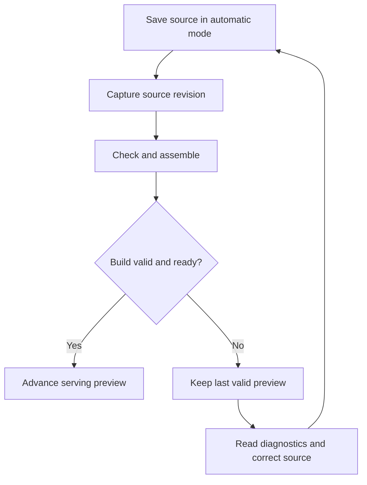

# Local development

Start a selected application locally, assign preview roles, inspect revision-bound controls, and keep source checks, example results and the serving preview aligned as you edit.

## Select and check an application

Work from the application root and select its `.can` entry source explicitly when the repository contains multiple applications:

```sh
can check Tasks.can
can compile Tasks.can
```

`check` analyzes source and reports diagnostics. `compile` performs that analysis: its default text output lists emitted module paths, while `--format=json` emits the artifact envelope to stdout. Neither writes the artifact to a named file. Use the build workflow when a platform artifact is required. A source fragment can be checked only when its dependencies and owning application context are supplied.

## Preview the app

Start the human preview using `can dev ui --source Tasks.can`. Add `--check-mode automatic` to check saved changes automatically; manual checking is the default. Use the selection flags shown by `can dev help`. The terminal reports the selected source, session status, preview address, diagnostics and available controls. `can dev ui` with no source attaches to the verified selected owner; it does not guess which app to launch. Keep the process available while using the preview.

```doc-visual
{
  "placeholder": "Find the selected source, serving revision, preview address and available controls in the development terminal.",
  "caption": "The actual local development terminal for a synthetic Tasks app, with marker 1 identifying the selected source, marker 2 the serving revision and marker 3 the preview address. The controls remain visible below the session status.",
  "alt": "Local development terminal showing the selected Tasks source, serving revision, preview address and controls",
  "production": {
    "method": "screenshot",
    "instructions": [
      "Use an installed Can toolchain with a complete synthetic Tasks.can application and its required local bindings. The operator must have local workspace read/write access and permission to start and stop this preview; no production credentials or records may be used.",
      "From that application root, run can dev ui --source Tasks.can in an interactive terminal. Keep the default manual check mode, enter check and press Enter in the development terminal, then wait for a healthy serving preview. Use only synthetic task titles and actors if any app data is visible.",
      "Record can --version, the source revision and the actual capture date in the asset notes at capture time. Do not hard-code a tool version or date into the image.",
      "Capture a 1280 by 800 terminal window in the dark theme with a readable monospace font. Retain the launch command identifying Tasks.can, the actual selected source revision, session/check status, serving revision, preview address and available input controls. Do not add labels or controls that the running tool does not display."
    ],
    "edits": [
      "Crop desktop and unrelated terminal history, keeping the complete session status and input controls legible. Remove personal workspace path prefixes without obscuring the synthetic source filename or revision values.",
      "Add sparse numbered rectangles around the selected source, serving revision and preview address. Explain those markers in the final caption using the exact captured labels; preserve all real terminal text.",
      "Check the final alt text against the capture and confirm the highlighted labels remain readable at narrow article widths."
    ]
  }
}
```

Preview requests run with the selected local app identity and its declared access rules. A hidden or disabled control is not an authorization rule: exercise the operation as both an allowed and a denied actor. Local preview state is isolated from production, but external services still require appropriate local bindings and credentials.

## Source changes and refresh

The development owner tracks source revisions and the serving build. Accepted automatic refresh captures a coherent source revision, checks and assembles it, then advances the preview only when the new build is valid. If compilation fails, the diagnostic belongs to that revision and the last valid preview remains identifiable; do not assume a failed change became live. Recheck after saving the correction and confirm the preview reports the new source revision.

A valid replacement advances the preview; a failed build leaves the previous serving revision available while you repair the source.



Local business state is retained according to the selected profile and app storage contract. A source refresh is not a schema migration and does not erase application data to make a new model fit. Schema changes that need data conversion follow [schema migrations](../12-Deploy-and-operate/03-schema-migrations.md).

## Inspect and stop a session

Use `can dev help` for the control names and required session/revision values. Status, diagnostics, example runs and failures are tied to the selected session and source revision. A stale revision refusal means the source advanced; inspect fresh status and rerun the action against the current revision. Stop only the session you own. See [development controls](../15-Tooling-reference/02-development-controls.md) for the machine protocol.

## When preview fails

First distinguish source diagnostics from tool or owner failures. A source diagnostic names the revision and location to repair. A missing or mismatched owner means selection must be resolved, not that the app source is invalid. A preview build can succeed while a particular external service is unavailable; verify that service independently and never interpret a transport receipt as a completed business action.

## Set up allowed and denied preview actors

Download [VerifiedTasks.can](../examples/verified-tasks/VerifiedTasks.can) into an application folder. It declares `reviewer`, permits members to create tasks and allows only reviewers to complete them. Start a manual preview with one reviewer:

```sh
can dev ui --source VerifiedTasks.can --preview-roles '{"Ava":["reviewer"],"Ben":[]}'
```

Use the preview's supplied local actor credentials and team selection. As Ben, create a task; as Ava, complete it. Ben's attempt to invoke completion must fail even if a client manually submits the action. These role assignments affect seeded local actors only. Production grants use the actual team's authorized role-management flow. Source `fixture checker=user {roles=[reviewer]}` belongs to isolated examples and does not grant Ava or Ben anything.

In the development terminal, enter `check` to check saved source. Use its displayed controls for the selected session; `can dev help` lists the machine commands and their payloads. For automatic checks on save, start with `--check-mode automatic`. Compare the source/check revision with the serving revision after each change: a failed replacement can leave the previous valid preview running.

## Use machine controls without guessing identifiers

From the same application directory, start a controlled session:

```sh
can dev start --source VerifiedTasks.can --app VerifiedTasks --preview-roles '{"Ava":["reviewer"],"Ben":[]}'
```

Copy the returned session identifier into `SESSION` below; replace `REVISION` with the current revision returned by status. These uppercase strings are placeholders, not literal IDs. Each command returns a JSON control envelope; inspect both `ok` and its nested result.

```sh
can dev status --session SESSION --app VerifiedTasks
can dev check --session SESSION --app VerifiedTasks --expected-revision REVISION
can dev diagnostics --session SESSION --app VerifiedTasks --revision REVISION
can dev preview.status --session SESSION --app VerifiedTasks
can dev preview.open --session SESSION --app VerifiedTasks
can dev example.run --session SESSION --app VerifiedTasks --expected-revision REVISION
can dev stop --session SESSION --app VerifiedTasks
```

Refresh status after checking or saving source; do not reuse a stale revision. Keep protected preview URLs and actor credentials out of shared logs. `preview.open` supplies access information; it does not prove that the browser loaded the current build. Stop only your owned session, including after a failed test. See [development controls](../15-Tooling-reference/02-development-controls.md) for selection flags and failure lookup.
