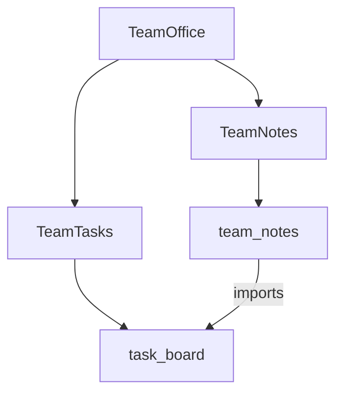

# Compose a multi-file task and note application

Build a complete three-file task-and-note application. Select packages, import exported names with aliases, share context defaults, and call the owning operation without bypassing its rules.

## Compose explicit owners

An app selects a product and its entry points. A package owns declarations, policies and operations. Files organize source; they do not create namespaces, initialization order or runtime behavior. Moving a package to another file preserves its identity.

This complete `TeamOffice` teaching project separates task ownership from linked notes. It follows the task-oriented [example progression](../01-Get-started/02-example-progression.md), but is a separate application, not a patch to the earlier single-file `Tasks` tutorial. You need the [installed toolchain](../01-Get-started/05-first-app.md) and a local preview account with team membership.

## Create the project directory

Create a directory named `team-office` with exactly these three source files. Each complete file is printed below and available in the handbook's source repository.

```text
team-office/
├── Office.can
└── packages/
    ├── Tasks.can
    └── Notes.can
```

The project root is `team-office`; `Office.can` is the entry source. The names in `uses` and `use` resolve declared identities, not filenames. There is no authored source registry or build manifest. Discovery indexes declarations under the project root; only selection and reachable dependencies determine inclusion. A nearby unrelated file is not automatically deployed.

## Select the apps and context in Office.can

[Complete Office.can](../examples/team-office/Office.can):

```can
# Manage the team's task board.
app TeamTasks uses=[task_board]
# Keep notes linked to team tasks.
app TeamNotes uses=[team_notes]
# Manage tasks and linked notes together.
app TeamOffice uses=[TeamTasks,TeamNotes]
context
 theme density=compact
```

`TeamTasks` selects the explicit `task_board` package. `TeamNotes` selects `team_notes`. `TeamOffice` composes both apps. Select exactly one app for a preview or deployment; this lesson uses `TeamOffice`.

The context immediately follows the app it configures, so compact density belongs to `TeamOffice`. The other two apps omit context. Runtime, D1 storage, email/password authentication, teams, generated MCP, the standard UI shell, system theme mode, blue accent, English locale and the standard file policy come from language defaults. Permissions still require explicit declarations.

Explicit contexts of selected apps merge before defaults apply. Identical explicit settings coalesce; incompatible explicit settings are errors. An omitted density in `TeamTasks` is not an explicit assertion of comfortable density, so it does not conflict with `TeamOffice`'s compact override. A package import does not import another app's context. Named resources are resolved through the selected app's merged context; see [context and defaults](05-context-and-defaults.md).

## Own tasks and export their operation in Tasks.can

[Complete packages/Tasks.can](../examples/team-office/packages/Tasks.can):

```can
package task_board
 Given
  export Todo {title:text trim min=1,done:bool=false}
  policy Todo read=members
 When
  crud Todo by=members fields=title delete=none
  export scenario complete(task:Todo) by=members
   require not task.done
   do set task {done=true}
 Then
  page / title="Team tasks"
   form Todo.create display=inline
   list Todo columns=title,done
    edit
    action complete
```

`task_board` owns `Todo`, its read policy, generated CRUD and `complete`. CRUD accepts only `title`; callers cannot set `done` through create or edit. Completion belongs to the guarded scenario. Deletion is disabled.

The exported model makes its type and enabled generated CRUD identities available for imports. The exported scenario makes its name available for imports. Neither export grants membership, read permission or permission to complete a task. `complete` checks `by=members` and rejects a task that is already done.

Every explicit package contains one ordered `Given`, `When`, `Then` body, even when a section is empty. A declaration is private unless exported. Keep a model's policies, invariants and canonical mutations with its owning package.

## Import aliases and call the owner in Notes.can

[Complete packages/Notes.can](../examples/team-office/packages/Notes.can):

```can
package team_notes
 use task_board {Todo as Task,complete as finish_task}
 Given
  Note {task:Task,title:text trim min=1,resolved:bool=false}
  policy Note read=members
 When
  crud Note by=members fields=task,title when=not row.resolved delete=none
  scenario resolve(note:Note) by=members
   require not note.resolved
   do
    call finish_task {task=note.task}
    set note {resolved=true}
 Then
  page /notes title="Linked notes"
   form Note.create display=inline
   list Note columns=task,title,resolved
    edit
    action resolve
```

The grouped import introduces two local names:

| Local name in team_notes | Canonical declaration | Purpose |
| --- | --- | --- |
| `Task` | `task_board.Todo` | Type of the note's required task reference |
| `finish_task` | `task_board.complete` | Operation that owns completion |

An alias does not create a new model, copy records, rename an operation or change authority. `Note.task` is a reference, not containment. Both models use default team ownership; the reference does not change either model's storage scope.

`resolve` first checks that the note is unresolved, then calls `finish_task` with its linked task. The called operation rechecks its own membership and task guard. Only after that call succeeds does the caller set `note.resolved=true`.

The notes package cannot replace the call with `set note.task {done=true}`: direct mutation of another package's model is forbidden. It also cannot add a policy that broadens the task owner's read access. Qualified spelling alone does not bypass the requirement to import a name.

Group imports with the same provider and binding. Enumerate names explicitly; wildcard imports and duplicate local names are errors. A composed app such as `TeamOffice` has no aggregate package to import: import from `task_board` or `team_notes`, the actual owners.

## Distinguish package ownership from transaction ownership

The example crosses a package ownership boundary through a canonical operation call. Both records belong to the same selected app and team-D1 authority, so the local call retains the caller and participates in the same bounded transaction. The callee's rules still apply. If completion or a final rule fails, neither the task completion nor the note resolution commits.

This does not create atomic transactions between different teams, independent storage owners or deployments. A remote operation uses a bound import with `from=deployment.name` and the asynchronous `send` path, with separate owner admission and delivery receipts. Import visibility is never remote authority. See [service bindings](../08-Connect-services/01-contracts-and-service-bindings.md) and [delivery recovery](../08-Connect-services/02-deliveries-and-recovery.md) before extending this example across deployments.

## Understand selection and dependency exposure



Selection and imports reach `task_board` twice, but include its canonical package only once. There is one task model and one completion operation in the selected deployment.

| Selected app | Product pages | Dependency behavior |
| --- | --- | --- |
| `TeamTasks` | `/` | Selects the task board; notes are not a dependency |
| `TeamNotes` | `/notes` | Imports the executable task owner internally, without automatically mounting its page or publishing all its tools |
| `TeamOffice` | `/` and `/notes` | Selects both packages and their permitted public interfaces |

An internal `call` does not by itself publish the callee as a public tool. Imported model references can require bounded authorized reads for pickers and typed inputs. An explicit imported form/action on a selected page exposes that canonical operation under its original permissions and the owner's CRUD exposure rules. Trusted handlers never become public tools.

App and package identifiers share a project-wide namespace. Duplicate identities, app-composition cycles and conflicting normalized page routes are errors. Stored-reference dependency cycles can be valid; containment, derive, hook and synchronous-call cycles are not. Imports do not give files an execution order.

## Check and preview the complete project

From inside `team-office`, check all three complete source files together:

```sh
can check Office.can packages/Tasks.can packages/Notes.can
```

A successful check reports no errors. Checking `Notes.can` without its provider is not a complete-project check. Then launch the selected app with an explicit root and entry source:

```sh
can dev ui --root . --source Office.can --app TeamOffice
```

Enter `check` in the preview terminal, wait for the serving revision, then use `open`. [Obtain access, sign in and select a team](../01-Get-started/05-first-app.md#obtain-access-and-sign-in) before exercising member operations. All three app declarations remain source choices; `--app TeamOffice` selects this session's product.

## Verify the cross-package workflow

1. On `/`, create an unfinished task titled `Prepare release notes`. Confirm `done` is false and editing exposes the title rather than a completion checkbox.
2. Open `/notes`. Create `Confirm release wording`, choosing that task in the authorized task picker. Confirm the note starts unresolved.
3. Run the note's `resolve` action. Revisit both pages: the linked task is done and the note is resolved. The operation changed each record through its own package's allowed effect.
4. Create a second note linked to the already completed task, then try to resolve it. The task owner's `require not task.done` refuses completion. The second note stays unresolved.
5. With a fresh task and note, complete the task directly before resolving the note. Resolution must still refuse; an import or an earlier page rendering cannot bypass current guards.
6. Sign out or use an account without membership in this team. Task and note operations must be denied. The import aliases confer no access.

For conflict and replay behavior, use the [transaction lesson](../06-Business-workflows/03-transactions-and-concurrency.md). Browser-generated request metadata carries protected record versions; source composition does not remove those checks.

## Preserve identities when reorganizing files

Moving `packages/Tasks.can` while keeping `package task_board` preserves `task_board.Todo` and `task_board.complete`. Renaming the package changes canonical identities and requires deliberate migration for deployed state and interfaces. A file move alone does not move data between deployments.

A small app can instead own an implicit package through its own `Given`/`When`/`Then` body. Such an app's name is also its package identity. An app with `uses` cannot also contain that implicit body, and an explicit package cannot duplicate an existing app name. Choose the ownership boundary intentionally before extracting a single-file app into differently named packages.
