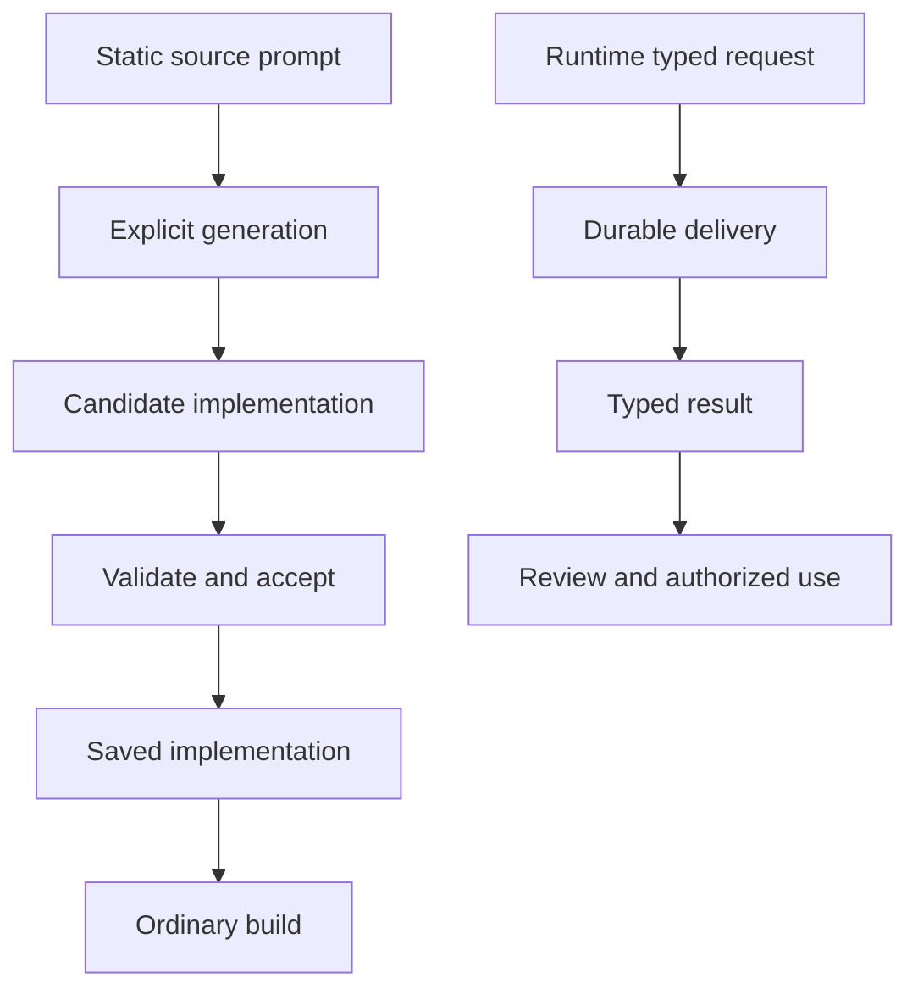

# Generate and refine a complete application

Use PromptStudio to generate traits, custom keywords, styles and views. Configure profiles, accept checked implementation, edit saved code, refine one unit and recover interrupted work.

## Before you begin

Complete [your first app](../01-Get-started/05-first-app.md) and read the [dollar syntax introduction](../02-Language-foundations/01-source-syntax.md#generate-with--and-reuse-with-name). This tutorial uses **PromptStudio**, a complete application project with source, saved implementation, settings, behavioral examples and a browser journey. The fragments below explain its source; they are not a second app to assemble by copying selected blocks.

You need the installed CanLang toolchain and an installed, authenticated coding runner supported by [generation configuration](../15-Tooling-reference/03-generation-configuration.md). Generation uses that runner's account and usage allowance. Ordinary checks, builds and preview consume saved implementation without calling a model.

The supplied project's browser checks also use Git, Node.js 22 or newer, Bun and Playwright Chromium. These are prerequisites for this example's automated browser journey, beyond the ordinary first-app preview. Keep authentication in the runner's machine configuration; never put credentials in `can.gen.toml`, prompts or generated code.

## Open the complete example project

Clone the example repository into a new directory. Install its JavaScript dependencies and the browser used by its acceptance journey, then enter the app folder:

```sh
git clone https://github.com/veighnsche/canlang.git can-generation
cd can-generation
bun install --frozen-lockfile
bunx playwright install chromium
cd tests/fixtures/prompt-pipeline
```

If you already have this checkout, use its existing `tests/fixtures/prompt-pipeline` folder instead. Keep the checkout's shared browser helper and dependency files: copying only `PromptStudio.can` omits part of this project.

| File or directory | Purpose |
| --- | --- |
| `PromptStudio.can` | All application declarations, prompts, permissions, operations and behavioral examples |
| `can.gen.toml` | Shared runner recipe and named profiles |
| `can.generated/` | Tracked implementation accepted for the source-owned generation units |
| `playwright.config.ts` and `playwright/` | The application's browser acceptance journey |
| `.can/gen/` | Ignored local work, attempts, leases and validation reports |

Open [the complete source](https://github.com/veighnsche/canlang/blob/main/tests/fixtures/prompt-pipeline/PromptStudio.can) in your editor. Run subsequent commands from this app folder. Record its absolute path with `pwd`; later JSON requests use that path as `root`.

## What is generated

PromptStudio manages items, notes and aliases. Its prompts prepare three kinds of implementation: `Given` traits and custom keywords, `Then` styles, and `Then` view renderers. The app's CRUD operations and permissions remain authored Can declarations.

`$"..."` is a static JSON string, not a runtime expression. It has no interpolation or translation suffix. `$Surface` is a named style use; named traits and keywords use bare names. The [syntax reference](../13-Language-reference/01-syntax-reference.md#dollar-prompts-and-named-styles) lists the exact placement rules.

### Named and inline model traits

Read these declarations in the project's `Given` section:

```can
trait completable $"Add the field done:bool=false to each attached model. This is a reusable model contribution."
Note {title:text title_text} completable trait $"Add pinned:bool=false to this model."
```

This excerpt depends on the project's `title_text` trait, explained next. `completable` is defined once and applied by its bare name to both `Item` and `Note` in the complete source. The inline `trait $"..."` on `Note` adds a separate `pinned` field only to that model. New notes therefore have both `done=false` and `pinned=false`.

A named trait is not applied with `$completable` or `trait completable`. Contributions are checked in source order; duplicates, incompatible targets and contradictory defaults are errors, not a prompt-resolution policy.

### Named and inline field traits

The same source defines a named text-field trait and an inline trait on one stored field:

```can
trait title_text $"Constrain each attached text field with trim, min=1 and max=80. Keep its text type and do not add a default."
Item {title:text title_text,handle:text trait $"Constrain this text field with trim, min=1 and max=40. Keep the field's text type and do not add a default."} completable
```

This excerpt also uses `completable` from the preceding example. `title_text` applies to both item and note titles. The inline handle trait belongs to `Item.handle`; it does not silently change every text field. Both forms keep their declared text type and contribute the specified validation. Traits cannot grant permissions or bypass canonical storage, versions or transactions.

### A typed custom keyword

Read the keyword definition and its two applications in `Given`:

```can
keyword canonical_identity(target:model,field:field(target,text)) $"Compute a unique key with Unicode NFKC normalization followed by ASCII A-Z lowercasing only. Preserve non-ASCII case and the stored spelling. Return the key as text. Uniqueness, permissions and transactions belong to the canonical owner."
canonical_identity target=Item field=Item.handle
canonical_identity target=Alias field=Alias.handle
```

The complete app declares `Item` and `Alias` and their text handles. The dependent parameter `field(target,text)` requires a text field belonging to the selected model. Applications supply named compile-time arguments, not another prompt. The generated normalization computes a key; the canonical owner still enforces uniqueness and performs the transaction.

For example, fullwidth `Ａlice` and ASCII `Alice` normalize to the same key, while non-ASCII case is preserved. The stored spelling remains the submitted, validated spelling. The app's seven `Alias.create` examples check these distinctions alongside validation and membership refusals. Read them before generating so the required behavior is explicit.

## Style components and render a view

### Reuse a style and attach an inline style

In `Then`, find `style Surface $"..."`. Its full prompt preserves the canonical card's surface and controls while styling owned typography and form spacing. The notes and aliases cards attach the same definition with `$Surface`.

The following excerpt from the notes page depends on the declared `Surface` style and the `Note.create` operation:

```can
card "New note" $Surface
 primary "Create note" action=Note.create fields=title
```

The root page instead has an inline `$"..."` style prompt on its `page` header. It requests a responsive item grid while preserving shared navigation, controls and validation. Compare the two placements in the complete source: a named definition supplies reusable CSS; an inline prompt belongs to one visual target.

Each eligible visual header accepts one style attachment. `primary` and `secondary` actions do not accept style attachments, and ancestor styles cannot restyle their standard controls. See [styles and custom views](03-styles-and-custom-views.md) for scope boundaries.

### Keep generated views bound to authored behavior

Find `view ItemTile(row:Item) $"..."`. Its renderer prompt asks for the complete source-owned canonical card exactly once. The authored children specify the title, handle, status, edit action, archive action and notes link. The list instantiates it with this source fragment:

```can
list Item empty="No items yet. Create your first item."
 show ItemTile {row=row}
```

This fragment belongs inside the project's page and depends on `Item` and `ItemTile`. Each `show` evaluates its row argument once. The renderer receives checked presentation inputs and canonical action bindings; it must not recreate privileged controls, add state mutations or invent network access. A generated renderer's optional root style is a separate style target.

The project also requests a browser enhancement that sets an instance marker and removes it on cleanup. This is presentation behavior; it does not create a second owner for permissions or business operations. Ordinary reusable views need no generation at all.

## Configure profiles and check the runner

Open `can.gen.toml`. Select runner/model pairs supported by your installed, authenticated runner. The following is a complete settings shape; replace both illustrative model strings before using it:

```toml
version = 1

[generation]
runner = "codex"
model = "your-compatible-model"
max_attempts = 1
timeout_seconds = 600

[generation.profiles.frontend]
runner = "codex"
model = "your-compatible-frontend-model"
```

`Given` uses the shared recipe. `Then` uses the `frontend` profile when configured, otherwise shared. Named profiles always contain both runner and model; their optional limits reuse shared limits when omitted. The shipped example also has native reasoning options: retain them only when your selected CLI/model supports them, or remove those optional native tables. Do not assume every runner accepts the same options.

An authored `agent=profile` selects a named recipe for a definition or inline prompt. For example, `style Surface agent=frontend $"..."` explicitly selects that profile. A named `$Surface` use cannot override it. A JSON request's run-level `profile` overrides declaration selection. Unknown explicit profiles fail; they do not silently fall back. Changing settings affects future attempts without invalidating compatible saved code.

To check availability without generating, save the following as `doctor.json` in the app folder. Replace `/absolute/path/to/prompt-pipeline` with the actual path printed by `pwd`:

```json
{"version":1,"request_id":"tutorial-doctor-1","operation":"doctor","root":"/absolute/path/to/prompt-pipeline"}
```

Run it through the dispatcher:

```sh
can gen --request doctor.json
```

Inspect `ok`, reported capabilities and `next` actions. Resolve authentication, model or adapter-capability failures before starting generation. A runner name alone does not prove the installed CLI supports the required protected submission or resume behavior.

## Generate and accept implementation

First inspect the plan without starting a coding agent:

```sh
can gen PromptStudio.can --dry-run
```

Check the selected units, app closure and effective recipes. Then prepare missing or changed implementation:

```sh
can gen PromptStudio.can
```

This command validates candidate implementation and accepts it only after the complete app's required checks pass. For this project that includes compilation, build, all seven behavioral examples and its browser journey. A successful runner response alone is not acceptance. If the shipped outputs are already compatible, preparation reuses and validates them without an AI call or promotion.

The generator receives immutable checked context and submits isolated candidate content. It cannot directly overwrite current implementation or accept its own output. Acceptance checks source, target contracts, current bytes and attempt state before promoting the required set together. A failed or interrupted attempt must preserve the previously accepted implementation.

To intentionally generate every prompt again, including successful styles and views, use:

```sh
can gen PromptStudio.can --retry
```

This is a fresh capture of the active app dependency closure, not a retry of only one failed file. It starts new generation work. Use the single-unit refinement below when you want a scoped change instead.

## Saved code and runtime AI

Accepted implementation lives in tracked `can.generated/<opaque-unit-id>/`. Keep the source, settings, saved files and application checks together. Work records under `.can/gen/` remain ignored. Generation does not commit source control for you.



Ordinary builds consume saved files and make zero AI calls. Runtime AI requests instead produce application data through deliveries; they do not install generated implementation. See [runtime text and image generation](../09-Runtime-AI/01-text-and-image-generation.md).

## Verify the complete application

Run the saved application checks without invoking generation:

```sh
can check PromptStudio.can
can validate PromptStudio.can
```

Require passing build, examples and browser results. The shipped journey exercises the actual protected preview, CRUD controls, generated defaults and validation, Unicode identity behavior, navigation, compact menus and responsive layout. It checks the candidate or saved source selected for the run and closes the session it owns. A missing browser dependency or setup failure is not a passing application check.

To inspect the app yourself, start its development terminal:

```sh
can dev ui --source PromptStudio.can --app PromptStudio
```

Enter `check`, wait for a serving revision, then enter `open` and follow the [sign-in and team-selection steps](../01-Get-started/05-first-app.md#obtain-access-and-sign-in). Use synthetic records:

1. On the root page, create an item with title `Review draft` and handle `review-draft`. Confirm its generated card shows the handle and Open status, with working edit and archive controls.
2. Open `/notes`, create a note, and check that its `done` and `pinned` values start false.
3. Open `/aliases`, create `Ａlice`, then try `Alice`. Expect a uniqueness conflict for the second request and preserved form input, not a second alias. Use a team without that key already present for this check.
4. Try a whitespace-only alias. Expect validation refusal. Reload and confirm permitted records persist while refused submissions created no record.
5. Inspect narrow and wide layouts, visible keyboard focus, action menus and cancellation. Styling must preserve canonical controls and the business behavior tested above.

Stop this manual preview before running another check that needs its own session. Enter `stop` in the development terminal that owns it.

## Directly edit saved implementation

A compatible edit is ordinary code editing; it does not need another model call or adoption ceremony. Coordinate the write with a lease so generation cannot promote over it.

First save and run this status request, using the same actual absolute `root`:

```json
{"version":1,"request_id":"tutorial-status-1","operation":"status","root":"/absolute/path/to/prompt-pipeline","files":["PromptStudio.can"]}
```

Save each JSON request in its own file and run it with `can gen --request FILE.json`. Use a new `request_id` for each new operation. Copy the returned ID for the `Surface` style unit; unit IDs and paths are opaque, not names to derive from the prompt.

Inspect that unit before editing:

```json
{"version":1,"request_id":"tutorial-inspect-1","operation":"inspect","root":"/absolute/path/to/prompt-pipeline","unit_id":"UNIT_ID_FROM_STATUS"}
```

Replace `UNIT_ID_FROM_STATUS` with the actual returned ID. Identify its existing CSS file, then acquire the unit's write lease:

```json
{"version":1,"request_id":"tutorial-edit-begin-1","operation":"edit.begin","root":"/absolute/path/to/prompt-pipeline","unit_id":"UNIT_ID_FROM_STATUS"}
```

Confirm `state:"editing"` and retain the returned token before writing. Make a small change to an existing owned text-spacing rule in that CSS file. Preserve scoping, shared tokens, readable labels, focus and canonical controls; do not change contribution contracts or generated interfaces for this exercise.

Release the lease even if editing fails. Replace the token placeholder with the returned token:

```json
{"version":1,"request_id":"tutorial-edit-end-1","operation":"edit.end","root":"/absolute/path/to/prompt-pipeline","token":"TOKEN_FROM_EDIT_BEGIN"}
```

Confirm `state:"released"`, then validate the saved unit without AI:

```json
{"version":1,"request_id":"tutorial-validate-1","operation":"validate","root":"/absolute/path/to/prompt-pipeline","unit_id":"UNIT_ID_FROM_STATUS"}
```

This checks the current saved implementation, not a pending candidate. Follow it with `can validate PromptStudio.can` for the whole app, examples and browser journey. A compatible byte edit is now the current implementation; it needs no `adopt` or AI regeneration. Inspect the visual result as well as the checks. If the edit fails validation, repair or restore it under a new edit lease and validate again. Unlike a rejected candidate, a direct edit has already changed current bytes.

## Refine one generated unit

Refinement starts with current code plus a new instruction. It differs from fresh generation, which starts from source intent. Inspect the selected unit and its current state before requesting a change. For the `Surface` style, save this request with the real root and unit ID:

```json
{"version":1,"request_id":"tutorial-refine-1","operation":"refine","root":"/absolute/path/to/prompt-pipeline","unit_id":"UNIT_ID_FROM_STATUS","instruction":"Improve spacing between the owned explanatory text and form content at narrow widths. Preserve the canonical card, controls, focus, shared tokens and all existing behavior. Do not add an enclosing frame.","accept":false}
```

Run the request. This creates a candidate for review without accepting it. Inspect its diff and preview through separate requests:

```json
{"version":1,"request_id":"tutorial-diff-1","operation":"diff","root":"/absolute/path/to/prompt-pipeline","unit_id":"UNIT_ID_FROM_STATUS"}
```

```json
{"version":1,"request_id":"tutorial-preview-1","operation":"preview","root":"/absolute/path/to/prompt-pipeline","unit_id":"UNIT_ID_FROM_STATUS"}
```

Use the returned checked paths and next actions to inspect the candidate; do not copy candidate bytes over current files to bypass acceptance. Confirm the change stays within the requested scope and preserves the form controls. The `preview` response shows candidate content; it does not itself establish passing browser behavior. After review, accept the selected candidate through the normal candidate validation and promotion checks:

```json
{"version":1,"request_id":"tutorial-accept-1","operation":"accept","root":"/absolute/path/to/prompt-pipeline","unit_id":"UNIT_ID_FROM_STATUS"}
```

Inspect the acceptance result and required next actions, then run `can validate PromptStudio.can` and recheck the interface. Multi-unit attempts must accept the whole required set using its returned attempt ID; do not promote individual members of a full retry independently.

If refinement changes lasting intent, update the source prompt and reconcile its source association and freshness using the [generation controls](../15-Tooling-reference/04-generation-controls.md). Otherwise a future fresh retry has only the old source intent to work from. `adopt` reconciles authored interfaces or source associations; it is not required for compatible byte edits alone.

## Recover without losing accepted work

Start with status and the failed request's envelope. Read `ok`, `state`, `error` and returned `next` actions. Preserve the actual request, session, attempt, unit and lease identifiers; do not guess replacements.

| Situation | Recovery |
| --- | --- |
| Runner cannot launch | Use `doctor`; repair authentication, recipe or required capabilities, then start a new applicable attempt. Never weaken permissions silently. |
| Candidate fails validation | Inspect diagnostics and fix its source intent or implementation. Current accepted code remains available; a model's success message does not override validation. |
| Source or current files changed during generation | Inspect fresh status. Acceptance must reject stale captured inputs; recapture the applicable work rather than forcing promotion. |
| Interrupted session | Use `resume` only if the adapter supports it and its captured inputs remain applicable. Otherwise cancel/reset the pending work and start fresh as directed. |
| Uncertain completion | Inspect status before retrying. Do not assume a timeout means no candidate or promotion exists. |
| Abandoned write lease | Confirm the writer has stopped, then use `lease.recover` with the returned lease identifier. Leases do not expire or get stolen automatically. |
| Unwanted accepted change | Use `rollback` with a retained previous revision or supported source-control revision, then validate the restored app. |

For example, an applicable interrupted session can be resumed with its actual returned session ID:

```json
{"version":1,"request_id":"tutorial-resume-1","operation":"resume","root":"/absolute/path/to/prompt-pipeline","session_id":"SESSION_ID_FROM_STATUS"}
```

To cancel that pending session, use `cancel` with the same `session_id`. Cancel and reset fence pending work without deleting current implementation. To restore retained previous code for one unit:

```json
{"version":1,"request_id":"tutorial-rollback-1","operation":"rollback","root":"/absolute/path/to/prompt-pipeline","unit_id":"UNIT_ID_FROM_STATUS","revision":"previous"}
```

Rollback requires an available retained revision and applicable checks; it is not a way to bypass current contracts. Run the full saved-app validation afterward. See [generation controls](../15-Tooling-reference/04-generation-controls.md) for exact fields, exit codes and reset/recovery selectors.

## Save and accept

Finish with source, saved implementation and application checks that agree. Review changed tracked files, keep credentials and `.can/gen/` work out of version control, and record permanent intent in `.can` rather than only in a one-time instruction.

You have exercised named and inline contributions, reusable and inline styles, a generated renderer, profile selection, explicit generation, acceptance, direct editing and candidate refinement. Continue with [editing and refinement](04-editing-and-refinement.md) for lifecycle details, or apply the same process to your own app's scoped extension.
