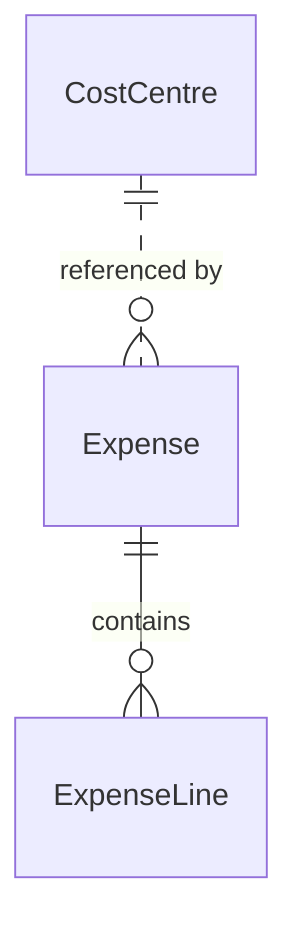

# Model expenses, references and contained records

Build an expense data model that separates shared references, contained lines and value snapshots. Compare contracts, unions and arrays, and keep ownership distinct from permission to read or change data.

## Start with a complete expense data app

This is a complete `ExpenseData` application, a data-modeling companion to the [ExpenseFlow business workflow](../01-Get-started/02-example-progression.md#follow-an-expense-through-a-business-workflow). It introduces cost centres, expense lines and payee/refund values. It is a separate application, not replacement source for ExpenseFlow or Tasks.

Save the entire listing as `ExpenseData.can`. All subsequent fragments on this page refer to declarations in this application.

```can
app ExpenseData
Given
 contract Payee {name:text trim min=1,email:email?}
 contract BankRefund {reference:text trim min=1}
 contract CardRefund {reference:text trim min=1,last_four:text min=4 max=4}
 CostCentre {code:text trim min=1 max=20 unique,name:text trim min=1}
 Expense {
  cost_centre:CostCentre,
  receipt_number:text trim min=1 max=80,
  purpose:text trim min=1 max=200,
  amount:money,
  payee:Payee,
  refund:BankRefund|CardRefund?,
  tags:text[] max=10,
  note:text?,
  status:enum(draft,submitted)=draft,
  submitted_by:user server=actor,
  recorded_at:datetime server=now
 }
 ExpenseLine in Expense {number:int min=1,description:text trim min=1,amount:money}
 policy CostCentre read=members
 policy Expense read=members
 policy ExpenseLine read=members
 unique Expense fields=cost_centre,receipt_number
 unique ExpenseLine fields=number
 invariant Expense: row.amount.minor>0
 invariant ExpenseLine: row.amount.minor>0
When
 crud CostCentre by=members fields=code,name
 crud Expense by=members fields=cost_centre,receipt_number,purpose,amount,payee,refund,tags,note
 crud ExpenseLine by=members fields=number,description,amount
 scenario add_line(expense:Expense,number:ExpenseLine.number,description:ExpenseLine.description,amount:money) by=members
  do
   create ExpenseLine {parent=expense,number,description,amount} as line
Then
 page / title="Expense records"
  form CostCentre.create display=inline
  list CostCentre columns=code,name
  form Expense.create display=inline
  list Expense columns=receipt_number,purpose,amount,status
   action add_line
   edit
   delete
   list row.ExpenseLine columns=number,description,amount
```

Run `can check ExpenseData.can`. Use the [first-app preview procedure](../01-Get-started/05-first-app.md#check-and-preview) with source `ExpenseData.can` and app `ExpenseData` to inspect it as a team member. Create a cost centre before selecting it for an expense. The row's `add_line` action supplies the selected expense to the scenario; its remaining inputs describe the child to create.

The sample teaches storage shape and record creation. Its `status` begins at draft; it does not include submission or approval operations. Each positive line amount is validated independently, and the source does not infer that their sum equals `Expense.amount`. Those are separate authored workflow and aggregate rules.

## Choose a model for independently identified records

`CostCentre` and `Expense` are stored models. Each record has canonical identity, version and metadata: `id`, `version`, `created`, `updated`, `created_by`, `updated_by` and nullable `archived_at`. These reserved names do not need fields in the schema. `Expense` denotes a model type or collection, not the currently selected expense.

Omitting `in` means team ownership. It never infers app scope or parent containment from a reference field. Explicit `Model in app` selects app-scoped ownership; explicit `Model in Parent` selects containment. There is no `in team` spelling. Selecting ownership does not create a team or grant membership.

The three read policies and member-only operations in the listing supply authority separately. Without a read policy, a model is not readable merely because it exists or appears on a page. See [operation permissions](../05-Permissions-and-policy/03-roles-and-operation-permissions.md).

## Reference shared records

`Expense.cost_centre:CostCentre` stores a reference to an existing cost centre. Many expenses can reference the same record. This relationship does not make the expense a child of that cost centre, embed a copy of its name, or grant permission to read it.

If a cost centre's name changes, an authorized read through that reference observes that record's name. Model references retain typed identity and applicable version checks; an arbitrary text ID is not a substitute for a validated reference. Owner, lifetime and admission rules still apply. New references cannot target archived records, while existing references may remain for authorized history.

Use a reference when the target has its own identity and lifecycle. Use a contract value when the expense needs its own copy of information instead.

## Declare containment

The complete app declares:

```can
ExpenseLine in Expense {number:int min=1,description:text trim min=1,amount:money}
```

This `Given` fragment requires the `Expense` model from the app. It creates an implicit required, immutable `parent:Expense` relationship. The child inherits the parent's team and storage owner. `expense.ExpenseLine` is the typed child collection of a particular bound expense; it is not a copied array.

The `add_line` scenario explicitly supplies `parent=expense` on creation. Later updates cannot move the child to another parent. A default CRUD archive of an expense includes its contained subtree. An ordinary reference to `CostCentre` does not create that containment lifecycle.



The key distinction is ownership: lines belong to their expense; cost centres are shared reference targets. Keep records that must change atomically under one compatible owner. Cross-owner coordination uses [transactions and concurrency](../06-Business-workflows/03-transactions-and-concurrency.md), not a relationship diagram that implies a distributed transaction.

## Store a contract value instead of a live reference

`Payee` is a named structural contract:

```can
contract Payee {name:text trim min=1,email:email?}
```

The expense's `payee:Payee` field stores that value, including its validated fields. A value such as the following has no independent record ID or ownership:

```can
Payee {name="Acme Travel",email="billing@example.com"}
```

This is a value expression, not a standalone declaration or a storage operation. It can be supplied where `Payee` is expected. Updating another expense's payee value does not change this one. A later source-directory update does not automatically rewrite the copy stored on the expense.

A contract does not make its stored field immutable: permitted expense updates can replace it. For evidence that must stop changing after submission, add explicit [locks and invariants](../05-Permissions-and-policy/04-invariants-and-locks.md). Do not confuse a copied value with an enforcement rule.

## Use a union for alternative value shapes

`refund:BankRefund|CardRefund?` allows either named contract or null. Each contract owns its fields. These are alternative value expressions for that field:

```can
BankRefund {reference="BANK-001"}
```

```can
CardRefund {reference="CARD-001",last_four="1234"}
```

Both alternatives have a compatible `reference` field, but only `CardRefund` has `last_four`. Narrow with `if refund is CardRefund` before reading a card-only field in that branch. Because the containing field is nullable, handle its null case as well. The declared length bounds on `last_four` enforce four characters; they do not by themselves assert four digits.

The runtime's tagged union representation identifies the selected qualified type and its value. In Can source, use the typed constructor rather than hand-writing transport tags. Unions do not turn incompatible declarations into the same type. See [types and values](../02-Language-foundations/02-types-and-values.md) and [narrowing](../02-Language-foundations/03-expressions-and-derives.md#narrow-values-before-using-them).

## Use arrays for ordered values

`tags:text[] max=10` stores up to ten text values in order, including duplicates. Omitting it on create produces an empty array. It is not a child model, an implicit set or ten separately identified records. Its `max` limits the number of entries, not each tag's text length.

For example, `["travel","client","travel"]` has three elements; it is not normalized into two unique tags. Use contract fields when each element needs a structured value with its own validation, or contained models when elements need their own record identity, edits and lifecycle. `T[]!` requires an explicit create input; `T[]?` permits a null container. Nullable elements and nested array suffixes are not supported forms.

## Apply the data contract consistently

The next lesson, [defaults and validation](02-defaults-and-validation.md), uses this same application to explain server-owned attribution, normalization, invariants and composite uniqueness. Stored references, containers and arrays still obey their own read permissions; a shape does not grant data access.

When adding these fields and relationships to an installed application, follow [schema migrations](../12-Deploy-and-operate/03-schema-migrations.md). Changing ownership or turning a reference into containment is not an ordinary field update. [History and retention](06-history-and-retention.md) explains archived records, retained keys and disposal.
