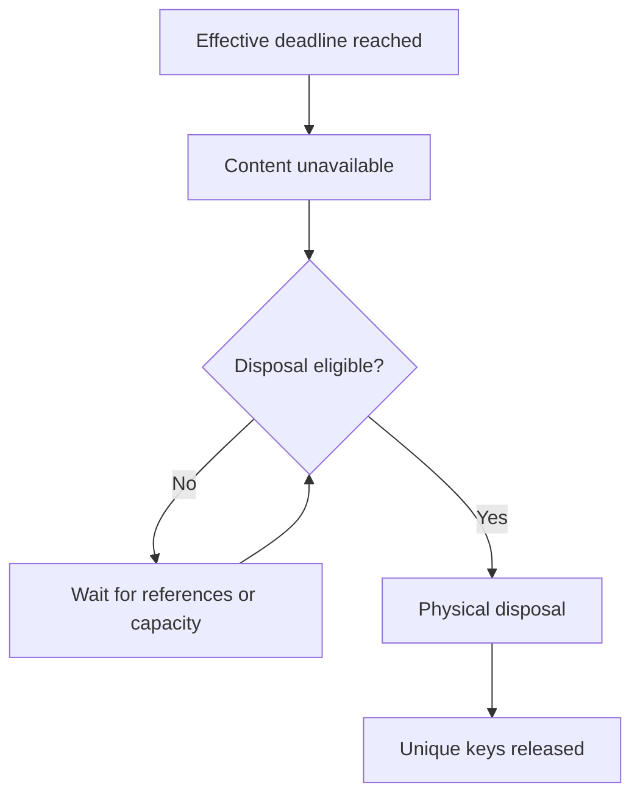

# History and retention

Distinguish business history from replay receipts, define record lifetimes, and understand why logical expiry can hide content before references permit its physical disposal.

## Distinguish history from receipts

Mutation history and operation receipts serve different purposes. History records committed business changes; receipts prevent a retried request from executing twice and retain its outcome for replay. Neither should be mistaken for a complete backup or an indefinite archive. Audit history defaults to 90 days, and longer business evidence should be modeled as records with an explicit lifetime.

## Archival and declared lifetimes

CRUD delete archives by default, including contained records. Archived data is not editable and cannot be newly referenced, but existing references may remain for authorized history. Explicit `delete=remove` permanently removes an unreferenced record/subtree; `delete=none` disables deletion. See [record lifecycle](../06-Business-workflows/01-crud-and-record-lifecycle.md).

## Declare a stable expiry deadline

`retain Model until=...` declares a pure `datetime?` deadline in `row` scope. It cannot depend on sliding `now`, caller identity, operation state, or randomness. Null gives no independent deadline; a containing parent's finite deadline still applies. A child's finite deadline cannot exceed its parent's. Expiry is irreversible: extending a deadline cannot resurrect already expired content.

At expiry, content becomes unavailable immediately even while bounded physical cleanup waits on references or storage.

### References and unique keys

Every stored incoming reference outside the removal set blocks physical removal, including archived or expired referrers. Uniqueness remains reserved until disposal; a conflicting key whose cleanup is blocked returns retryable `busy`.

### Retained outcomes and external copies

Local audit, receipt, and outbox copies obey the same declared content lifetime. A replay may return `result=null` while retaining safe outcome/identity metadata; it never reruns the mutation to recreate expired content. Locked evidence may expire under its declared lifetime. External copies or already accepted provider content cannot be recalled by local retention. Operators need visibility into blocked cleanup; see [operation](../12-Deploy-and-operate/05-operating-an-app.md).

## Expiry precedes physical disposal

A declared deadline removes content from authorized surfaces immediately. Physical removal can wait for references and bounded cleanup; waiting never restores visibility or releases a unique key early.

