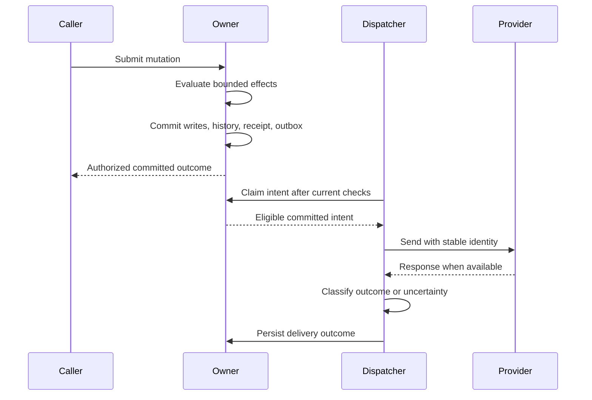

# Transactions and concurrency

Each mutation has one authoritative owner. D1 is the default; a root-bound `DurableObject` binding can place a whole related record group under one per-root SQLite authority. Children inherit the root owner. A business write touching more than one owner is rejected; cross-owner work uses explicit pending state and durable events, not a pretend distributed transaction.

## Fence writes and replay receipts

Within a D1 owner, admission uses an optimistic revision fence: read a revision before state-dependent reads, evaluate the bounded DSL, and atomically assert the revision while committing writes, constraints, history, receipt, and outbox. A mismatch rolls the batch back and retries evaluation a bounded number of times; a submitted stale record version remains a conflict. Durable Object SQLite transactions provide the local equivalent. Reads validate a consistent authorization snapshot.

Mutation identity includes app, owner/team, principal, operation, and stable operation ID. Existing receipts are checked before stale versions or business evaluation. The normalized explicitly supplied inputs are hashed with omission distinct from null; successful resolved defaults are retained separately. Same-identity same-input replay returns the recorded outcome projected through current access without rerunning effects. Different inputs conflict. Ordinary receipts remain at least seven days. Unseen identities older than 24 hours are rejected, with five minutes of future clock tolerance; an existing receipt is checked first. Receipt expiry never lets an old identity execute anew. External services remain outside the transaction: see [delivery recovery](../07-Integrations/02-deliveries-and-recovery.md).

## Commit before delivery

The owner commits business writes, history, the receipt, and external intent together. A dispatcher contacts the provider only after that commit; the saved delivery outcome remains separate from the business outcome.

The diagram follows an eligible delivery. A rejected mutation publishes no intent; a skipped dispatch does not contact the provider. Provider acceptance does not prove the business task is complete.
