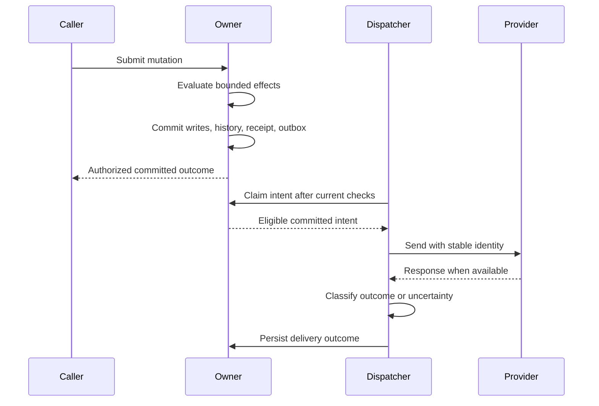

# Understand commits, rollback, conflicts and replay

Follow expense creation and batch submission through one owner transaction. Distinguish provisional changes, record-version conflicts, internal retries and replay of a previously recorded outcome.

## One mutation has one authoritative owner

Use [ExpenseOperations](02-scenarios-and-effects.md#declare-a-guarded-mutation) for the examples. `create_draft` and each top-level `submit_many` request are single mutations. A nested canonical `call` joins the same transaction and operation identity; it does not commit independently or elevate the caller.

D1 is the default owner. A root-bound Durable Object binding may place a related record group under one per-root SQLite authority; children inherit the root owner. A business write touching incompatible owners is rejected. Cross-owner work needs explicit pending state and durable events, not a pretend distributed transaction.

## Observe provisional changes and rollback

Within one transaction, effects execute in source order and later statements observe earlier provisional changes. Final invariants, locks, references and commit checks still have to pass. A `return` is not an early commit.

| Example request | Outcome |
| --- | --- |
| `create_draft` with a valid positive amount | The create and note update commit together; the returned record is projected through current access |
| `create_draft` with amount zero | The invariant rejects the resulting row; neither the create nor the note write commits |
| `submit_many` with two distinct owned drafts | Both transitions commit together |
| `submit_many` whose later item is already submitted | Its transition fails; earlier provisional transitions roll back |
| `submit_many` with more than 20 items | The work bound fails the whole request, not just the excess items |

A failed `require` normally returns `rule_failed` and rejects all provisional domain changes, events, delivery intents and attachment links. Hooks and nested calls share that outcome. An expected refusal in an example is not a partial commit. There is no catch-and-continue effect that silently preserves successful writes from a rejected batch.

## Record versions describe accepted write intent

Every new record begins at version 1 throughout its creating transaction, including further writes or create-hook adjustments. Existing mutation inputs carry the caller's expected record version.

For a stored expense at version 4:

| Action | Version behavior |
| --- | --- |
| One accepted update or archive | Reserve version 5 |
| Several writes to that expense within the same transaction | Still one increment to version 5 |
| Accepted normalized same-value write | Still advances the version and records write intent |
| Failed operation | No version advance |
| Receipt replay | No additional write or version advance |

During the transaction, ordinary references to an existing row retain their admitted version while field reads observe ordered provisional changes. A child write does not advance an unwritten parent. Locks compare protected values, not incidental modification metadata.

If Ava and Ben both read version 4, Ava's accepted write advances it to 5. Ben's new mutation carrying expected version 4 conflicts. Refresh the authorized record, reconcile the intended change, and submit a new deliberate operation if still appropriate. Do not silently overwrite newer data or relabel the old intent as current.

## Fence writes and replay receipts

A D1 mutation reads an owner revision before state-dependent reads, evaluates bounded effects, then atomically asserts that revision while committing writes, constraints, history, receipt and outbox. An owner-revision mismatch rolls the batch back and retries evaluation a bounded number of times. Durable Object SQLite transactions supply the local equivalent. Reads validate a consistent authorization snapshot.

This internal retry is different from accepting a stale client record version. A stale submitted version remains a conflict. Admission time, generated IDs and random values remain stable across internal retries so retrying evaluation does not invent a new business operation.

## Replay the same request without repeating effects

Mutation identity includes app, owner/team, principal, operation and a stable operation ID. The canonical interface carries that identity; it is not a domain field you add to `Expense`.

Receipts are checked before stale record versions or business evaluation. Normalized explicitly supplied inputs are hashed, preserving the distinction between omission and null. Successfully resolved defaults are retained separately.

| Retry situation | Result |
| --- | --- |
| Same identity and same inputs after a lost response | Return the recorded outcome under current access; do not rerun effects |
| Same identity with different inputs | Conflict; the ID cannot be repurposed |
| New identity submitting an already-submitted expense | Evaluate a new operation; the machine's draft-to-submitted edge refuses the current state |
| Replay after the caller's access changed | Reproject through current access; the old receipt is not an old permission grant |

For example, repeating a successful `create_draft` request with its same identity does not create a second expense. Creating a new identity means asking for a new operation, not checking the previous one. Preserve the original identity when recovering an uncertain response; use the canonical client's retry mechanism rather than blindly submitting a second action.

Ordinary receipts remain at least seven days, subject to the data-lifetime rules. Unseen identities older than 24 hours are rejected, with five minutes of future clock tolerance; an existing receipt is checked first. Receipt expiry does not let an old identity execute again. See [history and retention](../04-Model-and-query-data/06-history-and-retention.md) for content lifetime and replay of expired data.

## Commit before delivery

Business writes, history, the receipt and external intent commit together. A dispatcher contacts an external provider only afterward; provider response and business completion remain separate outcomes.

The diagram follows an eligible delivery. A rejected mutation publishes no intent, and a skipped dispatch does not contact the provider. External acceptance is not proof that the business task completed. Use [delivery recovery](../08-Connect-services/02-deliveries-and-recovery.md) to handle provider failures and uncertainty; a local rollback cannot recall an external effect that was already committed and dispatched by an earlier operation.

## Verify the transaction boundary

Exercise a batch with a failing later item and inspect every earlier item afterward. Submit stale versions and confirm no mutation commits. Replay a successful operation using the same identity and confirm unchanged record count/version; change its inputs under that identity and expect conflict. Check the same outcomes through [behavioral examples and joined journeys](../11-Verify-and-build/04-workflow-and-interface-testing.md), including current-access projections on replay.
