# Protect the expense lifecycle with a state machine

Declare the expense states and operation-owned transitions explicitly. Prevent direct status edits, reject invalid source states, and keep transitions inside the same rollback and version rules as other effects.

## Declare a stored machine field

The complete [ExpenseOperations app](02-scenarios-and-effects.md#declare-a-guarded-mutation) stores this field inside `Expense`:

```can
status:enum(draft,submitted,approved)=draft machine
```

This is a schema-field fragment, not a standalone declaration. The constant default establishes draft as the initial state. A machine must be a stored, nonnullable scalar enum with a constant default; arrays, server-initialized and derived fields cannot be machines.

Adding `machine` protects the lifecycle field. Ordinary `set`, CRUD patches, create inputs and hook rewrites cannot assign it. An ordinary enum without `machine` retains normal `set` behavior; merely naming a field `status` does not make it a machine.

## Declare an operation-owned transition

The application's member submission operation declares:

```can
scenario submit(expense:Expense) by=members
 require expense.submitted_by==actor
 do transition expense.status draft -> submitted
```

Its reviewer approval operation declares:

```can
scenario approve(expense:Expense) by=reviewer
 require expense.submitted_by!=actor
 do transition expense.status submitted -> approved
```

Both are `When` excerpts requiring the model, role and policies from the complete app. The transition checks the operation-owned edge and current provisional source state. The first also requires ownership; the second forbids self-approval. A transition is not a permission grant merely because its edge exists.

A source-state mismatch is a business-rule failure. Malformed edge data is validation failure. If a later guard, effect, invariant or commit check fails, the transition rolls back with the rest of the operation. In the sample, `submit_many` composes submission calls without creating new transaction boundaries.

## The declared edge

The complete app declares two edges and no implicit reverse, rejection or reopening operation:

```mermaid
stateDiagram-v2
  accTitle: Expense submission and approval
  accDescr: New expenses start in draft. The submit operation moves an owned draft to submitted, and an eligible reviewer can approve it. No other state transitions are declared; failures roll back the transaction.
  [*] --> draft
  draft --> submitted: submit
  submitted --> approved: approve
```



| Request | Expected behavior |
| --- | --- |
| Submit an owned draft | Move to submitted |
| Submit the same expense as a new request again | Refuse: current state is no longer draft |
| Approve a draft | Refuse: approval starts at submitted |
| Approve another person's submitted expense as reviewer | Move to approved |
| Update status through CRUD or `set` | Refuse direct assignment to the managed field |
| Replay a previously successful submit with the same identity and inputs | Replay its receipt; do not attempt the edge again |

Archiving a draft through `withdraw` is its record lifecycle operation, not an undeclared machine edge. The sample does not infer an approved-to-draft transition or a way to unarchive records.

## Keep snapshots and delayed work distinct

Fixture and migration snapshots can contain declared states without implying that an operation-owned edge previously ran. A submitted fixture is test setup, not evidence of a real submission event.

This is a flat lifecycle, not a hierarchical statechart: no parallel/history states, callbacks or automatic cascades. If a larger workflow leaves and later reenters the same state, a delayed completion cannot rely on the state name alone. Bind it to the relevant version or occurrence and check that identity before applying its effect. See [scheduling](07-scheduling-and-recurring-work.md) and [transactions](03-transactions-and-concurrency.md).
