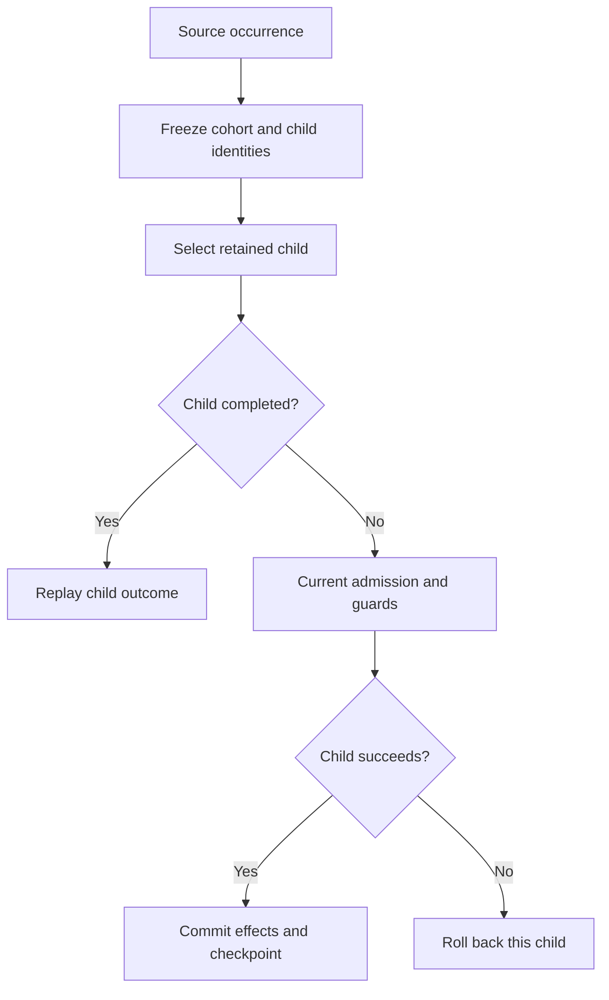

# Fanout and batch work

Choose bounded batch work or durable fanout, freeze a finite cohort, and recover independent child transactions without rerunning completed work or adding later records.

## Freeze the selected cohort

Trusted handlers may select a finite `each=` cohort of records from a declared source. The runtime freezes the complete membership for that source/handler occurrence before processing and retains stable child identities across retries. Later additions do not join a resumed cohort. Admission never silently truncates the set to a loop limit.

## Commit each child independently

Each child runs in its own bounded owner transaction with current record admission, guards, history, receipt, and checkpoint. A completed child is replayed without rerunning. A rejected child rolls back its own provisional work, while earlier committed children remain committed. Fanout is durable and recoverable, not an atomic transaction across all children or storage owners.

Use a bounded `for ... limit=N` within one operation for a small finite batch where exceeding the limit should fail the whole operation. Use durable fanout for resumable cohorts and visible per-child progress. See [events and hooks](06-events-and-hooks.md), [transactions](03-transactions-and-concurrency.md), and [live progress](../07-Build-interfaces/09-live-pages-and-progress.md).

## Resume the same cohort

Each child has its own commit boundary. After an interruption, the retained cohort and child identities let completed children replay while remaining children receive current admission checks.

Earlier committed children remain committed when another child rejects. Later records do not join this occurrence's cohort.
