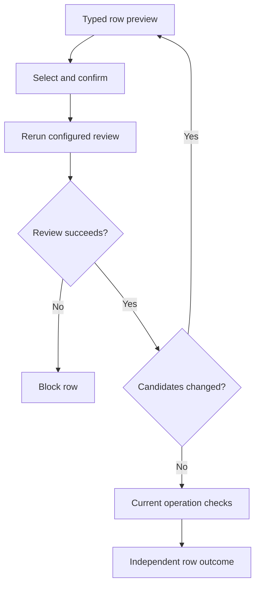

# CSV import

Import task rows through a canonical operation, review typed errors and existing candidates, confirm selected rows, and recover individual outcomes without replaying successful work.

## Review before applying

Enable intake with the source fragment `form Operation import=csv`, optionally adding `review=readOperation`. The optional review is a pure read scenario returning a model-record array; its required named parameters must be a compatible subset of the target inputs/bindings. A configured review failure blocks the row. The review request identifies the operation and structural mapping. Parse the complete supplied input under configured size and row limits; report malformed rows and ambiguous headers. Convert cells using the operation’s canonical types and validations. Show a preview with field names, normalized values and row-specific errors before asking the user to confirm.

Confirmation is explicit and scoped to the reviewed preview. Only valid selected rows are eligible. Recheck current permission and invariants for every row when applying it. Each row commits independently through the canonical operation; a failure on one row does not roll back prior successful rows or silently authorize later rows. Return per-row outcomes and a resumable recovery path without exposing protected values.

Do not treat CSV as bulk database access. Import never bypasses policy, form constraints, versions or business rules. See [forms](04-forms-and-inputs.md), [transactions](../06-Business-workflows/03-transactions-and-concurrency.md), and [fixture examples](../11-Verify-and-build/02-fixtures-and-examples.md).

```doc-visual
{
  "placeholder": "Use the CSV review to compare valid rows, errors and duplicates before committing selected rows.",
  "caption": "A synthetic CSV review before submission: marker 1 identifies the Valid, Invalid and Duplicate row statuses and details; marker 2 identifies Commit selected rows.",
  "alt": "CSV review with selectable valid rows, an invalid row, a duplicate row and the commit control",
  "production": {
    "method": "screenshot",
    "instructions": [
      "Run docs/public/examples/interface-tasks/InterfaceTasks.can with a synthetic signed-in team member. On the root page, open the add form and its CSV intake through the actual rendered control. Use the accompanying tasks.csv and create Review receipts first so its candidate match is visible.",
      "Prepare a small UTF-8 CSV with headers matching this operation’s real input paths: one valid synthetic row, an exact repeat of it, and a row violating a declared field constraint. Use harmless labels such as Sample A and Sample B and no personal data. Review the input, then stop before Commit selected rows; do not execute business mutations for the capture.",
      "Capture the actual CSV review heading, counts, row statuses, normalized inputs, field error, duplicate-row reference, valid-row selection and commit control. Keep any visible review/candidate summary; do not expose hidden consent tokens or operation identities through overlays or developer tools.",
      "Record the captured application and runtime revisions and capture date in the asset notes; do not include credentials, private addresses, session tokens or real personal data.",
      "Capture at 1280 by 800 with English interface text and the light theme. Use a focused crop so essential labels remain readable at narrow article widths."
    ],
    "edits": [
      "Crop unrelated browser and application content while retaining the review heading, counts, all three sample rows, their Detail cells and the Commit selected rows control.",
      "Add marker 1 beside the Status and Detail columns and marker 2 beside Commit selected rows. Preserve readable row labels, selection controls and actual error wording; explain both markers in the caption.",
      "Verify that only valid rows have selection controls and that the caption and alt text match the real capture."
    ]
  }
}
```

## Consent and row execution

Confirmation applies to a specific reviewed preview. Changed review candidates require renewed consent; each accepted row still passes the owning operation’s current checks and commits independently.



A configured review failure blocks that row. Keep succeeded, failed, pending and unknown outcomes distinct when recovering.

## Pinned CSV profile

Input is UTF-8, optionally beginning with a BOM, with a required header, comma separators, doubled quotes and CRLF or LF record boundaries; quoted newlines are preserved. There is no delimiter or locale guessing and no formula evaluation. One review accepts at most 10 MiB and 1,000 data rows. Input is transient intake data, not an attachable file or an upload-policy bypass.

Template headers use stable input paths. Unknown/duplicate headers and overlapping mappings must be corrected or excluded. Bound parent, record and identity inputs cannot be replaced by CSV. References and expected versions use authorized reference controls; a display label does not silently choose a record. Empty nullable cells become null; nonnullable text keeps empty text and then applies constraints. Omitted columns use ordinary defaults or report required-input errors. Integers/decimals use canonical decimal text, booleans `true`/`false`, enums stable case names, and dates/instants their canonical forms. Money and references use typed leaf columns such as `amount.minor`, `amount.currency`, `customer.id` and `customer.version`; arrays/structural values use closed typed JSON. File, secret and action cells cannot supply opaque authority: use protected bindings or ordinary authorized controls.

Exact repeated normalized rows are flagged. Candidate matches come from the optional review, with no automatic merge, upsert or role transfer. Confirmation submits selected rows in source order, retaining one operation identity and frozen inputs per row. Report succeeded, failed, pending and unknown separately. Retry retains that identity; changing a successful row requires a new reviewed invocation. Before each submission, rerun the configured review: changed candidates require renewed confirmation, while unchanged matches still require the recorded explicit create decision. Review does not lock out concurrent duplicates; owning guards and uniqueness rules remain authoritative.

Draft review state is private to the authenticated user/app/team and expires after 24 hours. Logout or context loss immediately revokes access. Recover only authorized drafts; receipt retention follows its independent replay contract.

## Import tasks with a duplicate review

[InterfaceTasks.can](../examples/interface-tasks/InterfaceTasks.can) is a complete app shared by these interface lessons. Download it and [tasks.csv](../examples/interface-tasks/tasks.csv), then follow [the first-app setup](../01-Get-started/05-first-app.md). Sign in as a member of a test team. The CSV needs no provider integration or file-storage setup: intake is transient data, not an attachment.

The app's `Todo.title` is trimmed, nonblank, at most 120 characters and unique. Its `add` scenario creates one task. This excerpt belongs in `When`:

```can
scenario matching(title:Todo.title) read=true -> Todo[] by=members
 do return (Todo as task where task.title==title)
scenario add(title:Todo.title) by=members -> Todo
 do
  create Todo {title} as task
  return task
```

The canonical form enables CSV intake and uses that pure read to identify existing candidates. This excerpt belongs on the app's `/` page in `Then`:

```can
form add import=csv review=matching
 input title
```

The review uses the same normalized `title` input as the create operation. It neither merges records nor overrides the model's unique constraint.

## Preview, select and commit the sample

The supplied UTF-8 CSV contains four data rows:

```csv
title
Prepare demo
Review receipts
Prepare demo
""
```

1. First create “Review receipts” with the ordinary single-task form. This establishes a real existing candidate for the review scenario.
2. Open the form's CSV intake, select the sample file or paste its contents, and map the `title` header to `title`. Review the entire preview before submitting anything.
3. Observe “Prepare demo” as a valid new row, its repeated row as a duplicate, the blank title as invalid, and “Review receipts” with its existing candidate. Duplicate input detection and database candidate matching are different checks.
4. Select only the first “Prepare demo” row and confirm the reviewed selection. Inspect its per-row success and the resulting task table. Do not select the existing-title row expecting an upsert: `add` creates, and the unique constraint refuses a duplicate.
5. Correct the blank row to a new title in the input and make a new preview if you want to import it. Changed inputs require a new reviewed invocation.

If another member creates the same title between review and commit, the candidate review or authoritative uniqueness check prevents an unnoticed duplicate. A failed configured review blocks that row. Changed candidates require fresh consent; a previous preview is not continuing permission to create.

## Recover without replaying successful rows

Inspect every row's outcome. If the response is lost, recover the authorized draft and retry the pending/unknown row with its retained identity; do not paste the whole file into a new import to discover whether it worked. Successfully committed rows remain committed when a later row fails. Corrected input is a new reviewed attempt, not a retry with changed arguments under an old identity.

Verify that the table contains one “Prepare demo”, that the blank title created nothing, and that the existing “Review receipts” was neither replaced nor silently merged. Then use [export and print](08-export-and-print.md) to inspect the authorized results.
