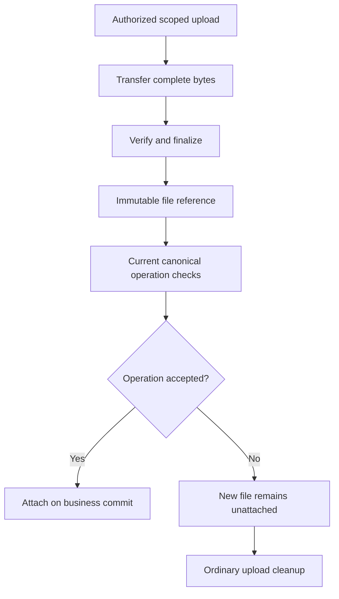

# Files and attachments

Files move through authorized upload, finalization, attachment and download steps; metadata references never substitute for custody of the bytes.

## Lifecycle

An upload begins under the shared file policy or an explicit context override, with a bounded type and size. The default is PDF/PNG/JPEG/plain text and 10 MiB per file; context files supplies only actual types/max differences. Runtime file use implies the app’s R2 store without an authored R2 declaration. The server issues a scoped upload capability; after bytes arrive, finalization verifies the stored object and produces an immutable finalized reference. An operation then attaches that reference to a model field under its normal permission and invariant checks. Abandoned uploads are not visible as attached evidence.

Uploading bytes does not attach evidence. Finalization establishes the file reference; the owning operation separately decides whether it may be attached, and each download checks current access.

Downloads resolve the reference against current record and file permission. Never expose a permanent public object URL for private content. Replacing a file creates a new version/reference; it does not mutate the old evidence in place. Preserve provenance linking the bytes to the operation and record that accepted them.

Retention applies to bytes and metadata under the declared policy. Logical expiry or archival precedes physical disposal where required; disposal can be delayed and must be observable. See [forms](../06-Interfaces/03-forms-and-inputs.md), [history and retention](../03-Data/06-history-and-retention.md), and [approval recipe](../11-Recipes/01-approval-workflow.md).
