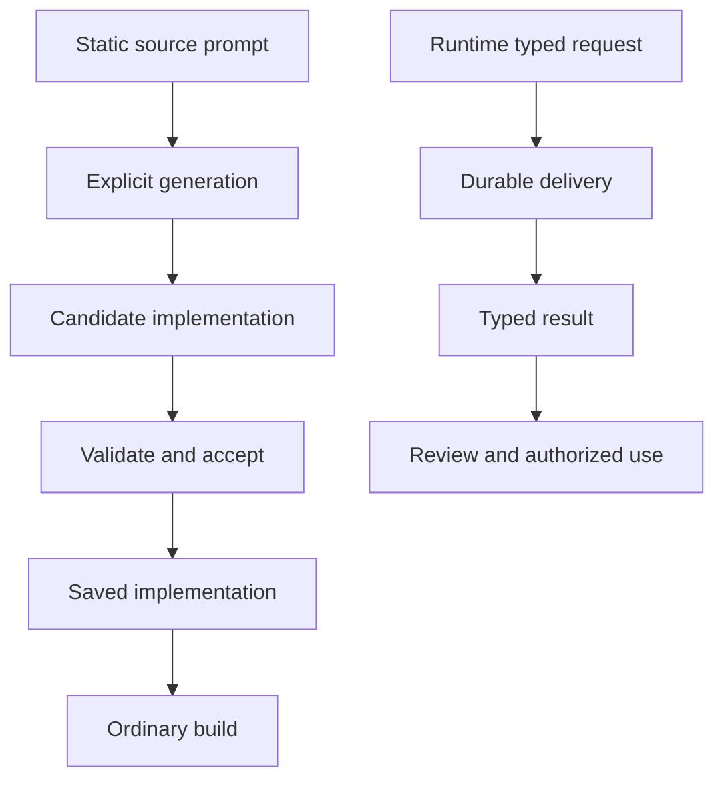

# Generation lifecycle

Can records static generation intent in source, invokes a configured coding CLI only through explicit generation preparation, and saves accepted implementation for ordinary builds.

## What is generated

Generation has three categories: Given model/field traits and named standalone keywords; Then styles; and custom view renderers. Ordinary `When` scenarios and handlers remain authored Can `do` bodies with their declared guards, effects and examples. Runtime AI calls are a separate capability.

The `$"…"` literal marks a static generation prompt. It is not interpolation or a runtime expression. Omitting `agent` selects the shared recipe, with `frontend` used for Then when configured. A normal check/build makes zero AI calls and consumes current saved files.

## Saved code and runtime AI

Build-time generation prepares implementation that must be validated and accepted before ordinary builds consume it. Runtime AI instead returns application data through durable deliveries; its output does not promote saved implementation.

Ordinary builds make zero AI calls. See [runtime text and image generation](../07-Integrations/07-text-and-image-generation.md) for request bounds and progress.

## Save and accept

Generate produces candidates. Validate against the checked contract and target, then accept through the fenced promotion protocol. Saved files remain in tracked `can.generated/<opaque-unit-id>/`; work records and leases are under ignored `.can/gen/`. Direct edits are supported and builds use them. A failed or incomplete full retry preserves all current groups. No generation operation commits source control automatically. See [Given extensions](02-traits-and-custom-keywords.md), [styles and views](03-styles-and-custom-views.md), [refinement](04-editing-and-refinement.md), and [generation controls](../12-Reference/03-generation-controls.md).
