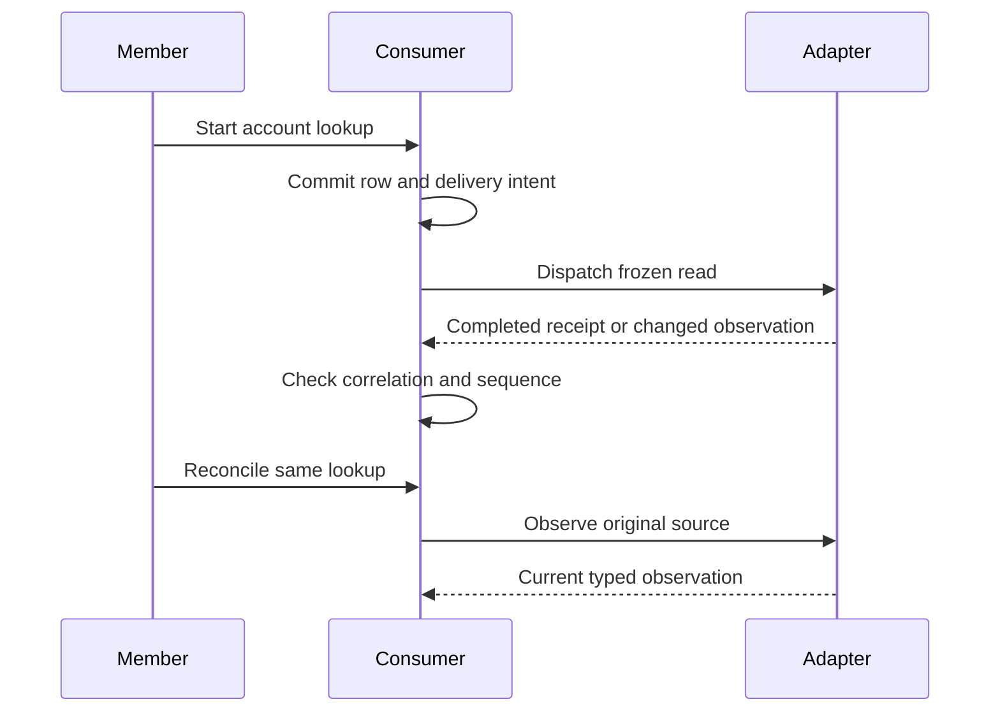

# Connect an account lookup service from request to recovery

Build a complete account-lookup consumer with a typed capability, deployment binding, durable request and stored receipt. Follow verified progress, completion and reconciliation through an authorized page.

## Before you begin

This is a focused account-read integration in the CanSync learning path. It is a separate teaching application, not the larger CRM correction workflow. It never writes remote account data. Its `lookup_api.AccountsV1` contract is defined below for this example; it is not an automatically installed standard service or an alias for another AccountsV1 declaration.

You need the [installed toolchain](../01-Get-started/05-first-app.md), an authenticated team member and a test adapter implementing this exact versioned capability. The adapter must expose a synthetic account namespace and verified event/completion ingress. Obtain that adapter and its deployment configuration from the service owner before trying live requests. Declaring a capability does not generate its provider implementation.

Use this directory, with both complete files below:

```text
account-lookup/
├── Accounts.can
└── Lookup.can
```

## Declare the provider interface in Accounts.can

[Complete Accounts.can](../examples/account-lookup/Accounts.can):

```can
package lookup_api
 Given
  export contract Observation {source:text,sequence:int min=1,state:enum(queued,running,found,missing,failed,unknown),completed:int min=0,name:text?,detail:text?}
  export capability AccountsV1 version=1
   read(source:text,account:text) -> Observation
   reconcile(source:text) -> Observation
   event changed {value:Observation}
 When
 Then
```

`Observation` is structural data. The capability names two operations and one verified event. `read` starts or retrieves the lookup identified by source; `reconcile` observes that same logical lookup without starting a replacement. Their `-> Observation` result is the eventual provider result, not the immediate enqueue receipt.

For this contract, the adapter implements these explicit rules:

| Contract fact | Required behavior |
| --- | --- |
| Source identity | Unique within the configured app/team/provider namespace; repeating read with the same source/account observes the same lookup; changed account under that source is rejected |
| `sequence` | Positive and monotonically increasing for changed observations; identical sequence means identical content |
| `state` | queued/running/unknown are unresolved; found/missing/failed are terminal observations of this read workflow |
| `completed` | Number of provider lookup stages completed, not a percentage or transport retry count; nondecreasing for a source |
| `name` | Nonnull only for found; null for all other states |
| `detail` | Nullable safe human explanation, never credentials or raw provider payloads |
| Terminal observation | Immutable; no later running/unknown observation may replace it |
| `changed` | Authenticated, schema-validated event for the configured namespace, carrying the same source and sequence contract |
| Reconciliation | Reads the original provider identity; an unavailable answer remains unknown rather than creating a new lookup |

These semantics belong to the adapter's implementation of this declared interface. A successful HTTP response is insufficient if its body violates the schema or its provenance cannot be established. The consumer's invariant also checks source/name consistency before storing a snapshot.

## Bind and consume the service in Lookup.can

[Complete Lookup.can](../examples/account-lookup/Lookup.can):

```can
# Look up remote accounts and retain their verified progress.
app AccountLookup uses=[lookup]
package lookup
 use lookup_api {Observation}
 use lookup_api {AccountsV1 as Remote} from=deployment.accounts
 Given
  Lookup {account:text trim min=1,source:text unique,requested_by:user server=actor,request:delivery(Remote.read)?,reconciliation:delivery(Remote.reconcile)?,snapshot:Observation?}
  policy Lookup read=row.requested_by==actor
  invariant Lookup: row.snapshot==null or (row.snapshot.source==row.source and ((row.snapshot.state==found and row.snapshot.name!=null) or (row.snapshot.state!=found and row.snapshot.name==null)))
  lock Lookup fields=account,source,requested_by,request
 When
  scenario start(account:text) by=members
   do
    create Lookup {account,source=operation.id} as lookup
    send Remote.read {source=lookup.source,account=lookup.account} as request
    set lookup {request}
  scenario reconcile(lookup:Lookup) by=members
   require lookup.requested_by==actor and lookup.request!=null
   require lookup.snapshot==null or lookup.snapshot.state in [queued,running,unknown]
   require lookup.reconciliation==null or lookup.reconciliation.status!=pending
   do
    send Remote.reconcile {source=lookup.source} as reconciliation
    set lookup {reconciliation}
  scenario completed on=Remote.read.completed
   do
    for lookup in Lookup as item where item.request?.id==event.delivery_id limit=1
     if event.status==succeeded and event.result!=null
      require event.result.source==lookup.source
      if lookup.snapshot==null or (event.result.sequence>lookup.snapshot.sequence and lookup.snapshot.state in [queued,running,unknown])
       set lookup {snapshot=event.result}
  scenario reconciled on=Remote.reconcile.completed
   do
    for lookup in Lookup as item where item.reconciliation?.id==event.delivery_id limit=1
     if event.status==succeeded and event.result!=null
      require event.result.source==lookup.source
      if lookup.snapshot==null or (event.result.sequence>lookup.snapshot.sequence and lookup.snapshot.state in [queued,running,unknown])
       set lookup {snapshot=event.result}
  scenario progressed on=Remote.changed
   do
    for lookup in Lookup as item where item.source==event.value.source limit=1
     if lookup.snapshot==null or (event.value.sequence>lookup.snapshot.sequence and lookup.snapshot.state in [queued,running,unknown])
      set lookup {snapshot=event.value}
 Then
  page / title="Account lookups" poll=2s
   form start display=inline
   list Lookup columns=account,request.status,reconciliation.status
    card "Verified remote observation"
     require row.snapshot!=null
     text row.snapshot.state,row.snapshot.completed
     text row.snapshot.name,row.snapshot.detail
    card "Delivery diagnostic"
     require row.request!=null and row.request.error!=null
     text row.request.error.message
    action reconcile
    pagination
```

The unbound `use lookup_api {Observation}` imports the structural type. The separate bound import selects `AccountsV1` as `Remote` through `deployment.accounts`. They are separate groups because only the capability group has a deployment binding. The interface package contains no business state or public pages.

`AccountLookup` selects the consumer package. `Lookup` belongs to the selected team's storage owner; `requested_by` records the initiating member. Its read policy grants each requester access only to their own lookup rows. There is no public CRUD that lets a caller forge a snapshot, receipt or source ID.

## Configure the deployment binding

Install the implementation as the `accounts` deployment binding using the environment's supported configuration workflow. Follow [environments and secrets](../12-Deploy-and-operate/01-environments-and-secrets.md); this example deliberately does not invent provider URLs, credential names or a universal adapter installation command.

The service owner must supply a concrete mapping for all of these points:

1. Pin the compatible `lookup_api.AccountsV1` version and reachable `Observation` schema to the implementation.
2. Map read/reconcile inputs to the synthetic provider namespace and retain source, frozen account and stable delivery/provider identities. Do not infer team authority from account text.
3. Keep credentials server-side. Authenticate provider completions and changed events, constrain them to the configured namespace and validate their complete typed payloads.
4. Map successful operation results to `Remote.read.completed` or `Remote.reconcile.completed`, including the originating delivery ID. Map domain progress separately to `Remote.changed`.
5. Preserve sequencing, duplicate handling, immutable terminal observations and uncertain outcomes. Reconciliation must query original work without resubmitting read as a new intent.

Unknown implementations or incompatible contracts fail deployment. A source file, a secret value or a matching capability name by itself is not a configured connection.

## Commit the request and its association together

`start` creates a lookup with `source=operation.id`, then sends the normalized stored account and associates the returned delivery with that record. The source transaction commits the row, frozen request and association together. A rollback publishes no send intent.

The `request` field has type `delivery(Remote.read)?`. It is not an Observation or a free-form text ID. `send ... as request` yields the protected association immediately within the transaction; it cannot yield a synchronous remote account name. The locked source/account/request keep this row tied to its original lookup.

An uncertain response to start must replay the original user operation identity and inputs. Pressing Start as a new operation deliberately creates another source and lookup, so it is not the recovery path for the earlier request.

## Observe progress and apply completion



The read completion handler locates the stored request by `event.delivery_id`, then verifies `event.result.source`. The changed-event handler uses the adapter-authenticated source identity. Both accept only the first observation or a higher sequence while the current snapshot remains unresolved. Duplicate/older observations do not overwrite it; terminal observations stay terminal.

Each handler runs later in its own owner transaction with trusted source authority and `actor=null`. A failure to apply a snapshot cannot retroactively roll back the member's start. The query is bounded to one row; the unique source and one stored original request establish that correlation boundary.

The page's `poll=2s` performs authorized rereads. It does not start more lookups or trigger reconcile. `request.status` displays transport status, while `snapshot.state` and `snapshot.completed` display this capability's domain observation. This custom contract does not automatically supply generic `request.progress`; observable standard operations can expose their separately declared progress type.

A request can therefore have status succeeded while its Observation says running. That means the provider returned a valid running observation, not that the account has been found. Later changed events or reconciliation establish the terminal domain result.

## Reconcile uncertainty without replacing the request

The reconcile action checks the requester, requires an original request and rejects an already-terminal snapshot. It permits at most one pending reconciliation association. It sends `Remote.reconcile` with the original source and stores a separate `delivery(Remote.reconcile)?` association.

The reconciliation completion handler matches that association's delivery ID and the original source before applying a newer observation. An older reconciliation completion cannot overwrite the currently selected reconciliation. Replacing that association does not cancel or erase an earlier attempt; the original read request is never replaced.

If reconcile itself fails or remains unknown, preserve uncertainty and inspect the safe receipt status/diagnostics. Do not infer that the lookup never ran. A new deliberate reconciliation may observe the same source once the previous reconciliation is no longer pending. This read-only exercise avoids remote write duplication, but still teaches the identity rules needed before adding payments or external writes.

## Present only authorized state

The list uses the requester's ordinary row policy. Its snapshot card is absent until an observation exists, and the diagnostic card reads only a present safe error message. The record grant does not allow raw provider payloads or credentials to be rendered. Receipt contents additionally obey their own disclosure and retention boundaries.

Receipt status/progress updates do not increment the referring Lookup row's version. The explicit handler's `set lookup {snapshot=...}` is a business write and does. The page keeps those two kinds of changes separate. A retained succeeded summary with redacted/expired result content is not permission to rerun the provider request.

## Check and exercise the integration

From `account-lookup`, check both sources together:

```sh
can check Lookup.can Accounts.can
can dev ui --root . --source Lookup.can --app AccountLookup
```

Enter `check`, wait for the serving revision, then use `open`. Live steps require the configured test adapter; source checking proves neither connectivity nor provider behavior.

1. Start a lookup for a synthetic account supplied by the adapter owner. Confirm a row appears with its original request status.
2. Have the test service produce queued/running observations and then found with a synthetic name. Confirm progress/state update without another Start, and that succeeded transport is not prematurely displayed as found.
3. Deliver the same event twice and an older sequence afterward. Confirm the newer snapshot survives. Exercise malformed or wrong-namespace ingress through adapter tests and confirm it is rejected before it becomes trusted event authority.
4. Use a second team member. Confirm the first member's lookup, snapshot and diagnostics are not readable, and reconcile fails its requester guard.
5. Simulate a lost provider response. Keep the original source and use Reconcile. Confirm a known observation can settle the UI; an unavailable answer remains unknown.
6. Delay a reconciliation completion while a newer changed event arrives. Confirm the lower sequence cannot overwrite the newer result. A later running snapshot cannot reopen a terminal found result.
7. Confirm `reconciliation.status` and the domain snapshot remain distinguishable if reconciliation transport fails. Inspect the original request rather than submitting Start again.

See [delivery recovery](02-deliveries-and-recovery.md) for the full status/error matrix, replay and redaction rules. The broader CanSync correction workflow adds reviewed remote writes; this read walkthrough does not grant or imply those capabilities.

## Native resources

The application’s D1 database is the default business store; an explicit model `at=` can route an owner to a declared Durable Object binding. A declared typed queue uses `queue Jobs type=Work`; publish with `send Jobs.publish {value=expression} as attempt` and consume through its typed `on=Jobs` delivery handler. A `cache KV ttl=5m` binding is only for explicitly public, reconstructible presentation assets or results. Never cache permission decisions, sessions, receipts, invariants or private business authority. Cache expiry or loss must be safe because the value can be rebuilt.

Declare analytics with a named typed schema and emit through its declared write operation. Telemetry is not billing, audit history or business state. Quotas and provider resource mapping are deployment concerns. Credentials stay in environment secret bindings, never source or generated browser assets.
