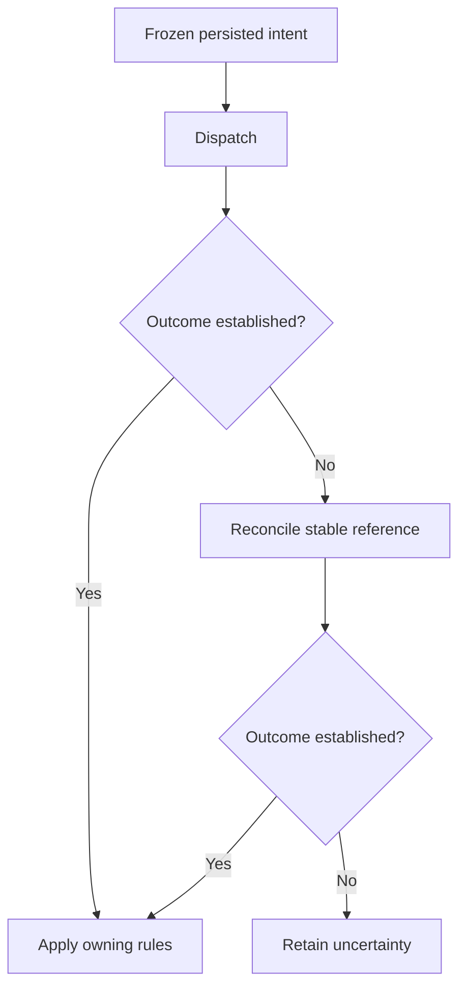

# Deliveries and recovery

Distinguish durable request identity, transport status and domain completion. Use the account lookup example to follow stored associations, sequenced observations and safe recovery after uncertain outcomes.

## Persisted intent

A send stores a frozen typed request and stable identity before dispatch. The returned `delivery(Target.operation)` association can be queried for status and progress. A provider completion arrives later as a typed completion envelope; handlers validate it and apply any business result through ordinary authorized operations.

## Retries and uncertainty

Queues and providers may deliver more than once or out of order. Use stable idempotency identities, sequence checks, frozen recipients/values and current-state guards. A timeout or lost receipt is uncertain, not proof of failure or success. Reconcile against the provider’s stable reference before retrying an action that could duplicate a payment, message or job. Cancellation requests do not prove the provider stopped.

Keep uncertainty visible until reconciliation establishes an outcome. A failed delivery can follow remote effects, so its error alone cannot authorize resending.

External service commits are not atomic with a database transaction. Preserve pending work and report safe failure details; never claim exactly-once delivery. Typed queue publication follows the same durable intent/recovery principles. See [concurrency](../06-Business-workflows/03-transactions-and-concurrency.md) and [scheduling](../06-Business-workflows/07-scheduling-and-recurring-work.md).

## Receipt and completion fields

An associated delivery exposes immutable `id` and currently authorized `status`, `result` and `error`; observable original operations additionally expose nullable typed `progress`. Status is `pending`, `succeeded`, `failed`, `unknown` or `skipped`. There is no generic cancelled receipt status: provider-confirmed cancellation can be a domain run state. `DeliveryError` is exactly `{code:text,message:text}`, both safe required fields; it has no retryable/details/provider-body fields.

A succeeded completion carries the declared result and null error; failed carries null result and a safe error; unknown carries null result and a safe diagnostic error or null; skipped carries null result/error. Pending is a receipt, not a completion occurrence. A nullable/no-result operation follows its declared result type. Invalid provider result schemas fail delivery even if remote effects may already have occurred; failed alone therefore does not prove safe resubmission. A valid result may itself report pending or unavailable business work.

Receipt progress updates do not version or rewrite the referring business row. Replacing an association neither cancels nor erases the prior attempt. Explicit completion handlers compare the current association ID to event.delivery_id before applying current source/revision/business checks. Result redaction can later leave a succeeded safe summary with unavailable content; never rerun work to refill it.

## Follow the complete account lookup

The [two-file walkthrough](01-contracts-and-service-bindings.md) connects these rules to real source. `Lookup.request` retains the original read association; `Lookup.reconciliation` retains the latest observation request; `Lookup.snapshot` is explicitly applied business state.

| Observation | Meaning in AccountLookup | Next step |
| --- | --- | --- |
| request is null | No original association is stored | Do not manufacture a receipt from text |
| request.status is pending | Dispatch/completion remains pending | Observe; do not start a duplicate lookup |
| request.status is succeeded; snapshot.state is running | A valid provider result reported continuing work | Await verified changed events or reconcile the same source |
| request.status is unknown | Remote acceptance/result is uncertain | Reconcile original source; keep uncertainty visible |
| request.status is failed | Delivery or typed-result validation failed | Inspect safe error; failure does not prove no remote effect |
| snapshot.state is found | Verified terminal account result is stored | Present the authorized name |
| snapshot.state is missing | Provider definitively reported no account | Show that domain result, not a transport error |
| reconciliation is failed/unknown | Recovery observation did not establish certainty | Keep original request and last valid observation |

A `Remote.read.completed` occurrence carries `delivery_id`, `status`, nullable typed `result` and nullable safe `error`. The handler compares the originating association ID, not the account's display name. `Remote.changed` instead follows this capability's explicitly declared `value:Observation` event schema. They are different sources with different correlation inputs.

## Keep errors safe and outcomes typed

For a failed completion, a safe error can be represented as `{"code":"provider_unavailable","message":"Account lookup is temporarily unavailable."}` only if that classification belongs to the installed versioned adapter mapping. This illustrates the closed two-field shape; it is not a universal provider-code enum. Never branch on localized message text or add undocumented retryable/details/raw-response fields.

A terminal domain failed observation is also distinct from a failed delivery. In AccountLookup, it is a valid Observation result with its own source and sequence. A succeeded delivery can carry that result without claiming the domain operation succeeded. Conversely, a malformed result may fail delivery after remote work already happened.

## Recover at the correct boundary

- **Unknown user response:** replay the same original user operation identity and supplied inputs, resolving its receipt before beginning a new intent.
- **Transient transport retry:** retry the original durable delivery with its stable identity and frozen request.
- **Domain reconciliation:** send the declared reconcile operation for the original source; retain its separate receipt and verify its resulting observation.
- **Failed completion handler:** recover the same handler occurrence under ordinary transaction/replay rules; do not resend the external operation merely to rerun local application logic.
- **Redacted or expired result:** retain the permitted safe status summary; never reconstruct private content by rerunning completed work.

Cancellation or replacing a record's association is not proof that a provider stopped. External commits and source-owner transactions do not share an atomic boundary. Use explicit domain rules for any new attempt after a known terminal outcome.
