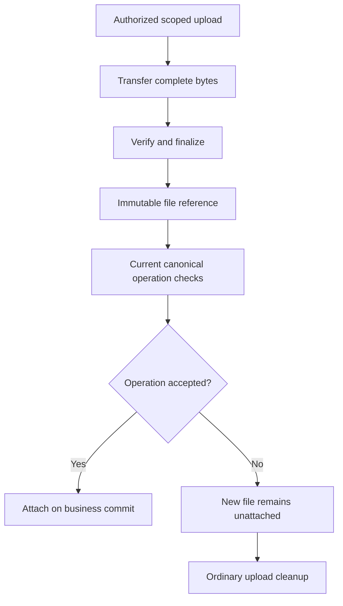

# Files and attachments

Upload a real sample file, finalize its immutable reference and attach it through a private receipt form. Verify replacement, access and conflict behavior without treating a URL or unfinished upload as evidence.

## Lifecycle

An upload begins under the shared file policy or an explicit context override, with a bounded type and size. The default is PDF/PNG/JPEG/plain text and 10 MiB per file; context files supplies only actual types/max differences. Runtime file use implies the app’s R2 store without an authored R2 declaration. The server issues a scoped upload capability; after bytes arrive, finalization verifies the stored object and produces an immutable finalized reference. An operation then attaches that reference to a model field under its normal permission and invariant checks. Abandoned uploads are not visible as attached evidence.

Uploading bytes does not attach evidence. Finalization establishes the file reference; the owning operation separately decides whether it may be attached, and each download checks current access.



Downloads resolve the reference against current record and file permission. Never expose a permanent public object URL for private content. Replacing a file creates a new version/reference; it does not mutate the old evidence in place. Preserve provenance linking the bytes to the operation and record that accepted them.

Retention applies to bytes and metadata under the declared policy. Logical expiry or archival precedes physical disposal where required; disposal can be delayed and must be observable. See [forms](../07-Build-interfaces/04-forms-and-inputs.md), [history and retention](../04-Model-and-query-data/06-history-and-retention.md), and [approval recipe](../10-Recipes/01-approval-workflow.md).


## Run a complete private receipt app

Save [ReceiptFiles.can](../examples/files-mail-payments/ReceiptFiles.can), and download or copy [receipt-sample.txt](../examples/files-mail-payments/receipt-sample.txt) as a local file to choose in the browser. Both contain synthetic data only.

```can
# Attach finalized evidence to a private receipt record.
app ReceiptFiles
Given
 Receipt {title:text trim min=1,evidence:file,owner:user server=actor}
 policy Receipt read=row.owner==actor
When
 crud Receipt by=members fields=title,evidence when=row.owner==actor
Then
 page / title="Receipt evidence"
  form Receipt.create display=inline
   input title
   file_input evidence
   primary "Save receipt" submit=true
  list Receipt columns=title
   link target=row.evidence caption="Open evidence"
   edit fields=title,evidence
   delete
   pagination
```

Use the [installed toolchain](../01-Get-started/05-first-app.md). Run `can check ReceiptFiles.can`, then `can dev ui --root . --source ReceiptFiles.can --app ReceiptFiles`. Check the preview revision, open it, sign in and select a team. The preview/deployment must provision the runtime's file store; there is no provider adapter to invent for ordinary file upload.

The default types and 10 MiB limit already admit this plain-text sample, so the app declares no context override. The owner is server-initialized; a caller cannot submit another owner. The read policy and CRUD guard restrict record access to that owner.

## Upload, finalize and attach the sample

1. Enter `Stationery receipt DEMO-001` as the title and choose `receipt-sample.txt` in evidence. Its sample total is EUR 12.50; the application stores the file, not an inferred financial transaction.
2. The canonical control obtains a scoped upload intent for `ReceiptFiles.Receipt.create` and its evidence input, transfers the actual bytes and finalizes them. Wait for successful file validation. A failed/partial upload is not a usable file value.
3. Choose Save receipt. The owning create operation rechecks access, input and finalized-file attachment permission before committing the new record.
4. Open evidence from the saved row. The runtime resolves a current authorized file download; the source never stores a public bucket URL.

For a supporting host that uses the upload bridge, the sequence is the same:

| Step | Public bridge action | Observable result |
| --- | --- | --- |
| Intent | `POST /files/intents` for the actual operation, writable field and current argument context | Opaque intent plus generated same-origin content/finalize destinations |
| Bytes | `PUT` actual bytes to the returned content destination with the required canonical `upload-offset` header | Validated received range; conflicting ranges/bytes fail |
| Finalize | `POST` to the returned finalize destination | Immutable file reference, still unattached |
| Business operation | Submit that reference in the owning operation's evidence input | Attached only if the business transaction commits |

Use returned destinations rather than constructing object-store paths. A host without the bridge must hand off to the generated browser upload flow; it cannot send local paths, base64 text or fabricated file-shaped JSON as the business input. Identity, authorization, size and type are verified by the runtime, not inferred from a filename.

## Replace evidence and handle a refused attach

Open the existing receipt's edit form, select a revised synthetic text file, wait for its finalization and submit. Replacement changes the record's reference through a versioned update; it does not overwrite the earlier immutable bytes. A finalized but unattached upload is not visible as evidence and follows normal cleanup if abandoned.

To exercise a conflict, open the same edit in two sessions. Finalize a replacement in one, update the record in the other, then submit the stale edit. The failed record transaction must not attach the new file. Preserve the editable draft and review current authorized values before a new attempt. Finalization itself is not rolled back as if no bytes ever arrived.

Do not infer authorization from a known file ID. Reuse requires a current permitted ownership/readable-attachment path and destination policy checks. Revoking record access also revokes the attachment's readable route. Retention and physical cleanup remain distinct; archival does not promise immediate physical destruction.

## Verify file boundaries

Confirm the saved sample opens for its owner and not another member. Try an unsupported file type, an oversized file and an interrupted upload: none may become accepted evidence. Check a denied/conflicting attach leaves the record unchanged. Test replacement through the canonical edit rather than modifying stored bytes or a bucket URL.
