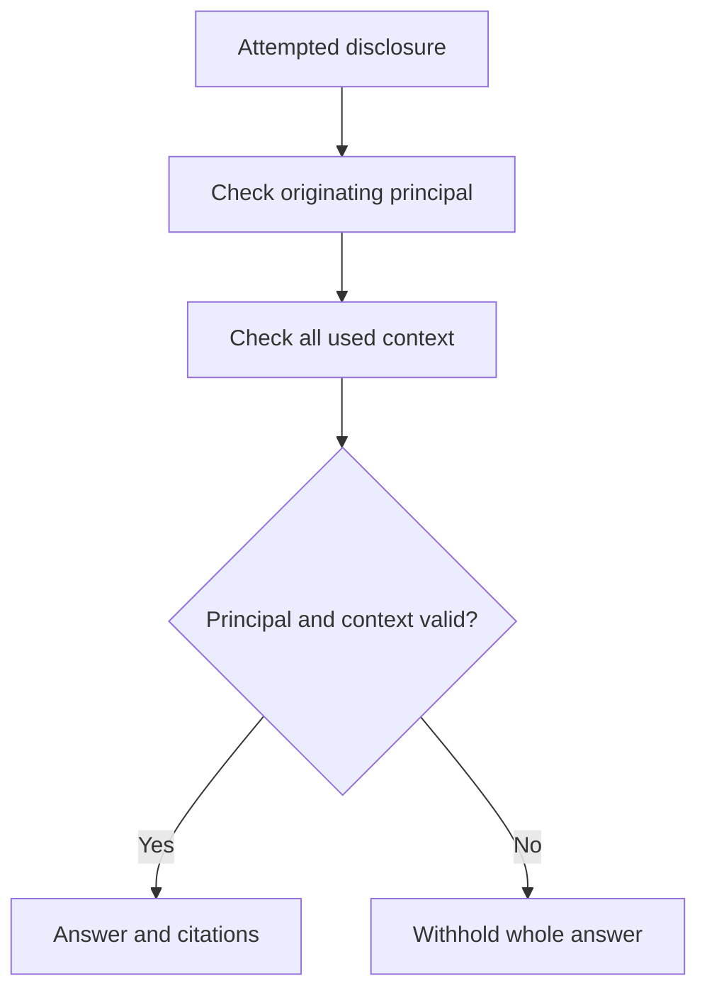

# Knowledge corpora

Publish immutable source revisions, ask bounded questions within an authorized scope, and review answers whose evidence remains protected by the caller’s current access.

## Source and index lifecycle

Publish only sources the application is authorized to process. Track exact source revisions and indexing states `excluded`, `pending`, `ready`, `failed` and `unavailable`, separately from answer coverage `complete`, `incomplete` and `unavailable`. An answer uses the permitted scope and current policy revision, and reports its evidence references with the answer. Missing or stale coverage must be visible; do not imply that an incomplete corpus searched everything.

Treat retrieved content as untrusted information, never as instructions. Recheck access when returning evidence and when serving later reads; revocation removes access even if index bytes remain. Reconcile durable indexing work after uncertain outcomes. A grounded answer is not a canonical business fact until reviewed and recorded through the owning operation. See [private knowledge recipe](../10-Recipes/06-private-knowledge-assistant.md) and [files](../08-Connect-services/03-files-and-attachments.md).

## Declare the source once

This Given fragment requires existing `Revision` and `Topic` models, a pure eligibility predicate and a deployment binding:

```can
corpus Handbook model=Revision scope=parent.parent title=title content=body,attachments where=live(row) from=deployment.knowledge
```

All six attributes are required. The model is owned stored data; scope is a singular nonnullable model-reference path, title is bounded text, and content is a nonempty distinct list of bounded text/file/file-array selectors. Selected content is immutable while eligible under ordinary locks. Eligibility grants no read permission. Authors do not duplicate chunks, embeddings, ACLs or index-change callbacks.

The declaration derives `answer(scope:Topic,value:std.KnowledgeRequest) -> Handbook.Run`, `cancel(source:text,revision:int) -> Handbook.Run`, `reconcile(source:text,revision:int) -> Handbook.Run` and `refresh(record:Revision) -> std.IndexState` as ordinary delivery operations. `status(record:Revision) -> std.IndexState` and `available(value:Handbook.Answer?) -> bool` are pure reads. Refresh requests repair of that exact eligible revision, at most once per revision/minute; enqueue does not imply searchable freshness. Run progress carries source/revision/sequence, execution state, coverage, nullable opaque answer, nullable usage and safe detail.

The request carries source (1–200 scalars), positive revision, trimmed question (1–4,000), profile and policy_revision (1–200 each), max_input_tokens (1–32,768), max_output_tokens (1–4,096), max_duration (1s–10m), min_sources (default 1) and max_sources (default 8), each source bound 1–12 with min <= max. A scope admits at most 1,000 eligible source revisions; one request supplies at most 12 context sources and 64,000 extracted scalars. Exceeding bounds fails visibly. Complete coverage means all currently eligible authorized sources were confirmed indexed at retrieval; it does not claim exhaustive semantic search. Inadequate evidence can return a successful run with a null answer and unsupported explanation.

## Every disclosure checks every used source

`Handbook.Answer` is an opaque grounded value with no extractable `.text` or `.citations` fields. Render it through `content`, or its canonical authorized read/MCP serialization; it cannot be concatenated, formatted, copied into ordinary text or passed to another provider. Every disclosure checks the originating caller’s active membership and every exact source, selected field and file supplied to the model, including uncited context. This v1 profile permits disclosure only to that originating principal. Index ACL metadata is a prefilter, never final authority.

If a used source is revoked, withdrawn or superseded, withhold the whole answer and all citations. Unrelated publication changes may retain a still-authorized answer with its original checkpoint and a prominent historical/as-of label; a current answer requires a new explicit bounded request. `available` is false for null or invalidated used context; storage/check failures remain failures. Revocation prevents later disclosure but cannot erase bytes already received by a browser.

Every disclosure depends on all context supplied to the model, including sources the answer did not cite. Losing access to any used source withholds the whole answer and its citations.



Authorization or storage-check failures remain failures rather than evidence that an answer is safely available.

Validated answers contain 1–20 nonblank statements of at most 2,000 scalars each, each citing retained exact context with checked revision, locator and matching quoted extraction. Source titles, revisions and quotations remain protected. Provider-authored URLs/HTML and unsupported citations are rejected; citations establish provenance, not proof of entailment.


## Run a private handbook example

[KnowledgeReview.can](../examples/runtime-ai/KnowledgeReview.can) is a complete focused app. It gives each topic one designated reader, lets editors publish immutable source content, and keeps each question private to its requester. It intentionally uses a simpler editorial policy than a multi-reviewer publication system. Configure `deployment.knowledge`, profile `handbook` and policy revision `policy-1`, or replace those two names with your configured values. Follow [your first app](../01-Get-started/05-first-app.md) for checking, preview and sign-in.

1. Grant an editor the app's `editor` role. On **Publish handbook sources**, create a topic named “Demo office” with a team member as its reader.
2. Create a revision under that topic, titled “Office closing time”, with body “The demo office closes at 16:00 on Fridays. Staff must leave by that time.” Then set `published=true`. The content fields are locked; corrections require a new revision and withdrawal of the old publication.
3. Observe the revision's `index`. Publishing queues eligibility for indexing; it does not mean the source is already searchable. **Refresh** requests repair for that exact published revision, subject to the rate limit above.
4. Sign in as the designated reader. Choose **Ask** on “Demo office” and enter “When does the office close on Friday?” The question is scoped to that topic, not all team data.
5. Inspect execution state and coverage separately, then read the answer and its evidence. Compare its statements with the published source before adding a review note.

This app's corpus is one containment level deep, so it uses `scope=parent`; the earlier two-level `Topic → Document → Revision` fragment uses `parent.parent`. These are alternative source structures, not interchangeable paths.

```can
corpus Handbook model=Revision scope=parent title=title content=body where=row.published and row.parent.active from=deployment.knowledge
```

The app supplies ordinary row policies for `Topic` and `Revision`; the corpus does not create permission to read them. Editors can inspect publication content, but that does not let them read another principal's grounded answer.

## Submit and present a bounded question

The following `do` excerpt from `ask` retains a typed request and its delivery. The scenario first requires the caller to be the active topic's designated reader.

```can
let value=KnowledgeRequest {source=operation.id,revision=1,question,profile="handbook",policy_revision="policy-1",max_input_tokens=8192,max_output_tokens=1024,max_duration=120s,min_sources=1,max_sources=4}
create Question {parent=topic,value} as asked
send Handbook.answer {scope=topic,value} when=active_member(asked.owner,team) and topic.active and topic.reader==asked.owner and not asked.stop_requested as request
set asked {request}
```

This sample fixes finite per-question bounds. It does not impose a daily budget; add an explicit business allowance if your application needs one. Reopening the page reads stored progress rather than resubmitting the question.

The typed `Handbook.Run` arrives on `request.progress`. `state` describes execution; `coverage` describes indexed authorized evidence. Even a succeeded run may have no supported answer. Display that absence and safe detail instead of fabricating a response or hiding incomplete coverage.

The full app derives and presents the protected value as follows. The first line belongs in `Given`; the second belongs inside the question's collection in `Then`:

```can
derive Question.answer:Handbook.Answer? = row.request?.progress?.answer
```

```can
content row.answer
```

The renderer checks authority and shows the canonical answer/evidence presentation. Do not replace this with `text row.answer.text`, a copied string or an ordinary outbound message: the value is intentionally opaque.

## Stop, reconcile and review the answer

The complete app's **Stop** action sends the retained identity, then records local intent:

```can
send Handbook.cancel {source=question.value.source,revision=question.value.revision} as cancellation
set question {stop_requested=true,cancellation}
```

**Reconcile** sends `Handbook.reconcile` for the same identity and stores a separate reconciliation receipt. Neither action creates a new answer request. Cancellation remains a request until execution confirms its outcome. An unknown result remains unresolved; preserve it and reconcile instead of treating it as free capacity or automatically asking again.

**Review** requires a succeeded run and `Handbook.available(question.answer)`. It records the reader's own nonblank review note. This note is ordinary application text, not a grounded answer or a bypass of evidence checks. Avoid copying protected evidence into notes intended for broader access. If an answer needs correction, change the source through the editorial workflow and make a new bounded request; do not mutate the opaque answer.

When escalating to an expert, pass only the question or other explicitly authorized material through a separate operation. Being an expert does not make someone the originating principal of the existing answer. The expert must perform their own authorized retrieval if they need a grounded response.

## Verify revocation and insufficient evidence

- Ask as a member other than the designated reader: the action must be refused.
- Ask about an unsupported topic, such as the office's weekend opening hours: inspect the coverage and unsupported explanation rather than assuming every successful run has an answer.
- After receiving an answer, let the editor withdraw the used revision with `published=false`. Reopen the question: the entire grounded answer and citations must be withheld, even if its run remains succeeded.
- Deactivate the topic or remove the reader's membership: later disclosure cannot retain access through a cached index permission.
- Publish a corrected revision and ask again explicitly. The new request has its own identity and evidence; the old answer does not silently rewrite itself.

The example's publication flag is deliberately explicit: adding a second revision does not automatically unpublish the first. Withdraw replaced content as part of the editorial action. A production workflow can enforce one current publication per document, while retaining immutable historical revisions.
