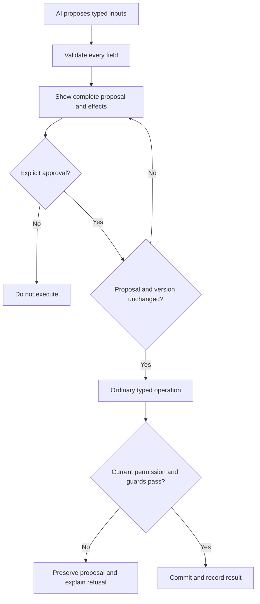

# Reviewed AI actions

Let an AI capability propose a typed business change, show the complete proposal to an authorized person, and execute only after explicit approval.

## Propose and review

The model receives only data admitted by the app's read policy and returns a typed proposal. Validate every field against the operation's input contract. A model response is untrusted input: it cannot grant a role, select a hidden record, bypass an invariant or invoke an arbitrary function.

Present the full proposed action, including affected records, exact values and meaningful side effects. Before acceptance, re-evaluate the caller's current permission, record version and business guards. Bind approval to the proposal and captured version; if either changes, ask the reviewer to inspect a fresh proposal.

Approval authorizes only the reviewed proposal and version. Execution still checks current authority and business rules; a changed proposal or version needs fresh review.

## Execute and verify

Execute through the ordinary typed operation and its transaction. Store the accepted proposal reference and operation result for audit. If the action is denied or conflicts, preserve the proposal and explain what must be reviewed again. Do not report model confidence as evidence that the change is safe.

Test prompt-injected or malformed content, an unauthorized reviewer, changed source records, duplicate acceptance and operation failure. Runtime AI requests are separate from build-time saved code generation. See [text generation](../07-Integrations/07-text-and-image-generation.md), [actions and invocations](../05-Workflows/08-actions-and-invocations.md) and [operation permissions](../04-Access-and-rules/02-roles-and-operation-permissions.md).
