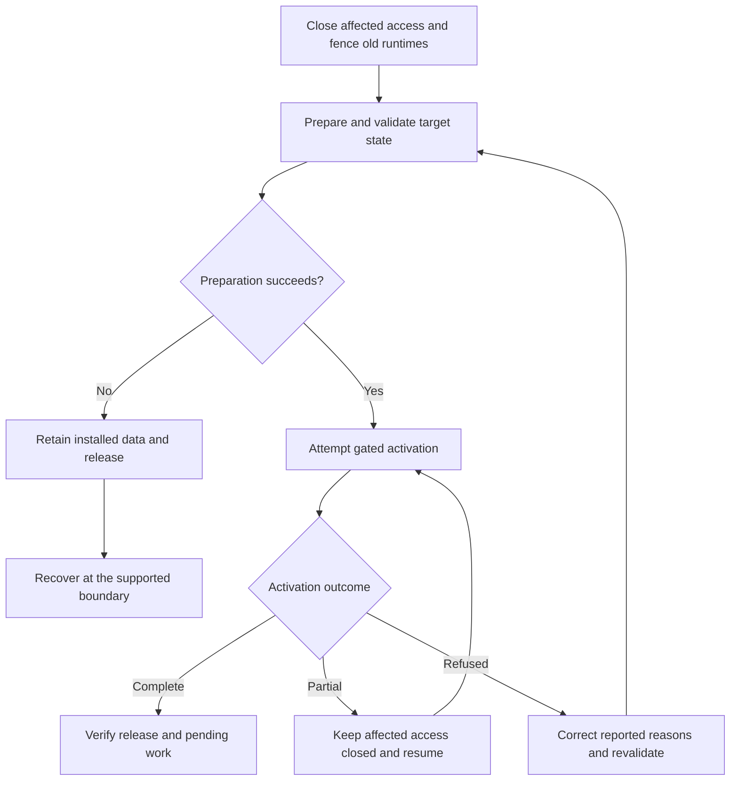

# Upgrades and recovery

Coordinate code, stored schema and pending work during an upgrade, distinguish preparation failure from partial activation, and recover within the owning deployment boundary.

An upgrade coordinates source compatibility, stored data, generated implementation, queued work and environment resources. Do not treat it as a compiler installation update. The installation process updates the local toolchain; this page concerns an app already serving users.

## Prepare a compatible transition

Identify the installed predecessor and any outstanding work created by it. Validate the new schema migration against complete stored data, and decide how old pending operations, schedules or deliveries remain valid, are cancelled, or are reconciled. Inventory work from older retained releases as well as the immediate predecessor. Preserve its identity and outcome history; cancellation alone does not prove an external operation stopped. An explicit `invalidate before.handler` can skip eligible inventoried, undispatched work from that pinned asynchronous handler contract; it cannot cancel in-flight, accepted or uncertain provider work.

Prepare the new release and migration in staging. Deployment closes affected admissions, writers, cleanup and dispatch and fences old runtimes before freezing predecessor data. If preparation fails, the installed data/release remains selected; retain the failure details and reopen access only when the owning recovery boundary permits it. Do not repair a staging failure by deleting user records or receipts.

## Activate and recover

Activation is gated by compatibility and serve readiness. If it refuses, use the reported reasons to correct the migration, binding or pending-work issue, then repeat validation from the current state. Recovery resumes or rolls back only at boundaries supported by the owning operation; a provider timeout can have an uncertain outcome and requires reconciliation before retry.

Activation across D1 and several Durable Object authorities is not one transaction. If activation partly succeeds, keep affected access closed and resume; do not reopen the old runtime against mixed layouts. No zero-downtime or automatic destructive rollback is promised.

Preparation failure and partial activation have different recovery boundaries: preserving the installed selection does not permit reopening an old runtime against partly converted authorities.

After activation, verify the new release and inspect pending work. If a defect requires rollback, confirm that the previous runtime remains compatible with the data and work already accepted under the new release. A code rollback cannot undo committed business operations or external side effects.

The public workflow must keep this process at the app/environment level. Internal staging files and sidecar construction are implementation details, not authoring commands. See [operating an app](05-operating-an-app.md) for the operator's status and recovery responsibilities.

## Choose recovery from the observed phase

| Observed phase | Safe next step |
| --- | --- |
| Plan only; no apply | Correct inputs and review a fresh plan. No remote release change is implied. |
| Apply request failed or response lost | Inspect target/provider status for that release before deciding whether a retry is needed. |
| Preparation refused before activation | Preserve installed selection and data; correct the reported problem at the supported preparation boundary. |
| Activation partly changed authorities | Keep affected admissions, writers and dispatch fenced. Resume the same tracked transition through the deployment owner. |
| New release active, defect found | Assess compatibility of any previous code with current data and accepted work; use a supported forward fix or compatible rollback. |
| External effect uncertain | Reconcile its original delivery identity with its provider; a release rollback does not undo it. |

The operator must be able to distinguish these phases and inspect the retained transition identity and progress. A CLI readiness check is not a substitute for the deployment owner's resume operation. If the target does not expose a supported recovery action for the observed phase, keep affected access closed and escalate to that owner rather than editing database migration markers.

## Rehearse a recovery before production

In an isolated staging environment, choose a candidate with a deliberately invalid compatibility requirement or a dataset that violates a new constraint. Confirm preparation refuses and that the installed selection remains intact. Correct the candidate/data through authorized operations, revalidate from the actual predecessor and complete activation.

For a multi-authority target, rehearse partial-activation recovery only through a supported target fault/recovery facility. Do not simulate it by corrupting user records or manually rewriting release pointers. Confirm the operator can identify the stopped phase, retain the fence and resume the same transition. Back up and restore all required state together under the provider's supported recovery procedure; a database-only restore cannot restore file bytes, grants or external side effects automatically.
