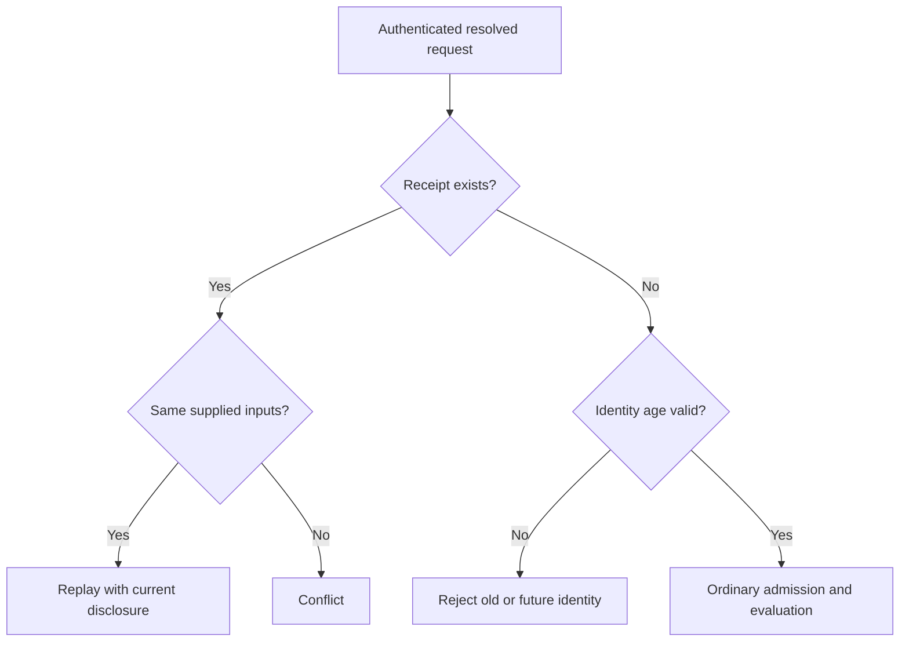

# Errors and wire values

Recognize safe error categories and encode exact values for generated interfaces. Work through a versioned update, null versus omission, replay and uncertain delivery without relying on internal runtime APIs.

## Interpret outcomes safely

CanLang exposes typed outcomes through source, generated interfaces, and runtime adapters. Errors distinguish invalid source/value shape, safe business-rule rejection, missing or inaccessible records, stale versions, conflicts, retryable contention, and external delivery uncertainty. A caller should receive a stable safe category and useful authorized context, never SQL text, credentials, hidden record content, or an internal stack trace.

## Business errors

| Code | Meaning | HTTP status |
| --- | --- | --- |
| `validation` | Invalid input representation, bounds, or writable shape | 400 |
| `forbidden` | Caller fails operation admission | 403 |
| `not_found` | Missing, foreign, expired, or inaccessible target where disclosure must be withheld | 404 |
| `conflict` | Stale record version or conflicting reuse of operation identity | 409 |
| `rule_failed` | Authored guard, invariant, or lock rejects the change | 422 |
| `busy` | Retryable contention or blocked bounded disposal | 503 |
| `limit` | Bounded work/rate limit exceeded | 429 |
| `delivery_unknown` | External acceptance/outcome remains uncertain | 502 |

An inline example expects one exact code with `error(code)`; setup/compiler failures cannot stand in for that business rejection. Retry uncertain work with its original identity and inputs rather than minting a duplicate request.

## Requests and replay

Mutation request envelopes carry a stable UUIDv7 operation ID, canonical operation identity, arguments, and expected versions for record inputs. Omission remains distinct from explicit null in normalized inputs. The receipt hashes supplied inputs and retains successful resolved defaults separately. Replaying the same identity and inputs returns the saved outcome under current disclosure rules; reusing the identity with different inputs conflicts. Reads do not create mutation receipts.

## Receipt lookup before reevaluation

A receipt is checked before stale versions or body evaluation. Current disclosure may withhold saved content; matching replay still does not execute the effects again.



An old identity cannot become a new mutation after its receipt expires. The normal future-clock tolerance still applies.

## Canonical wire values

At the MCP/typed JSON boundary, all int and decimal values are canonical decimal strings, including money minor units and record versions; their JSON type never changes with magnitude. Protocol-owned counts remain protocol numbers.

| Value | JSON representation |
| --- | --- |
| int, decimal | Canonical decimal string |
| money | `{"minor":"1250","currency":"EUR"}` |
| date | `"2026-10-20"` |
| datetime | RFC3339 UTC instant, for example `"2026-10-20T09:00:00.000Z"` |
| record read input | `{"id":"opaque-id"}` |
| record mutation input | `{"id":"opaque-id","version":"1"}` |
| enum | Stable case string, without translated display labels |
| tagged union | `{"type":"QualifiedType","value":...}` |
| null, array | JSON null; ordered JSON array preserving duplicates |

Generated CRUD update uses `{record,changes,operation_id}`. Scenario business inputs are named alongside `operation_id`. Authentication, roles, and team grants are verified context, never user-supplied business arguments. Unknown arguments and undeclared writable fields fail. File references denote finalized opaque identities and cannot be replaced with a URL or arbitrary file-shaped object. Secret values are never client-readable.

Wire encodings preserve enum case identity, nullability, ordered arrays, duplicates, canonical reference identity, and exact money/time values. Invalid representations or unavailable codecs must fail explicitly rather than weaken constraints. Provider acceptance is not a domain success; represent pending, failed, delivered, or uncertain states according to the owning contract. See [transactions](../06-Business-workflows/03-transactions-and-concurrency.md), [deliveries](../08-Connect-services/02-deliveries-and-recovery.md), and the [CLI reference](../15-Tooling-reference/01-cli.md) for command exit behavior.


## Compare source values with JSON values

Source literals and generated-interface JSON are different representations of the same declared type. These are value examples, not complete mutation requests:

| Declared type | Can source | Canonical JSON example | Common mistake |
| --- | --- | --- | --- |
| int | `42` | `"42"` | JSON number `42`, even though it is small |
| decimal | `12.5` | `"12.5"` | JSON number `12.5`, which risks binary precision loss |
| money | `money(12.5,"EUR")` | `{"minor":"1250","currency":"EUR"}` | Sending major units as minor units or dropping currency |
| bool | `true` | `true` | Text `"true"` is not a boolean |
| date | `date("2024-02-29")` | `"2024-02-29"` | An impossible date or timestamp in a civil-date field |
| datetime | `datetime("2026-10-20T09:00:00+02:00")` | `"2026-10-20T07:00:00.000Z"` | Assuming viewer-local clock text is an instant |
| int[] | `[2,2,5]` | `["2","2","5"]` | Removing duplicates or encoding its elements as numbers |
| text? | `null` | `null` | Text `"null"` or treating an omitted patch as null |

For a union containing a declared `contract BankRefund {iban:text}` in owner `RefundDemo`, its BankRefund case uses `{"type":"RefundDemo.BankRefund","value":{"iban":"synthetic-example"}}`. This illustrates the wire shape for that stated schema, not a validated real bank account. The wrapper does not permit inventing fields or arbitrary type names; use the generated schema. File, action, delivery and secret types likewise cannot be reconstructed by copying a plausible JSON object.

## Send a versioned update

For the `TaskForms.Todo.update` operation from the [forms tutorial](../07-Build-interfaces/04-forms-and-inputs.md), the business envelope has this shape:

```json
{
  "operation_id": "019a0000-0000-7000-8000-000000000001",
  "record": {"id": "task-example", "version": "3"},
  "changes": {"title": "Reviewed task", "note": null}
}
```

The ID and UUIDv7 above are illustrative placeholders, not a live request. Obtain the record and current expected version through authorized interfaces and use a freshly generated operation identity for a new attempt. The browser supplies this metadata for canonical forms; an MCP caller follows its generated tool schema. Do not add actor, role or team-grant fields to this business envelope.

This patch changes the title and explicitly clears the nullable note. Omitting `note` preserves its previous value. Omitting `project` preserves that relationship. `changes.done` is invalid for TaskForms CRUD because it is outside the writable field set; completion belongs to the scenario. Sending `version:3` as a JSON number is not the canonical version encoding.

If version 3 is current and the update succeeds, the record advances once to version 4. A matching replay with the same operation ID, version and supplied fields returns the retained outcome under current disclosure, even though version 3 is now stale. Changing the title under that same operation ID conflicts. A genuinely new request still carrying stale version 3 also conflicts, for a different reason.

## Identify the failing boundary

| Concrete situation | Expected category | Recovery |
| --- | --- | --- |
| Task title violates its nonempty constraint | `validation` | Correct the input; keep the draft |
| A nonmember invokes a members-only task operation | `forbidden` | Establish legitimate access; hiding a control is insufficient |
| A record input belongs to another team or has expired | `not_found` | Resolve an accessible current record; do not disclose hidden existence |
| An ordinary new update uses a stale version | `conflict` | Review authorized current values and make a deliberate new attempt |
| Complete an already-done task whose guard requires not done | `rule_failed` | Resolve the business condition; technical retry cannot make the guard true |
| Reuse an operation ID with different supplied inputs | `conflict` | Keep the original request immutable; a changed intent is a new attempt |
| Transient owner contention | `busy` | Retry within the documented bounded policy, preserving request identity when the outcome is uncertain |
| A query or bounded loop exceeds its admitted work limit | `limit` | Reduce or deliberately partition work; never silently truncate results |
| The provider may have accepted a delivery but its outcome is unknown | `delivery_unknown` | Reconcile the original delivery; do not infer that another send is safe |

These rows describe separately established conditions. They are not a promise that a later check outranks an earlier admission failure: a nonmember must not bypass forbidden admission to probe a private guard. Compiler diagnostics, invalid test setup and adapter outages cannot satisfy a behavioral `error(rule_failed)` expectation.

A canonical mutation failure commits no provisional business effects. A later delivery failure does not undo a source transaction that already committed. Pending, failed, fulfilled and unknown delivery states are outcomes of their owning contract, not alternate spellings of every HTTP failure. Keep safe codes separate from localized human messages; never return hidden values, credentials or internal diagnostic traces as a more helpful explanation.
